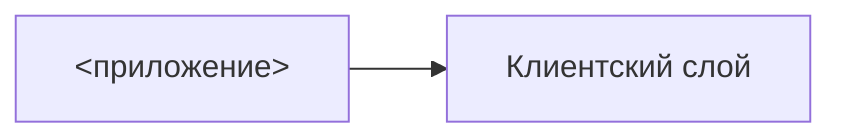

<!--
Шаблон README приложения — вход для всех аудиторий. Стандарт: .claude/skills/codelab-docs/SKILL.md.
README короткий: подробности — в doc/. Этот комментарий удали.
-->
# <Название продукта> (`<имя_каталога>`)

<Два-три предложения простым языком: что это, для кого, чем отличается от соседних приложений CodeLab.>

<Главный экран: PNG для app, текстовый снимок для терминала.>

## Кому какой документ

| Я хочу… | Читать |
|---|---|
| пользоваться <продуктом> | [Руководство пользователя](doc/user-guide.md) |
| собрать, развернуть, запустить в CI | [Эксплуатация](doc/operations.md) |
| менять код | [Разработка](doc/development.md) |

## Быстрый старт

<3–5 шагов от исходников до первого результата. Каждый шаг — одна команда и что появится на экране.>

1. <шаг>

   ```bash
   <команда>
   ```

## Как устроено

<Одна схема верхнего уровня: из каких частей состоит приложение и с чем говорит.>



## Смотрите также

- [Документация пользователя CodeLab](../../docs/user/README.md)
- [Эксплуатация CodeLab](../../docs/ops/README.md)
