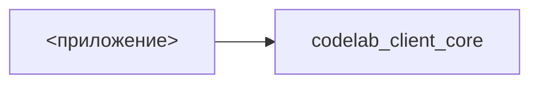
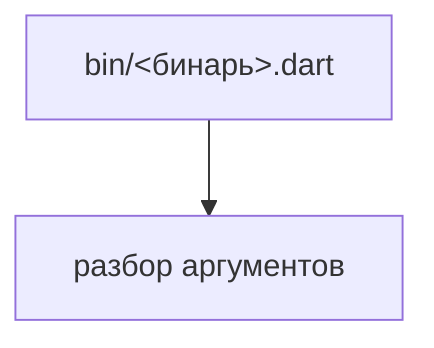

<!--
Шаблон руководства разработчика приложения (apps/*/doc/development.md). Стандарт: .claude/skills/codelab-docs/SKILL.md.
Правила для изменений — в AGENTS.md приложения: здесь не дублируются, а даются ссылкой. Этот комментарий удали.
-->
# <Продукт>: разработка

<Одно предложение: что нужно знать, чтобы уверенно менять код приложения.>

## Место в monorepo

<Какие пакеты использует приложение и почему не импортирует `codelab_agent_*` напрямую (мосты `codelab_setup`, `codelab_embedded`).>



<Только зависимости из `pubspec.yaml`.>

## Структура кода

| Каталог | Что там |
|---|---|
| `lib/src/<каталог>/` | <ответственность> |

## Поток запуска

<Путь от `main` до работающего режима: разбор аргументов, composition root, выбор режима, освобождение ресурсов.>



## Как добавить <типичное изменение>

<1–2 частых сценария изменения: новая команда, новый экран. Шаги и файлы.>

## Тесты

```bash
cd apps/<приложение>
fvm dart test
```

<Наборы тестов и melos-скрипты, которые относятся к приложению (AGENTS.md §21).>

## Правила

Правила для изменений — в [`AGENTS.md`](../AGENTS.md). <Одна-две строки о главных ограничениях.>

## Смотрите также

- <спецификации `openspec/specs/...`, документы `docs/architecture/...`>
