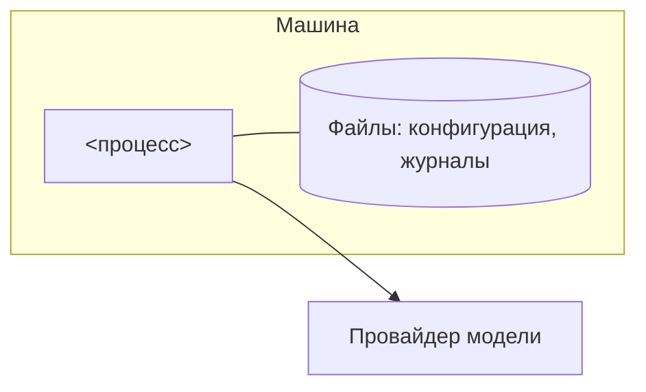

<!--
Шаблон руководства DevOps. Стандарт: .claude/skills/codelab-docs/SKILL.md.
Каждая переменная, путь, порт и код выхода проверен по коду (§8). Этот комментарий удали.
-->
# <Продукт>: эксплуатация

<Одно предложение: что здесь описано — сборка, запуск без участия человека, сопровождение.>

## Схема развёртывания



<Какие процессы, кто кого запускает, какие сетевые соединения открываются.>

## Сборка

```bash
<команда сборки из исходников>
```

<Что получится и где лежит артефакт. Требования: версия SDK из `.fvmrc`.>

## Запуск

<Режимы запуска и аргументы, которые важны для эксплуатации.>

## Конфигурация

| Где | Что | По умолчанию |
|---|---|---|
| `<путь>` | <назначение> | <значение> |

### Переменные окружения

| Переменная | Для чего |
|---|---|
| `<NAME>` | <назначение> |

### Секреты

<Где хранятся, как передать в CI, как не допустить их попадания в логи.>

## Логи и диагностика

<Где лежат логи и журналы, что в них попадает, что маскируется, как включить подробный режим.>

## Коды выхода

| Код | Значение | Что делать |
|---|---|---|
| `0` | <…> | <…> |

## Сеть и безопасность

<Порты, адреса, ограничения рабочей папки, разрешения агента.>

## Обновление

<Необязательный раздел: только когда есть выпущенные версии и что-то меняется между ними — конфигурация, данные, формат журналов.>

## Смотрите также

- [Эксплуатация CodeLab](../../../docs/ops/README.md)
