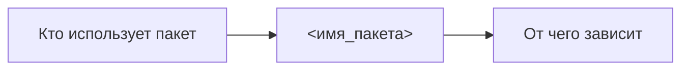
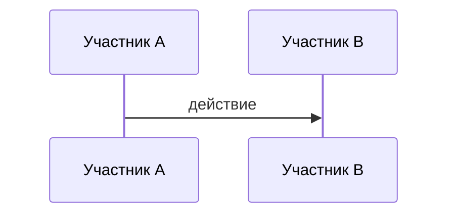

<!--
Шаблон README пакета (аудитория — разработчик). Стандарт: .claude/skills/codelab-docs/SKILL.md.
Удаляй разделы, которым нечего сказать. Заглушки «TBD» не оставляй. Этот комментарий удали.
-->
# <имя_пакета>

<Одно-два предложения: какую задачу решает пакет и почему он отдельный. Без пересказа имени.>

## Место в архитектуре

<Сторона и слой по ADR-0002: `codelab_<сторона>_<слой>`. Чистый Dart / Flutter, web-безопасен ли основной барель.>



<Пояснение неочевидного на схеме. Ссылка на документ архитектуры: `docs/architecture/...`.>

## Что внутри

| Часть | Для чего |
|---|---|
| `<ПубличныйТип>` | <ответственность одной строкой> |

Публичное API экспортирует `lib/<имя_пакета>.dart`<; дополнительные барели: `lib/io.dart` — …>.

## Как использовать

<Минимальный рабочий пример, проверенный по коду. Кто создаёт, в каком порядке вызывать, какие ошибки вернутся.>

```dart
// пример
```

## Ключевой поток

<Только если есть неочевидный поток: последовательность вызовов, жизненный цикл.>



## Тесты

```bash
cd packages/dart/<имя_пакета>
fvm dart test
```

<Особые наборы тестов, фикстуры, теги.>

## Правила пакета

Правила для изменений — в [`AGENTS.md`](AGENTS.md). <Одна-две строки о главном ограничении, если оно важно читателю README.>

## Смотрите также

- <ссылки на соседние пакеты, спецификации `openspec/specs/...`, документы `docs/architecture/...`>
