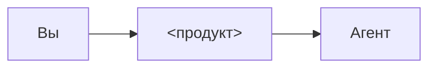

<!--
Шаблон руководства пользователя. Стандарт: .claude/skills/codelab-docs/SKILL.md, §4 (язык) и §7 (снимки).
Читатель не знает внутренних имён пакетов и классов. Этот комментарий удали.
-->
# <Продукт>: руководство пользователя

<Одно предложение: что умеет продукт и что читатель сможет после этого руководства.>

## Перед началом

- <что нужно установить или иметь: ключ провайдера модели, папка проекта…>
- <ссылка на установку/запуск из исходников>

## Первый запуск

1. <действие>

   <что пользователь увидит — снимок экрана>

## Основные задачи

### <Задача глазами пользователя: «Задать вопрос по проекту»>

<Зачем это делать — одно предложение.>

1. <шаг>
2. <шаг>

<Снимок результата.>

<!-- Повтори для каждой важной задачи. Порядок — от частой к редкой. -->

## Как это работает

<Только то, что помогает пользователю понимать поведение: где выполняется агент, когда он спрашивает разрешение.>

## Настройка

<Ключевые настройки для пользователя или ссылка на `docs/user/configuration.md`. Не дублируй.>

## Если что-то пошло не так

| Что видите | Почему | Что сделать |
|---|---|---|
| <сообщение или поведение> | <причина простыми словами> | <действие> |

## Смотрите также

- <ссылки>
