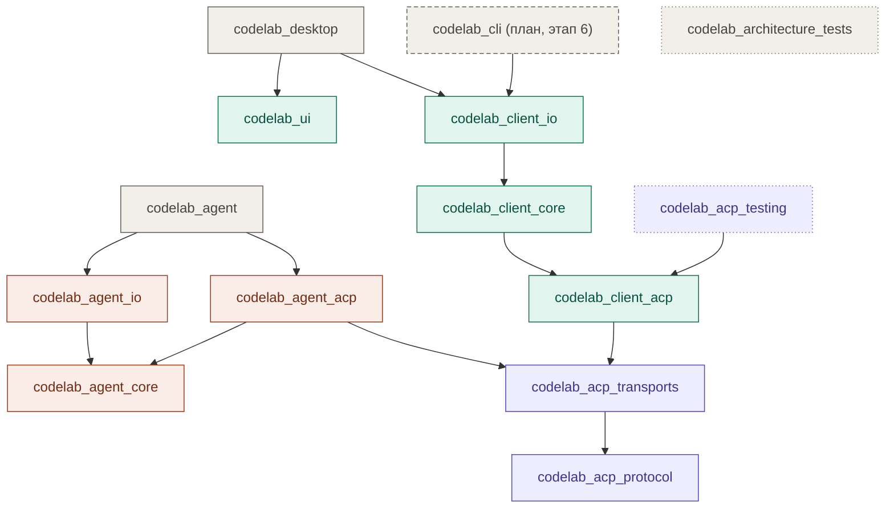

# CodeLab

Monorepo CodeLab на Dart и Flutter: desktop-клиент (`apps/codelab_desktop`) для работы с AI-агентами по ACP (Agent Client Protocol) и встраиваемое ядро Dart-агента, которое подключается к клиентам через ACP. Решение и план — ADR-0001 (`docs/architecture/adr/0001-embed-dart-agent-core-behind-acp.md`) и дорожная карта `docs/architecture/proposals/delivery-roadmap.md`.

## Структура

Пакеты называются по схеме `codelab_<сторона>_<слой>` (ADR-0002, `docs/architecture/adr/0002-name-packages-codelab-side-layer.md`): сторона — `acp` (общий протокольный слой), `client` или `agent`; слой — `core` (логика без IO), `io` (адаптеры `dart:io`), `acp` (проекция стороны в протокол).

| Путь | Что это |
|---|---|
| `apps/codelab_desktop` | Flutter Desktop клиент ACP |
| `apps/codelab_agent` | бинарь Dart-агента: `codelab-agent serve --stdio \| --ws` |
| `packages/dart/codelab_acp_protocol` | типизированные модели ACP JSON-RPC, кодеки и валидация |
| `packages/dart/codelab_acp_transports` | транспорты ACP; `io.dart` — stdio и WebSocket |
| `packages/dart/codelab_acp_testing` | fake-транспорты, фикстуры и помощники conformance-тестов |
| `packages/dart/codelab_client_acp` | протокольный клиент `AcpClientApplication`: domain, состояние и use cases |
| `packages/dart/codelab_client_core` | общий клиентский слой без UI и IO для desktop и CLI: рабочее пространство, соединение, сессии, транскрипт |
| `packages/dart/codelab_client_io` | `dart:io`-адаптеры клиента: файлы, процессы, транспорты, хранилища профилей |
| `packages/dart/codelab_agent_core` | встраиваемое ядро Dart-агента на чистом Dart: LLM, цикл, инструменты, разрешения, сессии |
| `packages/dart/codelab_agent_io` | `dart:io`-реализации портов ядра агента: файлы, процессы, журналы сессий |
| `packages/dart/codelab_agent_acp` | ACP-сервер агента: проекция `AgentRuntime` в протокол |
| `packages/dart/codelab_architecture_tests` | сторож границ пакетов и схемы имён (`melos run guard`) |
| `packages/flutter/codelab_ui` | Fluent UI виджеты рабочего места |
| `openspec/` | спецификации поведения и активные изменения |
| `docs/` | архитектура, спецификация ACP, интеграции |

### Граф зависимостей

Стрелка ведёт от пакета к его зависимости. Показаны рабочие зависимости (`dependencies`) без транзитивных: если `A → B → C`, прямое ребро `A → C` не рисуется. `codelab_acp_testing` как dev-зависимость подключают почти все пакеты; на графе это не показано.



Цвета: серый — приложения и инфраструктура, сиреневый — `codelab_acp_*`, зелёный — `codelab_client_*` и `codelab_ui`, терракотовый — `codelab_agent_*`. Пунктирная рамка — пакет запланирован, точечная — пакет только для тестов. Кроме показанного, `codelab_agent_acp` берёт `codelab_client_acp` и `codelab_agent_io` как dev-зависимости: conformance-тест агента гоняет настоящий клиент против настоящего сервера.

Клиентская и агентская ветки сходятся только на `codelab_acp_transports` и `codelab_acp_protocol`: клиенты не импортируют `package:codelab_agent_*` (`AGENTS.md` §5). `codelab_agent_core` не зависит даже от протокола, а `codelab_ui` — ни от одного внутреннего пакета. Границы проверяет `codelab_architecture_tests`; при добавлении пакета или новой зависимости граф обновляется вместе с правилом сторожа.

## Начало работы

Flutter SDK закреплён в `.fvmrc` и ставится через [FVM](https://fvm.app); monorepo управляется [Melos](https://melos.invertase.dev) из секции `melos:` корневого `pubspec.yaml`.

```bash
fvm install
fvm flutter pub get
fvm dart run melos exec -c 1 --depends-on=build_runner -- "fvm dart run build_runner build --delete-conflicting-outputs"
fvm dart run melos run check
```

Сгенерированный код (`*.freezed.dart`) в git не хранится — третья команда создаёт его после checkout. `check` запускает формат, анализ, сторож архитектуры, проверку промптов ядра, тесты, protocol conformance, прогон golden-фикстур ACP в роли клиента (`conformance:client`) и агента (`conformance:agent`) и web-компиляцию ядра; интеграционные тесты в `feature/*` и `hotfix/*` идут только на Dart VM. Прогон приложения на устройстве или симуляторе — `fvm dart run melos run test:e2e:app:<имя>` (список — `fvm dart run melos run --list`) — выполняется только в ветке `release/<version>` (`AGENTS.md` §21).

## Правила разработки

- Обязательные правила для разработчиков и AI-агентов — `AGENTS.md`.
- Архитектура — `docs/architecture/README.md`; ядро агента — `docs/architecture/proposals/agent-core-architecture.md`.
- Поведение продукта — `openspec/specs/`; изменения — через OpenSpec change (`AGENTS.md` §17).
- Ветвление — git flow: `feature/*` от `develop`, pull request в `develop` (`AGENTS.md` §22).

## Лицензия

Код распространяется по лицензии MIT — см. [`LICENSE`](LICENSE). Учёт воспроизведённых внешних фрагментов — [`THIRD_PARTY_NOTICES.md`](THIRD_PARTY_NOTICES.md).
