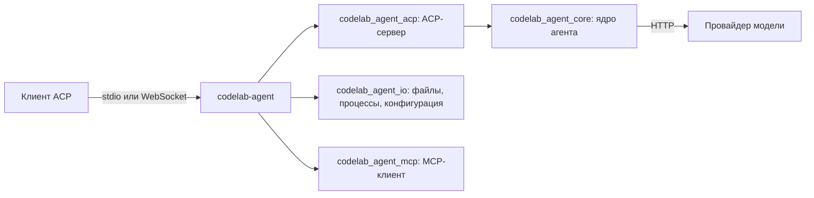

# CodeLab Agent (`codelab_agent`)

`codelab-agent` — Dart-агент CodeLab как отдельная программа. Она запускается командой `codelab-agent serve --stdio` или `serve --ws` и говорит с клиентом по ACP (Agent Client Protocol — протокол, по которому клиент и агент обмениваются сообщениями). Нужна, чтобы подключить агента к стороннему клиенту, например к Zed, или запустить его по сети. Терминальный клиент `codelab` и приложение CodeLab app запускают такого же агента внутри себя и этой программы не требуют.

Рядом с `serve` у бинаря есть команды без сервера: `config`, `provider`, `mcp`, `secret` — они читают и правят файлы конфигурации и секреты.

## Кому какой документ

| Я хочу… | Читать |
|---|---|
| понять, что умеет агент: инструменты, разрешения, контекст проекта, субагенты, MCP, сессии | [Руководство пользователя](doc/user-guide.md) |
| подключить агента к Zed | [Агент в Zed](../../docs/user/zed.md) |
| настроить провайдера, модель и ключ | [Настройка агента](../../docs/user/configuration.md) |
| собрать, запустить на сервере или в CI, понять логи и коды выхода | [Эксплуатация](doc/operations.md) |
| менять код | [Разработка](doc/development.md); все документы приложения — [оглавление](doc/README.md) |

## Быстрый старт

1. Подготовьте репозиторий и соберите агента ([запуск из исходников](../../docs/user/run-from-source.md)):

   ```bash
   fvm dart run melos run build:agent
   ```

   Появится `build/bin/codelab-agent`.

2. Подключите провайдера и модель ([настройка агента](../../docs/user/configuration.md)), затем проверьте конфигурацию:

   ```bash
   build/bin/codelab-agent config check
   ```

3. Запустите агента. Для клиента, который сам запускает процесс (Zed, `codelab`), — по stdio:

   ```bash
   build/bin/codelab-agent serve --stdio
   ```

   Для доступа по сети — по WebSocket с токеном:

   ```bash
   CODELAB_AGENT_TOKEN="<token>" build/bin/codelab-agent serve --ws
   ```

   В stderr появится `serve.ws.listening`. Процесс слушает `127.0.0.1:8765`.

## Подключение к клиентам

- **Zed** — Zed запускает `codelab-agent serve --stdio` как внешнего агента: [инструкция](../../docs/user/zed.md).
- **`codelab`** — профиль `stdio:codelab-agent serve --stdio` запускает агента процессом, профиль `ws://127.0.0.1:8765` подключается к уже работающему: [профили в руководстве `codelab`](../codelab_cli/doc/user-guide.md).
- Любой другой ACP-клиент — тем же способом: либо запускает процесс и говорит с ним по stdin/stdout, либо подключается к порту по WebSocket с заголовком `Authorization: Bearer <token>`.

Как агент спрашивает разрешения на опасные действия и какие бывают режимы — в главе [«Разрешения»](doc/user/05-permissions.md) руководства пользователя; для Zed — [«Разрешения и режимы»](../../docs/user/zed.md#разрешения-и-режимы).

## Как устроено

На схеме — что делает процесс между клиентом и моделью.



Само приложение не содержит поведения агента: оно разбирает флаги, загружает конфигурацию, собирает ядро и отвечает за транспорт, логи, сигналы и коды выхода.

## Смотрите также

- [Эксплуатация CodeLab](../../docs/ops/README.md)
- [Документация пользователя CodeLab](../../docs/user/README.md)
- [`codelab` — терминальный клиент](../codelab_cli/README.md)
