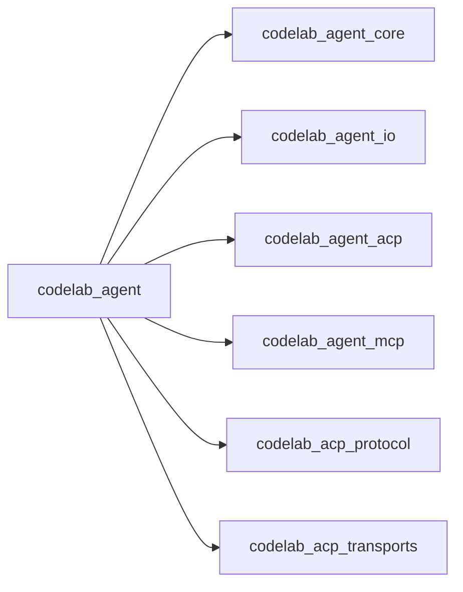
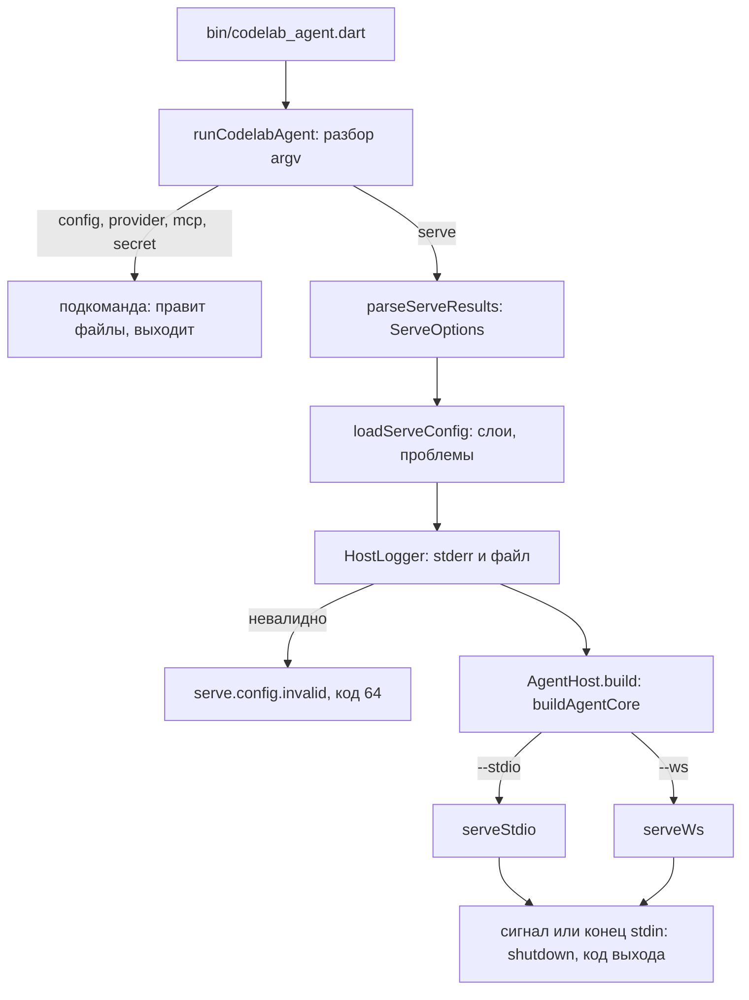

# `codelab-agent`: разработка

Приложение — тонкая оболочка над ядром агента: флаги, конфигурация, транспорт, логи, сигналы, коды выхода. Поведения агента здесь нет, оно в пакетах `codelab_agent_*`.

## Место в monorepo

На схеме — пакеты monorepo из `dependencies`.



Клиентские пакеты и Flutter приложение не импортирует (правило сторожа `melos run guard`). Сам `codelab-agent` не импортируется клиентами: `codelab` и CodeLab app получают агента через мосты `codelab_embedded` и `codelab_setup`.

## Структура кода

| Каталог | Что там |
|---|---|
| `bin/codelab_agent.dart` | точка входа: вызывает `runCodelabAgent` и завершает процесс через `exit` |
| `lib/src/run.dart` | `runCodelabAgent`: разбор argv, выбор команды, загрузка конфигурации, сборка логгера и хоста |
| `lib/src/cli/` | разбор аргументов: `serve_args.dart` (флаги `serve`, `ServeOptions`), `config_cli.dart`, `provider_cli.dart`, `mcp_cli.dart`, `secret_cli.dart`, общий `write_cli_support.dart`. Тексты и правила подкоманд — в `codelab_agent_io` |
| `lib/src/host/agent_host.dart` | `AgentHost.build`: сборка ядра через `buildAgentCore`, хранилище сессий, секреты, MCP, источник конфигурации; `createServer` и `shutdown` |
| `lib/src/host/serve_config.dart` | `loadServeConfig`, `serveConfigSource`, `logSettings` |
| `lib/src/serve/` | `serve_stdio.dart`, `serve_ws.dart`, `signals.dart`, `exit_codes.dart` |
| `lib/src/log/` | `HostLogger`, приёмники `StderrLogSink` и `FileLogSink` |
| `test/` | юнит- и процессные тесты; `test/support/` — запуск бинаря и ACP-пир |

## Поток запуска



Конфигурация грузится до логов и транспорта: по ней выбираются уровень и файл лога, а невалидная конфигурация завершает процесс кодом `64` до первого хода. Ядро собирается только через `buildAgentCore`. Владелец источника конфигурации и ядра — `AgentHost`: `shutdown` закрывает их в нужном порядке.

## Как добавить флаг `serve`

1. Добавьте опцию в `_serveParser` в `lib/src/cli/serve_args.dart` с англоязычной справкой и, если нужно, переменной окружения.
2. Проверьте значение в `parseServeResults`; ошибка — `UsageError` (код `64`), текст без значения секрета.
3. Если флаг задаёт ключ конфигурации, добавьте его в слой флагов (`_flagsLayer`) и, при необходимости, в таблицу переменных `environmentLayerVariables` пакета `codelab_agent_io`: не создавайте второй путь настройки ядра.
4. Добавьте тест в `test/serve_flags_test.dart` (красный тест — до кода) и обновите таблицу флагов в [эксплуатации](operations.md#флаги-serve).

## Тесты

```bash
cd apps/codelab_agent
fvm dart test
```

Процессные тесты запускают бинарь с `--llm-script` (сценарий модели) или с провайдером на локальном HTTP-сервере теста; это интеграционные тесты на Dart VM. Melos-скрипты, которые затрагивают приложение:

- `melos run guard` — границы пакетов и allowlist зависимостей;
- `melos run conformance:agent` — корпус ACP-фикстур против ACP-сервера агента;
- `melos run test:e2e:cli:dart-agent` — сквозные тесты `codelab` против `codelab-agent`.

Что запускать перед pull request — AGENTS.md корня, §21.

## Правила

Правила для изменений — в [`AGENTS.md`](../AGENTS.md). Главное: в stdout режима `--stdio` только кадры ACP, значения секретов и токен не попадают в лог и ошибки, ядро собирается только через `buildAgentCore`, а набор `dependencies` расширяется только через OpenSpec change.

## Смотрите также

- `openspec/specs/agent-binary/spec.md` — требования к бинарю
- `openspec/specs/agent-configuration/spec.md`, `openspec/specs/agent-secrets/spec.md`
- [`docs/architecture/proposals/agent-core-architecture.md`](../../../docs/architecture/proposals/agent-core-architecture.md) — §12.3, §13, §15
- [Эксплуатация](operations.md)
