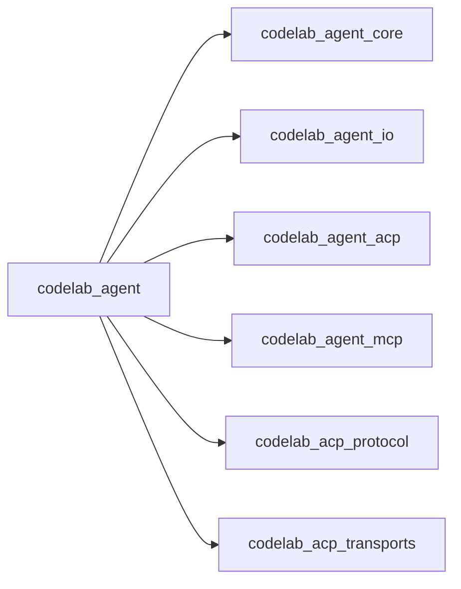
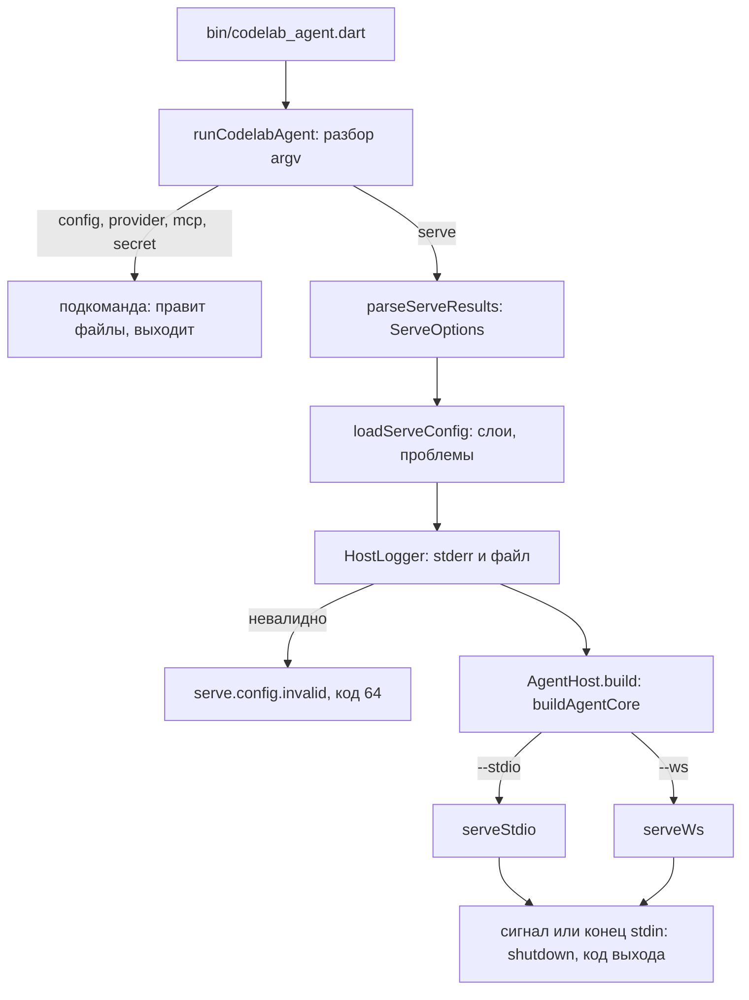

# `codelab-agent`: разработка

Приложение — тонкая оболочка над ядром агента: флаги, конфигурация, транспорт, логи, сигналы, коды выхода. Поведения агента здесь нет, оно в пакетах `codelab_agent_*`.

## Начало работы

Подготовка репозитория (SDK из `.fvmrc`, `melos bootstrap`, генерация кода) — в [запуске из исходников](../../../docs/user/run-from-source.md#1-подготовка). Без сгенерированного кода (`*.freezed.dart`) приложение не соберётся: тесты и запуск упадут ошибками компиляции в `codelab_acp_protocol` и `codelab_agent_acp`.

Запуск агента из исходников без провайдера и сети — со сценарием модели `--llm-script`. Сценарий `test/llm_scripts/hello.json` отвечает текстом `hello`. Следующая команда отправляет `initialize` и получает ответ; логи идут в stderr, в stdout — только кадры ACP (в примере уровень `warning`, чтобы они не мешали):

```bash
printf '{"jsonrpc":"2.0","id":1,"method":"initialize","params":{"protocolVersion":1,"clientCapabilities":{}}}\n' \
  | fvm dart run apps/codelab_agent/bin/codelab_agent.dart serve --stdio \
      --llm-script apps/codelab_agent/test/llm_scripts/hello.json --log-level warning
```

```text
{"jsonrpc":"2.0","id":1,"result":{"protocolVersion":1,"agentCapabilities":{"loadSession":false,"mcpCapabilities":{"http":true,"sse":false},"promptCapabilities":{"audio":false,"embeddedContext":true,"image":true},"sessionCapabilities":{}},"agentInfo":{"name":"codelab-agent","version":"0.1.0","title":"CodeLab Agent"},"authMethods":[]}}
```

У сценария `loadSession` — `false`: сессии в памяти, а не в журнале на диске (`--sessions-dir <каталог>` включает журнал). Без `--llm-script` ответ другой (`loadSession: true`) — см. пример в [эксплуатации](operations.md#serve---stdio). Со сценарием `$CODELAB_HOME` и файлы проектных слоёв не читаются, поэтому пример не зависит от вашей конфигурации.

Собрать исполняемый файл, как у релиза:

```bash
fvm dart run melos run build:agent
```

Появится `build/bin/codelab-agent`. Подкоманды (`config`, `provider`, `mcp`, `secret`) запускаются так же, без `serve` и без транспорта.

Дальше по темам — [оглавление документов](README.md): устройство, тестирование, рецепты, частые проблемы.

## Место в monorepo

На схеме — пакеты monorepo из `dependencies`.



Клиентские пакеты и Flutter приложение не импортирует (правило сторожа `melos run guard`). Сам `codelab-agent` не импортируется клиентами: `codelab` и CodeLab app получают агента через мосты `codelab_embedded` и `codelab_setup`.

## Структура кода

| Каталог | Что там |
|---|---|
| `bin/codelab_agent.dart` | точка входа: вызывает `runCodelabAgent` и завершает процесс через `exit` |
| `lib/src/run.dart` | `runCodelabAgent`: разбор argv, выбор команды, загрузка конфигурации, сборка логгера и хоста |
| `lib/src/cli/` | разбор аргументов: `serve_args.dart` (флаги `serve`, `ServeOptions`), `config_cli.dart`, `provider_cli.dart`, `mcp_cli.dart`, `secret_cli.dart`, общий `write_cli_support.dart`. Тексты и правила подкоманд — в `codelab_agent_io` |
| `lib/src/host/agent_host.dart` | `AgentHost.build`: сборка ядра через `buildAgentCore`, хранилище сессий, секреты, MCP, источник конфигурации; `createServer` и `shutdown` |
| `lib/src/host/serve_config.dart` | `loadServeConfig`, `serveConfigSource`, `logSettings` |
| `lib/src/serve/` | `serve_stdio.dart`, `serve_ws.dart`, `signals.dart`, `exit_codes.dart` |
| `lib/src/log/` | `HostLogger`, приёмники `StderrLogSink` и `FileLogSink` |
| `test/` | юнит- и процессные тесты; `test/support/` — запуск бинаря и ACP-пир |

Барель `lib/codelab_agent.dart` экспортирует разбор аргументов (`serve_args.dart`), `AgentHost`, `loadServeConfig` и `serveConfigSource`, лог (`HostLogger`, `StderrLogSink`, `FileLogSink`) и `runCodelabAgent`. Он нужен `bin/` и тестам; другим пакетам приложение не импортируется.

## Поток запуска



Конфигурация грузится до логов и транспорта: по ней выбираются уровень и файл лога, а невалидная конфигурация завершает процесс кодом `64` до первого хода. Ядро собирается только через `buildAgentCore`. Владелец источника конфигурации и ядра — `AgentHost`: `shutdown` закрывает их в нужном порядке.

Подробно — какие ошибки откуда приходят, чем режимы отличаются в сборке хоста и как устроены сигналы, — в [устройстве](internals.md).

## Как добавить флаг `serve`

1. Добавьте опцию в `_serveParser` в `lib/src/cli/serve_args.dart` с англоязычной справкой и, если нужно, переменной окружения.
2. Проверьте значение в `parseServeResults`; ошибка — `UsageError` (код `64`), текст без значения секрета.
3. Если флаг задаёт ключ конфигурации, добавьте его в слой флагов (`_flagsLayer`) и, при необходимости, в таблицу переменных `environmentLayerVariables` пакета `codelab_agent_io`: не создавайте второй путь настройки ядра.
4. Добавьте тест в `test/serve_flags_test.dart` (красный тест — до кода) и обновите таблицу флагов в [эксплуатации](operations.md#флаги-serve).

Те же шаги на коде реального флага `--max-steps` — в [рецептах](recipes.md#новый-флаг-serve). Новая подкоманда рядом с `serve` — [там же](recipes.md#новая-подкоманда).

## Тесты

```bash
cd apps/codelab_agent
fvm dart test
```

Процессные тесты запускают бинарь с `--llm-script` (сценарий модели) или с провайдером на локальном HTTP-сервере теста; это интеграционные тесты на Dart VM. Melos-скрипты, которые затрагивают приложение:

- `melos run guard` — границы пакетов и allowlist зависимостей;
- `melos run conformance:agent` — корпус ACP-фикстур против ACP-сервера агента;
- `melos run test:e2e:cli:dart-agent` — сквозные тесты `codelab` против `codelab-agent`.

Что запускать перед pull request — AGENTS.md корня, §21.

Полный прогон приложения (около 280 тестов) занимает порядка 20 секунд. Карта тестов, помощники и скелеты — в [тестировании](testing.md).

## Отладка

- **Лог.** `--log-level debug` (или `CODELAB_LOG_LEVEL`) включает подробный режим; `trace` — только для отладки: stderr MCP-серверов попадает в лог без редактирования. `--log-file <файл>` пишет ещё и JSON Lines. `--debug-secrets` добавляет события `secrets.lookup` (имя, источник, найден ли; значение не пишется).
- **Конфигурация.** `codelab-agent config check` показывает слои и проблемы без запуска сервера; `config path` — где лежат файлы слоёв.
- **Сессии.** Журналы — в `$CODELAB_HOME/sessions/` (или в `sessions.dir`); сценарий `--llm-script` пишет журнал только с `--sessions-dir`.

Реальный stderr запуска `serve --stdio` со сценарием `hello.json` и `--log-level debug` после `initialize` и `session/new` (путь проекта и идентификатор сессии заменены):

```text
2026-11-24T18:24:41.519343Z info secrets.backend.selected {backend: env, path: null, reason: forced by --llm-script}
2026-11-24T18:24:41.519640Z info host.config.loaded {sources: [defaults, flags], warnings: 0, project_root: ~/projects/demo, transport: stdio, models: [scripted/scripted-1]}
2026-11-24T18:24:41.520008Z info host.plan {profile: agent-serve, tools: [read, write, edit, task_create, task_update, task_list, task_get, exec, ls, search], off: {sessionPersistence: --llm-script: сессии в памяти}}
2026-11-24T18:24:41.520115Z info serve.stdio.start {}
2026-11-24T18:24:41.520403Z debug acp.extensions.negotiated {keys: []}
2026-11-24T18:24:42.498489Z info session.model.selected {session_id: <session-id>, model: scripted/scripted-1, source: config}
2026-11-24T18:24:42.499031Z info skills.loaded {session_id: <session-id>, count: 0, names: [], project: false}
```

В файле с `--log-file` те же записи выглядят так (JSON Lines, права файла `0600`):

```text
{"ts":"2026-11-24T18:24:41.520403Z","level":"debug","event":"acp.extensions.negotiated","keys":[]}
{"ts":"2026-11-24T18:24:42.498489Z","level":"info","event":"session.model.selected","session_id":"<session-id>","model":"scripted/scripted-1","source":"config"}
```

События самого бинаря (`serve.*`, `host.*`, `log.file.write_failed`) — в [таблице эксплуатации](operations.md#логи-и-диагностика). События ядра и сервера — в [главе 10 руководства по ядру](../../../packages/dart/codelab_agent_core/doc/10-observability-and-errors.md#журнал-диагностики). Не печатайте в stdout: в режиме `--stdio` он несёт только кадры ACP.

Как собирается ядро и чем бинарь отличается от встроенного агента — [сборка ядра и хосты](../../../packages/dart/codelab_agent_core/doc/02-assembly-and-hosts.md#хост-1-бинарь-codelab-agent).

## Правила

Правила для изменений — в [`AGENTS.md`](../AGENTS.md). Главное: в stdout режима `--stdio` только кадры ACP, значения секретов и токен не попадают в лог и ошибки, ядро собирается только через `buildAgentCore`, а набор `dependencies` расширяется только через OpenSpec change.

## Смотрите также

- `openspec/specs/agent-binary/spec.md` — требования к бинарю
- `openspec/specs/agent-configuration/spec.md`, `openspec/specs/agent-secrets/spec.md`
- [`docs/architecture/proposals/agent-core-architecture.md`](../../../docs/architecture/proposals/agent-core-architecture.md) — §12.3, §13, §15
- [Эксплуатация](operations.md)
- [Устройство](internals.md), [тестирование](testing.md), [рецепты](recipes.md), [частые проблемы](troubleshooting.md)
- [Руководство по ядру агента](../../../packages/dart/codelab_agent_core/doc/README.md)
