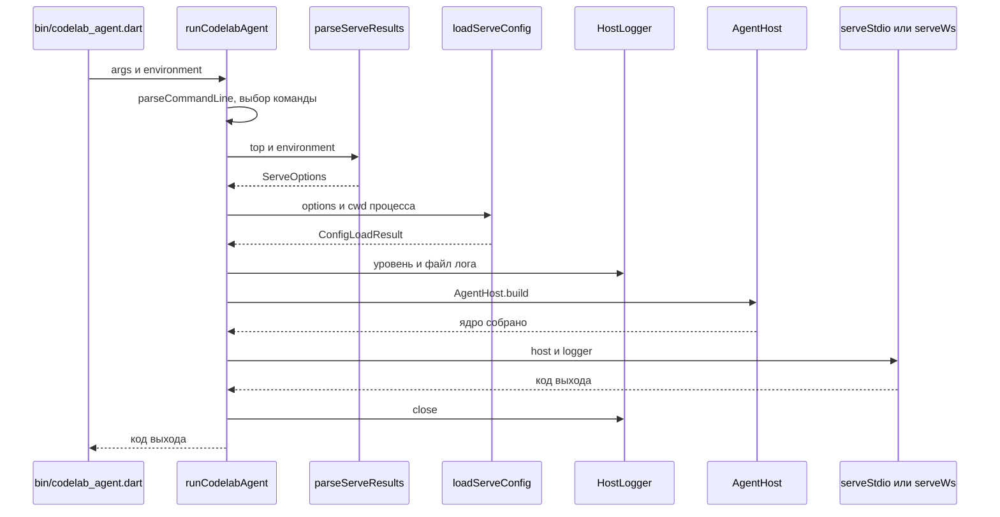

# `codelab-agent`: устройство

Глава для разработчика объясняет, как бинарь превращает аргументы командной строки в работающий ACP-сервер: порядок запуска, разбор аргументов, загрузку конфигурации, сборку хоста ядра, транспорты, сигналы и логи. Что делает ядро и как устроена его сборка (`buildAgentCore`, профили, порты), здесь не повторяется — см. [главу 2 руководства по ядру](../../../packages/dart/codelab_agent_core/doc/02-assembly-and-hosts.md#хост-1-бинарь-codelab-agent). Структура каталогов и схема зависимостей — в [разработке](development.md).

## Порядок запуска

`bin/codelab_agent.dart` вызывает `runCodelabAgent(args, environment: Platform.environment)` и завершает процесс через `exit` с полученным кодом. Это `exit`, а не `exitCode`: подписка на stdin держала бы процесс живым после остановки сервера.

На схеме — порядок для `serve` (подкоманды `config`, `provider`, `mcp`, `secret` выходят раньше, на втором шаге).



Что важно:

- **Конфигурация грузится до логов.** Уровень и файл лога берутся из слитых слоёв (`logSettings`), поэтому проблемы конфигурации пишутся уже в настроенный логгер.
- **Невалидная конфигурация не доходит до сборки хоста.** `loaded.config == null` — `_reportInvalidConfig`: по строке на проблему в stderr, одно событие `serve.config.invalid` в логе, код `64`. `AgentHost.build` не вызывается, транспорт не открывается.
- **Ошибки использования приходят из разных мест.** `parseCommandLine`, `parseServeResults`, `loadServeConfig` и `FileLogSink.open` бросают `UsageError`, который `run.dart` печатает в stderr: первые три — без логгера, а ошибка файла лога случается уже при сборке приёмников. `AgentHost.build` бросает его при готовом логгере, поэтому ошибка идёт событием `serve.usage`. Во всех случаях код `64`.
- **Любое другое исключение `serve`** — `serve.failed` с ошибкой и стеком, код `1`. Подкоманды ловят исключения сами и печатают одну строку `codelab-agent: <команда> failed: <ТипИсключения>`, код `1`: текст исключения мог бы цитировать значение секрета.
- **`logger.close()` — в `finally`**: файл лога сбрасывается и закрывается при любом выходе.

## Разбор аргументов

Разбор двухуровневый (`lib/src/cli/serve_args.dart`).

1. `parseCommandLine` разбирает верхний уровень парсером `package:args` с пятью командами: `serve`, `config`, `provider`, `mcp`, `secret`. Каждая команда имеет собственный `ArgParser` (`_serveParser`, `configParser`, `providerParser`, `mcpParser`, `secretParser`). Ошибка разбора — `UsageError`.
2. `run.dart` смотрит на `top.command` и передаёт управление: `runConfigCommand`, `runProviderCommand`, `runMcpCommand`, `runSecretCommand` либо дальше к `serve`.
3. Для `serve` `parseServeResults(top, environment: ...)` проверяет значения и строит `ServeOptions`.

Что проверяет `parseServeResults` (всё — до чтения файлов и открытия транспорта, код `64`):

| Проверка | Текст ошибки (stderr) |
|---|---|
| лишние слова после `serve` | `unexpected arguments (N)` (только число, слова не цитируются) |
| ровно один транспорт | `pass exactly one of --stdio or --ws` |
| порт `0..65535` | `--port must be a number 0..65535: <значение>` |
| `--provider` и `--llm-script` вместе | `--provider and --llm-script are mutually exclusive` |
| `--sessions-dir` без сценария | `--sessions-dir requires --llm-script` |
| `--provider` без модели | `--provider needs --model (or CODELAB_MODEL)` |
| `--model` без `--provider` | `--model needs <provider>/<model> without --provider`; повтор без `--provider` — `--model can be repeated only together with --provider` |
| `openai-compatible` без `--base-url` | `--provider openai-compatible needs --base-url` |
| имя режима разрешений | `unknown permission mode: <значение>` |
| уровень лога | `unknown log level: <значение>` (регистр не важен) |
| `CODELAB_HOME` (кроме сценария) | текст `ConfigUsageException`, например `~user` |
| имя файла `--config` | только `.yaml` и `.yml` |
| `--max-steps` | `--max-steps must be a positive integer: <значение>` |
| `--provider-type` и `--provider-config` | вместе, не сочетаются с `--provider` и `--base-url`, `@путь` читается как обычный файл до 1 МиБ в UTF-8 |

Реальный вывод ошибки использования — сообщение, пустая строка и справка (хвост справки опущен):

```text
codelab-agent: --max-steps must be a positive integer: 0

Usage: codelab-agent serve (--stdio | --ws) [options]
       codelab-agent config check|path|get|set|unset ...
       codelab-agent provider add|list|remove ...
       codelab-agent mcp add|list|remove ...
       codelab-agent secret set|delete|list|migrate
…
```

Код выхода — `64`. Справка той команды, которую пользователь начал писать, а не всегда `serve`.

### Что в `ServeOptions`, а что нет

`ServeOptions` хранит только то, что относится к запуску: транспорт, адрес и порт WebSocket, имя переменной токена, модели каталога (`cli/<id>` у провайдера, `scripted/<id>` у сценария), путь `--llm-script`, `--sessions-dir`, уровень и файл лога, `CODELAB_HOME`, путь `--config`, `--debug-secrets`, предконфигурацию провайдера и слой флагов `flags`. Настройки ядра — провайдеры, режим разрешений, лимит шагов — в нём нет: они лежат в слое флагов и приходят из результата `loadServeConfig`. Ключ провайдера в `ServeOptions` не хранится вообще: слой флагов называет только переменную `api_key_env`, а значения переменных лежат в `environment`. В `toString` нет ни окружения, ни JSON из `--provider-config`.

### Почему часть ошибок без цитат

Если в командной строке есть `secret`, `provider` или `mcp` (а у `config` — `set` или `unset`), ошибка разбора argv печатает только `codelab-agent: invalid arguments for <команда>` и справку команды. Верхний парсер падает на первом неверном слове, а оно может оказаться значением секрета, переданным по ошибке аргументом. Функция `_quietCommandOf` ищет команду по всему argv, а не по первому слову: флаг верхнего уровня перед `secret` её не обманет. По той же причине `serve` и `config` в сообщениях не цитируют лишние слова, а пишут их число.

```text
codelab-agent: invalid arguments for secret

Usage: codelab-agent secret set|delete|list|migrate
…
```

Правило нужно помнить при добавлении любой команды, которая принимает значения, способные оказаться секретами.

## Слой флагов и загрузка конфигурации

Флаги не меняют ядро напрямую: `_flagsLayer` собирает из них дерево `ConfigTree` слоя флагов (`ConfigLayerKind.flags`). Туда попадает только названное явно: провайдер `cli` (`--provider`, `--base-url`, `--model`), `agent.default_model`, `permissions.mode`, `budget.max_steps`, `logging.level` и `logging.file`. Приоритет «флаг сильнее переменной» обеспечивает порядок слоёв в загрузчике, а не код бинаря. Полный порядок слоёв — в [настройке агента](../../../docs/user/configuration.md#слои-конфигурации) и [руководстве по ядру](../../../packages/dart/codelab_agent_core/doc/09-config-prompts-commands.md#путь-от-источников-до-coreconfig).

`loadServeConfig` (`lib/src/host/serve_config.dart`) вызывает общий `ConfigLoader` из `codelab_agent_io`. Особенности бинаря:

- **Корень проектных слоёв — аргумент `cwd`, обязательный.** Бинарь передаёт `Directory.current.path`; тест — временный каталог, чтобы не читать `.codelab/` каталога, из которого его запустили.
- **`--llm-script`.** Слои 2–4 (файлы) не читаются. Сценарий описывается провайдером в слое флагов через `withScriptedProviders`: модели берутся из файла, ключ и сеть конфигу не нужны. Файл `--config` читается и со сценарием; ключ `trusted_projects` в нём — ошибка конфигурации.
- **Переменная токена.** `knownVariables: {options.tokenEnv}`: имя из `--token-env` не считается опечаткой `CODELAB_*` (`config.env.unknown`).
- **Один набор параметров для старта и перезагрузки.** `serveConfigSource` создаёт `FileConfigSource` с теми же корнем, окружением, флагами, предконфигурацией, `--config` и известными переменными. Параметры собраны в одном файле, чтобы «перезагрузка» не могла прочитать другой конфиг, чем старт.

`logSettings(options, loaded)` возвращает уровень и файл лога: при валидной конфигурации — из слитых `HostSettings` (флаг сильнее переменной, переменная сильнее `logging.*`), при невалидной — только флаги и переменные. Файл лога по умолчанию не создаётся.

## Сборка хоста: `AgentHost`

`AgentHost.build(options, logger:, loaded:)` собирает ядро. Он не выбирает каталог проекта сам: `loaded` — результат `loadServeConfig`, а `cwd` — тот же корень (по умолчанию каталог процесса). Хост владеет ядром, источником конфигурации и общим `http.Client`; все три закрывает `shutdown`.

Порядок сборки, `AcpServerConfig` и порядок `shutdown` описаны в [главе 2 руководства по ядру](../../../packages/dart/codelab_agent_core/doc/02-assembly-and-hosts.md#хост-1-бинарь-codelab-agent). Чем режимы отличаются друг от друга (все различия — в `agent_host.dart`):

| | `--stdio` | `--ws` | `--llm-script` |
|---|---|---|---|
| Файлы проекта (`ProjectFilesLoader`) | да: `$CODELAB_HOME`, домашний каталог, локальная ФС | нет, событие `project_files.skipped` | да, но без `$CODELAB_HOME` и домашнего каталога; проект всегда недоверенный |
| Навыки и `hostFiles` | да | нет | только абсолютные `skills.extra_roots` из `--config`: проект недоверенный, навыков проекта нет |
| MCP | работает | возможность `mcp` выключена | как у выбранного транспорта (тесты `mcp_stdio_process_test.dart` идут со сценарием) |
| Листинг файлов (`localListing`) | локальный | выключен | как у выбранного транспорта |
| `FileConfigSource` | да, он же `projectConfig` (конфигурация папки сессии) | да, но `projectConfig` не передаётся: `cwd` приходит из сети | нет |
| команды `/config` и `/mcp` | объявляются | не объявляются: `configCommand: false`, MCP выключен | как у транспорта |
| Секреты | `secrets.backend` конфигурации | то же | всегда `env` |
| Журнал сессий | `openHostSessions` (JSONL) | то же | память или `--sessions-dir` |
| `lastModel`, `agentConfigPaths` | да | да | нет |

Версия — константа `agentVersion` в `lib/src/host/agent_host.dart`; парная константа встроенного агента — `embeddedAgentVersion` в `codelab_embedded`, значения должны совпадать. Файлы и команды в этом хосте исполняет клиент (`fs/*`, `terminal/*`), во встроенном агенте — хост: [устройство моста](../../../packages/dart/codelab_embedded/doc/00-architecture-and-debugging.md).

## Транспорты и сигналы

### `serveStdio`

`lib/src/serve/serve_stdio.dart`. Создаёт `StdioServerAcpTransport` и сервер, подписывается на сигналы, пишет `serve.stdio.start` и запускает `server.serve(transport)`. Процесс завершается, когда сработало одно из трёх: `serve` закончился (клиент закрыл stdin — код `0`), `serve` упал (`serve.stdio.failed`, код `1`) или пришёл сигнал (`130` или `143`). Дальше: `serve.stop {exit_code}`, `host.shutdown()`, закрытие транспорта, сброс stdout.

### `serveWs`

`lib/src/serve/serve_ws.dart`. Токен берётся из переменной `--token-env`; пустой — `serve.usage` и код `64`, до открытия порта, но уже после сборки ядра (в логе есть `host.config.loaded` и `host.plan`). Дальше порт: `HttpServer.bind`; ошибка — `serve.ws.bind_failed` и код `1`. Не loopback-адрес — предупреждение `serve.ws.non_loopback`. На каждый запрос:

1. не WebSocket upgrade — `426`;
2. заголовок `Authorization` не равен `Bearer <token>` (сравнение за постоянное время, `_sameBytes`) — `401` с `WWW-Authenticate: Bearer realm="codelab-agent"` и `serve.ws.unauthorized`; присланный и верный токен в лог не пишутся;
3. upgrade — `serve.ws.connected` и `server.serve(WebSocketServerAcpTransport(socket))` без ожидания: каждое подключение — отдельное соединение одного сервера.

Путь запроса не проверяется. Остановка: `serve.stop`, отмена подписки на запросы, `http.close(force: true)`, `host.shutdown()`.

Реальная проверка кодов ответа на запущенном процессе (`--port 18766`, токен `<token>`): запрос без upgrade даёт `426`, upgrade без заголовка `Authorization` — `401`; в логе появляется `warning serve.ws.unauthorized {remote: 127.0.0.1}`.

### Сигналы

`watchStopSignals(onStop)` (`lib/src/serve/signals.dart`) слушает `SIGINT` и, кроме Windows, `SIGTERM`. Первый сигнал вызывает `onStop(130 или 143)`. Второй, пока остановка идёт, вызывает `exit(code)` немедленно: пользователь не должен ждать зависший ход. Реальный лог при `SIGTERM`:

```text
2026-11-24T18:25:19.378401Z info serve.stdio.start {}
2026-11-24T18:25:22.408705Z info serve.stop {exit_code: 143}
```

### Коды выхода

Константы — в `lib/src/serve/exit_codes.dart` (`usageExit` общий с `config check`, `configUsageExit` из `codelab_agent_io`). Значения и что делать при каждом — в [эксплуатации](operations.md#коды-выхода).

## Логи

Порт `Logger` ядра реализует `HostLogger` (`lib/src/log/host_logger.dart`): фильтр по уровню и раздача записи приёмникам `LogSink`. Первый приёмник основной — `StderrLogSink` (строка на запись: время UTC, уровень, событие, поля в скобках). Второй — `FileLogSink` (JSON Lines, только если задан `--log-file`, `CODELAB_LOG_FILE` или `logging.file`).

Правила, которые нельзя ломать:

- **stdout несёт только кадры ACP.** `StderrLogSink` пишет в stderr; `FileLogSink.open` отвергает пути, ведущие в stdout (`-`, `/dev/stdout`, `/dev/fd/1`, `/proc/self/fd/1`), ошибкой `--log-file cannot point to stdout: stdout carries the ACP protocol` и кодом `64`. Не добавляйте в `lib/` и `bin/` ни `print`, ни запись в `stdout`.
- **Сбой файла не роняет агента.** Если приёмник бросил при записи, он отключается до конца процесса, а в оставшиеся приёмники уходит одна запись `warning log.file.write_failed`. Так отключается любой приёмник, в том числе stderr: условие `!identical(_sinks.first, sink)` в `_dispatch` проверяется уже после удаления сбойного приёмника и потому всегда истинно, а предупреждение уходит в оставшийся (при сбое stderr — в файл). Тест `log_sinks_test.dart` проверяет только сбой файла.
- **Файл лога:** каталоги создаются с правами `0700`, новый файл — `0600`, запись в конец, ротации нет. Каждая запись пишется одним вызовом `write`, поэтому несколько процессов могут дописывать один файл без перемешивания строк.
- **Секреты и токен в лог не попадают**: значения ключей — только через `SecretResolver`, который пишет имя и источник; токен `--ws` не логируется ни присланный, ни ожидаемый. Редакции текстов промптов и вывода инструментов до 1.0 нет.

Какие события бинарь пишет сам и что означают — в [таблице событий эксплуатации](operations.md#логи-и-диагностика). События ядра и сервера — в [главе 10 руководства по ядру](../../../packages/dart/codelab_agent_core/doc/10-observability-and-errors.md#журнал-диагностики).

## Подкоманды

Подкоманды не запускают сервер и не открывают транспорт. В бинаре от каждой — только оболочка `package:args`: парсер, справка, проверка числа аргументов и вызов общего класса из `codelab_agent_io`. Тексты вывода, правила и коды выхода живут там, чтобы `codelab` печатал то же самое.

| Команда | Файл | Общий класс | Шов для тестов |
|---|---|---|---|
| `config check\|path\|get\|set\|unset` | `lib/src/cli/config_cli.dart` | `ConfigCommands` | параметр `commands` |
| `provider add\|list\|remove` | `lib/src/cli/provider_cli.dart` | `ProviderCommands` | `commands`, `input` |
| `mcp add\|list\|remove` | `lib/src/cli/mcp_cli.dart` | `McpServerCommands` | `commands` |
| `secret set\|delete\|list\|migrate` | `lib/src/cli/secret_cli.dart` | `SecretCommands` | `commands`, `input` |

Общее для трёх команд записи — `lib/src/cli/write_cli_support.dart`: флаги слоя `--project` и `--local` (`withLayerFlags`), печать результата (`printResult`: `stdout`, `stderr` и код из `ConfigCommandResult`) и ответ на ошибку использования (`usageFailure`, код `64`). stdin читают только `provider add --api-key-stdin`, `mcp add --header-stdin` и `--env-stdin`, `secret set`; значение секрета аргументом не принимается нигде.

Реальный пример: добавить провайдера и проверить результат (изолированный `CODELAB_HOME`; пути заменены):

```bash
codelab-agent provider add local --kind openai-compatible --base-url http://127.0.0.1:9/v1 --model test --context-window 32000 --default
codelab-agent provider list
codelab-agent config check
```

```text
Updated providers.local in ~/.codelab/config.yaml
local  kind: openai-compatible  base_url: http://127.0.0.1:9/v1  models: test  key: none
Sources: defaults, ~/.codelab/config.yaml
Default model: local/test (config)
Config: valid
```

## Смотрите также

- [Разработка](development.md) — структура кода, начало работы, отладка;
- [Тестирование](testing.md);
- [Рецепты](recipes.md);
- [Частые проблемы](troubleshooting.md);
- [Эксплуатация](operations.md) — флаги, события, коды выхода с точки зрения оператора.
