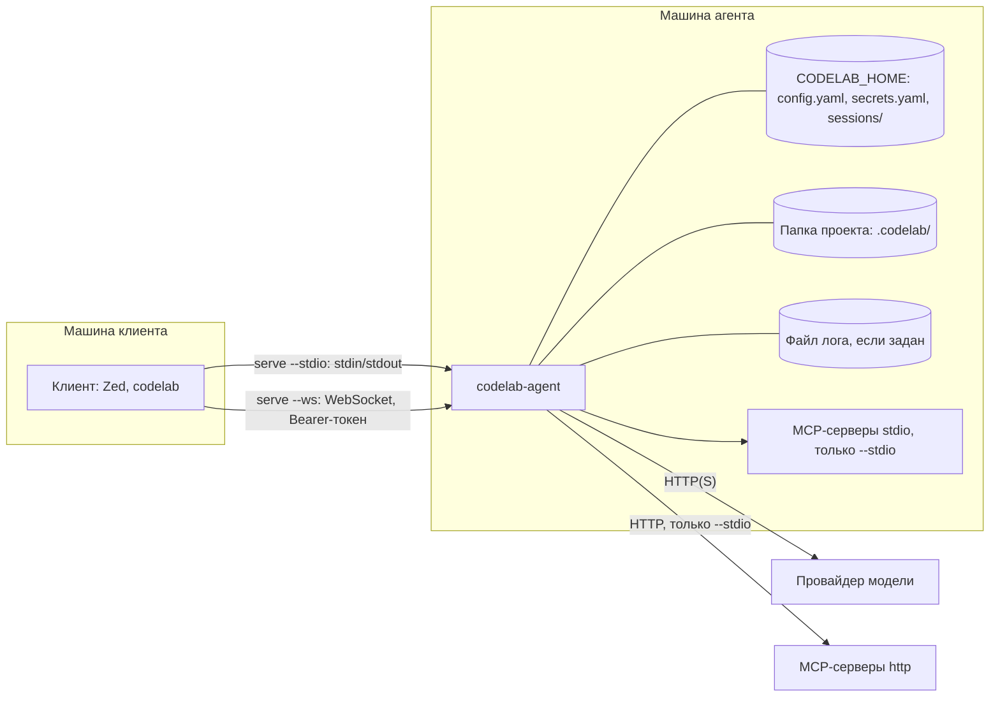

# `codelab-agent`: эксплуатация

Здесь описано, как собрать `codelab-agent`, запустить его как процесс (`serve --stdio` или `serve --ws`), где он хранит файлы, какие переменные читает, что пишет в логи и с какими кодами завершается.

`codelab-agent` — Dart-агент как отдельная программа. Терминальный клиент `codelab` и приложение CodeLab app по умолчанию запускают агента внутри себя и этой программы не требуют. Она нужна, когда агента подключают к чужому клиенту (например, к Zed) или запускают по сети.

## Схема развёртывания

На схеме — два режима запуска и всё, с чем процесс говорит.



- `--stdio`: клиент запускает процесс сам и говорит с ним по stdin/stdout. Один процесс обслуживает одного клиента и завершается, когда клиент закрывает stdin.
- `--ws`: процесс слушает один TCP-порт и принимает клиентов по WebSocket. Путь запроса не проверяется.
- MCP-серверы (и `stdio`, и `http`) работают только в режиме `--stdio`: в `--ws` возможность `mcp` отключена целиком (подробности в разделе «Различия режимов»).
- Исходящие соединения: к провайдеру модели; в режиме `--stdio` ещё и к MCP-серверам типа `http`.

## Сборка

Подготовка репозитория и версия SDK (`.fvmrc`) — в [запуске из исходников](../../../docs/user/run-from-source.md#1-подготовка).

```bash
fvm dart run melos run build:agent
```

Получится самостоятельный исполняемый файл `build/bin/codelab-agent`. Версия пакета — `0.1.0` (`pubspec.yaml`); флага `--version` у бинаря нет, версию агента сообщает его ответ на `initialize` (`agentInfo.version`).

## Запуск

Бинарь принимает команду `serve` и четыре команды настройки (`config`, `provider`, `mcp`, `secret`), которые правят файлы и сервер не запускают.

В `serve` нужно указать ровно один транспорт: `--stdio` или `--ws`. Иначе — код `64`.

### `serve --stdio`

```bash
codelab-agent serve --stdio
```

stdout несёт только кадры ACP (Agent Client Protocol — протокол, по которому клиент и агент обмениваются сообщениями); логи идут в stderr. Не перенаправляйте stdout процесса в файл и не пишите в него сами.

Проверка без клиента: отправить `initialize` и получить ответ. Провайдер на этом шаге не нужен, поэтому подойдёт недоступный локальный адрес.

```bash
printf '{"jsonrpc":"2.0","id":1,"method":"initialize","params":{"protocolVersion":1,"clientCapabilities":{}}}\n' \
  | codelab-agent serve --stdio --provider openai-compatible --base-url http://127.0.0.1:9/v1 --model test --log-level warning
```

```text
{"jsonrpc":"2.0","id":1,"result":{"protocolVersion":1,"agentCapabilities":{"loadSession":true,"mcpCapabilities":{"http":true,"sse":false},"promptCapabilities":{"audio":false,"embeddedContext":true,"image":true},"sessionCapabilities":{"list":{}}},"agentInfo":{"name":"codelab-agent","version":"0.1.0","title":"CodeLab Agent"},"authMethods":[]}}
```

### `serve --ws`

```bash
export CODELAB_AGENT_TOKEN="<token>"
codelab-agent serve --ws --host 127.0.0.1 --port 8765
```

Процесс не стартует без непустого токена: он берётся из переменной, имя которой задаёт `--token-env` (по умолчанию `CODELAB_AGENT_TOKEN`). Клиент передаёт его заголовком `Authorization: Bearer <token>` при открытии WebSocket.

| Запрос | Ответ |
|---|---|
| обычный HTTP без upgrade | `426` |
| upgrade без заголовка или с неверным токеном | `401` с `WWW-Authenticate: Bearer realm="codelab-agent"`, в лог идёт `serve.ws.unauthorized` |
| upgrade с верным токеном | соединение WebSocket, обмен ACP |

Порт `0` позволяет системе выбрать свободный: реальный порт — в строке лога `serve.ws.listening`.

Пример лога при запуске с `--port 18765` (stderr):

```text
2026-11-18T09:54:24.700707Z info serve.ws.listening {host: 127.0.0.1, port: 18765}
```

Занятый порт или недоступный адрес — код `1` и событие `serve.ws.bind_failed`.

### Различия режимов

В `--ws` клиент может быть на другой машине и сам выбирает рабочую папку сессии. Чтобы это не открыло чтение файлов и запуск процессов этой машины без нужды, режим `--ws` отключает часть возможностей. Причины видны в строке `host.plan` при старте.

| Возможность | `--stdio` | `--ws` |
|---|---|---|
| файлы проекта (`AGENTS.md`, шаблоны команд, определения агентов): чтение с машины агента | читаются | не читаются, при старте событие `project_files.skipped` |
| MCP-серверы (`stdio` и `http`) | работают | отключены |
| листинг файлов с машины агента | да | нет |
| встроенные команды `/config` и `/mcp` | объявляются | не объявляются |
| перезагрузка конфигурации при правке файла | да, если не задано `config.watch: false` | да, если не задано `config.watch: false` (по наблюдателю за файлами) |

Со скрытым флагом `--llm-script` (для тестов) источника конфигурации нет, и перезагрузки нет.

### Флаги `serve`

Справка печатается в stderr при ошибке использования. Отдельного `--help` нет: `codelab-agent serve --help` завершается кодом `64` и печатает ту же справку.

| Флаг | Значение | Переменная |
|---|---|---|
| `--stdio` | обслуживать одного клиента по stdin/stdout | — |
| `--ws` | обслуживать клиентов по WebSocket | — |
| `--host` | адрес WebSocket; по умолчанию `127.0.0.1` | — |
| `--port` | порт WebSocket, `0..65535`; по умолчанию `8765` | — |
| `--token-env` | имя переменной с Bearer-токеном; по умолчанию `CODELAB_AGENT_TOKEN` | — |
| `--provider` | `openai-compatible` или `anthropic`: провайдер, заданный флагами; ключ — из `CODELAB_API_KEY` | `CODELAB_API_KEY` (ключ) |
| `--base-url` | адрес провайдера; обязателен для `openai-compatible`, у `anthropic` по умолчанию `https://api.anthropic.com` | — |
| `--model` | идентификатор модели; с `--provider` можно повторять, первая — по умолчанию; без `--provider` — `<провайдер>/<модель>` из конфигурации | `CODELAB_MODEL` |
| `--provider-type`, `--provider-config` | предконфигурация провайдера: вид и JSON (или `@путь` к файлу с ним); вместе, не сочетаются с `--provider` и `--base-url`. Предпочитайте `@путь`: JSON в аргументах виден другим пользователям через `ps` | `CODELAB_PROVIDER_TYPE`, `CODELAB_PROVIDER_CONFIG` |
| `--permission-mode` | `plan`, `ask`, `standard`, `accept-edits`, `bypass`, `autopilot` | `CODELAB_PERMISSION_MODE` (без `autopilot`) |
| `--log-level` | `trace`, `debug`, `info`, `warning`, `error`; регистр не важен; по умолчанию `info` | `CODELAB_LOG_LEVEL` |
| `--log-file` | файл лога в формате JSON Lines | `CODELAB_LOG_FILE` |
| `--config` | дополнительный файл конфигурации, выше `config.local.yaml`; только `.yaml` или `.yml` | `CODELAB_CONFIG` (только абсолютный путь) |
| `--debug-secrets` | писать в лог `secrets.lookup` (имя, назначение, источник, найден ли); значение не пишется | `CODELAB_DEBUG_SECRETS=1` |
| `--max-steps` | число шагов модели за ход, целое `≥ 1` | `CODELAB_MAX_STEPS` |

Скрытые флаги `--llm-script` и `--sessions-dir` нужны тестам и в эксплуатации не используются.

Подкоманды настройки ([`config`, `provider`, `mcp`, `secret`](../../../docs/user/configuration.md)) работают без сервера и транспорта. Их справка — в stderr при ошибке использования (`codelab-agent config`, `codelab-agent secret` и так далее).

## Конфигурация

Конфигурацию собирают из слоёв: значения по умолчанию, файлы, переменные `CODELAB_*`, флаги. Слои, их приоритет и ключи — в [настройке агента](../../../docs/user/configuration.md#слои-конфигурации); не дублируются здесь. Расположение `CODELAB_HOME` и общих файлов — в [каталоге `CODELAB_HOME`](../../../docs/ops/codelab-home.md).

| Где | Что |
|---|---|
| `$CODELAB_HOME/config.yaml` | глобальная конфигурация |
| `<папка запуска>/.codelab/config.yaml`, `<папка запуска>/.codelab/config.local.yaml` | слои проекта; папка запуска — текущая папка процесса |
| файл из `--config` или `CODELAB_CONFIG` | дополнительный слой; названный, но отсутствующий файл — код `64` |
| `$CODELAB_HOME/secrets.yaml` | секреты открытым текстом, права `0600`; только при `secrets.backend: file` |
| `$CODELAB_HOME/sessions/` | журналы сессий; другой каталог задаёт `sessions.dir` |

Файлы Python-агента (`codelab.toml`, `auth.toml`) не читаются: найденный файл даёт только предупреждение `config.legacy_found`. Перенос настроек — [переход с Python-агента](../../../docs/user/migrating-from-python-agent.md).

Невалидная конфигурация останавливает запуск до старта транспорта. Проверить её заранее можно без запуска сервера:

```bash
codelab-agent config check
```

Пример при пустом `CODELAB_HOME` (код выхода `1`):

```text
Sources: defaults
defaults: agent.default_model: no model is configured; add a provider with at least one model
Config: invalid (issues: 1)
```

`codelab-agent serve` на той же конфигурации печатает проблему и завершается кодом `64`:

```text
codelab-agent: defaults: agent.default_model: no model is configured; add a provider with at least one model
2026-11-18T09:54:14.829566Z error serve.config.invalid {issues: [{source: defaults, line: null, column: null, key: agent.default_model, kind: value}]}
```

В работающем процессе (кроме запуска со сценарием) правка файлов конфигурации подхватывается без перезапуска; детали и ограничения — в разделе «Правки после перезапуска» [настройки агента](../../../docs/user/configuration.md#правки-после-перезапуска-и-сессии-других-папок).

### Переменные окружения

Полный перечень `CODELAB_*` с проверенными значениями — в [переменных окружения](../../../docs/ops/environment.md). У `codelab-agent` из них действуют все, а здесь — только то, что относится к `serve`:

- `CODELAB_AGENT_TOKEN` — Bearer-токен для `--ws`; имя переменной меняет `--token-env`. Переменная, названная в `--token-env`, предупреждения `config.env.unknown` не даёт.
- Флаги `--model`, `--max-steps`, `--permission-mode`, `--log-level`, `--log-file`, `--config`, `--debug-secrets` и `--provider-*` имеют одноимённые переменные (таблица флагов выше). Флаг главнее переменной.
- `CODELAB_API_KEY` нужен только при запуске с `--provider`; пустое значение равно отсутствию.
- Ошибка в `CODELAB_HOME` (`~user/…`, `~\…`) — код выхода `64` до чтения файлов.

Агент берёт окружение своего процесса. Если его запускает клиент (Zed, `codelab`), ключи должны быть в окружении клиента или в `env` его настроек запуска.

### Секреты

- В CI и на сервере проще всего передать ключ переменной окружения: `api_key_env` провайдера или `CODELAB_SECRET_<ИМЯ>` для `api_key_secret`. Файл хранилища для этого не нужен.
- Токен `--ws` задавайте переменной окружения, не аргументом: аргументы видны в `ps`. Токен и значения ключей не попадают в лог, текст ошибок и строковое представление опций.
- Бэкенд `secrets.backend: file` кладёт значения открытым текстом в `$CODELAB_HOME/secrets.yaml` (права `0600`) и при каждом старте пишет `secrets.backend.plaintext`. Бэкенд `keychain` в этой версии не поддерживается: значение даёт ошибку конфигурации (код `64`). На запуск с `--llm-script` настройка не влияет.
- `codelab-agent secret set <имя>` читает значение только из stdin, значение аргументом — код `64`.

## Логи и диагностика

Агент пишет события в два места:

- stderr — всегда. Формат строки: время UTC, уровень, имя события, поля в скобках.
- файл — только если задан `--log-file`, `CODELAB_LOG_FILE` или `logging.file`. Формат — JSON Lines: по одной записи на строку с полями `ts`, `level`, `event`, полями события и, если есть, `error` и `stack`.

Пример записи в файле (запуск с `--port 18765`):

```text
{"ts":"2026-11-18T09:54:24.700707Z","level":"info","event":"serve.ws.listening","host":"127.0.0.1","port":18765}
```

Правила файла лога:

- Каталоги по пути создаются с правами `0700`, новый файл — `0600`; запись идёт в конец файла.
- Ротации нет: файл растёт, пока вы его не уберёте. Ограничьте размер внешними средствами (logrotate и подобные).
- Путь, указывающий на stdout (`-`, `/dev/stdout`, `/dev/fd/1`, `/proc/self/fd/1`), отклоняется кодом `64`: stdout несёт протокол.
- Файл, который не удалось открыть, — код `64`. Если запись в уже открытый файл начала падать, процесс продолжает работу: файл отключается, а в stderr появляется предупреждение `log.file.write_failed`.
- Каталога `$CODELAB_HOME/logs` и файла лога по умолчанию нет.

Основные события `serve`:

| Событие | Когда |
|---|---|
| `host.config.loaded` | конфигурация загружена; поля — слои, число предупреждений, корень проекта, транспорт, модели |
| `host.plan` | выбранный профиль, список инструментов и что отключено в этом режиме |
| `secrets.backend.selected` | выбран бэкенд секретов (`backend`) и причина (`reason`); без `secrets.backend` в конфигурации это `env` |
| `config.watch.fallback` | наблюдатель за файлами конфигурации не нашёл каталог (например, нет `.codelab/`) и перевёл файл на опрос; сообщение, а не ошибка |
| `serve.stdio.start` | запущен режим `--stdio` |
| `serve.ws.listening` | порт открыт |
| `serve.ws.non_loopback` | предупреждение: `--host` не loopback-адрес |
| `serve.ws.connected`, `serve.ws.disconnected` | клиент подключился и отключился (поле `remote`) |
| `serve.ws.unauthorized` | отклонён upgrade без верного токена |
| `serve.ws.upgrade_failed`, `serve.ws.connection_failed` | сбой подключения клиента |
| `serve.stop` | остановка; поле `exit_code` |
| `serve.config.invalid`, `serve.usage`, `serve.failed` | ошибка конфигурации, использования, неожиданный сбой |

Диагностика:

- `--log-level debug` включает подробный режим. `trace` включайте только для отладки: stderr MCP-серверов попадает в лог без редактирования.
- `--debug-secrets` показывает, какие секреты агент искал и откуда; значения не пишутся.
- Журналы сессий — в `$CODELAB_HOME/sessions/` (или `sessions.dir`): по подкаталогу на папку проекта.
- Что попадает в логи и журналы и что не редактируется до 1.0 — [в настройке агента](../../../docs/user/configuration.md#что-попадает-в-логи-и-журналы). Не публикуйте логи и журналы, не просмотрев их.

## Коды выхода

Источник: `lib/src/serve/exit_codes.dart`.

| Код | Значение | Что делать |
|---|---|---|
| `0` | `--stdio`: клиент закрыл stdin, агент завершился штатно; подкоманда выполнена | — |
| `1` | неожиданный сбой `serve` (`serve.failed`, `serve.stdio.failed`); не удалось открыть порт (`serve.ws.bind_failed`); `config check` нашёл ошибки; ошибка хранилища в `secret` | смотреть stderr и файл лога |
| `64` | ошибка использования: неверный или несовместимый флаг, нет транспорта или токена `--ws`, невалидная конфигурация, неоткрываемый файл лога, ошибка в `CODELAB_HOME` | исправить команду или конфигурацию; сообщение — в stderr |
| `130` | остановка по `SIGINT` (Ctrl+C) | — |
| `143` | остановка по `SIGTERM` (на Windows не обрабатывается) | — |

Остановка по сигналу штатная: активные ходы отменяются, сокеты закрываются, ожидание завершения — до 5 секунд. Повторный сигнал во время остановки завершает процесс сразу с тем же кодом.

Отсутствие токена в `--ws` проверяется после сборки ядра: код `64`, но строки `host.config.loaded` и `host.plan` в логе уже есть.

## Сеть и безопасность

- По умолчанию `--ws` слушает `127.0.0.1:8765`. Другой `--host` вызывает предупреждение `serve.ws.non_loopback`.
- Соединение — обычный WebSocket (`ws://`) без TLS: токен и разговор идут открытым текстом. Для доступа не с этой машины ставьте перед агентом обратный прокси с TLS или SSH-туннель.
- Токен — единственная защита порта. Сравнивается за постоянное время; неверный токен даёт `401` до обмена ACP.
- Инструменты сессии работают на стороне клиента, в обоих режимах: `read`, `write` и `edit` идут клиенту запросами `fs/*`, `exec` — запросами `terminal/*`. Этими инструментами агент не читает и не правит файлы проекта на своей машине и не запускает там команды. Что разрешено без вопроса, решает режим разрешений: `standard` — по умолчанию, правки и команды с разрешением клиента. `bypass` и `autopilot` выполняют их без вопросов, `autopilot` включается только флагом `--permission-mode autopilot`. Правила режимов — [Zed: разрешения и режимы](../../../docs/user/zed.md#разрешения-и-режимы).
- Выход путей и рабочей папки за пределы папки сессии отклоняет клиент. Рабочую папку сессии в `--ws` выбирает клиент.
- На машине агента остаются запросы к провайдеру модели, журналы сессий, лог и конфигурация (`CODELAB_HOME`). В режиме `--stdio` добавляются файлы проекта (`AGENTS.md`, шаблоны команд, определения агентов), листинг файлов и MCP-серверы. Держатель токена `--ws` до них не добирается: файлы проекта, листинг и MCP в `--ws` отключены.
- Запускайте процесс отдельным пользователем без лишних прав. В `--ws` доступ к папке проекта агенту не нужен: файлами проекта владеет клиент, а агенту нужен только свой `CODELAB_HOME`. В `--stdio` агент читает `AGENTS.md`, шаблоны команд, определения агентов и каталоги навыков с локальной файловой системы, поэтому ему нужен доступ на чтение папки проекта.
- До выпуска 1.0 тексты промптов и вывод инструментов не редактируются ни в журнале сессии, ни в логах.

## Смотрите также

- [Эксплуатация CodeLab](../../../docs/ops/README.md)
- [`codelab`: эксплуатация](../../codelab_cli/doc/operations.md) — терминальный клиент, который может запускать `codelab-agent` как профиль `stdio:…` или подключаться по `ws://…`.
- [Настройка агента](../../../docs/user/configuration.md)
- [Агент в Zed](../../../docs/user/zed.md)
