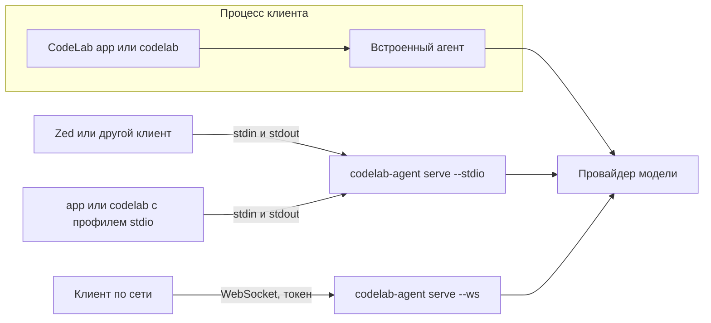

# Обзор: что умеет агент

Агент CodeLab — программа на Dart, которая ведёт разговор с моделью и выполняет работу в папке проекта. После этой главы вы будете знать, что агент делает сам, что спрашивает у вас и как он запускается.

## Что делает агент

Вы пишете задачу. Агент отправляет её модели вместе с правилами проекта и списком своих инструментов. Модель отвечает текстом или просит вызвать инструмент. Агент вызывает его и возвращает результат модели. Так он повторяет шаги, пока задача не решена или не исчерпан лимит хода.

С инструментами агент:

- читает и ищет файлы проекта;
- создаёт и правит файлы;
- запускает команды оболочки;
- ведёт список задач, который вы видите в клиенте;
- передаёт отдельные задания субагентам;
- подключает инструменты внешних MCP-серверов.

Опасные действия — правку файла, запуск команды — агент выполняет только по правилам режима разрешений. В режиме по умолчанию он спрашивает у вас. Подробно — в главах [«Инструменты»](04-tools.md) и [«Разрешения»](05-permissions.md).

Агент работает в одной папке — рабочей папке сессии. Файловые инструменты принимают только пути внутри неё; как именно это проверяется в каждом виде агента — в [главе о разрешениях](05-permissions.md#рабочая-папка).

Агент не создаёт собственного окна. Вопросы, ответы и список задач показывает клиент: CodeLab app, `codelab` или любой другой клиент ACP.

## Три способа запустить агента

Один и тот же агент работает в трёх видах.

| Вид | Как запускается | Когда нужен |
|---|---|---|
| Встроенный агент | внутри процесса app или `codelab`; отдельная программа не нужна | работа в app и в `codelab` — это вид по умолчанию |
| `codelab-agent serve --stdio` | клиент запускает программу как дочерний процесс и говорит с ней через stdin и stdout | Zed и другие клиенты, которые умеют запускать внешних агентов; профиль `stdio:…` в `codelab` и app |
| `codelab-agent serve --ws` | программа сама слушает порт и принимает клиентов по WebSocket с токеном | агент на другой машине или как сетевой сервис |

Ядро агента во всех трёх видах одно и то же: инструменты, режимы разрешений и сжатие контекста не зависят от вида. Различается, кто выполняет файловые операции и команды и что агенту доступно.

| Что | Встроенный | `serve --stdio` | `serve --ws` |
|---|---|---|---|
| Чтение и запись файлов проекта | агент сам, в процессе клиента | через клиента: он читает и пишет файлы | через клиента |
| Команды `exec` | агент сам, на вашей машине | в терминале клиента; без поддержки терминала у клиента `exec` не работает | в терминале клиента |
| `ls` и `search` | есть | есть, по файлам машины агента | нет |
| `AGENTS.md`, шаблоны команд, определения агентов, навыки | читаются | читаются | не читаются |
| MCP-серверы из конфигурации | работают | работают | отключены |
| Команды `/config` и `/mcp` | есть | есть | нет |
| Кто задаёт рабочую папку сессии | клиент | клиент | клиент |

Что именно отключено в `--ws`, агент пишет при старте в строке `host.plan` — [различия режимов](../operations.md#различия-режимов). Как встроенный агент выполняет файлы и команды сам — [мост встроенного агента](../../../../packages/dart/codelab_embedded/README.md).

Режим `--ws` намеренно сужен: клиент по сети может быть на другой машине и сам выбирает рабочую папку, поэтому агент не читает файлы своей машины без нужды.

## Когда что выбрать

- Работаете в app или `codelab` и вам хватает встроенного агента — ничего запускать не нужно. Достаточно [настроить модель](03-model-and-providers.md).
- Хотите открыть агента в Zed — [подключите `codelab-agent serve --stdio`](02-connect-clients.md#zed).
- Нужен агент на сервере, а клиент на ноутбуке — [`serve --ws`](01-install-and-run.md#запуск-по-сети-serve---ws); токен и защита порта — в [эксплуатации](../operations.md#сеть-и-безопасность).
- Хотите, чтобы app или `codelab` ходили к уже запущенному агенту — [профиль подключения](02-connect-clients.md#app-и-codelab-с-внешним-агентом).

Настройки — провайдеры, ключи, MCP-серверы, режим разрешений — общие для всех трёх видов: они читают одни и те же файлы `config.yaml`. Меняете файл один раз — действует везде, где агент читает этот файл.

## Что агент не умеет

В этой версии у агента нет инструмента для запросов в интернет и поиска в сети. Сетевые команды (`curl`, `git clone`) модель запускает через `exec`, а вывод таких команд агент помечает как недоверенный. Настройка `tools.disabled` принимается, но пока не применяется.

## Смотрите также

- [Настройка агента](../../../../docs/user/configuration.md)
- [Установка и запуск](01-install-and-run.md)
- [Оглавление руководства](../user-guide.md)
