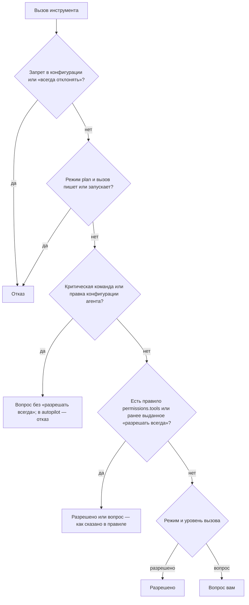

# Разрешения

Агент не выполняет опасные действия молча. Перед правкой файла или запуском команды он по правилам режима либо разрешает действие, либо спрашивает вас, либо отказывает. После этой главы вы знаете режимы, смысл каждого вопроса и то, что агент не делает никогда без вашего ведома.

Вопросы показывает клиент: [в app](../../../codelab_desktop/doc/user/04-permissions.md#отвечать-на-запросы-разрешений), [в `codelab`](../../../codelab_cli/doc/user/02-repl.md#разрешения), в Zed — [по инструкции Zed](../../../../docs/user/zed.md#разрешения-и-режимы). Здесь — правила, общие для всех клиентов.

## Режимы

Режим задаёт, что агент делает без вопроса. Новая сессия стартует в режиме `standard`.

| Режим | Чтение | Правка файлов | Команды и MCP-инструменты |
|---|---|---|---|
| `plan` | без вопроса | запрещена без вопроса | запрещены без вопроса |
| `ask` | вопрос | вопрос | вопрос |
| `standard` | без вопроса | вопрос | вопрос |
| `accept-edits` | без вопроса | без вопроса | вопрос |
| `bypass` | без вопроса | без вопроса | без вопроса |

- **`plan`** — агент только читает и составляет план. Попытка записать файл или запустить команду получает отказ `plan mode: changes are not allowed`. Режим нужен, чтобы изучить задачу, ничего не меняя.
- **`ask`** — агент спрашивает про каждый вызов, даже про чтение.
- **`standard`** — рекомендуемый режим: чтение свободно, правки и команды — с вашего разрешения.
- **`accept-edits`** — правки файлов выполняются без вопроса, команды — по-прежнему с разрешением. Осторожно: свободная запись не ограничена конфигурацией агента. Файлы вроде `.git/hooks/*`, `Makefile`, `package.json`, а также `AGENTS.md` и `CLAUDE.md` агент не считает критическими. Правка такого файла может заставить выполниться код при следующей команде, которую вы разрешите, или повлиять на будущие сессии. Просматривайте различия, не включайте режим в чужом проекте.
- **`bypass`** — агент не спрашивает ни о чём, кроме критических команд и правок конфигурации агента (см. ниже). Включайте его в доверенном проекте или в песочнице.

Есть и шестой режим, `autopilot`: как `bypass`, но там, где `bypass` задал бы вопрос, `autopilot` отказывает, потому что некому спросить. Он нужен для запуска без человека. Его включает только флаг `--permission-mode autopilot` у `codelab-agent serve`: селектор клиента, конфигурация, переменная `CODELAB_PERMISSION_MODE` и команда `/mode` его включить не могут.

**Обратное тоже верно.** Если агент запущен с `--permission-mode autopilot`, флаг перекрывает режим сессии: селектор, `/mode` и `permissions.mode` не действуют, пока вы не перезапустите агента без флага. При этом `/mode` отвечает `Mode: ask.`, а `/status` показывает выбранный режим, хотя действует `autopilot`. Правило `permissions.tools.<инструмент>: ask` в `autopilot` по-прежнему задаёт вопрос клиенту, а не отказывает. Запрещённые режимом `plan` действия в `autopilot` тоже не блокируются.

Названия и описания режимов агент сообщает клиенту при создании сессии. Реальный ответ `session/new`, выдержка (`availableModes`, описания по-английски, как их присылает агент):

```text
plan          Read and plan only, no changes
ask           Approve every call, including reads
standard      Reads without asking, edits and commands with approval
accept-edits  Reads and edits without asking, commands and network with approval
bypass        No approval except for critical commands, agent config edits and network access
```

Слова про сеть в двух описаниях относятся к уровню `network`. Он зарезервирован: ни один инструмент в этой версии им не пользуется, а команды `curl` и подобные идут как `exec`.

### Как сменить режим

| Способ | Что меняет | Когда действует |
|---|---|---|
| селектор режима в клиенте | текущую сессию | сразу, со следующего вызова |
| команда `/mode <режим>` | текущую сессию | сразу, со следующего вызова; допустимы `plan`, `ask`, `standard`, `accept-edits`, `bypass` |
| ключ `permissions.mode` в `config.yaml` | режим новых сессий | после перезапуска агента |
| флаг `--permission-mode` или переменная `CODELAB_PERMISSION_MODE` у `codelab-agent serve` | режим новых сессий | при запуске |

Команды `/mode` и `/status` агент выполняет сам, без модели. Реальные ответы агента (`>` — то, что набрано в поле ввода):

```text
> /mode ask
Mode: ask.
> /mode autopilot
Unknown mode: autopilot. Available: plan, ask, standard, accept-edits, bypass.
> /status
Model: local/qwen/qwen3-1.7b
Mode: ask
Working directory: ~/projects/demo
MCP servers: files (failed)
Config: ok
```

Проектный файл `.codelab/config.yaml` может только ужесточить режим: репозиторий не вправе смягчить то, что выбрали вы — [слои конфигурации](../../../../docs/user/configuration.md#слои-конфигурации).

## Как агент решает

Для каждого вызова агент проходит правила по порядку и останавливается на первом, которое сработало.



Что на схеме:

- «Запрет в конфигурации» — ключи `permissions.deny` и `permissions.tools` со значением `deny`.
- Правило `permissions.tools.<инструмент>: allow` не снимает ни режим `plan`, ни критические проверки.
- Отказ агент возвращает модели как данные: «Permission denied for <инструмент>: <причина>. Do not retry the same call». Ход при этом не обрывается, модель выбирает другой путь.

## Вопрос и четыре ответа

Когда агент спрашивает, клиент показывает: инструмент, аргументы, для записи — различие файла, а для критических вызовов — причину. Ответы:

| Ответ | Что значит |
|---|---|
| разрешить один раз | выполнить этот вызов |
| разрешать всегда | выполнять такие же вызовы до конца сессии без вопроса |
| отклонить один раз | отказать в этом вызове |
| отклонять всегда | отказывать в таких же вызовах до конца сессии |

<!-- screenshot: блок запроса разрешения в `codelab` (заголовок, команда, подсказка клавиш) -->

Что важно про «всегда»:

- «Такие же» — по инструменту и шаблону, а не по виду инструмента. Для `exec` шаблон — вся строка команды: разрешение на `dart test` не относится к `dart test --update-goldens`. Для `write` и `edit` — путь файла, для `skill` — имя навыка, для `agent` — имя типа субагента.
- Решения «всегда» живут в памяти сессии. После закрытия агента или `session/load` он спросит снова.
- Для критических вызовов вариант «разрешать всегда» не предлагается.
- Пока вы думаете над ответом, время хода не идёт: ожидание не входит в `budget.max_duration`.
- Если вы отменили ход, пока вопрос ждал ответа, вызов отменяется, а не отклоняется.

Если у клиента нет интерфейса вопросов, агент отказывает во всём, что требует вопроса: `no approval interface is available`. Сбой при отправке вопроса агент тоже считает отказом.

## Критические действия

Для этих вызовов агент спрашивает в любом режиме, в том числе в `bypass`, и не предлагает «разрешать всегда». В `autopilot` они запрещены.

**Критические команды `exec`:**

- рекурсивное удаление защищённого пути (`rm -rf /`, `rm -rf ~`), удаление каталога `.git`, `find … -delete` и рекурсивная смена прав защищённого пути;
- привилегированные команды (`sudo`);
- fork-бомба, запись в дисковое устройство, форматирование, перезапись системных файлов учётных записей, запись в конфигурацию SSH;
- «скачать и выполнить» (`curl … | sh`);
- остановка и перезагрузка машины, `kill` всех процессов;
- принудительный push в git, удаление удалённой ветки, переписывание истории;
- запись в конфигурацию агента (ниже).

Агент разбирает команду, а не ищет подстроку: `git commit -m "rm -rf /"` — обычная команда, а `sh -c 'rm -rf ~'` — критическая. Команду, которую не удалось разобрать, он тоже считает критической.

**Правка конфигурации агента.** Агент перечитывает свои файлы на лету, поэтому их меняет только человек. Критическими считаются `write`, `edit` и команды `exec`, которые пишут в `.codelab/config.yaml`, `.codelab/config.local.yaml`, `.codelab/agents/`, `.codelab/prompts/`, `.codelab/skills/`, `.agents/skills/`, а также в глобальный `$CODELAB_HOME/config.yaml`, файл секретов и каталоги агентов, шаблонов и навыков в `CODELAB_HOME`. Чтение этих файлов не ограничено. Без человека (в `autopilot`) агент отказывает: `Editing agent configuration requires a human: <путь>`.

Точная таблица критических шаблонов — в [документе разработчика по разрешениям](../../../../packages/dart/codelab_agent_core/doc/07-permissions.md#критические-команды).

## Своё правило для инструмента

Режим можно дополнить правилами в `config.yaml`:

```yaml
permissions:
  tools:
    exec: ask           # спрашивать про каждую команду, даже в accept-edits
    read: allow         # читать без вопросов, даже в режиме ask
  deny:
    - "exec:git push"   # точная команда: инструмент и шаблон через двоеточие
```

- `permissions.tools.<инструмент>` — `allow`, `ask` или `deny`.
- `permissions.deny` — список записей `<инструмент>:<шаблон>`. Запись сравнивается с шаблоном вызова целиком: для `exec` это вся строка команды, для файловых инструментов — путь относительно рабочей папки. Запрет проверяется раньше других правил и побеждает правило `allow`, но для `exec` он не граница безопасности: `git  push`, `git push origin` или `sh -c 'git push'` — другие строки и под запись не подпадают. Чтобы закрыть класс команд, используйте `permissions.tools.exec: ask` или `deny`.
- Правки `permissions.*` действуют после перезапуска агента. Если вы изменили глобальные `permissions` и открываете сессию в папке с собственным `.codelab/config.yaml`, агент откажется её открыть до перезапуска — [почему](../../../../docs/user/configuration.md#правки-после-перезапуска-и-сессии-других-папок).
- Файл проекта `.codelab/config.yaml` может только ужесточить режим. Пока проект не назван в `trusted_projects` вашего глобального конфига, так же действуют и его остальные правила: `deny` добавляется к вашему списку, а `permissions.tools` применяется, только если строже вашего.
- Командой правка выглядит так (значения — JSON): `codelab-agent config set permissions.tools '{"exec":"ask"}'`, `codelab-agent config set permissions.deny '["exec:git push"]'`. Неизвестное значение политики команда отклонит: `unknown tool policy (known: allow, ask, deny)`.

Ключ `permissions.timeout` (время ожидания ответа) схема принимает, но агент его пока не применяет.

## Рабочая папка

Файловые инструменты работают только внутри рабочей папки сессии. Абсолютный путь вне неё и путь с `../…` агент отклоняет до обращения к файлу. Модель получает ошибку `Path is outside the workspace: <путь>`.

Ссылки (symlink) наружу проверяются по-разному:

- **Встроенный агент** раскрывает ссылки и отклоняет путь, ведущий за пределы папки.
- **`codelab-agent serve --stdio` и `--ws`**: `read`, `write` и `edit` идут клиенту запросами `fs/*`, и ссылки раскрывает клиент. Сам агент проверяет только текст пути.
- **`ls` и `search` в `serve --stdio`** читают файлы машины агента напрямую и идут по ссылкам: ссылка `docs -> /etc` в папке проекта покажет содержимое `/etc`. Не держите в проекте ссылок на то, что нельзя показывать модели.

Для `exec` ограничен рабочий каталог команды: `cwd` вне папки сессии получает ту же ошибку `Path is outside the workspace: <cwd>`. Содержимое команды не проверяется: ограничен только каталог запуска. Команда `cat ~/.ssh/id_rsa` из рабочей папки выполнится, если вы её подтвердили; за содержимое отвечает ваш ответ на вопрос.

Исключение только для чтения — каталоги загруженных навыков вне рабочей папки: агент читает их, но записать туда не может — [навыки](06-project-context.md#навыки).

Рабочую папку выбирает клиент при создании сессии; у агента по WebSocket её задаёт клиент, а не машина агента.

## Субагенты

Субагент работает в режиме не мягче вашего: если вы в `ask`, субагент типа `plan` получает `ask` и запрет на запись и команды. Его вопросы приходят вам, а не ему: клиент показывает их по одному, с пометкой `[<тип>: <описание задания>]`. Решение «всегда» действует на всё дерево субагентов, включая решение «отклонять всегда». Подробнее — [субагенты](07-subagents-and-tasks.md).

## Смотрите также

- [Инструменты агента](04-tools.md)
- [Разрешения в Zed](../../../../docs/user/zed.md#разрешения-и-режимы)
- [Для разработчика: разрешения в ядре](../../../../packages/dart/codelab_agent_core/doc/07-permissions.md)
- [Оглавление руководства](../user-guide.md)
