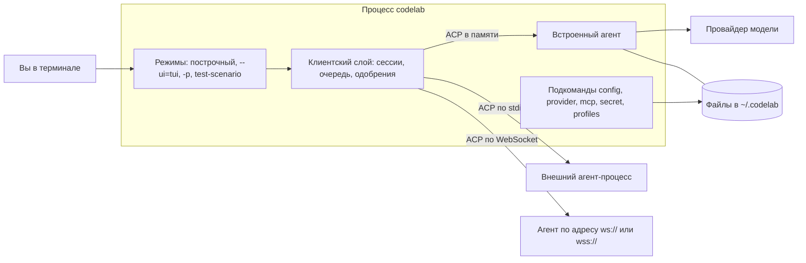

# Терминальный клиент CodeLab (`codelab_cli`)

`codelab` — терминальный клиент CodeLab. В нём можно работать с AI-агентом в диалоге (построчный режим или полноэкранный `--ui=tui`), выполнить один запрос из скрипта или CI (`-p`) и настроить агента: провайдеров модели, MCP-серверы, секреты и профили подключения. Как и CodeLab app, по умолчанию он запускает встроенного агента в своём процессе. `codelab-agent` — отдельная программа: это сам агент для подключения к другим клиентам, например к Zed.

Полноэкранный режим `codelab --ui=tui` после команды `/profile` (снимок нижней части окна 96×24):

```text
> /profile
Profile embedded (Embedded agent): embedded embedded-cli
>
Enter send · Shift+Enter/Alt+Enter new line · Esc/Ctrl+C cancel · PgUp scroll · ctrl+t tasks
embedded · standard · lmstudio/qwen/qwen3-1.7b
```

<!-- screenshot: PNG окна codelab --ui=tui во время хода агента (значок хода, ответ, статус-строка) — apps/codelab_cli/doc/images/tui-turn.png -->

## Кому какой документ

| Я хочу… | Читать |
|---|---|
| пользоваться `codelab` | [Руководство пользователя](doc/user-guide.md) |
| собрать, запустить в CI, разобраться с файлами и кодами выхода | [Эксплуатация](doc/operations.md) |
| менять код клиента | [Руководство разработчика](doc/README.md); обзор и карта кода — [Разработка](doc/development.md) |

## Быстрый старт

Команды выполняются из корня репозитория.

1. Подготовьте репозиторий и сгенерированный код — по шагу 1 из [запуска из исходников](../../docs/user/run-from-source.md#1-подготовка).

2. Соберите бинарь:

   ```bash
   fvm dart run melos run build:cli
   ```

   Появится файл `build/bin/codelab`.

3. Подключите провайдера модели. Проще всего запустить `build/bin/codelab` без аргументов в терминале: если провайдер не настроен, откроется мастер.

   ```text
   No model provider is configured for the embedded agent.
   Let's set one up. Press Ctrl+C to quit; run "codelab provider add" later to change it.
   ? API type
     › OpenAI
       Anthropic
       OpenRouter
       Ollama (local, no key)
       Custom OpenAI-compatible endpoint
       Custom Anthropic-compatible endpoint
   ```

   Другие способы — в разделе [«Настроить провайдера модели»](doc/user/06-providers.md).

4. Проверьте настройки:

   ```bash
   build/bin/codelab config check
   ```

   Для локальной модели из [примера с LM Studio](../../docs/user/configuration.md#пример-локальная-модель-lm-studio) вывод такой:

   ```text
   Sources: defaults, ~/.codelab/config.yaml
   Default model: lmstudio/qwen/qwen3-1.7b (config)
   Config: valid
   ```

5. Задайте вопрос по проекту в папке проекта:

   ```bash
   build/bin/codelab -p "Объясни, что делает этот проект"
   ```

   Ответ агента появится в stdout.

## Как устроено

На схеме — режимы `codelab` и то, с кем говорит каждый из них.



ACP (Agent Client Protocol) — протокол, по которому клиент и агент обмениваются сообщениями. Встроенный агент выбран по умолчанию; внешний агент выбирается явно флагом `-a`. Подкоманды настройки работают с файлами напрямую и агента не запускают.

## Смотрите также

- [Документация пользователя CodeLab](../../docs/user/README.md)
- [Эксплуатация CodeLab](../../docs/ops/README.md)
- [Правила приложения для разработчиков и агентов](AGENTS.md)
