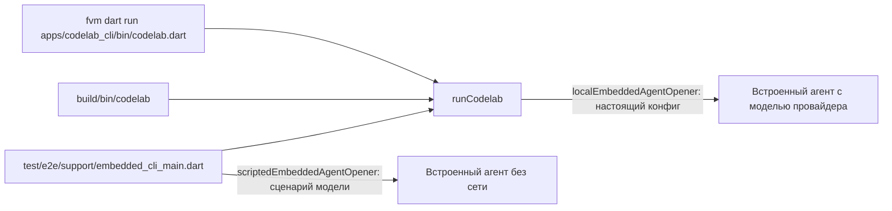

# Начало работы с кодом клиента

Эта глава для разработчика, который впервые открыл `apps/codelab_cli`. Она отвечает на практические вопросы: как подготовить репозиторий, как запустить `codelab` из исходников, как собрать бинарь, куда смотреть при отладке, как прогнать тесты и в какой файл идти с задачей. Устройство клиента объясняют остальные главы; сюда они ссылаются по месту. Оглавление руководства — [README](README.md).

## Подготовка репозитория

Шаги подготовки описаны в [запуске из исходников](../../../docs/user/run-from-source.md#1-подготовка). Здесь конспект; команды выполняются из корня репозитория.

1. Установите [FVM](https://fvm.app). Версия Flutter SDK лежит в `.fvmrc`; все команды Dart идут через `fvm`.
2. Поставьте SDK и свяжите пакеты:

   ```bash
   fvm install
   fvm flutter pub get
   fvm dart run melos bootstrap
   ```

3. Создайте сгенерированный код. В git его нет, без него бинарь и тесты не соберутся (`Error when reading '….freezed.dart'`):

   ```bash
   fvm dart run melos exec -c 1 --depends-on=build_runner -- "fvm dart run build_runner build --delete-conflicting-outputs"
   ```

Приложение написано на чистом Dart, но зависит от пакетов, которым нужен этот код (клиентский слой, мосты). Поэтому генерация нужна и для CLI.

## Три способа запустить `codelab`

На схеме три входа в один и тот же `runCodelab`. Они различаются тем, откуда берётся агент и видит ли программа терминал.



### Из исходников

Подходит для неинтерактивных запусков: `--version`, `--help`, подкоманды, headless `-p`.

```bash
fvm dart run apps/codelab_cli/bin/codelab.dart --version
```

```text
codelab 0.1.0
```

Под `tmux` (PTY) `dart run` передаёт терминал дочернему процессу, поэтому интерактив так тоже работает (проверено запуском), но стартует дольше бинаря. Из скриптов и инструментов, которые перехватывают вывод, `codelab` увидит pipe: построчный режим и `--ui tui` там не проверить, нужен `tmux` или `script` (ниже).

### Бинарь

```bash
fvm dart run melos run build:cli
build/bin/codelab --version
```

Скрипт `build:cli` — `fvm dart compile exe apps/codelab_cli/bin/codelab.dart -o build/bin/codelab`. Скрипт `build:cli` не входит в `melos run check`. Бинарь запускается так же, как установленный `codelab`.

### Тестовая точка входа со сценарием модели

Рабочий бинарь открывает встроенного агента настоящим `localEmbeddedAgentOpener`: ему нужны конфигурация, ключ и сеть. Чтобы увидеть ход без провайдера, e2e-тесты запускают `test/e2e/support/embedded_cli_main.dart`. Это тот же `runCodelab`, в который через шов `embeddedOpener:` подставлен открыватель со сценарием модели (`package:codelab_embedded/testing.dart`). В рабочий код `testing.dart` попасть не может — это проверяет сторож.

Из каталога `apps/codelab_cli` (снимки ниже получены этим запуском, `CODELAB_HOME` — пустая папка для опытов):

```bash
CODELAB_HOME=<папка> CODELAB_E2E_LLM_SCRIPT=test/e2e/llm_scripts/normal.json fvm dart run test/e2e/support/embedded_cli_main.dart -C <папка-проекта> -p "say hi"
```

```text
hello from compatible stdio agent
```

Сценарии лежат в `test/e2e/llm_scripts/*.json`: `normal`, `with_permission_request`, `with_critical_permission`, `with_tool_calls`, `hangs_until_cancel`, `prompt_error` и другие. Переменные точки входа описаны в её шапке: `CODELAB_E2E_LLM_SCRIPT` (обязательна), `CODELAB_E2E_PERMISSION_MODE`, `CODELAB_E2E_MODELS`, `CODELAB_E2E_SESSIONS_DIR`.

Если `CODELAB_HOME` пуст и нет `config.yaml` с провайдером, интерактивные режимы откроют мастер первого запуска ([глава 07](07-config-and-setup.md#первый-запуск)). Чтобы его не видеть, заранее добавьте провайдера на loopback-адрес — запросов в сеть при этом нет:

```bash
codelab provider add local --kind openai-compatible --base-url http://127.0.0.1:9/v1 --model demo-model --context-window 8192 --default
```

## Изоляция: `CODELAB_HOME` и ключи

Любой запуск для опытов делайте с отдельным `CODELAB_HOME` и без ключей провайдеров. Иначе `codelab` прочитает ваш настоящий `~/.codelab`, запишет в него историю и недавние проекты и может отправить запрос настоящему провайдеру.

```bash
env -u OPENAI_API_KEY -u ANTHROPIC_API_KEY -u OPENROUTER_API_KEY -u GEMINI_API_KEY \
  CODELAB_HOME="$PWD/.scratch/home" build/bin/codelab config path
```

Сетевые запросы к настоящим провайдерам при разработке не нужны: используйте сценарий модели, `test-scenario` ([глава 06](06-test-scenario.md)) или loopback-адрес вроде `http://127.0.0.1:9/v1`. Ход к такому адресу заканчивается ошибкой, которая сама по себе полезна для проверки пути ошибки:

```bash
codelab -p "hi"
```

```text
codelab: request failed after 4 attempts in 5.6 s: attempt 1 network (connection failed: _ClientSocketException); attempt 2 network (connection failed: _ClientSocketException); attempt 3 network (connection failed: _ClientSocketException); attempt 4 network (connection failed: _ClientSocketException) (network)
```

Код выхода этого запуска — `1`. Вывод получен бинарём с провайдером `http://127.0.0.1:9/v1` (порт 9 никто не слушает).

## Интерактивные режимы под терминалом

Построчный режим и TUI проверяют только в терминале. Под рукой два способа.

- `tmux` — удобнее всего: `tmux -L <имя> new-session -d -x 120 -y 40 "<команда>"`, ввод — `tmux -L <имя> send-keys`, снимок — `tmux -L <имя> capture-pane -p`; в конце — `tmux -L <имя> kill-server`. Так получены снимки этого руководства.
- `script -q <файл> <команда>` с `stty rows 40 cols 120` перед запуском: без размера окна Dart не считает вывод терминалом.

Запуск из исходников под `tmux` (PTY) тоже работает: `tmux -L <имя> new-session -d -x 120 -y 40 "fvm dart run apps/codelab_cli/bin/codelab.dart -C <папка-проекта>"` из корня репозитория. Он заметно медленнее бинаря: `dart run` сначала компилирует приложение.

## Подробный лог: `--verbose`

Без `--verbose` служебные записи не выводятся никуда: stdout headless несёт только ответ, а stderr — только сообщения хода. С `-v` в stderr идут диагностика соединения, журнал клиентского слоя и лог встроенного агента.

```bash
CODELAB_HOME=<папка> CODELAB_E2E_LLM_SCRIPT=test/e2e/llm_scripts/normal.json fvm dart run test/e2e/support/embedded_cli_main.dart -C <папка-проекта> -v -p hi 2>&1
```

```text
[info] secrets.backend.selected backend=env path=null reason=OS keychain backends are not available in this version; set secrets.backend: <redacted> or CODELAB_SECRET_* variables
[info] connection_state_changed category=application component=client connection_generation=1 from=ClientConnectionDisconnected to=ClientConnectionConnecting
[info] connection_state_changed category=application component=client connection_generation=1 from=ClientConnectionConnecting to=ClientConnectionInitializing
[info] connection_state_changed category=application component=client connection_generation=1 from=ClientConnectionInitializing to=ClientConnectionReady
hello from compatible stdio agent[info] prompt: Prompt completed with stopReason endTurn.

[error] In-process client transport peer closed the connection. category=application component=transport connection_generation=1 source=transport code=disconnected cause=AcpTransportException(AcpTransportErrorCode.disconnected): In-process client transport peer closed the connection.
[warning] connection_state_changed category=application component=client connection_generation=1 from=ClientConnectionReady to=ClientConnectionFailed
```

Ответ (stdout) и журнал (stderr) смешаны, потому что снимок снят с `2>&1`. Две последние строки идут после ответа: так клиентский слой записывает закрытие соединения при выходе. Код выхода запуска — `0`.

Строки `[info] …` — `CliLogger` (клиентский слой) и `CliEmbeddedLogger` (встроенный агент). Ключи и значения проходят `SecretRedactor`, управляющие символы терминала вырезаются. Для поиска проблем с секретами есть отдельный флаг `--debug-secrets`: он включает событие `secrets.lookup` (имя, назначение, источник, найден ли секрет) и без `--verbose`. Подробнее про логгеры — [глава 02](02-startup-and-composition.md#логгеры). Правила маскирования — в [«Маскирование секретов»](../../../packages/dart/codelab_client_acp/doc/redaction.md).

## Тесты

Из каталога `apps/codelab_cli`. Весь модульный набор без процессных тестов `test/e2e/`:

```bash
fvm dart test $(ls -d test/*_test.dart test/*/ | grep -v '^test/e2e/')
```

У модульных тестов тега нет, поэтому отделить их от процессных можно только путями. Один файл или один тест:

```bash
fvm dart test test/repl/commands/queue_test.dart
fvm dart test test/cli_args_test.dart --name "provider add"
```

Процессные и PTY-тесты запускаются так же, но агент выбирает переменная `CODELAB_E2E_AGENT` ([глава 09](09-testing.md#матрица-e2e-и-теги)). Тесты, которые нужны только scripted-агенту, при остальных значениях исключаются:

```bash
CODELAB_E2E_AGENT=embedded fvm dart test test/e2e/headless_print_basic_test.dart --exclude-tags scripted-only
```

Без `--exclude-tags scripted-only` в варианте `embedded` такие тесты падают с `embedded_cli_main: CODELAB_E2E_LLM_SCRIPT is not set`: у них нет сценария модели.

### Скрипты Melos

Скрипты запускаются из корня репозитория: `fvm dart run melos run <скрипт>`.

| Скрипт | Что делает | Когда запускать |
|---|---|---|
| `test:e2e:cli` | `fvm dart test apps/codelab_cli/test/e2e` против scripted stdio-агента из `codelab_acp_testing`; входит и в `test` | после правок, которые видны процессу |
| `test:e2e:cli:dart-agent` | `CODELAB_E2E_AGENT=dart`, без тега `scripted-only`: против `codelab-agent` со сценарием `--llm-script`; входит в `check` | изменён CLI, `apps/codelab_agent` или клиентский слой |
| `test:e2e:cli:embedded` | `CODELAB_E2E_AGENT=embedded`, без `scripted-only`: тестовая точка входа со сценарием модели; входит в `check` | изменён CLI, `codelab_embedded` или клиентский слой |
| `test:e2e:cli:python-agent` | тесты с тегом `python-agent` против Python-агента; только локально, в `check` не входит | почти никогда: Python-агент заморожен |
| `conformance:embedded` | `codelab test-scenario packages/dart/codelab_acp_testing/fixtures/acp --agent embedded`; с `CODELAB_TEST_REPORT_DIR` пишет JUnit `scenario-embedded.xml` | изменён встроенный агент или `test-scenario` |
| `guard` | сторож: импорты между пакетами, allowlist зависимостей, `dart:io` в `tui/core` | изменён `pubspec.yaml` или импорты |
| `build:cli` | компиляция бинаря в `build/bin/codelab` | нужен бинарь |

Состав скриптов задан в секции `melos:` корневого `pubspec.yaml`. Полный `melos run check` по просьбе пользователя; перед pull request запускают проверки затронутого (корневой [`AGENTS.md`](../../../AGENTS.md), §21). Тесты на устройстве для CLI не нужны: все его тесты идут на Dart VM.

## Что изменить, куда смотреть

| Задача | Куда идти | Глава |
|---|---|---|
| новый флаг `codelab` | `lib/src/cli_args.dart` (`_parser`, `CliOptions`, `_options`), потребитель в `lib/src/run.dart` | [10](10-extending.md#флаг-или-режим-запуска) |
| новая подкоманда | `cli_args.dart` (`CliCommand`, `_parser`, ветка в `parseCliArgs`), `run.dart` (`_run`) | [10](10-extending.md#подкоманда) |
| новая слэш-команда | `lib/src/repl/commands/`, список в `commands.dart` | [туториал](tutorial-new-command.md) |
| поведение блока одобрения | `lib/src/repl/approval_prompt.dart`; решения headless — `lib/src/headless/approval_policy.dart` | [03](03-repl.md#блок-одобрения), [05](05-headless.md#политика-одобрений) |
| как печатается ход в REPL | `lib/src/render/terminal_renderer.dart`, `tool_row.dart` | [03](03-repl.md#вывод-хода) |
| клавиши | `lib/src/input/key_bindings.dart`, декодер `key_decoder.dart`, TUI — `tui/tui_input.dart` | [03](03-repl.md#ввод), [10](10-extending.md#клавиша-tui) |
| кадр, прокрутка, композер TUI | `lib/src/tui/core/` | [04](04-tui.md) |
| запуск и закрытие `dart_tui` | `lib/src/tui/tui_runner.dart`, `tui_app.dart`, `tui_effects.dart` | [04](04-tui.md#адаптер-к-dart_tui) |
| коды выхода headless | `lib/src/headless/outcome.dart` (`exitCodeOf`), константы — `exit_codes.dart` | [02](02-startup-and-composition.md#коды-выхода), [05](05-headless.md#исход-хода-и-код-выхода) |
| профиль подключения из `--agent` | `lib/src/profiles/profile_arg.dart` | [08](08-profiles-and-home.md#формы---agent) |
| сборка клиентского слоя, резолверы | `lib/src/composition_root.dart`, `embedded_transport_resolver.dart` | [02](02-startup-and-composition.md#composition-root) |
| сигналы, выход | `lib/src/signals.dart`, `_runRepl`, `_runTui`, `_runHeadless` в `run.dart` | [02](02-startup-and-composition.md#сигналы-и-выход) |
| `config`, `provider`, `mcp`, `secret` | `run.dart` (`_runConfigCheck`, `_runConfigEdit`, `_runProvider`, `_runMcp`, `_runSecret`) | [07](07-config-and-setup.md) |
| мастер провайдера, `/settings`, первый запуск | `lib/src/setup/` | [07](07-config-and-setup.md) |
| `test-scenario` | `lib/src/scenario/` | [06](06-test-scenario.md) |
| `profiles.json`, `cli_history`, недавние проекты | `lib/src/home.dart`, `profiles/` | [08](08-profiles-and-home.md) |
| правило сторожа для приложения | `packages/dart/codelab_architecture_tests/test/support/rules.dart` | [01](01-overview.md) |

## Если что-то не работает

Типичные сбои сборки, запуска и тестов — в [частых проблемах](11-troubleshooting.md).
