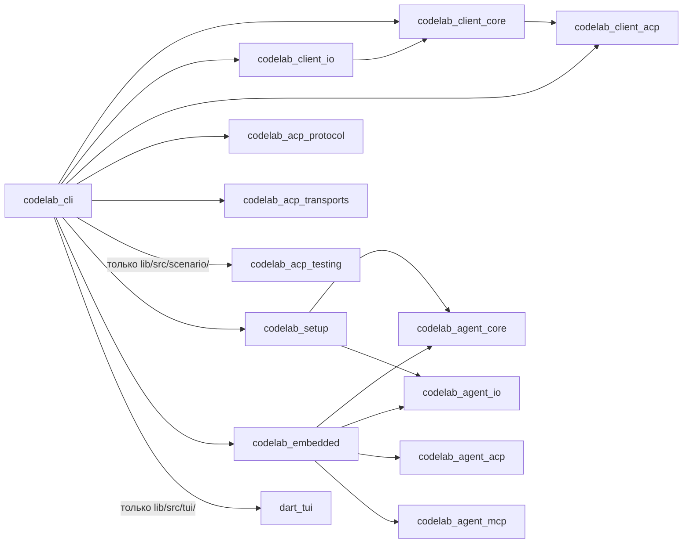

# Обзор: слои, зависимости, карта кода

Глава даёт общую картину терминального клиента `codelab`: где он стоит среди пакетов, от чего зависит, как разложен `lib/src/` и какие швы позволяют тестировать его без процессов. Остальные главы разбирают части подробно; читать их удобнее, когда карта уже в голове. Оглавление руководства — [README](README.md); правила изменений — в [`AGENTS.md`](../AGENTS.md) приложения.

## Место в архитектуре

`apps/codelab_cli` — приложение на чистом Dart, без Flutter. Своего состояния сессий, очереди промптов и одобрений у него нет: их владелец — клиентский слой `codelab_client_core` (`ClientWorkspace`, `SessionView`, `SessionHandle`). CLI отображает состояние и передаёт действия пользователя, так же как Cubit-ы CodeLab app.

Агентскую сторону CLI получает только через два моста: `codelab_embedded` (встроенный агент в процессе) и `codelab_setup` (команды конфигурации и секретов). Прямой импорт `package:codelab_agent_*` запрещён и проверяется сторожем (`melos run guard`).

Зависимости по `pubspec.yaml` приложения и его прямых зависимостей:

Кроме показанных, CLI зависит от `args`, `path` и `meta`. На схеме опущены зависимости внутри нижних слоёв: `codelab_client_io` зависит ещё от `codelab_client_acp`, а `codelab_client_*`, `codelab_embedded` и `codelab_agent_acp` — от `codelab_acp_protocol` и `codelab_acp_transports`. `codelab_setup` использует только `codelab_agent_core` и `codelab_agent_io`; ACP-сервер и MCP-клиент агента приходят только через `codelab_embedded`. Список разрешённых зависимостей CLI держит сторож (`cliAllowlist`); его расширение — через OpenSpec change.

Общая картина слоёв — [layers-and-dependencies.md](../../../docs/architecture/layers-and-dependencies.md) и [acp-boundary.md](../../../docs/architecture/acp-boundary.md). Что даёт каждый нижний слой, объясняют руководства [`codelab_client_core`](../../../packages/dart/codelab_client_core/doc/README.md), [`codelab_client_acp`](../../../packages/dart/codelab_client_acp/doc/README.md) и [`codelab_client_io`](../../../packages/dart/codelab_client_io/doc/README.md).

## Что приложение берёт у клиентского слоя

Чтобы читать код CLI, нужны шесть типов клиентского слоя. Они встречаются во всех главах.

| Тип | Что это | Кто его создаёт в CLI |
|---|---|---|
| `ClientWorkspace` | рабочее пространство: подключение к агенту по профилю, список сессий, события исхода ходов | `buildCliRuntime` ([глава 02](02-startup-and-composition.md#composition-root)) |
| `ConnectionProfile` | профиль подключения: `StdioProfile`, `WebSocketProfile`, `EmbeddedProfile` | `resolveAgentProfile` ([глава 08](08-profiles-and-home.md#формы---agent)) |
| `TransportResolver` | по профилю открывает транспорт ACP | `ioTransportResolver` и `EmbeddedTransportResolver` |
| `SessionHandle` | активная сессия: `send`, `cancel`, `respond`, `setConfigOption`, поток `view` | `openCliSession` или `/new`, `/resume` |
| `SessionView` | неизменяемая ревизия состояния сессии: транскрипт, статус, очередь, одобрения, опции, план, расход | клиентский слой; CLI только читает |
| `PromptOutcome` | исход одного промпта: `PromptCompleted`, `PromptFailed`, `PromptQueued` | клиентский слой, поток `ClientWorkspace.promptOutcomes` |

Режимы CLI делят между собой эту модель. REPL и TUI подписываются на `SessionHandle.view` и рисуют ревизии, headless выводит их в потоки процесса, а `test-scenario` вообще не создаёт `ClientWorkspace`: он гонит кадры ACP через транспорт напрямую ([глава 06](06-test-scenario.md)).

## Структура кода

| Путь | Что там |
|---|---|
| `bin/codelab.dart` | точка входа: `exit(await runCodelab(args, environment: Platform.environment))` |
| `lib/codelab_cli.dart` | барель для `bin/` и тестов |
| `lib/src/run.dart` | `runCodelab`: выбор режима, коды выхода, первый запуск, подкоманды настройки; единственное место импорта `package:codelab_setup/io.dart` |
| `lib/src/cli_args.dart` | парсер флагов (`package:args`), `CliOptions`, `UsageError`, тексты справки |
| `lib/src/composition_root.dart` | `buildCliRuntime`: `AcpClientApplication`, `ClientWorkspace`, резолверы транспортов; единственное место импорта `package:codelab_embedded/io.dart` |
| `lib/src/embedded_transport_resolver.dart` | резолвер встроенного агента: открывает и закрывает агента по профилю `embedded` |
| `lib/src/embedded_logger.dart`, `lib/src/cli_logger.dart` | логгеры агента и клиента в stderr при `--verbose` |
| `lib/src/cli_io.dart` | шов потоков и признаков терминала (`CliIo`, `ProcessCliIo`): тесты подставляют буферы |
| `lib/src/exit_codes.dart` | коды выхода `0`, `1`, `64`, `130`, `143` |
| `lib/src/home.dart` | `CodelabHome`: `CODELAB_HOME`, `profiles.json`, `recent_projects.json` (`recentProjectsFile`), `cli_history` |
| `lib/src/signals.dart` | `SIGINT`/`SIGTERM` через шов `SignalSeam` |
| `lib/src/session_setup.dart` | открытие сессии (новая, `--resume`, `--continue`) и опции `--model`, `--mode` до первого промпта |
| `lib/src/strings.dart` | английские строки REPL и TUI в одном месте |
| `lib/src/serve_alias.dart` | переходный алиас `codelab serve` |
| `lib/src/headless/` | режим `-p`: источник промпта, политика `--approve`, исход хода и его код выхода |
| `lib/src/repl/` | построчный режим: цикл `Repl`, блок одобрения, маршрутизатор и команды `/…` (`commands/`) |
| `lib/src/tui/core/` | чистое ядро полноэкранного режима: модель, сообщения, `reduce`, кадр; без `dart_tui` и `dart:io` |
| `lib/src/tui/` | адаптер ядра к `dart_tui` и терминалу (`TuiRunner`, `TuiApp`) |
| `lib/src/input/` | порт терминала, общий stdin (`SharedStdin`), декодер клавиш, редактор строки, реестр клавиш, история |
| `lib/src/render/` | поверхности вывода, рендер транскрипта, строки инструментов, очистка управляющих символов |
| `lib/src/profiles/` | разбор `--agent` и подкоманда `profiles` |
| `lib/src/setup/` | мастер провайдера, первый запуск, `/provider`, `/settings` |
| `lib/src/scenario/` | `test-scenario`: проигрывание фикстур, JUnit-отчёт; единственное место импорта `codelab_acp_testing` и `codelab_embedded/testing.dart` |

Где допустим `dart:io`, а где код должен оставаться чистым, — в [`AGENTS.md`](../AGENTS.md), §2. Сторож (`melos run guard`) проверяет импорты пакетов, а `dart:io` запрещает только в `lib/src/tui/core/`; остальные места `dart:io` он не проверяет.

## Как данные идут через режимы

На схеме — путь от пользователя до агента и обратно. Режимы разные, но состояние и ACP у них общие.

Правило одно: режим не хранит копию состояния сессии. Он берёт `SessionHandle.current` или подписывается на `SessionHandle.view`, а всё, что нужно только отображению (строка ввода, прокрутка, режим показа мыслей), держит у себя.

## Швы для тестов

Режимы не обращаются к `dart:io` напрямую; всё внешнее проходит через небольшие интерфейсы. Тесты подставляют на их место фейки, поэтому большая часть CLI проверяется без процессов и терминала.

| Шов | Где | Что заменяет в тесте |
|---|---|---|
| `CliIo` | `cli_io.dart` | stdout, stderr, признаки TTY; `FakeCliIo` собирает вывод в буферы |
| `Terminal` | `input/terminal.dart` | байты клавиш, raw-режим, ширина; `FakeTerminal` |
| `SignalSeam` | `signals.dart` | сигналы ОС и `exit` |
| `EmbeddedAgentOpener` | параметр `runCodelab(embeddedOpener:)` | открытие встроенного агента: сценарий модели вместо настоящего конфига |
| `ProfileStore`, `HistoryStore` | клиентский слой и `input/history.dart` | `profiles.json` и `cli_history` в памяти |
| `SetupCommands` | `setup/setup_commands.dart` | порт записи конфигурации для `/provider` и `/settings` |
| `ReplContext` | `repl/repl_command.dart` | всё, что слэш-команде нужно от REPL или TUI |
| `TuiReduce` | `tui/tui_app.dart` | функция ядра экрана внутри `TuiApp` |

Швы устроены по правилу: порт описывает интерфейс в чистом слое, `dart:io`-реализация живёт в composition root или в одном адаптере. Подробности использования — [глава 09](09-testing.md).

## Словарь

| Термин | Значение |
|---|---|
| REPL | построчный режим по умолчанию: ввод промпта и команд `/…`, вывод ходов в stdout |
| TUI | полноэкранный режим `--ui tui` на `dart_tui` |
| headless | режим `-p` или `-f`: один ход, ответ в stdout, код выхода |
| kit | сокращённое имя клиентского слоя `codelab_client_core`; встречается в комментариях и спецификациях |
| профиль подключения | запись «как подключиться к агенту»: команда `stdio:…`, адрес `ws://…` или встроенный агент |
| профиль хоста | имя набора возможностей встроенного агента: `embedded-cli` для CLI |
| шов (seam) | интерфейс, на место которого тест подставляет фейк |
| sealed-иерархия | закрытый набор вариантов; компилятор требует разобрать каждый (`TuiMsg`, `TuiCmd`, `HeadlessOutcome`, `CommandRoute`) |
| ядро экрана | чистая часть TUI (`tui/core/`): модель и функции без ввода-вывода |
| фикстура | JSON-сценарий обмена клиента и агента из корпуса `codelab_acp_testing` |

Идентификаторы `D6`, `TUI-5`, `H-01`, `U-03` в комментариях кода — решения `design.md` и пункты проектных документов; расшифровка есть в самих документах, на которые ссылается комментарий.

## Смотрите также

- [Руководство пользователя `codelab`](user-guide.md)
- [Эксплуатация `codelab`](operations.md)
