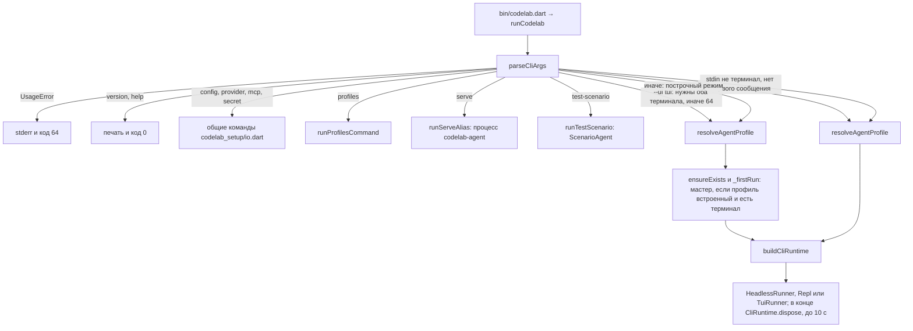

# Запуск и composition root

Глава описывает путь от `main` до работающего режима: как `runCodelab` разбирает аргументы, как выбирает режим, как `buildCliRuntime` собирает клиентский слой, как открывается встроенный агент, какие коды выхода возвращает процесс и как он завершается по сигналу. Режимы описаны в главах [03](03-repl.md), [04](04-tui.md), [05](05-headless.md) и [06](06-test-scenario.md). Оглавление руководства — [README](README.md).

## `runCodelab`

`bin/codelab.dart` — одна строка: `exit(await runCodelab(args, environment: Platform.environment))`. `exit`, а не `exitCode`: подписки на stdin и сигналы держали бы процесс живым после завершения клиента.

Вся логика — в `runCodelab` (`lib/src/run.dart`). Он нужен отдельной функцией, чтобы выбор режима, коды выхода и содержимое stdout были одними для процесса и для модульных тестов: тесты вызывают `runCodelab(args, environment: …, io: FakeCliIo(), embeddedOpener: …, signals: …)`. Параметры функции — это её швы ([глава 01](development.md#швы-для-тестов)):

| Параметр | По умолчанию | Для чего |
|---|---|---|
| `environment` | обязателен | окружение процесса: `CODELAB_HOME`, ключи, `NO_COLOR` |
| `io` | `ProcessCliIo` | stdin, stdout, stderr и признаки терминала |
| `embeddedOpener` | `localEmbeddedAgentOpener` | как открыть встроенного агента; тест подставляет сценарий модели |
| `signals` | `SignalSeam()` | сигналы ОС и выход |

Функция ловит два типа ошибок и переводит их в код `64`:

- `EmbeddedAgentConfigException` — невалидная конфигурация встроенного агента. Текст (проблемы загрузчика и подсказка `Configure the embedded agent in <home>/config.yaml; check it with: codelab config check`) идёт в stderr через `sanitizeTerminalText`: его собирает мост из файлов конфигурации.
- `UsageError` — ошибка использования. В stderr идёт `codelab: <сообщение>`; если у ошибки есть `usage` (справка подкоманды) или `showSecretUsage`, после пустой строки печатается справка. stdout остаётся пустым.

В `finally` вызывается `io.flush()`: `exit` не дожидается записи потоков.

Пример ошибки использования (stderr, код `64`):

```bash
codelab --foo
```

```text
codelab: Unknown flag --foo
```

 Невалидная конфигурация (пустой `CODELAB_HOME`):

```bash
codelab -p hi
```

```text
codelab: defaults: agent.default_model: no model is configured; add a provider with at least one model
Configure the embedded agent in ~/.codelab/config.yaml; check it with: codelab config check
```

Здесь путь замаскирован: на самом деле печатается настоящий `CODELAB_HOME`.

## Разбор аргументов

`parseCliArgs(args)` (`lib/src/cli_args.dart`) строит `CliOptions` на `package:args`. Порядок работы:

1. Если первое слово `serve`, возвращается `CliCommand.serveAlias` с остатком argv в `positional`. Проверка идёт до `ArgParser`: флаги `--help`, `--stdio`, `--port` принадлежат `codelab-agent`. Только первое слово: `codelab -v serve` — первое сообщение REPL.
2. Иначе argv разбирает общий `ArgParser` с подкомандами `profiles`, `config`, `provider`, `mcp`, `secret`, `test-scenario`. Ошибка разбора превращается в `UsageError`. Тексты не цитируют присланные слова, если в argv есть `secret`, `provider` или `mcp` (среди них могут быть ключи и значения заголовков) и если это `config set` или `config unset` (значение может начинаться с `-`): печатается фиксированная фраза вроде `invalid arguments for secret`.
3. `--help` и `--version` проверяются раньше подкоманд.
4. Подкоманды `test-scenario`, `config`, `provider`, `mcp`, `secret` обрабатываются каждая своей функцией. Всё остальное, что распознал `ArgParser` как команду, попадает в `CliCommand.profiles`. Поэтому новая подкоманда обязана получить свою ветку **до** этого общего случая ([рецепт](10-extending.md#подкоманда)).
5. Слова `sessions`, `update`, `login`, `logout`, `trajectory` (`_laterCommands`) дают `Unknown command <слово>`: они зарезервированы за будущими этапами и не должны уйти агенту первым сообщением.
6. Для режимов REPL и headless проверяются взаимоисключающие сочетания: `--print` и `--prompt-file` вместе, `-p`/`-f` вместе со словами, `--resume` вместе с `--continue`, `--ui tui` вместе с `-p`/`-f`.
7. Результат — `CliOptions`; режим — `headless`, если задан `-p` или `-f`, иначе `repl`.

Подкоманды записи (`config`, `provider`, `mcp`, `secret`) отвергают флаги подключения и запроса (`_connectionFlags`): `codelab config check --agent x` даёт `64` и `--agent does not apply to config check`. Общий `-C/--cwd` с `config`, `provider`, `mcp` разрешён — он задаёт папку проекта; с `secret` — нет.

### Флаги и их потребители

| Флаг | Поле `CliOptions` | Кто использует |
|---|---|---|
| `-a`, `--agent` | `agent` | `resolveAgentProfile` во всех режимах и у `test-scenario` (его собственный `-a`) |
| `-C`, `--cwd` | `cwd` | `_sessionFolder` (папка сессии); у подкоманд — папка проекта для слоёв конфигурации |
| `-m`, `--model` | `model` | `applyConfigFlag(session, 'model', …)` до первого промпта |
| `--mode` | `configMode` | `applyConfigFlag(session, 'mode', …)` |
| `-r`, `--resume` | `resume` | `openCliSession` → `session/load` |
| `-c`, `--continue` | `continueLast` | `openCliSession(last: true)`: последняя сессия папки |
| `-p`, `--print` | `prompt` | headless, `readPrompt` |
| `-f`, `--prompt-file` | `promptFile` | headless; `-` — stdin |
| `--approve` | `approve` | `HeadlessRunner` ([глава 05](05-headless.md#политика-одобрений)) |
| `--timeout` | `timeout` | `HeadlessRunner`; у `test-scenario` — ожидание кадра, по умолчанию `30s` |
| `--ui` | `ui` | REPL или TUI |
| `--no-color` | `noColor` | `selectOutputSurface` |
| `-v`, `--verbose` | `verbose` | логгеры, диагностика соединения |
| `--debug-secrets` | `debugSecrets` | `buildCliRuntime`, событие `secrets.lookup` |

Длительность `--timeout` — `90s`, `10m`, `1h30m`; ноль и число без суффикса — `UsageError` (`_parseDuration`). Полный текст справки печатает `cliUsage()`; список опций в нём берётся из `ArgParser.usage`, поэтому новый флаг появляется в `--help` сам.

## Выбор режима

На схеме — как `runCodelab` выбирает режим по разобранным аргументам.



Это `_run` в `run.dart`: `switch` по `CliCommand` с охраной для `repl`. Порядок охран важен: сначала `--ui tui` (нужны оба терминала), затем «stdin не терминал и нет первого сообщения» (это headless, H-01), и только потом REPL. Поэтому `echo "вопрос" | codelab` — headless, а `codelab "первое сообщение" < файл` — построчный REPL без терминала.

В интерактивных режимах `_firstRun` сразу возвращается, если профиль не встроенный (`profile is! EmbeddedProfile`) или stdin либо stdout не терминал. Headless не вызывает первый запуск и `CodelabHome.ensureExists`: не создаёт `profiles.json` и `cli_history` и не выставляет права `0700`. Встроенный агент при этом создаёт `$CODELAB_HOME/sessions/` (и сам `CODELAB_HOME`, если его нет) с правами по умолчанию (umask).

Ошибка разбора — `UsageError`: `runCodelab` печатает её в stderr и возвращает `64`, stdout остаётся пустым. Невалидная конфигурация встроенного агента приходит как `EmbeddedAgentConfigException` и тоже даёт `64`.

### Заготовка каждого режима

Три режима с агентом устроены одинаково (`_runRepl`, `_runTui`, `_runHeadless`):

1. Папка сессии: `_sessionFolder` нормализует `-C` или текущую папку; несуществующая — `UsageError('No such folder: …')`.
2. `CodelabHome.resolve(environment)` и `resolveAgentProfile(options.agent, …)`.
3. Только REPL и TUI: `home.ensureExists()` и `_firstRun`.
4. `_openProfileSecrets` и `_warnIfTokenSecretMissing`: хранилище секретов для токенов профилей `secret:<имя>`.
5. `buildCliRuntime` → `CliRuntime` с `workspace`.
6. Режим (`Repl`, `TuiRunner`, `HeadlessRunner`) получает `workspace`, профиль, папку и обратные вызовы.
7. `watchModeSignals` на всё время работы.
8. `try { run } finally { stopped = true; await runtime.dispose(); await signals.cancel(); }`.

Headless читает промпт раньше всего (`readPrompt`): пустой промпт — ошибка использования до подключения к агенту.

## Composition root

`buildCliRuntime` (`lib/src/composition_root.dart`) собирает клиентский слой так же, как CodeLab app:

1. `AcpClientApplication` с файловым вводом-выводом (`IoTextFileIo`) и терминалами (`IoTerminalProcessRunner`) из `codelab_client_io`. Его начальный транспорт — `_NotConnectedTransport`, который никогда не стартует: настоящий транспорт открывает резолвер при `ClientWorkspace.connect`.
2. `ClientWorkspace` с двумя резолверами транспорта: `ioTransportResolver` (профили `stdio` и WebSocket; токен берёт `ProfileSecretSource`) и `EmbeddedTransportResolver` (профиль `embedded`). Каждый резолвер отвечает на `supports(profile)`.
3. Встроенного агента открывает `localEmbeddedAgentOpener` с окружением процесса. Тестовая точка входа подменяет его сценарием модели через параметр `runCodelab(…, embeddedOpener:)`.

Файл — единственное место CLI, где разрешён `package:codelab_embedded/io.dart` (правило сторожа). Поэтому `buildCliRuntime` принимает `embeddedOpener`, а не создаёт его в режимах.

Политика payload (`protocolPayloads`): с `--verbose` клиент хранит полные payload ACP (после маскирования), иначе только метаданные. Кадров CLI не показывает, но запись `protocol_message` следует той же политике, что в app.

### Закрытие: `CliRuntime.dispose`

`dispose` закрывает рабочее пространство, затем резолвер встроенного агента — с таймаутом 10 секунд, — затем ядро клиента. Цепочка `try/finally` гарантирует, что сбой одного шага не оставит транспорт открытым. Резолвер закрывается раньше клиента, чтобы агент отменил ход и дописал журнал, пока клиентский конец жив. Если агент не остановился за 10 секунд, пишется событие `embedded.close_timeout` и **всегда** одна строка `codelab: the embedded agent did not stop in 10 s` в stderr, после чего выход продолжается. Обработчики сигналов снимаются только после этого: журнал сессии успевает дописаться.

## Встроенный агент

`EmbeddedTransportResolver` (`lib/src/embedded_transport_resolver.dart`) реализует `TransportResolver` для `EmbeddedProfile`. Он владеет жизненным циклом агента: один агент на соединение.

- `open` **сериализован**: следующий вызов ждёт окончания предыдущего, затем `dispose()` прежнего агента, затем открыватель. Два агента одного резолвера не пишут один журнал сессий одновременно.
- **Устаревший результат**: если пока открыватель работает, пришёл новый `open` или `close()`, агент, вернувшийся позже, сразу получает `dispose()` и не становится текущим; вызывающий получает `EmbeddedOpenCancelledException`. Иначе агент держал бы MCP-процессы и журнал без владельца. Номер поколения (`_generation`) отличает актуальный результат от устаревшего.
- `close()` идемпотентен, дожидается открытия в полёте и `dispose` текущего агента; после него `open` отклоняется.

Резолвер лежит в приложении, а не в пакете: он реализует порт клиентского слоя, а мост `codelab_embedded` не зависит от `codelab_client_*`. Общий пакет невозможен: `codelab_client_core` не может зависеть от `codelab_embedded` (allowlist сторожа). У CodeLab app свой почти такой же резолвер — `apps/codelab_desktop/lib/app/embedded_transport_resolver.dart`. Одинаковость поведения держат тесты обоих клиентов, поэтому правка здесь требует парной правки там.

Запуск агента по профилю `embedded` даёт профиль хоста `embedded-cli` (`embeddedHostProfile` в `profiles/profile_arg.dart`). Профиль встроенный: в `profiles.json` его нет, а `--agent embedded`, `--agent default` и отсутствие `--agent` дают один и тот же `embeddedCliProfile` ([глава 08](08-profiles-and-home.md#формы---agent)).

## Логгеры

В CLI два логгера, потому что порты `Logger` клиентского слоя и ядра агента — разные типы:

| Класс | Порт | Что пишет |
|---|---|---|
| `CliLogger` | `Logger` клиентского слоя | `[info] событие ключ=значение…` с уровня `info`; контекст проходит `SecretRedactor`, текст — `sanitizeTerminalText` |
| `CliEmbeddedLogger` | `Logger` ядра агента | то же для записей агента; ошибки — только `error_class=<тип>`, без текста; вариант `secretLookupsOnly` — только `secrets.lookup` |

Оба пишут только в stderr и только с `--verbose`. Без него `CliLogger.silent()` и `CliEmbeddedLogger.silent()` не пишут ничего: логгер ядра клиента по умолчанию писал бы JSON в stdout и ломал headless. С `--debug-secrets` (или `CODELAB_DEBUG_SECRETS=1`) без `--verbose` включается `CliEmbeddedLogger.secretLookupsOnly`. Файла лога у `codelab` нет.

## Коды выхода

Все коды объявлены в `lib/src/exit_codes.dart`; что они значат для скриптов, описывает [эксплуатация](operations.md#коды-выхода). Здесь — кто и где их возвращает.

| Код | Константа | Где возникает |
|---|---|---|
| `0` | `okExit` | `--version`, `--help`; конец REPL и TUI (`/exit`, Ctrl+D, двойной Ctrl+C); headless `end_turn` с непустым ответом; подкоманда выполнена |
| `1` | `failureExit` | не удалось подключиться или открыть сессию (REPL, TUI, headless); ошибка хода; пустой ответ; три ошибки ядра экрана подряд в TUI; `config check` нашёл ошибки; `test-scenario` с `FAIL` или без сыгранных фикстур; `profiles show` или `profiles remove` с неизвестным id; неожиданное исключение подкоманды (`codelab: <команда> failed: <тип>`; у `config check` — `codelab: config failed: <полный текст>`) |
| `64` | `usageExit` | `UsageError`, `EmbeddedAgentConfigException` |
| `130` | `sigintExit` | `SIGINT`; в headless — истёкший `--timeout` и ход, отменённый `stopReason: cancelled`; Ctrl+C в мастере настройки (в REPL и TUI отмена хода сама по себе процесс не завершает) |
| `143` | `sigtermExit` | `SIGTERM` |

Для headless код вычисляет одна функция `exitCodeOf` из исхода хода ([глава 05](05-headless.md#исход-хода-и-код-выхода)), а не из текста транскрипта.

## Сигналы и выход

`watchModeSignals` (`lib/src/signals.dart`) подписывает режим на `SIGINT` и `SIGTERM` на всё время его работы, включая `dispose` встроенного агента. Причина: пока агент завершается, процесс не должен остаться без обработчиков, иначе Ctrl+C ушёл бы в ОС без кода `130`, а журнал мог не дописаться.

Режим передаёт два замыкания: `onStop(code)` — отменить ход и выйти с `code`; `isStopped()` — режим уже закончился и идёт `dispose`.

- Пока `isStopped()` ложно, первый сигнал вызывает `onStop` (`Repl.interrupt`, `TuiRunner.interrupt`, `HeadlessRunner.interrupt`), второй выходит сразу (`forceExit`).
- Когда режим закончен, уже первый сигнал выходит сразу с кодом `130` или `143`: пользователь не должен ждать зависшего агента.
- REPL передаёт ещё `onSigint`: `SIGINT` вне raw-режима ведёт себя как Ctrl+C (`Repl.onSigint`), а не как остановка. В raw-режиме Ctrl+C приходит байтом клавиши, сигнала ОС нет.
- TUI использует свои сигналы, а не обработчик `dart_tui`: `SIGTERM` даёт код `143`, ход отменяется.
- `SIGTERM` в Windows не отслеживается.

Шов `SignalSeam` (`sigint`, `sigterm`, `sighup`, `forceExit`) заменяет потоки сигналов и `exit`: тест не может слать настоящие сигналы процессу, а `exit` из теста завершил бы сам тест. `sighup` нужен только алиасу `codelab serve` ([глава 08](08-profiles-and-home.md#алиас-codelab-serve)).

## Смотрите также

- [Глава 03: построчный режим](03-repl.md), [глава 04: TUI](04-tui.md), [глава 05: `-p`](05-headless.md)
- [Эксплуатация `codelab`](operations.md): коды выхода и файлы с точки зрения пользователя
- Руководство клиентского слоя: [`codelab_client_core`](../../../packages/dart/codelab_client_core/doc/README.md)
