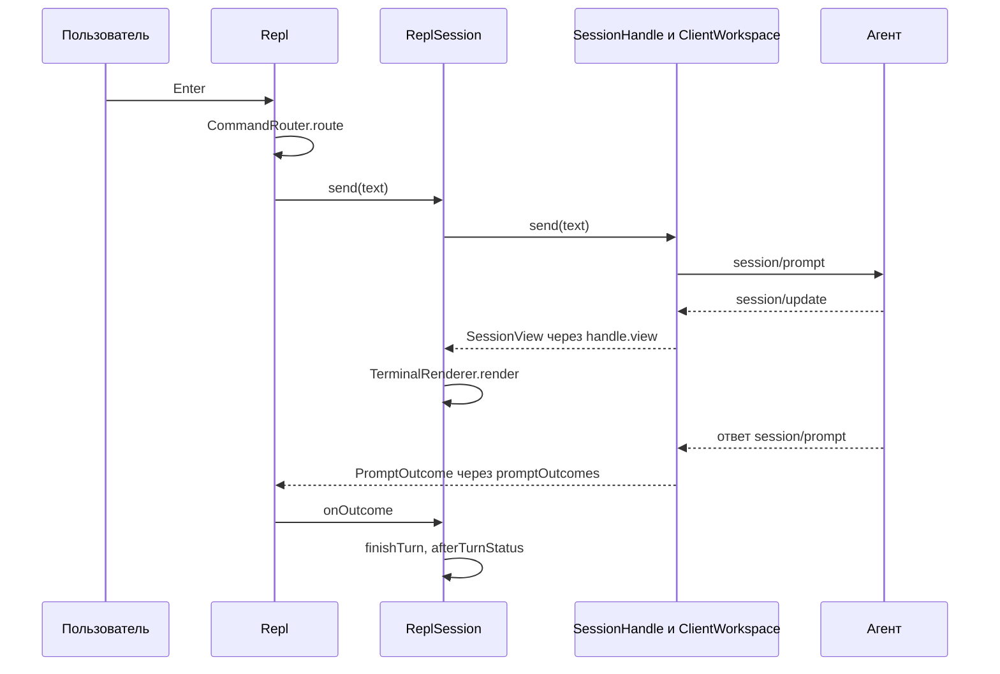
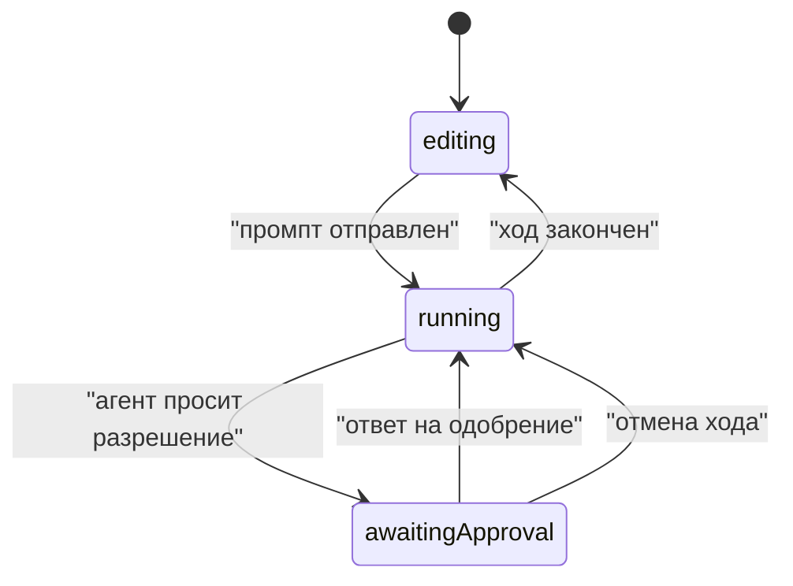

# Построчный режим (REPL)

REPL — основной режим `codelab`: пользователь вводит промпты и команды `/…`, а ответы агента печатаются построчно в stdout. Глава объясняет, из чего он состоит, как проходит ход, как работает ввод, маршрутизатор и блок одобрения и как ход превращается в строки на экране. Запуск режима описан в [главе 02](02-startup-and-composition.md); полноэкранный режим, который переиспользует те же команды, — в [главе 04](04-tui.md). Оглавление руководства — [README](README.md).

## Состав

| Часть | Файл | Ответственность |
|---|---|---|
| `Repl` | `repl/repl.dart` | владеет терминалом: режим stdin, строка ввода, история, клавиши, команды, выход; реализует `ReplContext` |
| `ReplSession` | `repl/repl_session.dart` | активная сессия: вывод ревизий, рисование строки ввода, учёт ходов |
| `CommandRouter` | `repl/command_router.dart` | разбор `/…` и Tab-дополнение |
| `ReplCommand` и команды | `repl/repl_command.dart`, `repl/commands/` | клиентские команды по файлу на команду |
| `ApprovalPrompt` | `repl/approval_prompt.dart` | текст блока одобрения и выбор варианта клавишей |
| `Terminal`, `IoTerminal` | `input/terminal.dart`, `input/io_terminal.dart` | порт терминала и реализация на `dart:io` |
| `KeyDecoder`, `KeyBindings`, `LineEditor`, `History` | `input/` | разбор байтов в клавиши, таблица клавиш, модель строки ввода, история |
| `TerminalRenderer` | `render/terminal_renderer.dart` | печать хода из ревизий `SessionView` |

REPL не хранит состояние сессии. Состояние хода, очередь и одобрения — у клиентского слоя; REPL владеет только терминалом (spec [`codelab-cli`](../../../openspec/specs/codelab-cli/spec.md), «Рендер хода в REPL», «Редактор строки и клавиши»).

## Жизненный цикл

`Repl.run()` возвращает код выхода (`0`, `1` или код сигнала). Порядок:

1. Загрузить историю (`HistoryStore.load`); сбой чтения — строка в stderr и пустая история.
2. `_open()`: `workspace.connect(profile, projectDirectory: cwd)`, обратный вызов `onConnected` (запись недавнего проекта), `openCliSession` (новая сессия, `--resume`, `--continue`), затем `applyConfigFlag` для `--model` и `--mode`. Любой сбой, кроме ошибки конфигурации встроенного агента, — код `1`: `codelab: cannot start the agent …: <причина>` в stderr, а для `SessionSetupError` (нет сессии для `--continue`, неизвестная опция) — `codelab: <сообщение>`. `EmbeddedAgentConfigException` пробрасывается наверх и становится кодом `64` ([глава 02](02-startup-and-composition.md#runcodelab)).
3. Подписаться на `workspace.promptOutcomes`: исход каждого хода активной сессии идёт в `ReplSession.onOutcome`.
4. Открыть ввод. С терминалом: `Terminal.enableRawMode()`, `KeyDecoder` и подписка на `Terminal.input`. Без терминала (pipe): ввод читается по строкам, каждая строка — как Enter.
5. Если есть первое сообщение, отправить его сразу.
6. Ждать `_exit`. В `finally` терминал восстанавливается на любом выходе, подписки отменяются, дожидается запись истории.

Выход: Ctrl+D на пустой строке, два Ctrl+C подряд в течение секунды (`exitWindow`), `/exit` или `/quit`, конец ввода (в терминале — сразу, с отменой хода; в pipe — когда у всех отправленных промптов, включая очередь, есть исход), сигнал (`Repl.interrupt`). `_finish(code)` отменяет идущий ход и ждёт ответа агента не дольше `cancelGrace` (2 секунды). Если открыт мастер `/provider add`, `_finish` даёт ему дописать запись, но не дольше 10 секунд.

## Ход

На диаграмме — путь одного промпта от Enter до строки на экране. Участники — объекты кода, а не процессы.



Три правила, которые стоит знать:

- `ReplSession.send` не ждёт ответа: `handle.send` возвращает исход позже, а пока ход идёт, клиентский слой сам ставит новый промпт в очередь. REPL лишь замечает рост `handle.current.queue` и печатает `queued: <n>`. Свою очередь REPL не ведёт; `/queue` читает очередь клиентского слоя.
- `ReplSession.outstanding` считает промпты без исхода. По нему pipe-режим понимает, что все ходы закончились.
- Каждая ревизия `SessionView` приходит в `onView`; ревизия, которая пришла синхронно с ответом, не теряется: перед итогом хода `onOutcome` повторно вызывает `render(handle.current)`.

### Состояния ввода

Ввод REPL — не набор флагов, а закрытый перечень `ReplInputState`, который вычисляется из `SessionView`:



- `editing` — ход не идёт; строка ввода открыта.
- `running` — статус `running` или `cancelling`; ввод открыт и уходит в очередь клиентского слоя.
- `awaitingApproval` — статус `running` и есть `pendingApprovals`; ввод промпта недоступен, клавиши выбирают вариант. Запрос, оставшийся в представлении после конца хода, ввод не блокирует.

Таблица клавиш зависит от состояния: `KeyBindings.actionFor(key, running: …)` выбирает привязку области `editing` или `running`, иначе привязку области `any`.

## Ввод

Путь клавиши: байты `Terminal.input` → `KeyDecoder` → `KeyEvent` (`TextKey` или `SpecialKey`) → `KeyBindings.mvp` → `KeyAction` → метод `LineEditor` или действие `Repl`.

- **`IoTerminal`** переводит терминал в raw-режим командой `stty` (`-icanon -echo -isig -icrnl -ixon -iexten`): `stdin.lineMode = false` в `dart:io` оставляет `ISIG` и `ICRNL`, и Ctrl+C пришёл бы сигналом, а Enter был бы неотличим от Ctrl+J. Настройки до режима (`stty -g`) возвращает `restore()`, он идемпотентен. Без `/dev/tty` и в Windows — запасной путь `echoMode`/`lineMode`.
- **`KeyDecoder`** собирает байты в клавиши: UTF-8, управляющие коды, `ESC [` и `ESC O`. Одиночный Esc отличается от начала последовательности только паузой: `escapeTimeout` по умолчанию 50 мс. `ESC CR` — Alt+Enter. Неизвестная CSI-последовательность отбрасывается целиком, неверный UTF-8 даёт `U+FFFD`. Печатаемые символы одного чтения, в том числе вставка, приходят одним `TextKey`.
- **`KeyBindings.mvp`** — единственный источник привязок. `/help keys` строится из той же таблицы, поэтому подсказка не разойдётся с поведением; конфликт двух действий на одной клавише даёт `KeyBindingConflict` при построении таблицы. Таблица полноэкранного режима — `KeyBindings.tui` ([глава 04](04-tui.md)).
- **`LineEditor`** — модель строки: буфер из кодовых точек, курсор, многострочность, история. Enter с `\` в конце строки превращает её в перевод строки (запасной путь для терминалов без Alt+Enter). Home и End работают в пределах строки многострочного ввода.
- **`History`** хранит до 1000 записей без повторов подряд. Файл — `$CODELAB_HOME/cli_history`, по записи на строку в виде JSON-строки, чтобы многострочный промпт пережил запись ([глава 08](08-profiles-and-home.md#история-ввода)). Повреждённая строка пропускается. В историю попадают и команды `/…`.
- **Строка ввода** рисуется только в терминале и только когда вывод стоит в начале строки (`ReplSession.drawInput`): пока ответ дописывается, она скрыта, а набранное остаётся в редакторе. Перед каждым выводом `hideInput` стирает её, после — `drawInput` рисует снова.

### Общий stdin

`io.stdin` читается одной подпиской, и её отмена закрывает fd 0. Мастер первого запуска и следующий за ним REPL или `dart_tui` должны читать один терминал, поэтому `run.dart` создаёт один `SharedStdin` и отдаёт его `stream` в `IoTerminal(input:)` и `TuiRunner(input:)`. Пока слушателей нет, подписка на паузе, и нажатия остаются в буфере ОС для следующего владельца. Тот же порядок действует для мастера `/provider add` внутри REPL: клавиши идут из подписки `Repl`, второй подписки нет.

## Маршрутизатор и команды

`CommandRouter.route(line, agentCommands:)` возвращает одну из четырёх закрытых веток `CommandRoute`:

| Ветка | Когда | Что делает REPL |
|---|---|---|
| `PromptRoute` | строка не начинается с `/` | отправляет промпт |
| `ClientCommandRoute` | `/<имя>` совпало с клиентской командой | выполняет `ReplCommand.run`; клиентская команда сильнее одноимённой команды агента |
| `AgentPromptRoute` | `/<имя>` — команда агента, либо `/agent:<имя>` | отправляет агенту промпт `/<имя> аргументы` |
| `UnknownCommandRoute` | ни клиент, ни агент такой команды не знают | печатает `Unknown command /<имя>`, запроса нет |

Команды агента берутся из текущего `SessionView.agentCommands`: новое `available_commands_update` действует сразу. Одноимённая команда агента доступна как `/agent:<имя>`. Tab (`CommandRouter.complete`) дополняет имя по `CommandCatalog` клиентского слоя: один кандидат подставляется с пробелом, несколько — общий префикс и список с пометкой `(agent)`.

Снимок под терминалом (`/help`, вывод сокращён в середине; бинарь `codelab`, встроенный агент, провайдер на loopback):

```text
> /help
Commands:
  /help [keys]                                     show the commands, or the keys with "keys"
  /exit                                            exit
  …
  /thoughts dim|collapsed|hidden                   show thoughts dimmed, collapsed or not at all
  /provider add|list|remove [<id>] [--local]       add, list or remove model providers
  /settings [<key> [<value> | --reset]] [--local]  show or change agent settings
Agent commands:
  /compact  Compact the session history
  /agent:mode  Switch the session mode
  /agent:model  Switch the model
  /status  Show the model, mode, working directory and MCP servers
  /usage  Show token usage and cost of the session
  /agent:config  Reload or check the agent config
  /mcp  List, reload, enable or disable MCP servers
  /agent:help  List commands
Run /help keys for the keys.
```

Видно правило приоритета: `/help`, `/mode`, `/model`, `/config` — клиентские, поэтому одноимённые команды агента получили префикс `/agent:`.

Tab после `/c`:

```text
> /c
  /config        show or set a config option
  /cancel        cancel the running turn
  /clear         clear the screen
  /compact       Compact the session history (agent)
  /agent:config  Reload or check the agent config (agent)
```

### Реестр команд

Команды объявлены в `repl/commands/commands.dart` двумя списками: `mvpReplCommands` и `replCommands = [...mvpReplCommands, ProviderCommand(), SettingsCommand()]`. `/help` и маршрутизатор берут команды из одного списка. И `Repl`, и `TuiRunner` используют `replCommands`.

| Команда | Файл | Что делает |
|---|---|---|
| `/help [keys]` | `help.dart` | список команд клиента и агента; `keys` — таблица клавиш |
| `/exit`, `/quit` | `exit.dart` | выход с кодом `0`, ход отменяется |
| `/new` | `new_session.dart` | новая сессия в папке REPL |
| `/sessions` | `sessions.dart` | сессии папки с номерами; до 10 страниц `session/list` |
| `/resume <n или id>` | `resume.dart` | открыть сессию из списка или по id и напечатать историю |
| `/mode`, `/model` | `mode.dart`, `model.dart` | опция конфигурации `mode` или `model` |
| `/config [id] [значение]` | `config.dart` | любая опция конфигурации сессии |
| `/cancel` | `cancel.dart` | отменить идущий ход |
| `/queue [drop <n> или clear]` | `queue.dart` | очередь промптов клиентского слоя |
| `/profile [id]` | `profile.dart` | показать профиль или подключиться к другому |
| `/reconnect` | `reconnect.dart` | переподключиться и перезагрузить сессию |
| `/plan` | `plan.dart` | текущий план |
| `/clear` | `clear.dart` | очистить экран |
| `/thoughts dim, collapsed или hidden` | `thoughts.dart` | режим показа мыслей до конца процесса |
| `/provider add, list или remove` | `provider.dart` | провайдеры модели ([глава 07](07-config-and-setup.md#provider-и-settings-в-интерактивных-режимах)) |
| `/settings` | `settings.dart` | настройки агента ([глава 07](07-config-and-setup.md#provider-и-settings-в-интерактивных-режимах)) |

`/mode` и `/model` без аргумента показывают значения опции и отмечают текущее; с аргументом отправляют `session/set_config_option`. Опция ищется по id, затем по категории. Устаревший `session/set_mode` клиентский слой не поддерживает.

### `ReplContext`

Команда не знает, REPL она или TUI: всё, что ей нужно, она берёт из `ReplContext` (`repl/repl_command.dart`). Интерфейс делится на три группы:

- состояние и клиентский слой: `workspace`, `session`, `cwd`, `profile`, `commands`, `keys`, `listedSessions`;
- общий вывод: `say(text)` печатает строку клиента, `exit(code)`, `cancelTurn()`, `openSession(handle, replay:)`, `switchProfile`, `reconnect`;
- то, что REPL и TUI показывают по-разному: `pick(PickerSpec)` (REPL печатает список, TUI открывает пикер), `showPlan`, `showSettings`, `thoughts`, `clearScreen`, `runWizard`.

Так одни и те же команды работают в обоих режимах. Если команде нужен новый вид вывода, который в REPL и TUI выглядит по-разному, он добавляется узким членом интерфейса, а не рендером целиком. Интерфейс реализуют `Repl`, `TuiCommandContext` и два тестовых контекста; новый член ломает их все, и это нормально ([глава 10](10-extending.md#слэш-команда)).

Ошибка команды не роняет REPL: `UsageError` печатается своим текстом, остальное — `codelab: /<имя>: <причина>`. Команды выполняются по одной: следующая строка ждёт предыдущую, как в shell (`_commands`).

Снимок (`/profile`, неизвестная команда, `/model`, `/queue`; встроенный агент):

```text
> /profile
Profile embedded (Embedded agent): embedded embedded-cli
> /nosuch
Unknown command /nosuch
> /model
Model (model):
  * local/demo-model  demo-model
> /queue
The queue is empty.
```

## Блок одобрения

Решение о действии агента принимает человек. Он должен видеть, что именно разрешает, и выбирать только из вариантов, которые предложил агент. `ApprovalPrompt.first(view, cwd:)` строит блок по первому элементу `SessionView.pendingApprovals`:

- заголовок и уровень риска (`read-only`, `unknown risk`, `local write`, `network`, `shell`, `destructive`) и пометка `critical`, если агент так отметил запрос;
- `command:` — команда вызова или первая строка `rawInput`; сериализованный объект аргументов не показывается;
- `cwd:` — папка сессии;
- подсказка только с клавишами предложенных вариантов.

Клавиши: `y` — разрешить один раз, `a` — разрешить всегда, `n` — отклонить один раз, `N` — отклонить всегда, `?` — показать `rawInput` целиком (секреты замаскированы `formatRedactedJson` клиентского слоя), `Esc` — отменить ход. Если вариантов вида нет, клавиша ничего не делает; Enter тоже. Если запрос исходит от субагента, блок начинается со строки о том, чей это запрос, и описанием его задачи.

Блок в REPL после промпта `run echo` (сценарий модели `with_permission_request`, точка входа `test/e2e/support/embedded_cli_main.dart`; папка замаскирована):

```text
> run echo
… echo hello
Permission: echo hello (shell)
  command: echo hello
  cwd: ~/projects/demo
  [y] allow once  [a] allow always  [n] reject once  [N] reject always  [?] details  [Esc] cancel
```

После `?`:

```text
{
  "command": "echo hello",
  "timeout": 30
}
  [y] allow once  [a] allow always  [n] reject once  [N] reject always  [?] details  [Esc] cancel
```

После `y` ход заканчивается итоговой строкой вызова и ответом:

```text
✓ echo hello 4.0s
approved
─ standard · scripted/scripted-1 · ctx 8%
>
```

Ответ на запрос отправляет `SessionHandle.respond(approvalId, optionId)`; ошибка ответа печатается строкой `codelab: cannot answer the permission request: …`. Решение для одного вызова инструмента не применяется к другому: идентификатор одобрения берётся из блока, который показан.

## Вывод хода

`TerminalRenderer` (`render/terminal_renderer.dart`) печатает ход построчно. Терминал умеет только дописывать, поэтому рендер помнит, что уже напечатал, и выводит только изменения ревизий, не повторяя текст. Рендер создаётся заново на каждую сессию (`Repl._attach`) и на каждую ревизию вызывает `render(view)`.

Что и когда выводится:

- ответ агента — хвост сверх уже напечатанного;
- мысли — по режиму `ThoughtsMode`: `dim` (по мере прихода, приглушённо), `collapsed` (одна строка `thought for <n>s`), `hidden`;
- вызов инструмента — строка при появлении и итоговая строка со временем (`toolRow`): `<значок> <название> <команда> <время>`, значки Unicode или ASCII (`supportsUnicode` по `LC_ALL`, `LC_CTYPE`, `LANG`);
- план — целиком, когда он изменился; список задач и вызовы субагентов — деревом с отступами;
- промпт пользователя и заметки — строкой `> текст`;
- `afterTurnStatus` — строка статуса после хода: режим, модель и сегменты расхода (`render/usage_segments.dart`).

### Поверхности вывода

`selectOutputSurface` выбирает поверхность один раз при старте по первому подходящему условию:

| Поверхность | Условие | Поведение |
|---|---|---|
| `raw` | stdout не терминал | ответ байт в байт, без ANSI и мыслей; строки инструментов, план и заметки — в stderr |
| `plain` | `TERM=dumb`, непустой `NO_COLOR` или `--no-color` | без последовательностей SGR |
| `ansi` | иначе | с цветом и атрибутами |

### Очистка текста

Весь текст сессии (ответ, мысли, заголовки инструментов, ошибки) приходит от агента, и `ESC` в нём мог бы менять цвет, двигать курсор или писать в заголовок окна терминала. Поэтому он проходит `sanitizeTerminalText`: управляющие символы C0 (кроме `\n`), DEL и C1 вырезаются, `\t` раскрывается в четыре пробела. Управляющие последовательности в вывод добавляет только сам рендер. Исключение — поверхность `raw` и stdout headless: там ответ выводится байт в байт, потому что это данные для скриптов.

Тот же принцип у логгеров ([глава 02](02-startup-and-composition.md#логгеры)) и у полноэкранного режима ([глава 04](04-tui.md)): любой текст из сессии перед выводом в терминал проходит `sanitizeTerminalText`.

## Смотрите также

- [Глава 04: полноэкранный режим](04-tui.md) — те же команды в TUI
- [Глава 10: расширение](10-extending.md) и [туториал новой команды](tutorial-new-command.md)
- Спецификация [`codelab-cli`](../../../openspec/specs/codelab-cli/spec.md): «Рендер хода в REPL», «Редактор строки и клавиши», «Одобрение в REPL», «Slash-меню и клиентские команды»
- Что видит пользователь: [руководство пользователя](user-guide.md#работать-с-агентом-в-диалоге)
