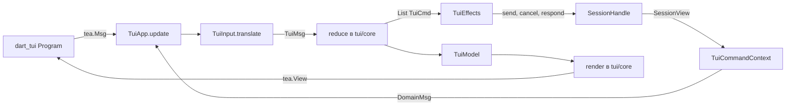

# Полноэкранный режим (TUI)

`codelab --ui tui` открывает рабочее место в альтернативном экране терминала: транскрипт, композер, строку подсказок и статус-строку. Глава объясняет устройство в два слоя: чистое ядро экрана `lib/src/tui/core/` (модель, сообщения, `reduce`, кадр) и адаптер к пакету `dart_tui` в `lib/src/tui/`. Запуск режима описан в [главе 02](02-startup-and-composition.md), команды `/…` — в [главе 03](03-repl.md). Оглавление руководства — [README](README.md).

## Зачем два слоя

Ядро экрана не импортирует ни `package:dart_tui`, ни `dart:io` (инвариант TUI-5; два правила сторожа, `melos run guard`). Из этого следует всё остальное:

- клавиши, вставка, прокрутка, одобрения и кадр проверяются модульными тестами как обычные функции, без терминала;
- версия `dart_tui` не влияет на логику экрана: адаптер переводит сообщения пакета в сообщения ядра и обратно;
- ввод-вывод описан командами-данными (`TuiCmd`), которые сравниваются в тестах по значению.

Состояния сессии у TUI нет, как и у REPL: ход, очередь и одобрения идут через `SessionHandle` и `SessionView` клиентского слоя. Ядро держит только локальное состояние экрана рядом с последней ревизией.

## Поток данных

На схеме — как сообщение проходит от терминала до кадра и обратно. Слева от `reduce` всё чисто, справа — адаптер.



## Ядро экрана

### Модель

`TuiModel` (`tui/core/tui_model.dart`) неизменяема; её меняет только `reduce`. Поля:

| Поле | Что хранит |
|---|---|
| `session` | последняя ревизия `SessionView` |
| `composer` | `ComposerState`: строки, курсор `(row, column)`, история, позиция в ней |
| `scroll` | `ScrollState`: следование за выводом или удержание окна, `top`, `holdTotal` |
| `notes` | строки клиента (`TuiNote`: вывод команд, ошибки), привязанные к месту в транскрипте |
| `thoughts` | режим показа мыслей |
| `turnStartedAt`, `lastInterrupt` | начало хода для статус-строки; первый Ctrl+C для выхода по второму за секунду |
| `overlay` | открытый пикер, мастер провайдера или экран настроек |
| `detailsFor`, `tasksHidden`, `detailsExpanded` | раскрытый `rawInput` одобрения; свёрнутый список задач; раскрытые строки `agent` |
| `size`, `layout`, `unicode`, `color`, `cwd`, `commands`, `profile` | данные окружения; `layout` — мемоизация строк транскрипта, общая для `reduce` и `render` |

Время, от которого зависит решение (двойной Ctrl+C, начало хода), приходит в самом сообщении (`at`): ядро не читает часы.

### Сообщения и команды

Сообщения (`tui_msg.dart`) и команды (`tui_cmd.dart`) — закрытые иерархии (`sealed`). Компилятор требует разобрать каждый вариант в `reduce` и в `TuiEffects`: пропущенную ветку покажет анализатор.

| Сообщение `TuiMsg` | Что означает |
|---|---|
| `KeyMsg`, `PasteMsg`, `ResizeMsg` | ввод пользователя и размер терминала |
| `SessionViewMsg`, `SessionAttachedMsg` | новая ревизия сессии; активной стала другая сессия (`/new`, `/resume`, `/profile`) |
| `NoteMsg`, `EffectFailedMsg`, `ClearNotesMsg` | строка клиента в транскрипт; сбой команды заметкой; `/clear` |
| `OpenPickerMsg`, `PickerChosenMsg`, `PickerClosedMsg` | пикер: открыть, выбран пункт, закрыт без выбора |
| `ThoughtsMsg` | `/thoughts`: новый режим показа мыслей |
| `OpenWizardMsg`, `WizardStateMsg` | мастер `/provider add`: открыть, новое состояние автомата |
| `OpenSettingsMsg`, `SettingsAppliedMsg` | экран `/settings`: открыть, исход записи |

| Команда `TuiCmd` | Что делает адаптер |
|---|---|
| `SubmitCmd(text)` | `SessionHandle.send`: во время хода клиентский слой ставит промпт в очередь |
| `CancelTurnCmd` | `SessionHandle.cancel` |
| `RespondCmd(approvalId, optionId)` | `SessionHandle.respond` |
| `RunCommandCmd(line)` | клиентская команда или команда агента |
| `SaveHistoryCmd(entries)` | запись `cli_history` |
| `QuitCmd(code)` | запомнить код выхода и закрыть программу |
| `WizardEventCmd`, `ApplySettingCmd` | событие мастеру; запись настройки |

### `reduce`

`reduce(model, msg)` возвращает пару «новая модель, список команд» (`tui_update.dart`). Правила, которые стоит знать:

- Клавиши идут в порядке приоритета: модальный экран (мастер, настройки) → зона одобрения → композер. Поэтому в модальном экране Enter не отправляет промпт, а Esc закрывает экран, а не отменяет ход.
- Ревизия старше последней отбрасывается (`view.revision < current.revision`), кроме `SessionAttachedMsg`: у каждой сессии свой счётчик ревизий.
- Начало хода берётся из времени сообщения; пока ход идёт, `turnStartedAt` сохраняется.
- Enter с `/` в начале — `RunCommandCmd`, а сама строка остаётся в транскрипте заметкой `> /команда`, потому что клиентский слой её не видит. Иначе — `SubmitCmd`. Оба пути добавляют `SaveHistoryCmd`.
- Двойной Ctrl+C вне хода: первый очищает композер и записывает `lastInterrupt`, второй за `exitWindow` (1 секунда) даёт `QuitCmd(0)`. Во время хода Ctrl+C и Esc отменяют ход.
- Tab дополняет команду; если кандидатов несколько, открывается пикер с действием `insert`: выбор подставляет команду в композер, а не исполняет.
- Выбор в пикере с действием `run` — та же команда с аргументом, например `/model b`; строка остаётся в транскрипте.
- Прокрутка: PgUp и PgDn листают, End возвращает следование за выводом. При удержании окна вверху появляется счётчик «↓ N new».

Исключение внутри `reduce` не должно ронять экран: `TuiApp` оставляет прежнюю модель, а третья ошибка подряд завершает программу кодом `1` ([ниже](#адаптер-к-dart_tui)).

### Кадр

`render(model, chrome)` (`tui_view.dart`) возвращает `Frame`: ровно `size.rows` строк и позицию курсора. `dart_tui` пишет содержимое как есть и не режет строки шире экрана: длинная строка перенеслась бы терминалом и сдвинула весь кадр. Поэтому ширину считает и строки режет наш рендер: `fitLine` — последний шаг каждой строки (обрезка по графемам и сброс атрибутов, TUI-9), `wrapLine` переносит текст сессии, `displayWidth` считает колонки без SGR. Для символов, ширину которых терминалы считают по-разному, строке оставляется запас в одну колонку.

Сверху вниз:

1. транскрипт, прижатый к низу окна;
2. строки пикера (не выше половины экрана);
3. строка «↓ N new» при удержании окна;
4. блок задач `Tasks <c>/<n> done · ctrl+t hide`, если у сессии есть план;
5. зона одобрения или композер (до 10 строк, дальше прокрутка внутри), либо модальный экран вместо них;
6. строка подсказок (при высоте экрана 15 строк и больше; в зоне одобрения и пикере её нет);
7. статус-строка: спиннер и время хода, профиль, режим, модель, очередь, расход.

Текст из сессии попадает в кадр только после `sanitizeTerminalText` (TUI-11); строки инструментов строятся тем же правилом, что в REPL, и не содержат `rawInput` (TUI-6).

`TuiChrome` — готовые строки компонентов пакета: значок хода, пикер, подсказки. Ядро пакет не импортирует, поэтому адаптер передаёт их в `render` строками.

Снимок кадра сразу после запуска (бинарь `codelab --ui tui` в `tmux` 120×40, встроенный агент; пустые строки сверху, где транскрипта ещё нет, опущены):

```text
>
Enter send · Shift+Enter/Alt+Enter new line · Esc/Ctrl+C cancel · PgUp scroll · ctrl+t tasks · ctrl+o details
embedded · standard · local/demo-model
```

Строка подсказок строится из того же реестра клавиш, что и обработка (`RegistryKeyMap` → `HelpModel`), поэтому разойтись с поведением не может.

После `/profile` и `/model`: ответ команды в транскрипте и пикер значений опции.

```text
> /profile
Profile embedded (Embedded agent): embedded embedded-cli
> /model
Model (model):

› local/demo-model  demo-model
1 items
>
embedded · standard · local/demo-model
```

Ход с запросом разрешения (сценарий модели `with_permission_request`, точка входа `test/e2e/support/embedded_cli_main.dart`; строки с папкой сессии заменены на `…`):

```text
> run echo
… echo hello
Permission: echo hello (shell)
  command: echo hello
cwd:
…
  [y] allow once  [a] allow always  [n] reject once  [N] reject always  [?] details  [Esc] cancel
⠏ 2s · embedded · standard · scripted/scripted-1
```

Здесь вместо композера зона одобрения, строки подсказок нет, а курсор скрыт. После `y`:

```text
> run echo
✓ echo hello
approved
>
Enter send · Shift+Enter/Alt+Enter new line · Esc/Ctrl+C cancel · PgUp scroll · ctrl+t tasks · ctrl+o details
embedded · standard · scripted/scripted-1 · ctx 8%
```

### Одобрения, пикеры, оверлеи

- **Зона одобрения.** Строится тем же `ApprovalPrompt`, что блок REPL ([глава 03](03-repl.md#блок-одобрения)). Клавиши `y`, `a`, `n`, `N` дают `RespondCmd`; `?` переключает показ `rawInput` не выше половины экрана; прокрутка и переключатели (`ctrl+t`, `ctrl+o`) работают и здесь. Строки переносятся по ширине, а подсказка — целыми пунктами, чтобы клавиша не оторвалась от подписи.
- **Пикер.** `PickerOverlay(spec)` в модели; сам список рисует `ListModel` пакета в адаптере. Enter выбирает, Esc вне режима фильтра закрывает, `/` включает фильтр.
- **Модальные экраны.** `ProviderWizardOverlay` (мастер `/provider add`) и `SettingsOverlay` (экран `/settings`) занимают место зоны одобрения и композера. Клавиши и вставка идут им раньше всего, ход при закрытии экрана не отменяется, ожидающее одобрение видно в статус-строке (`approval pending · esc to answer`), а зона вернётся после закрытия. Тексты шагов мастера — только `wizardStepOf`, запись настройки — `applySetting`; у оверлея своих текстов и проверок нет ([глава 07](07-config-and-setup.md)). Значение секрета в кадре — только маска `*`; Ctrl+R показывает и прячет значение.

Экран `/settings` (тот же запуск; строки транскрипта выше экрана и часть строк таблицы опущены, путь файла в заголовке заменён на `…`):

```text
> /settings
Settings · /settings · user …
                   key · value · source
› Models       │ › agent.default_model  local/demo-model  user
  Agent        │   providers.local.models.demo-model.context_window  8192  user
  Providers    │   providers.local.models.demo-model.max_output_tokens  (not set)  default
  Permissions  │   providers.local.models.demo-model.name  (not set)  default
  …
↑↓ move · enter edit · ←→ choose · tab section · r reset · esc close
embedded · standard · local/demo-model · ctx 27%
```

## Адаптер к `dart_tui`

| Класс | Файл | Роль |
|---|---|---|
| `TuiRunner` | `tui_runner.dart` | запуск режима: подключение, сессия, `Program`, гарантия восстановления терминала |
| `TuiApp` | `tui_app.dart` | модель `dart_tui` (`tea.Model`): `update` и `view` вызывают ядро |
| `TuiInput` | `tui_input.dart` | перевод сообщений пакета в `TuiMsg` |
| `TuiEffects` | `tui_effects.dart` | исполнение `TuiCmd` в функциях `Cmd` пакета |
| `TuiCommandContext` | `tui_command_context.dart` | `ReplContext` для TUI: команды печатают заметками |
| `RegistryKeyMap` | `registry_key_map.dart` | реестр клавиш как `KeyMap` пакета: источник строки подсказок |

### `TuiRunner.run`

1. Загрузить историю.
2. Подключиться, как REPL: `connect`, `onConnected`, `openCliSession`, `--model` и `--mode`. Сбой — `codelab: cannot start the agent …` (для `SessionSetupError` — `codelab: <сообщение>`) и код `1`; `EmbeddedAgentConfigException` — наверх, код `64`.
3. Собрать `TuiEffects`, `TuiApp` с начальной моделью (`TuiModel.initial`) и `tea.Program(options: [withAltScreen(), withFps(60), …])`.
4. `program.run(app)` запускается до первого `await`, поэтому отправленные сразу сообщения не теряются. Затем создаётся `TuiCommandContext`, он вызывает `attach(handle)`: подписывается на `SessionHandle.view` и шлёт `SessionViewMsg` через `program.send(DomainMsg(...))`. Сменяется сессия — `attach` снова.
5. Подписаться на `workspace.promptOutcomes`: отмена и сбой хода без заметки клиентского слоя — строкой клиента, как в REPL.
6. Отправить первое сообщение, если есть.
7. `await done`. В `finally`: закрыть контекст, отписаться, восстановить терминал.
8. Отменить идущий ход (ожидание не дольше `cancelGrace`, 2 секунды), напечатать итог в обычный экран и вернуть `_code ?? 0`.

Итог после выхода: последний ответ агента и статус-строка остаются в прокрутке обычного экрана терминала (`_printSummary`).

Код выхода: первый заданный побеждает (`_code ??= …`), поэтому сигнал раньше `QuitMsg` сохраняет свой код. Сигналы режима — `watchModeSignals` с `tui.interrupt`: он заводит код и закрывает программу, отмена хода идёт после выхода из цикла.

### Восстановление терминала

`Program` включает режимы терминала: расширенные клавиши, мышь, фокус, bracketed paste, альтернативный экран, скрытый курсор. Выключить их при любом выходе — обязанность нашего кода, чтобы TUI-4 не зависел от версии пакета. `TuiRunner` в `finally` пишет последовательности выключения (`_restoreSequences`) и возвращает `echoMode` и `lineMode` stdin; повтор безвреден.

### `TuiApp`

`update` обрабатывает по порядку:

1. тик значка хода (раз в 100 мс, пока ход идёт);
2. клавиши открытого пикера (они уходят в `ListModel`, а Enter и Esc превращаются в `PickerChosenMsg` и `PickerClosedMsg`);
3. иначе — `DomainMsg` берётся как есть, остальные сообщения переводит `TuiInput`.

`_apply` вызывает `reduce`. Исключение оставляет прежнюю модель; третье подряд завершает программу командой `QuitCmd(1)`, а текст ошибки печатается после восстановления терминала (`codelab: the screen failed: …`). `view()` вызывает `render`; ошибка рендера оставляет прошлый кадр. Новый размер терминала (`ResizeMsg`) вызывает полную перерисовку: построчный diff пакета не стирает хвосты строк прошлого, более широкого кадра.

### `TuiInput`

Перевод `tea.KeyPressMsg` в `KeyMsg`: `shift+enter` и `alt+enter` — отдельные клавиши, Ctrl+буква — свои `Key`. Распознаются Ctrl+A, C, D, E, L, O, R, T, U; остальные Ctrl-сочетания теряются. Ctrl+J `dart_tui` присылает как Enter, поэтому в таблице TUI его нет, а новая строка — Shift+Enter и Alt+Enter. Отчёты терминала (`KeyboardEnhancementsMsg`, `ModeReportMsg`) ядру не нужны.

Таблица клавиш TUI — `KeyBindings.tui`. От REPL она отличается: нет Ctrl+J, добавлены PgUp, PgDn, End (следование за выводом), Ctrl+T (список задач) и Ctrl+O (строки `agent`); конец строки — только Ctrl+E.

### `TuiEffects`

Каждая `TuiCmd` становится `Cmd` пакета. Исключение команды возвращается как `DomainMsg(EffectFailedMsg(error))`: иначе обработчик пакета напечатал бы его поверх кадра и завершил программу. Сессия читается в момент исполнения (`session()`): после `/resume` это уже новая сессия.

### `TuiCommandContext`

Реализует `ReplContext`, поэтому слэш-команды работают без изменений: `say` → `NoteMsg`, `pick` → `OpenPickerMsg`, `clearScreen` → `ClearNotesMsg`, `thoughts` → `ThoughtsMsg`, `showPlan` → заметка, `openSession` → `attach`. Он же — единственный владелец подписки на `flow.states` мастера провайдера и порта записи настроек. `turnRunning` у него всегда `false`: отказ «сначала закончите ход» относится к построчному REPL, где вопросы мастера смешались бы с выводом хода, а в TUI мастер модальный.

## Тесты

Ядро проверяется без терминала: `reduce` вызывается цепочкой сообщений, кадр — как строки. Образцы: `test/tui/tui_update_test.dart`, `tui_view_test.dart`, `tui_interaction_test.dart`; адаптер — `tui_app_test.dart`, `tui_effects_test.dart`, `tui_input_test.dart`, `tui_command_context_test.dart`; PTY-прогон — `test/e2e/tui_smoke_test.dart`. Подробности — [глава 09](09-testing.md).

## Смотрите также

- [Глава 07: настройка агента](07-config-and-setup.md) — мастер и `/settings`
- [Глава 10: расширение](10-extending.md#клавиша-tui) — новая клавиша и сообщение
- Спецификация [`codelab-tui`](../../../openspec/specs/codelab-tui/spec.md), проектный документ [отображение и ввод CLI](../../../docs/architecture/proposals/dart-agent-and-clients/12-2-cli-display-and-input.md)
- Что видит пользователь: [руководство пользователя](user/03-tui.md)
