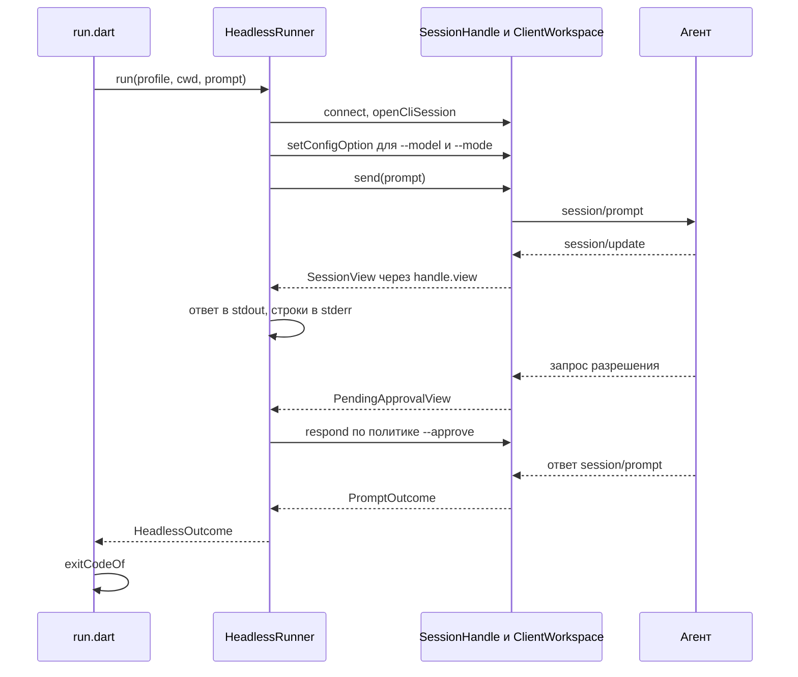

# Режим `-p` (headless)

Headless-режим выполняет один ход без человека: читает промпт, подключается к агенту, печатает ответ в stdout и завершается кодом, по которому скрипт или CI узнаёт исход. Глава объясняет, откуда берётся промпт, как решаются одобрения, что идёт в какой поток и как исход хода превращается в код выхода. Что значат флаги и коды для пользователя, объясняют [руководство пользователя](user/04-headless.md) и [эксплуатация](operations.md#запуск-без-участия-человека). Оглавление руководства — [README](README.md).

## Контракт

Весь режим держится на нескольких обещаниях скриптам (spec [`cli-headless`](../../../openspec/specs/cli-headless/spec.md), H-01, H-02):

- stdout несёт только текст ответов агента, байт в байт как пришёл, с переводом строки в конце. Без цветов и разметки.
- Всё остальное — строки инструментов, решения политики, заметки, диагностика `--verbose` — идёт в stderr без управляющих символов терминала.
- Код выхода вычисляется одним местом (`exitCodeOf`) из ответа `session/prompt`, ошибок и сигналов, а не из текста транскрипта.
- Ошибка использования оставляет stdout пустым.
- Мастер первого запуска, `CodelabHome.ensureExists` и запись недавних проектов в headless не выполняются.

Код — `lib/src/headless/`:

| Файл | Что в нём |
|---|---|
| `prompt_source.dart` | `readPrompt`: источник промпта |
| `approval_policy.dart` | `decideApproval`, `describeApproval`: политика `--approve` |
| `outcome.dart` | `HeadlessOutcome` и `exitCodeOf` |
| `headless_runner.dart` | `HeadlessRunner`: подключение, ход, вывод, одобрения, таймаут, отмена |

## Источник промпта

`readPrompt(options, io)` вызывается из `run.dart` раньше всего, до подключения к агенту:

| Что задано | Откуда промпт |
|---|---|
| `-p <текст>` | сам текст; файлом он не считается никогда |
| `-f <файл>` | содержимое файла в UTF-8 |
| `-f -` | весь stdin |
| ничего, но stdin не терминал | весь stdin (`CliCommand.repl` с пустыми `positional` переводится в headless) |

Пустой промпт — `UsageError('No prompt.')`; нечитаемый файл — `Cannot read the prompt file <путь>: <причина>`; файл не UTF-8 — `The prompt file <путь> is not UTF-8 text.`. Все они дают код `64`, агент не запускается. Пример:

```bash
codelab -p "  "
```

```text
codelab: No prompt.
```

Код выхода — `64`, stdout пуст.

## Ход

`HeadlessRunner.run(profile, cwd, prompt, …)` возвращает `HeadlessOutcome`. Диаграмма показывает порядок; закрывает рабочее пространство вызывающий (`run.dart`).



Подробности по шагам:

1. **Подключение.** `workspace.connect` и `openCliSession`; затем `applyConfigFlag` для `--model` и `--mode`. Сбой — `ConnectFailed` и строка `codelab: cannot start the agent <профиль>: <причина>` (или текст `SessionSetupError`, например `No session to continue in <папка>.`). `EmbeddedAgentConfigException` пробрасывается наверх: это не сбой подключения, а ошибка использования, код `64`.
2. **Реплей.** Элементы транскрипта, которые были до промпта (загруженная сессия при `--resume` и `--continue`), запоминаются в `_before`, и их текст не выводится.
3. **Таймаут.** Если задан `--timeout`, запускается `Timer`: по истечении печатается `codelab: timeout after <N>s, cancelling the turn` и вызывается `session.cancel()`.
4. **Отправка.** `session.send(prompt)`. Дальше `HeadlessRunner` слушает `session.view`.
5. **Вывод.** Каждая ревизия обрабатывается `_onView` ([ниже](#вывод)). Последняя ревизия могла прийти синхронно с ответом, поэтому перед итогом она обрабатывается ещё раз; если ответ не кончается переводом строки, он дописывается.
6. **Исход.** Ответ `session/prompt` превращается в `HeadlessOutcome` (`_outcomeOf`); истёкший таймаут перекрывает исход хода значением `TimedOut`, но не сигнал: `Signalled` возвращается раньше проверки таймаута.

## Вывод

Что идёт в какой поток (`HeadlessRunner._onView`):

| Элемент транскрипта | Куда |
|---|---|
| текст агента (`AgentTextItem`) | stdout, только новый хвост сверх уже выведенного; без санитизации |
| вызов инструмента в итоговом состоянии | stderr: `✓ <заголовок> <команда>`, `✗ …`, `⊘ …` (успех, сбой, отмена); одна строка на вызов |
| заметка клиентского слоя (`NoticeItem`) | stderr: `codelab: <текст>` |
| операция со списком задач | stderr, строкой, когда за ней пришёл другой видимый элемент или кончился ход |
| мысли модели, промпт пользователя | нигде |
| решение политики | stderr: `codelab: permission "<заголовок>": <вариант> (<причина>)` |
| пустой ответ | stderr: `codelab: empty response` |
| диагностика клиентского слоя | stderr, только с `--verbose`: `[<серьёзность>] <источник>: <сообщение>` |

Исключение из правила санитизации — только текст ответа: он идёт в stdout как есть, потому что stdout — данные. Всё, что идёт в stderr, проходит `sanitizeTerminalText`.

Снимок (сценарий модели `normal`, точка входа `test/e2e/support/embedded_cli_main.dart`; stdout и stderr показаны отдельно):

```bash
codelab -C <папка-проекта> -p "say hi"
```

```text
hello from compatible stdio agent
```

Код выхода `0`.

## Политика одобрений

В headless нет человека, а stdin занят промптом, поэтому одобрения решает политика `--approve` (`decideApproval`): детерминированно и видимо. Допустимый вариант берётся только из предложенных агентом.

| Политика | Что отвечает |
|---|---|
| `reject` (по умолчанию) | `reject_once` |
| `read-only` | `allow_once`, только если вид вызова `read` **и** уровень риска запроса `readOnly`; иначе `reject_once` |
| `allow-all` | `allow_once`; для запроса, который агент пометил критичным, — `reject_once` (причина `critical`) |

Если нужного варианта нет, берётся первый вариант `reject_*`; если нет и его, ход отменяется (`session.cancel()`), а ожидающий запрос получает исход `cancelled` (причина `cancelled`). Одного вида вызова из транскрипта для `read-only` мало: при незнакомом виде и при `switch_mode` вид записи сохраняется, а риск запроса поднимается до `unknown`, при `execute` — до `shell`. Решает риск: по умолчанию неизвестное запрещено (корневой [`AGENTS.md`](../../../AGENTS.md), §10).

Ровно одно решение и одна строка stderr на запрос: `_decided` запоминает идентификаторы, на которые политика уже ответила. Ответ уходит `session.respond(approvalId, optionId)`, ошибка ответа — строка `codelab: cannot answer the permission request: …`. С `--approve allow-all` перед началом хода печатается предупреждение, что разрешается всё, кроме критичного.

Снимок: сценарий `with_permission_request` и точка входа `test/e2e/support/embedded_cli_main.dart` (запрос на `echo hello`), одна и та же команда с разными политиками. Это stderr и stdout вместе:

```bash
codelab -C <папка-проекта> -p "run echo"
```

```text
codelab: permission "echo hello": reject_once (policy)
✗ echo hello echo hello
approved
```

```bash
codelab -C <папка-проекта> --approve allow-all -p "run echo"
```

```text
codelab: warning: --approve allow-all allows every permission request except critical ones without asking
codelab: permission "echo hello": allow_once (policy)
✓ echo hello echo hello
approved
```

Строка `approved` — ответ сценария после результата вызова: он идёт в stdout независимо от того, разрешён вызов или нет. Критичная команда (`with_critical_permission`, `rm -rf .`) при `allow-all` всё равно отклоняется:

```text
codelab: warning: --approve allow-all allows every permission request except critical ones without asking
codelab: permission "rm -rf .": reject_once (critical)
✗ rm -rf . rm -rf .
approved
```

## Исход хода и код выхода

`HeadlessOutcome` — закрытая иерархия; `exitCodeOf(outcome)` — единственное место таблицы кодов.

| Исход | Когда | Код |
|---|---|---|
| `TurnCompleted(endTurn, hadText: true)` | ход закончился `end_turn`, был непустой `agent_message_chunk` | `0` |
| `TurnCompleted(endTurn, hadText: false)` | `end_turn` без текста | `1` |
| `TurnCompleted(max_tokens, max_turn_requests, refusal)` | остальные причины остановки | `1` |
| `TurnCompleted(cancelled)` | ход отменён | `130` |
| `TurnFailed` | JSON-RPC ошибка на `session/prompt`, обрыв соединения | `1` |
| `ConnectFailed` | не удалось подключиться или открыть сессию | `1` |
| `TimedOut` | истёк `--timeout` | `130` |
| `Signalled(code)` | сигнал прервал прогон | `130` или `143` |

Ошибка использования (`64`) возникает раньше, до `HeadlessRunner`. Таймаут кончается отменой хода: агент отвечает `stopReason: cancelled`, но `_timedOut` заменяет этот исход на `TimedOut`, чтобы причина была названа.

Снимок таймаута (сценарий `hangs_until_cancel`, точка входа `test/e2e/support/embedded_cli_main.dart`):

```bash
codelab -C <папка-проекта> --timeout 2s -p hi
```

```text
codelab: timeout after 2s, cancelling the turn
codelab: Completed with stopReason cancelled.
```

Код выхода `130`. Ошибка провайдера (сценарий `prompt_error`) — код `1` и строка `codelab: Provider is unavailable (auth)`. Недоступный провайдер даёт `1` после повторных попыток (снимок — [глава 00](00-getting-started.md#изоляция-codelab_home-и-ключи)).

## Сигналы

`watchModeSignals` с `onStop: runner.interrupt`. `interrupt(code)` завершает `_interrupted` кодом и отменяет идущий ход; `run` ждёт ответа агента на `session/cancel` не дольше `cancelGrace` (2 секунды) и возвращает `Signalled(code)`. Повторный сигнал выходит сразу. После выхода из `run` `run.dart` закрывает рабочее пространство и дожидается `dispose` встроенного агента ([глава 02](02-startup-and-composition.md#сигналы-и-выход)).

## Тесты

- `test/headless/` — модульные тесты на `FakeAgent` и `FakeCliIo`: `prompt_source_test`, `approval_policy_test`, `exit_codes_test`, `headless_runner_test`.
- `test/e2e/headless_print_basic_test.dart`, `headless_exit_codes_test.dart`, `headless_kit_log_test.dart` — процесс против агента из `CODELAB_E2E_AGENT` ([глава 09](09-testing.md)).

## Смотрите также

- [Глава 02](02-startup-and-composition.md) — выбор режима и сигналы
- Спецификация [`cli-headless`](../../../openspec/specs/cli-headless/spec.md)
- [Эксплуатация `codelab`](operations.md#запуск-без-участия-человека) — как использовать режим в CI
