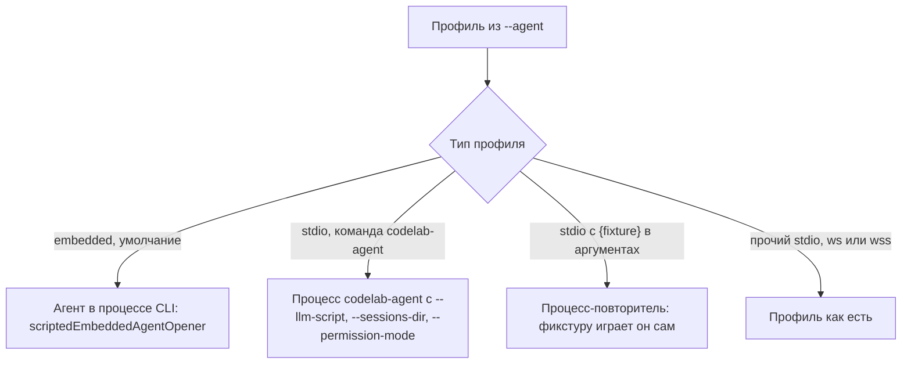

# Драйвер фикстур `test-scenario`

`codelab test-scenario` проигрывает golden-фикстуры ACP (записанные сценарии обмена клиента и агента) против агента выбранного профиля и сравнивает кадры. Эталон поведения агента — корпус фикстур `codelab_acp_testing`, и любой агент (встроенный, `codelab-agent`, сторонний) должен проверяться им из рабочего бинаря тем же алгоритмом, что и тесты самого агента. Глава объясняет устройство драйвера: выбор агента, пропуск фикстур, вывод, отчёт JUnit. Как использовать команду в CI, описывает [эксплуатация](operations.md#проверка-агента-фикстурами-test-scenario). Оглавление руководства — [README](README.md).

Код — `lib/src/scenario/`:

| Файл | Что в нём |
|---|---|
| `test_scenario_command.dart` | `runTestScenario`: загрузка, фильтр, цикл по фикстурам, вывод, коды |
| `agent_connector.dart` | `ScenarioAgent`: как запустить агента профиля на фикстуру и какие фикстуры ему не сыграть |
| `junit_report.dart` | `renderJunitReport`: чистая функция без IO и без пакета `xml` |

Это единственное место CLI, где разрешены `package:codelab_acp_testing/` и `package:codelab_embedded/testing.dart` (правила сторожа). Рабочий код не должен тянуть тестовый пакет и сценарий модели; драйвер — исключение, потому что проигрывает фикстуры в рабочем бинаре (`codelab_acp_testing` для этого — обычная зависимость CLI, а не `dev_dependency`).

## Что такое фикстура

Файл в корпусе (`packages/dart/codelab_acp_testing/fixtures/acp/*.json`) описывает один сценарий: идентификатор (`id`; его последняя часть совпадает с именем файла), условия (`setup`: папка, профиль хоста, режим разрешений, иногда конфигурация и MCP), сценарий модели (`llm`: ответы по шагам) и последовательность кадров (`frames`): какие кадры шлёт клиент (`c2a`), какие ожидает от агента (`a2c`), с шаблонами вроде `"$any"`, `"$capture"`, `"$textContains"`. Роли — клиент, агент или обе. Формат и загрузчик — [README `codelab_acp_testing`](../../../packages/dart/codelab_acp_testing/README.md).

Для `test-scenario` фикстура — это роль «агент»: драйвер играет клиента, а проверяет агента.

## Команда

```bash
codelab test-scenario <файл-или-папка>... [--agent <профиль>] [--filter <glob>] [--timeout <длительность>] [--junit <файл>]
```

`parseCliArgs` разбирает подкоманду собственным `ArgParser` (флаги `--agent`, `--filter`, `--timeout`, `--junit`), положение аргументов — `CliOptions.positional`. Без `--agent` выбирается встроенный агент, как во всём CLI (`resolveAgentProfile`). Таймаут — ожидание кадра агента, по умолчанию `30s`; `--timeout` можно указать у подкоманды или перед ней. `--filter` — glob по id: `*` любые символы, `?` один.

## Ход `runTestScenario`

1. **Проверка пути отчёта.** Если задан `--junit`, `_probeJunit` до запуска первого агента проверяет, что отчёт удастся записать: допустимы только «нет файла» и обычный файл (symlink, каталог и устройство дают `UsageError`), а временный каталог рядом создаётся и сразу удаляется. Так путь, закрытый для записи, не стоит прогона корпуса. Сам файл не создаётся: ошибка фикстуры не должна стоить пользователю прежнего отчёта.
2. **Загрузка.** `_load` собирает фикстуры по путям (файл или каталог через `loadFixtureCorpus`), убирает повторы по id и сортирует по id. Нет путей или путь не существует — `UsageError`. Битая фикстура — `FixtureFormatException`, тоже `64`.
3. **Фильтр.** По glob от `--filter`.
4. **Предупреждение о токене.** Если у профиля токен `secret:<имя>` не задан, в stderr печатается то же предупреждение, что у остальных режимов.
5. **`ScenarioAgent(profile, …)`** и цикл по фикстурам.
6. Для каждой фикстуры `agent.skipReason(fixture)`; если причина есть — `SKIP`, иначе `_play`.
7. Итог, затем JUnit, затем код выхода.

`_play` вызывает `runAgentFixtureOver(fixture, agent.connector(…), frameTimeout:, quietPeriod:, transportFixtures: false)` из `codelab_acp_testing`. `quietPeriod` (200 мс) — тишина в конце фикстуры: драйвер убеждается, что агент не прислал лишних кадров. Любое исключение превращается в строки `FAIL`.

## Выбор агента

`ScenarioAgent` выбирает способ запуска по профилю и заново подключает агента на каждую фикстуру:



- **Встроенный агент.** Открывается в процессе CLI открывателем `scriptedEmbeddedAgentOpener` из `codelab_embedded/testing.dart`: блок `llm` фикстуры — сценарий модели, профиль хоста — `setup.profile` (по умолчанию `agent-serve`), режим разрешений — `setup.mode`. Журнал сессий и `CODELAB_HOME` лежат во временной папке фикстуры, которая удаляется после `dispose` агента. Журнал нужен, потому что без него агент не объявит `loadSession`, а это часть его контракта (`acp/initialize-capabilities`).
- **`codelab-agent`.** Определяется по имени файла команды. Драйвер дописывает `--llm-script <файл>` (сценарий из фикстуры), `--sessions-dir` и `--permission-mode`, подставляет временный `CODELAB_HOME` и запускает агента в папке проекта фикстуры. Домашний `~/.codelab` пользователя не затрагивается.
- **Повторитель.** Если в аргументах stdio-профиля есть `{fixture}`, туда подставляется путь файла фикстуры; агент (`FixtureReplayAgent` в тестах) играет фикстуру сам, и драйвер ничего не пропускает.
- **Прочие агенты** запускаются по профилю как есть.

Транспорт открывает `ioTransportResolver`, тот же, что в остальных режимах; `ClientWorkspace` драйвер не создаёт.

### Какие фикстуры пропускаются

`ScenarioAgent.skipReason(fixture)` возвращает причину, по которой этому агенту фикстуру не сыграть (`SKIP`). Повторитель не пропускает ничего. У остальных агентов:

| Условие | Причина |
|---|---|
| `setup.mcp` не пуст (любой агент, кроме повторителя) | fake MCP-серверы живут в памяти фабрики агентского прогона и в процесс настоящего агента не передаются |
| встроенный агент: `setup.sessions`, `setup.config`, `setup.web` или `setup.profile`, кроме `agent-serve` и `embedded-cli` | эти входы сценарный открыватель не принимает |
| `codelab-agent`: те же входы, `setup.profile` кроме `agent-serve` | их нельзя передать процессу агента флагами |
| сторонний агент и фикстура с `llm` | сценарий модели стороннему агенту передать нельзя |

Кроме того, пропускается фикстура, которой нет роли «агент» (`result.skipped` из `runAgentFixtureOver`): например, `acp/prompt-update-plan` — фикстура клиентской роли.

## Вывод и коды выхода

На фикстуру — строка `PASS|FAIL|SKIP <id> (<время>)` в порядке id; под `SKIP` — причина с отступом, под `FAIL` — расхождение. В конце — `<passed> passed, <failed> failed, <skipped> skipped`.

Снимок `SKIP` (бинарь `codelab`, `--agent embedded`; полный прогон корпуса показан в [эксплуатации](operations.md#проверка-агента-фикстурами-test-scenario)):

```text
SKIP acp/prompt-max-turn-requests (0.0s)
    embedded: setup.config cannot be played by the embedded agent
```

`FAIL` показывает, на каком кадре и чем не совпало, и оба кадра с отступами. Чтобы получить его, скопируйте фикстуру `prompt-text-end-turn.json` в свою папку и поправьте ожидаемую причину остановки с `end_turn` на `max_tokens`:

```bash
codelab test-scenario <папка>/prompt-text-end-turn.json --agent embedded
```

```text
FAIL acp/prompt-text-end-turn (0.0s)
    frame #3 (ответ последним кадром хода (ACP-3)): a2c frame differs
    - $.result.stopReason: expected "max_tokens", got "end_turn"
    expected:
    {
      "jsonrpc": "2.0",
      "id": "fixture-promptId",
      "result": {
        "stopReason": "max_tokens"
      }
    }
    actual:
    {
      "jsonrpc": "2.0",
      "id": "fixture-promptId",
      "result": {
        "stopReason": "end_turn"
      }
    }
0 passed, 1 failed, 0 skipped
```

Код выхода `1`. Имя файла без `.json` должно совпадать с последней частью `id`: если переименовать копию в `broken.json`, загрузчик её не примет.

```bash
codelab test-scenario broken.json
```

```text
codelab: broken.json: FixtureFormatException: broken.json: $.id: expected "acp/broken" to match the file, got "acp/prompt-text-end-turn"
```

Код `64`. Сторонний агент не получает сценария модели, поэтому ту же фикстуру он пропустит, а прогон, где ничего не сыграно, не считается успешным:

```bash
codelab test-scenario <папка>/prompt-text-end-turn.json -a stdio:/nonexistent/agent
```

```text
SKIP acp/prompt-text-end-turn (0.0s)
    third-party agent: llm script cannot be passed
0 passed, 0 failed, 1 skipped
codelab: no fixtures were played
```

Последняя строка идёт в stderr. Коды выхода:

| Код | Когда |
|---|---|
| `0` | сыграна хотя бы одна фикстура и нет `FAIL` |
| `1` | есть `FAIL` (в том числе агент не запустился); не сыграна ни одна (все `SKIP` или пустой фильтр) — `codelab: no fixtures were played`; не удалось записать отчёт уже после прогона |
| `64` | нет путей, путь не существует, битая фикстура, нельзя записать `--junit` по результатам проверки до запуска |

Правило «не сыграна ни одна — код `1`» действует для любого агента: прогон, где всё пропущено, ничего не доказывает, и зелёный код скрыл бы пустой корпус.

## Безопасность вывода

Аргументы stdio-профиля могут нести ключ (`--api-key sk-…`). `ProcessException.toString()` печатает `Command: <команда и аргументы>`, поэтому драйвер в `FAIL` берёт только `ProcessException.message`: это вторая линия обороны на случай ошибки, брошенной мимо транспорта (основная — `StdioAcpTransport`). Имя команды строка `FAIL` не называет: она стоит под id фикстуры, а профиль задан флагом того же запуска.

Если среди слов argv есть `secret`, оно могло быть значением секрета: пути фикстур и отчёта в тексте ошибок заменяются фиксированной фразой (`Cannot load the fixtures`, `<path>`). Значения аргументов stdio-профиля и путь `{fixture}` в отчёт JUnit не попадают.

## JUnit

`--junit <файл>` пишет отчёт JUnit XML после последней фикстуры, в том числе при `FAIL` и при «не сыграна ни одна» (пустой `testsuite`). Тексты `failure` и `skipped` — те же строки, что в stdout. Файл пишется атомарно: временный каталог рядом, затем `rename`, при сбое всё временное удаляется. Прерывание сигналом отчёт не пишет: частичный отчёт хуже отсутствующего. Формат: один `testsuite` с именем `codelab test-scenario`, на фикстуру — `testcase` с `classname` (каталог id) и `name` (весь id).

```xml
<testsuite name="codelab test-scenario" tests="27" failures="0" skipped="6" time="4.575">
<testcase classname="acp" name="acp/prompt-anthropic-tool-call" time="0.208"/>
…
<testcase classname="acp" name="acp/prompt-max-turn-requests" time="0"><skipped message="embedded: setup.config cannot be played by the embedded agent"/></testcase>
```

Фрагмент отчёта прогона `--filter 'acp/prompt-*'` корпуса; остальные `testcase` опущены.

## Где это запускается

- `fvm dart run melos run conformance:embedded` — весь корпус `packages/dart/codelab_acp_testing/fixtures/acp` против встроенного агента; входит в `melos run check`. С `CODELAB_TEST_REPORT_DIR` пишет `scenario-embedded.xml`.
- `test/scenario/` — модульные тесты: `test_scenario_command_test.dart`, `agent_connector_skip_test.dart`, `junit_report_test.dart`, `codelab_agent_corpus_test.dart`. Им нужен процесс-повторитель: `test/support/replay_agent.dart` компилирует его в kernel один раз.
- Те же фикстуры проигрывают тесты клиентского слоя (`conformance:client`) и агентского ACP (`conformance:agent`): `test-scenario` — третий проигрыватель корпуса, из рабочего бинаря.

Источник правил команды — спецификация [`cli-scenario-driver`](../../../openspec/specs/cli-scenario-driver/spec.md).

## Смотрите также

- [`codelab_acp_testing`](../../../packages/dart/codelab_acp_testing/README.md) — корпус, загрузчик и драйверы
- [Эксплуатация `codelab`](operations.md#проверка-агента-фикстурами-test-scenario) — пример прогона корпуса
- [Глава 09: тестирование](09-testing.md)
