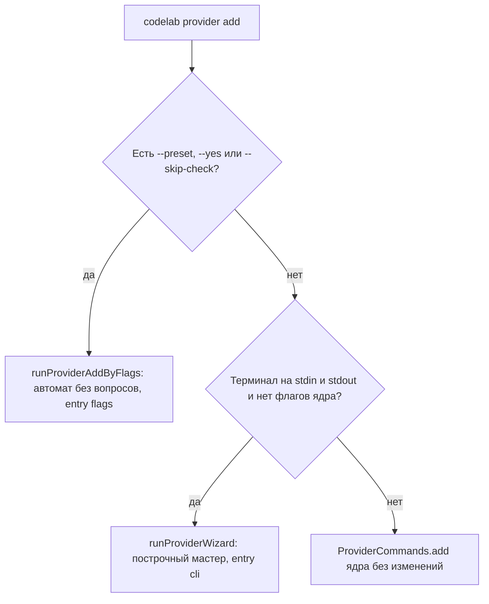

# Настройка агента: `config`, `provider`, `mcp`, `secret`, мастер и `/settings`

`codelab` не только запускает агента, но и настраивает встроенного: проверяет и правит файлы конфигурации, добавляет провайдеров и MCP-серверы, хранит секреты. Всё это делает мост `codelab_setup`, а не код CLI: клиенты не импортируют `package:codelab_agent_*`. Глава объясняет, как CLI подключает мост, как выбирается способ `provider add`, как устроены первый запуск и мастер и как `/provider` и `/settings` работают в REPL и TUI. Что настройки значат для пользователя, описывают [руководство пользователя](user/06-providers.md) и [настройка агента](../../../docs/user/configuration.md). Оглавление руководства — [README](README.md).

## Подкоманды без агента

Подкоманды `config`, `provider`, `mcp` и `secret` работают с файлами напрямую. Они не создают `ClientWorkspace`, не открывают транспорт и не запускают агента. Они же не вызывают `CodelabHome.ensureExists`, поэтому `sessions/`, `profiles.json` и `cli_history` в `CODELAB_HOME` не появляются.

Подкоманда реализована общей командой моста, чтобы вывод, коды выхода и записанные байты `config.yaml` совпадали с `codelab-agent`. Соответствие:

| Подкоманда | Класс моста | Функция в `run.dart` |
|---|---|---|
| `config check` | `ConfigCommands.check(CheckOptions)` | `_runConfigCheck` |
| `config path`, `get`, `set`, `unset` | `ConfigCommands` | `_runConfigEdit` |
| `provider add`, `list`, `remove` | `ProviderCommands` | `_runProvider` |
| `mcp add`, `list`, `remove` | `McpServerCommands` | `_runMcp` |
| `secret set`, `delete`, `list`, `migrate` | `SecretCommands` | `_runSecret` |

Правила устройства, которые стоит держать в голове:

- **Единственный импорт моста.** `package:codelab_setup/io.dart` разрешён только в `lib/src/run.dart` (правило сторожа на весь `lib/`, чтобы барель `lib/codelab_cli.dart` его тоже не реэкспортировал). Остальные файлы используют основной барель `package:codelab_setup/codelab_setup.dart` — чистые типы без IO. Поэтому `cli_args.dart` не может сослаться на `ConfigGetLayer`: допустимые значения `--layer` записаны в парсере литералом `['user', 'project', 'local', 'merged']`, а их равенство перечислению проверяет тест `config_command_test.dart`.
- **Разбор отдельно от выполнения.** Листовые подкоманды регистрирует `cli_args.dart`; их `ArgResults` лежит в `CliOptions.subcommand` (имя — `name`, слова — `rest`), а `CliOptions.positional` у `config`, `provider`, `mcp` пуст. У `secret` в `positional` идут имя подкоманды и её слова.
- **Результат команды** — `ConfigCommandResult(exitCode, stdout, stderr)`: строки печатает `_printResult`, код возвращается как есть.
- **Неожиданное исключение** — одна строка и код `1`, а не трасса Dart и код `255`. У `config path|get|set|unset`, `provider`, `mcp` и `secret` это `codelab: <команда> failed: <тип исключения>`: печатается только тип, потому что текст чужого исключения мог бы процитировать значение секрета (CFG-10). Исключение — `config check`: он печатает полный текст, `codelab: config failed: <исключение>` (`run.dart`, `_runConfigCheck`).
- **Папка проекта** — `_projectDir(options)`: `--cwd` подкоманды, общий `-C`, текущая папка; путь передаётся как есть, без нормализации, чтобы текст ошибки совпал с `codelab-agent`. `--cwd` есть у `config` (все подкоманды), у `provider list` и `mcp list`; у `provider add|remove` и `mcp add|remove` его нет, там папку задаёт общий `-C`.
- **Секреты в argv не цитируются.** Ключ провайдера флагом не передаётся: `--api-key-stdin` читает значение из stdin (`StdinSecretInput`), а `--api-key-secret` и `--api-key-env` называют только имя. Ошибка разбора argv с `secret`, `provider` или `mcp` — только `codelab: invalid arguments for <команда>` и справка ([глава 02](02-startup-and-composition.md#разбор-аргументов)).

Снимки (бинарь `codelab`, `CODELAB_HOME` в пустой папке):

```bash
codelab provider add local --kind openai-compatible --base-url http://127.0.0.1:9/v1 --model demo-model --context-window 8192 --default
```

```text
Updated providers.local in ~/.codelab/config.yaml
```

```bash
codelab provider list
```

```text
Secrets: env (OS keychain backends are not available in this version; set secrets.backend: file or CODELAB_SECRET_* variables)
local  kind: openai-compatible  base_url: http://127.0.0.1:9/v1  models: demo-model  key: none
```

```bash
codelab config get agent.default_model
```

```text
local/demo-model
layer: user
```

Ошибки использования, код `64`, stdout пуст:

```bash
codelab config set agent.default_model x --agent z
```

```text
codelab: --agent does not apply to config set

Usage: codelab config check [--cwd <dir>]
       codelab config path [--project | --local] [--cwd <dir>]
       codelab config get <key> [--layer user|project|local|merged] [--cwd <dir>]
       codelab config set <key> <value> [--project | --local] [--cwd <dir>]
       codelab config unset <key> [--project | --local] [--cwd <dir>]

`check` loads the configuration like the agent does and prints sources, issues and warnings. `get` prints the raw value of a key and its layer (references like ${VAR} are not expanded, secret-like values are masked). `set` and `unset` edit one config file in place and keep its comments. Nothing prints secret values.
```

Справки `configUsage`, `providerUsage`, `mcpUsage`, `secretUsage` — в `cli_args.dart`: у каждого бинаря своя, потому что она называет его (`codelab-agent` печатает свою); общие только тексты результатов. Строка про 1.0 (`before1Note`) приходит из основного бареля моста.

### Что проверяет парсер, а что мост

Парсер (`cli_args.dart`) отвергает то, что не требует чтения файлов: незарегистрированную подкоманду (`config migrate` → `Unknown command config migrate`), неверное число аргументов, флаги подключения вместе с подкомандой записи. Мост проверяет всё, что связано с содержимым: сочетание `--project` и `--local` (код `64` и `<label>: --project and --local cannot be combined`), неизвестный ключ конфигурации, значения. Свою копию проверки в CLI не добавляют: она разошлась бы с `codelab-agent`.

`secret` отдельно: значение секрета читается только из stdin, флага `--value` нет (argv виден через `ps`). Любая ошибка разбора argv, если `secret` есть в нём где угодно (в том числе флаг верхнего уровня до `secret`), — только `codelab: invalid arguments for secret` и справка. Лишний аргумент `secret set` — вероятно, значение: он доходит до моста только признаком `hasValueArgument` и нигде не печатается.

## `provider add`: мастер, флаги или ядро

`_providerAdd` в `run.dart` выбирает один из трёх путей по флагам и терминалу.



- **Автомат по флагам** (`--preset`, `--yes`, `--skip-check`) — `lib/src/setup/provider_add_flags.dart`. Сначала разбор флагов и ошибки, не требующие сети, сеть последней; `--skip-check` пропускает только исходы `unreachable` и `timeout` проверки `/models`. Ключ на терминале вводится скрытым полем поверх общего stdin, без терминала читается из stdin.
- **Мастер** — `runProviderWizard` (`provider_wizard.dart`), если нет ни клиентских флагов, ни флагов ядра, а stdin и stdout — терминал.
- **Ядро** — `ProviderCommands.add`: вывод, коды и байты как у `codelab-agent provider add`. Без `<id>` — `provider add needs the provider id`, код `64`.
- Слой 3 (проектный `config.yaml`) клиенты не пишут (SETUP-3): `--project` с клиентскими флагами или с мастером — `64`.

Выбор опирается на то, что клиент знает про терминал; поэтому он в `run.dart`, а не в мосте.

## Мастер провайдера

Мастер — это не логика, а вид: логика шагов, проверка `/models`, порядок записи и тексты — в мосте `codelab_setup`. В CLI два вида одного автомата `ProviderSetupFlow`:

| Вид | Где | Как получает клавиши |
|---|---|---|
| построчный `LineWizard` | `setup/provider_wizard.dart` | подкоманда `provider add` и первый запуск: из своей подписки на `Terminal.input`; `/provider add` в REPL — из подписки `Repl` |
| оверлей `ProviderWizardOverlay` | `tui/core/tui_overlay.dart` | `reduce` ядра экрана ([глава 04](04-tui.md#одобрения-пикеры-оверлеи)) |

`LineWizard` превращает состояния автомата в вопросы и ответы пользователя в события. Состояние он не хранит: источник правды — автомат, здесь только вид ввода текущего шага (выбор стрелками, строка, фильтр, запись). Тексты шагов — только `wizardStepOf` (`wizard_steps.dart`), общий для обоих видов; поле ввода — чистый `LineField` (`line_field.dart`); `PromptLine` добавляет отрисовку в `StringSink`.

**Значение ключа.** Ключ вводится в скрытое поле: на экране `*` по числу символов, Ctrl+R показывает и прячет, Ctrl+U очищает. Значение живёт только в поле и в `SecretValue` автомата; буфер не попадает в `History`, `cli_history` и журнал и сбрасывается при отправке, отмене и закрытии. Вставка нескольких строк или значение длиннее `maxKeyBytes` не принимаются (`keyRejectedLine`) и не цитируются. `PromptReader` читает одиночные строки (вопрос `[Y/n]`, ключ) и не переносит опережающий ввод в следующее поле: набранное вперёд не должно оказаться открытым текстом в чужой строке.

**Запись.** Во время записи (`Saving`) мастер игнорирует Ctrl+C и Esc; при закрытии терминала ждёт итога записи не дольше 10 секунд, чтобы не бросить запись на середине.

## Первый запуск

`_firstRun` в `run.dart` вызывается в REPL и TUI до `buildCliRuntime`. Он работает только если профиль встроенный и stdin и stdout — терминал; в `-p`, без терминала и для внешних агентов готовность не вычисляется (SETUP-7). Почему в `run.dart`, а не в `composition_root.dart`: снимок, порт ключей и проверка `/models` строятся из `codelab_setup/io.dart`, а он разрешён только там.

`runFirstRun` (`setup/first_run.dart`) вычисляет `checkProviderReadiness` и ветвится:

| Готовность | Что делает CLI |
|---|---|
| `ProviderReady`, `ConfigBroken` | обычный старт; сломанный конфиг покажет открытие агента кодом `64` |
| `NoProviderConfigured` | текст «No model provider is configured for the embedded agent…» и полный мастер (`entry: firstRun`, цель `user`) |
| `ProviderKeyMissing` | мастер не запускается, конфиг не меняется: вопрос про ключ и запись только секрета, либо подсказка (бэкенд только для чтения, ключ из переменной) |

Сбой чтения снимка или порта ключей — обычный старт без вывода: проблему покажет открытие агента. Ctrl+C или отмена мастера — код `130`. Начало первого экрана:

```text
No model provider is configured for the embedded agent.
Let's set one up. Press Ctrl+C to quit; run "codelab provider add" later to change it.
? API type
  › OpenAI
    Anthropic
    OpenRouter
    Ollama (local, no key)
    Custom OpenAI-compatible endpoint
    Custom Anthropic-compatible endpoint
```

Снимок получен запуском тестовой точки входа с пустым `CODELAB_HOME`; ту же картину показывает [README приложения](../README.md#быстрый-старт).

Один владелец stdin: мастер первого запуска и следующий за ним REPL или TUI читают один терминал, поэтому `run.dart` создаёт общий `SharedStdin` до мастера ([глава 03](03-repl.md#общий-stdin)).

## Порт `SetupCommands`

Командам `/provider` и `/settings` нужны те же порты записи, что подкомандам, но `repl/` и `tui/` импортировать `codelab_setup/io.dart` не вправе. Поэтому `setup/setup_commands.dart` объявляет порт `SetupCommands`, а `run.dart` реализует его классом `_RunSetupCommands` и передаёт в `Repl` и `TuiRunner` (`setup:`); команды получают его как `ReplContext.setup`.

Методы порта принимают `SetupScope` — доступ профиля подключения (`EditableSettings`), `env` stdio-профиля и папку снимка. `CODELAB_HOME` (в том числе с `~`), `--config` и `api_key_env` берутся у профиля, а не у клиента: запись идёт в конфиг того агента, к которому подключены (SETUP-2). `_SetupKit` открывает хранилище секретов лениво и один раз на область; `_RunSetupCommands` держит кэш китов по области.

Чьи это настройки, решает `settingsAccessOf(profile, …)` (`setup/settings_access.dart`) через `resolveSettingsAccess` моста:

| Профиль | Доступ |
|---|---|
| встроенный агент | `EditableSettings` |
| stdio-агент | `EditableSettings`, если базовое имя команды — `codelab-agent`; иначе `NotManaged` с именем агента |
| WebSocket | `RemoteReadOnly` |

Для `RemoteReadOnly` и `NotManaged` команды печатают строку только для чтения (`Provider settings are read-only for a remote agent. Run "codelab provider add" on the agent host.` или `Provider settings are managed by <имя>.`) и порт не вызывают.

## `/provider` и `/settings` в интерактивных режимах

Обе команды входят в `replCommands`. Они вызывают порт через `ReplContext.setup`, а различие REPL и TUI вынесено в узкие члены контекста (`runWizard`, `showSettings`).

- **`/provider add|list|remove [<id>] [--local]`.** `list` и `remove` печатают вывод `ProviderCommands` построчно. `add` ведёт мастер: в REPL — `LineWizard` с клавишами из подписки `Repl`, в TUI — оверлей. В REPL во время хода и без терминала мастер не открывается (`turnRunning`, `hasTerminal`): вопросы мастера смешались бы с выводом хода. В TUI `turnRunning` всегда `false`: мастер модальный, а запрос разрешения ждёт его закрытия. `--local` пишет слой `projectLocal` текущей папки; у агента без такого слоя — `This agent has no project-local config; run without --local.`
- **`/settings [<key> [<value> | --reset]] [--local]`.** Без аргументов — список `ключ значение источник` в REPL и экран-оверлей в TUI. `<key>` — выбор значения пикером или подсказка формата; `<key> <value>` — запись в слой `user` (с `--local` — `projectLocal`); `<key> --reset` — удаление ключа из слоя. Слой 3 не пишется никогда (SETUP-3). Ключ из `--config` или окружения не правится. Запись идёт через тот же `AgentConfigStore`, что у мастера (SETUP-6: конфликт без автоповтора); все проверки и тексты — в `applySetting` (`settings_rows.dart`), своей копии в командах нет. Экран TUI показывает только ключи реестра со `scope: shared`; карты и списки отображений доступны только для чтения.

## Недавние проекты

Интерактивные режимы пишут проверенную папку сессии в `$CODELAB_HOME/recent_projects.json` один раз за запуск: `_recordRecentProject` передаётся как `onConnected` в `Repl` и `TuiRunner` и вызывается после успешного `connect` и до `openCliSession`. Headless, `test-scenario` и подкоманды файл не создают и не меняют. Подробности — [глава 08](08-profiles-and-home.md#недавние-проекты).

## Тесты

`test/config_command_test.dart`, `provider_mcp_command_test.dart`, `secret_command_test.dart` — подкоманды на `runCodelab` с `FakeCliIo`; `test/setup/` — мастер, первый запуск, флаговая форма, строки настроек; `test/repl/commands/provider_test.dart`, `settings_test.dart` — команды; `test/tui/core/provider_wizard_overlay_test.dart`, `settings_overlay_test.dart` — оверлеи. Процессные: `test/e2e/config_write_command_test.dart` сравнивает код, stdout, stderr и байты файлов `CODELAB_HOME` с собранным `codelab-agent`; `provider_setup_test.dart`, `secret_command_test.dart`, `mcp_add_stdin_test.dart`, `tui_setup_test.dart`. Каждый тест, запускающий REPL или TUI, должен иметь свой временный `CODELAB_HOME` ([глава 09](09-testing.md)).

## Смотрите также

- Сквозной разбор настроек: [настройки на клиенте](../../../packages/dart/codelab_client_core/doc/settings-on-client.md) и [алгоритм настроек агента](../../../packages/dart/codelab_agent_core/doc/algorithms/settings.md).
- [`codelab_setup`](../../../packages/dart/codelab_setup/README.md) — мост настроек
- Спецификации [`client-agent-setup`](../../../openspec/specs/client-agent-setup/spec.md) и [`codelab-cli`](../../../openspec/specs/codelab-cli/spec.md) («Подкоманда codelab config», «Мастер первого запуска CLI», «Команды /provider и /settings в REPL и TUI»)
- Проектный документ [первый запуск и настройки](../../../docs/architecture/proposals/dart-agent-and-clients/12-4-first-run-and-settings.md)
