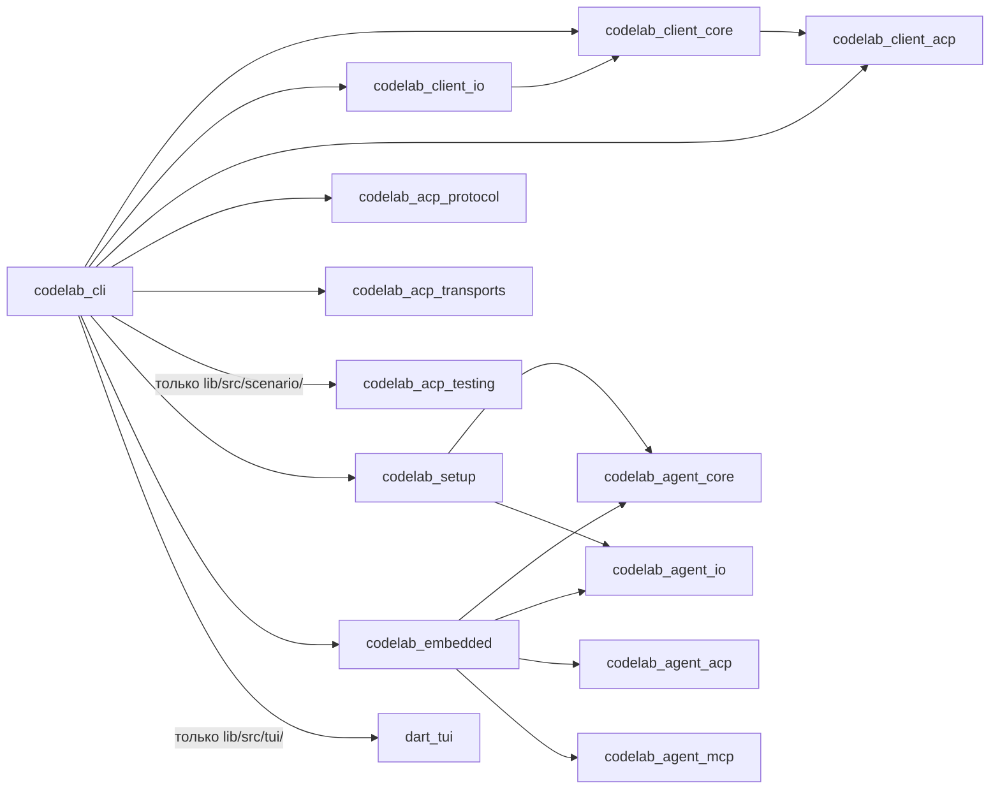
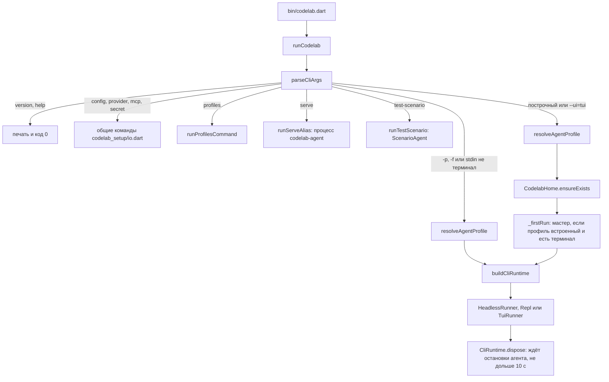

# `codelab_cli`: разработка

Документ для тех, кто меняет код терминального клиента. Правила изменений — в [`AGENTS.md`](../AGENTS.md) приложения; здесь — карта кода, зависимости, поток запуска и тесты.

## Место в архитектуре

`apps/codelab_cli` — приложение на чистом Dart, без Flutter. Своего состояния сессий, очереди промптов и одобрений у него нет: их владелец — клиентский слой `codelab_client_core` (`ClientWorkspace`, `SessionView`, `SessionHandle`). CLI отображает состояние и передаёт действия пользователя, так же как Cubit-ы CodeLab app.

Агентскую сторону CLI получает только через два моста: `codelab_embedded` (встроенный агент в процессе) и `codelab_setup` (команды конфигурации и секретов). Прямой импорт `package:codelab_agent_*` запрещён и проверяется сторожем (`melos run guard`).

Зависимости по `pubspec.yaml` приложения и его прямых зависимостей:



Кроме показанных, CLI зависит от `args`, `path` и `meta`. На схеме опущены зависимости внутри нижних слоёв: `codelab_client_io` зависит ещё от `codelab_client_acp`, а `codelab_client_*`, `codelab_embedded` и `codelab_agent_acp` — от `codelab_acp_protocol` и `codelab_acp_transports`. `codelab_setup` использует только `codelab_agent_core` и `codelab_agent_io`; ACP-сервер и MCP-клиент агента приходят только через `codelab_embedded`. Список разрешённых зависимостей CLI держит сторож (`cliAllowlist`); его расширение — через OpenSpec change.

Общая картина слоёв — [layers-and-dependencies.md](../../../docs/architecture/layers-and-dependencies.md) и [acp-boundary.md](../../../docs/architecture/acp-boundary.md).

## Структура кода

| Путь | Что там |
|---|---|
| `bin/codelab.dart` | точка входа: `exit(await runCodelab(args, environment: Platform.environment))` |
| `lib/codelab_cli.dart` | барель для `bin/` и тестов |
| `lib/src/run.dart` | `runCodelab`: выбор режима, коды выхода, первый запуск, подкоманды настройки; единственное место импорта `package:codelab_setup/io.dart` |
| `lib/src/cli_args.dart` | парсер флагов (`package:args`), `CliOptions`, `UsageError`, тексты справки |
| `lib/src/composition_root.dart` | `buildCliRuntime`: `AcpClientApplication`, `ClientWorkspace`, резолверы транспортов; единственное место импорта `package:codelab_embedded/io.dart` |
| `lib/src/embedded_transport_resolver.dart` | резолвер встроенного агента: открывает и закрывает агента по профилю `embedded` |
| `lib/src/embedded_logger.dart`, `lib/src/cli_logger.dart` | логгеры агента и клиента в stderr при `--verbose` |
| `lib/src/cli_io.dart` | шов потоков и признаков терминала (`CliIo`, `ProcessCliIo`): тесты подставляют буферы |
| `lib/src/exit_codes.dart` | коды выхода `0`, `1`, `64`, `130`, `143` |
| `lib/src/home.dart` | `CodelabHome`: `CODELAB_HOME`, `profiles.json`, `recent_projects.json` (`recentProjectsFile`), `cli_history` |
| `lib/src/signals.dart` | `SIGINT`/`SIGTERM` через шов `SignalSeam` |
| `lib/src/session_setup.dart` | открытие сессии (новая, `--resume`, `--continue`) и опции `--model`, `--mode` до первого промпта |
| `lib/src/serve_alias.dart` | переходный алиас `codelab serve` |
| `lib/src/headless/` | режим `-p`: источник промпта, политика `--approve`, исход хода и его код выхода |
| `lib/src/repl/` | построчный режим: цикл `Repl`, блок одобрения, маршрутизатор и команды `/…` (`commands/`) |
| `lib/src/tui/core/` | чистое ядро полноэкранного режима: модель, сообщения, `reduce`, кадр; без `dart_tui` и `dart:io` |
| `lib/src/tui/` | адаптер ядра к `dart_tui` и терминалу (`TuiRunner`, `TuiApp`) |
| `lib/src/input/` | порт терминала, общий stdin (`SharedStdin`), декодер клавиш, редактор строки, реестр клавиш, история |
| `lib/src/render/` | поверхности вывода, рендер транскрипта, строки инструментов, очистка управляющих символов |
| `lib/src/profiles/` | разбор `--agent` и подкоманда `profiles` |
| `lib/src/setup/` | мастер провайдера, первый запуск, `/provider`, `/settings` |
| `lib/src/scenario/` | `test-scenario`: проигрывание фикстур, JUnit-отчёт; единственное место импорта `codelab_acp_testing` и `codelab_embedded/testing.dart` |

Где допустим `dart:io`, а где код должен оставаться чистым, — в [`AGENTS.md`](../AGENTS.md), §2. Сторож (`melos run guard`) проверяет импорты пакетов, а `dart:io` запрещает только в `lib/src/tui/core/`; остальные места `dart:io` он не проверяет.

## Поток запуска

Так `runCodelab` выбирает режим по разобранным аргументам.



В интерактивных режимах `_firstRun` сразу возвращается, если профиль не встроенный (`profile is! EmbeddedProfile`) или stdin либо stdout не терминал. Headless не вызывает первый запуск и `CodelabHome.ensureExists`: не создаёт `profiles.json` и `cli_history` и не выставляет права `0700`. Встроенный агент при этом создаёт `$CODELAB_HOME/sessions/` (и сам `CODELAB_HOME`, если его нет) с правами по umask.

Ошибка разбора — `UsageError`: `runCodelab` печатает её в stderr и возвращает `64`, stdout остаётся пустым. Невалидная конфигурация встроенного агента приходит как `EmbeddedAgentConfigException` и тоже даёт `64`.

`buildCliRuntime` собирает клиентский слой так же, как app:

1. `AcpClientApplication` с файловым вводом-выводом и терминалами из `codelab_client_io`.
2. `ClientWorkspace` с двумя резолверами транспорта: `ioTransportResolver` (профили `stdio` и `WebSocket`) и `EmbeddedTransportResolver` (профиль `embedded`).
3. Встроенного агента открывает `localEmbeddedAgentOpener` с окружением процесса. Тестовая точка входа подменяет его сценарием модели через параметр `runCodelab(…, embeddedOpener:)`.

`CliRuntime.dispose` закрывает рабочее пространство, затем резолвер встроенного агента — с таймаутом 10 секунд, — затем ядро клиента. Обработчики сигналов снимаются только после этого: журнал сессии успевает дописаться.

## Тесты

Модульные тесты используют фейковый терминал и `ClientWorkspace` поверх `FakeAcpTransport` или `InProcessAcpLink`. `fvm dart test` без аргументов запускает весь каталог `test/`, вместе с процессными тестами `test/e2e/`. Тегов для модульных тестов нет, поэтому только их запускают по путям:

```bash
cd apps/codelab_cli
fvm dart test $(ls -d test/*_test.dart test/*/ | grep -v '^test/e2e/')
```

Процессные и PTY-тесты лежат в `test/e2e/` и запускают CLI против агента из переменной `CODELAB_E2E_AGENT`:

| Значение | Агент | Скрипт Melos |
|---|---|---|
| `scripted` (по умолчанию) | scripted stdio-агент из `codelab_acp_testing` | `test:e2e:cli` |
| `dart` | `codelab-agent serve --stdio` со сценарием модели | `test:e2e:cli:dart-agent` |
| `embedded` | встроенный агент; точка входа `test/e2e/support/embedded_cli_main.dart` | `test:e2e:cli:embedded` |
| `python` | Python-агент; только локально, не входит в `check` | `test:e2e:cli:python-agent` |

Скрипты запускаются из корня: `fvm dart run melos run test:e2e:cli:embedded`. Тег `scripted-only` отмечает тесты только для scripted-агента, тег `python-agent` — тесты, которые идут и против Python-агента (`dart_test.yaml`). Это интеграционные тесты на Dart VM; на устройстве или симуляторе CLI не тестируется.

Проверки, которые обычно затрагивает изменение CLI (полный список — корневой `AGENTS.md`, §21):

- `fvm dart run melos run guard` — границы импортов и allowlist зависимостей;
- `fvm dart run melos run conformance:embedded` — корпус фикстур ACP против встроенного агента через `codelab test-scenario`;
- `fvm dart run melos run test:e2e:cli:dart-agent` — при изменении CLI, агента или клиентского слоя.

Без сгенерированного кода (`*.freezed.dart`) тесты и запуск падают; как его создать — в [запуске из исходников](../../../docs/user/run-from-source.md#1-подготовка). Уровни тестов — [testing.md](../../../docs/architecture/testing.md).

## Спецификации и решения

- Спецификации: [codelab-cli](../../../openspec/specs/codelab-cli/spec.md), [cli-headless](../../../openspec/specs/cli-headless/spec.md), [codelab-tui](../../../openspec/specs/codelab-tui/spec.md), [cli-scenario-driver](../../../openspec/specs/cli-scenario-driver/spec.md), [client-agent-setup](../../../openspec/specs/client-agent-setup/spec.md).
- Устройство CLI: [этап 6, CLI MVP](../../../docs/architecture/proposals/dart-agent-and-clients/09-11-stage-6-cli-mvp.md), [отображение и ввод CLI](../../../docs/architecture/proposals/dart-agent-and-clients/12-2-cli-display-and-input.md), [первый запуск и настройки](../../../docs/architecture/proposals/dart-agent-and-clients/12-4-first-run-and-settings.md), [этап 7, встроенный агент](../../../docs/architecture/proposals/dart-agent-and-clients/09-12-stage-7-embedded.md).
- Правила приложения: [`AGENTS.md`](../AGENTS.md); правила клиентского слоя: [`codelab_client_core/AGENTS.md`](../../../packages/dart/codelab_client_core/AGENTS.md).

## Смотрите также

- [Руководство пользователя `codelab`](user-guide.md)
- [Эксплуатация `codelab`](operations.md)
