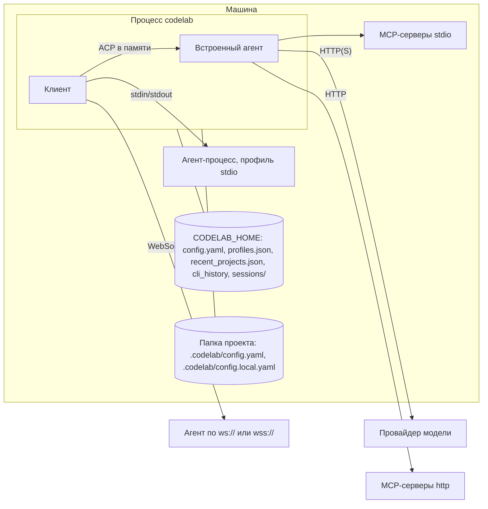

# `codelab`: эксплуатация

Здесь — как собрать `codelab`, запускать его без участия человека (скрипты, CI), где он хранит файлы, какие переменные окружения читает и с какими кодами завершается.

## Схема развёртывания

На схеме — процесс `codelab`, его файлы и сетевые соединения.



- По умолчанию работает только процесс `codelab`: встроенный агент выполняется внутри него. Отдельный `codelab-agent` не нужен.
- Агент-процесс появляется, только если выбран профиль `stdio:…`. `codelab` запускает его в папке сессии и завершает при выходе.
- `codelab` не открывает портов на приём. Исходящие соединения: к провайдеру модели, к MCP-серверам типа `http` и к агенту по WebSocket, если он выбран.

## Сборка

Требования и подготовка репозитория (`fvm install`, `melos bootstrap`, генерация `*.freezed.dart`) — в [запуске из исходников](../../../docs/user/run-from-source.md#1-подготовка). Версия SDK закреплена в `.fvmrc`.

```bash
fvm dart run melos run build:cli
```

Получится самостоятельный исполняемый файл `build/bin/codelab`. Без генерации кода сборка и `fvm dart run apps/codelab_cli/bin/codelab.dart` падают с ошибками `Error when reading '….freezed.dart'`.

Проверка сборки:

```bash
build/bin/codelab --version
```

```text
codelab 0.1.0
```

## Запуск без участия человека

Для скриптов и CI используйте режим `-p` (headless): один запрос, ответ, выход. Подробно о флагах `-p`, `-f`, `--approve` и `--timeout` — в [руководстве пользователя](user-guide.md#выполнить-один-запрос-без-диалога).

```bash
codelab -C "$PROJECT_DIR" --approve read-only --timeout 10m -f prompt.md > answer.md
```

Правила, на которые можно опираться в скриптах:

- stdout содержит только текст ответа агента, без цветов и разметки терминала. Всё остальное идёт в stderr.
- Ошибка использования оставляет stdout пустым.
- Если stdin перенаправлен, а нет ни `-p`, ни `-f`, ни первого сообщения в аргументах, запрос читается из stdin: `codelab < prompt.md` — это тоже headless.
- По умолчанию `--approve reject`: агент не получит разрешения ни на одно действие, требующее одобрения. `allow-all` разрешает всё, кроме критических действий, — используйте его только в изолированной среде.
- Мастер настройки провайдера в headless не запускается: конфигурацию нужно подготовить заранее.

Готовую конфигурацию проверяйте до запуска агента:

```bash
codelab config check
```

Код `0` — конфигурация годится, `1` — есть ошибки:

```text
Sources: defaults
defaults: agent.default_model: no model is configured; add a provider with at least one model
Config: invalid (issues: 1)
```

## Файлы

По умолчанию файлы клиента и встроенного агента лежат в каталоге `CODELAB_HOME`; исключение — слои конфигурации проекта. Где лежит каталог и какие файлы в нём общие с CodeLab app (`config.yaml`, `profiles.json`, `secrets.yaml`, `sessions/`), — в [каталоге `CODELAB_HOME`](../../../docs/ops/codelab-home.md). Токен внешнего агента `ws://…` — `CODELAB_AGENT_TOKEN`, если профиль не задаёт другую ссылку, — тоже там. Здесь — только то, что относится к `codelab`.

| Где | Что | Кто пишет |
|---|---|---|
| `<проект>/.codelab/config.yaml`, `<проект>/.codelab/config.local.yaml` | слои проекта | `config set --project` и `--local`; вы |
| `$CODELAB_HOME/cli_history` | история ввода диалога; создаётся с правами `0600` | диалог и полноэкранный режим |
| `$CODELAB_HOME/recent_projects.json` ([общий файл](../../../docs/ops/codelab-home.md#общие-файлы)) | список недавних проектов, общий с CodeLab app | диалог и полноэкранный режим, в том числе с `--resume` и `--continue`; headless `-p`, `test-scenario` и подкоманды файл не трогают |
| `$CODELAB_HOME/secrets.yaml` ([общий файл](../../../docs/ops/codelab-home.md#общие-файлы)) | какие команды `codelab` его пишут при `secrets.backend: file` | `codelab secret set` и `secret migrate`, `provider add --api-key-stdin`, `mcp add --header-stdin` и `--env-stdin`, мастер провайдера |

Папку сессии (`-C` или текущую) `codelab` записывает в `recent_projects.json` после мастера первого запуска и до подключения к агенту. Если записать не удалось, работа и код выхода не меняются; с `--verbose` в stderr выводится строка `codelab: cannot record a recent project: <тип ошибки>`. Нечитаемый файл `codelab` не перезаписывает; чтобы сбросить список, удалите файл.

Диалог, полноэкранный режим и `codelab profiles` создают `CODELAB_HOME` с правами `0700`, если каталога нет. Headless `-p` этого не делает: если первым запустить его, встроенный агент создаст `CODELAB_HOME` и `sessions/` с правами по umask. В CI заранее создайте каталог с правами `0700`. Подкоманды `config`, `provider`, `mcp` и `secret` не создают `sessions/`, `profiles.json` и `cli_history`.

Пути слоёв конфигурации для текущей папки печатает `codelab config path`:

```text
user: ~/.codelab/config.yaml (exists)
project: ~/projects/demo/.codelab/config.yaml (missing)
local: ~/projects/demo/.codelab/config.local.yaml (missing)
```

Слои и их приоритет — в [настройке агента](../../../docs/user/configuration.md#слои-конфигурации).

## Переменные окружения

Переменные `CODELAB_*` (`CODELAB_HOME`, `CODELAB_CONFIG`, `CODELAB_SECRET_<ИМЯ>`, `CODELAB_AGENT_TOKEN`, `CODELAB_DEBUG_SECRETS` и другие) общие для приложений CodeLab — их таблица в [переменных окружения](../../../docs/ops/environment.md). Здесь — только то, что относится к `codelab`.

| Переменная | Для чего |
|---|---|
| переменная из `api_key_env` провайдера | ключ API провайдера |
| `NO_COLOR` (непустая), `TERM=dumb` | вывод без цветов |
| `LC_ALL`, `LC_CTYPE`, `LANG` | значение с `UTF-8` включает символы Unicode в выводе |

Встроенный агент получает окружение процесса `codelab`: переменные с ключами должны быть заданы там, где запускается `codelab`.

### Секреты

- В CI ключ проще всего передать переменной окружения: `api_key_env` провайдера или `CODELAB_SECRET_<ИМЯ>` для `api_key_secret`. Файл хранилища и запись секретов для этого не нужны.
- Аргументы агента из профиля `stdio:…` не печатаются нигде — ни в ошибках, ни в `profiles list` и `profiles show`: видно только команду и число аргументов. Сами значения лежат в `profiles.json` — не кладите туда токены, если файл могут прочитать другие.

Где хранятся секреты, что маскируется в выводе и что попадает в журналы — в [настройке агента](../../../docs/user/configuration.md#шаг-2-задайте-ключ-api) и [что попадает в логи и журналы](../../../docs/user/configuration.md#что-попадает-в-логи-и-журналы).

## Логи и диагностика

- `--verbose` (`-v`) пишет в stderr диагностику соединения, журнал клиентского слоя (например, предупреждение о битом снимке расхода токенов) и лог встроенного агента. Без него эти строки никуда не пишутся, и stderr headless содержит только сообщения хода.
- `--debug-secrets` (или `CODELAB_DEBUG_SECRETS=1`) пишет в stderr, какие секреты искал встроенный агент: имя, назначение, источник и найден ли секрет. Значения не печатаются. На внешнего агента флаг не влияет.
- Файл лога `codelab` не ведёт. Журналы сессий встроенного агента — в `$CODELAB_HOME/sessions/` (или в `sessions.dir`, если он задан).
- Если встроенный агент не остановился за 10 секунд после выхода, `codelab` пишет `codelab: the embedded agent did not stop in 10 s` и всё равно завершается.

## Коды выхода

| Код | Значение | Что делать |
|---|---|---|
| `0` | успех: агент закончил ответ и ответ не пустой; подкоманда выполнена | — |
| `1` | ошибка хода или соединения: ошибка агента или провайдера, пустой ответ, обрыв, агент не запустился; `config check` нашёл ошибки; в `test-scenario` — есть `FAIL` или не сыграна ни одна фикстура; `profiles show` или `profiles remove` с несуществующим id | смотреть stderr; с `-v` — подробности соединения |
| `64` | ошибка использования: неверный флаг, нет запроса, неизвестный профиль в `-a`, несуществующая папка `-C`, невалидная конфигурация встроенного агента | исправить команду или конфигурацию; stdout пуст |
| `130` | отмена: `SIGINT` (Ctrl+C), истёкший `--timeout`, Ctrl+C в мастере настройки | — |
| `143` | завершение по `SIGTERM` | — |

Пример ошибки использования:

```bash
codelab --foo
```

```text
codelab: Unknown flag --foo
```

## Сигналы

Первый `SIGINT` или `SIGTERM` отменяет ответ агента, закрывает соединение и завершает агент-процесс; повторный сигнал завершает `codelab` сразу. В диалоге `SIGINT` действует как Ctrl+C. В Windows `SIGTERM` не отслеживается.

## Проверка агента фикстурами: `test-scenario`

`codelab test-scenario` проигрывает записанные сценарии обмена клиента и агента (фикстуры ACP) против выбранного агента и сравнивает ответы. Сеть и настоящий провайдер модели не нужны: встроенному агенту ответы модели подставляет сам сценарий.

```bash
codelab test-scenario packages/dart/codelab_acp_testing/fixtures/acp --agent embedded --filter 'acp/prompt-*' --junit build/scenario.xml
```

```text
PASS acp/prompt-anthropic-tool-call (0.2s)
PASS acp/prompt-cancel-during-terminal (0.2s)
…
SKIP acp/prompt-max-turn-requests (0.0s)
    embedded: setup.config cannot be played by the embedded agent
…
SKIP acp/prompt-update-plan (0.0s)
    acp/prompt-update-plan has roles [client] without "agent"
…
21 passed, 0 failed, 6 skipped
```

- Аргументы — файлы фикстур или каталоги с ними. `--filter` — шаблон id фикстур, `--timeout` — ожидание кадра агента (по умолчанию `30s`).
- Без `--agent` выбирается встроенный агент, как во всём `codelab`. Внешний агент — `--agent stdio:…`, `ws://…` или id профиля.
- `--junit <файл>` пишет отчёт JUnit XML. Путь проверяется до запуска агента: если записать нельзя, код `64`. Отчёт пишется и при `FAIL`.
- Если не сыграна ни одна фикстура (все пропущены или фильтр пуст) — `codelab: no fixtures were played` и код `1`.

В репозитории этот прогон запускает `fvm dart run melos run conformance:embedded`; с `CODELAB_TEST_REPORT_DIR` он пишет `scenario-embedded.xml`.

## Переходная команда `codelab serve`

`codelab serve …` запускает отдельный бинарь `codelab-agent` с теми же аргументами: сначала из каталога, где лежит `codelab`, затем из `PATH`. Перед запуском `codelab` пишет в stderr `codelab: "codelab serve" is deprecated and will be removed in a future release; use "codelab-agent serve" instead.` Код выхода — код агента; если `codelab-agent` не найден — `1`. Команда временная и в `codelab --help` не указана. Что использовать вместо неё — в [переходе с Python-агента](../../../docs/user/migrating-from-python-agent.md#профили-и-скрипты-с-codelab-serve).

## Смотрите также

- [Эксплуатация CodeLab](../../../docs/ops/README.md)
- [Настройка агента](../../../docs/user/configuration.md)
- [Руководство пользователя `codelab`](user-guide.md)
