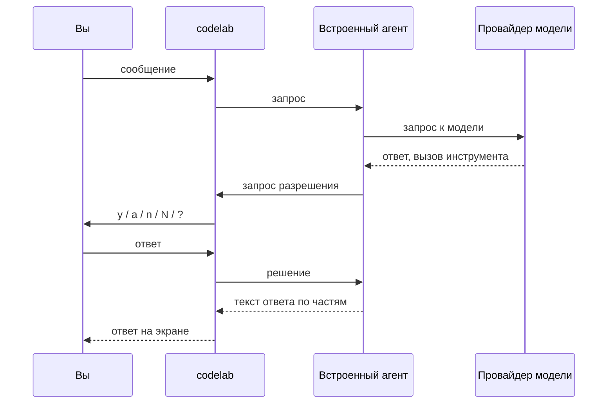

# `codelab`: руководство пользователя

`codelab` — терминальный клиент CodeLab. После этого руководства вы сможете работать с агентом в диалоге и одним запросом, выбрать агента и настроить провайдера модели, MCP-серверы и секреты.

## Перед началом

- Соберите `codelab` по [запуску из исходников](../../../docs/user/run-from-source.md). Установщика пока нет. В примерах ниже бинарь вызывается как `codelab`: добавьте `build/bin` в `PATH` или пишите полный путь.
- Нужен доступ к модели: ключ API облачного провайдера или локальный сервер (LM Studio, Ollama). Как это настроить — в разделе [«Настроить провайдера модели»](#настроить-провайдера-модели).
- Агент работает в папке проекта. Запускайте `codelab` из неё или передайте папку флагом `-C <папка>`.

## Первый запуск

1. Откройте терминал в папке проекта и запустите:

   ```bash
   codelab
   ```

   Если провайдер модели ещё не настроен, откроется мастер:

   ```text
   No model provider is configured for the embedded agent.
   Let's set one up. Press Ctrl+C to quit; run "codelab provider add" later to change it.
   ? API type
     › OpenAI
       Anthropic
       OpenRouter
       Ollama (local, no key)
       Custom OpenAI-compatible endpoint
       Custom Anthropic-compatible endpoint
   ```

2. Выберите тип API стрелками и нажмите Enter. Дальше мастер спросит адрес, модель и ключ. Ключ при вводе показывается звёздочками: Ctrl+R показывает и снова прячет его, Ctrl+U очищает поле.

   После сохранения появится строка `Saved provider "<id>". Starting the embedded agent…`, и откроется диалог.

3. Напишите вопрос и нажмите Enter.

   <!-- screenshot: текстовый снимок первого хода в построчном режиме: вопрос, ответ агента, приглашение `> ` -->

Ctrl+C в мастере выходит из `codelab` с кодом `130` и ничего не записывает. Мастер открывается только в терминале и только для встроенного агента: в `-p`, без терминала и с внешним агентом его нет.

Если провайдер настроен, но не хватает ключа, мастер не открывается. Вместо него `codelab` предложит сохранить ключ в хранилище секретов или подскажет, какую переменную окружения задать.

## Основные задачи

### Работать с агентом в диалоге

Построчный режим — режим по умолчанию. Он печатает ответы в обычный поток терминала, поэтому историю можно прокручивать и копировать средствами терминала.

1. Запустите `codelab`. Можно сразу передать первое сообщение: `codelab Объясни структуру проекта`.
2. Пишите сообщения и отправляйте их Enter. Новая строка внутри сообщения — Alt+Enter или Ctrl+J.
3. Пока агент отвечает, можно отправить следующее сообщение. Оно встанет в очередь, и `codelab` напечатает `queued: 1`. После ответа очередь уйдёт сама.
4. Выход — Ctrl+D на пустой строке, `/exit` или двойной Ctrl+C.

Главные клавиши:

| Клавиша | Что делает |
|---|---|
| Enter | отправить сообщение; во время ответа — поставить в очередь |
| Esc, Ctrl+C во время ответа | отменить ответ |
| Ctrl+C на строке ввода | очистить строку; второе нажатие за 1 секунду — выход |
| ↑, ↓ | предыдущее и следующее сообщение из истории |
| Tab | дополнить команду после `/` |
| Ctrl+L | очистить экран |

Полный список клавиш печатает `/help keys`.

#### Команды

Строка, которая начинается с `/`, — команда. `/help` печатает команды `codelab` и команды агента:

```text
> /help
Commands:
  /help [keys]                                     show the commands, or the keys with "keys"
  /exit                                            exit
  /quit                                            exit
  /new                                             start a new session in this folder
  /sessions                                        list the sessions of this folder
  /resume <n|id>                                   open a session from /sessions or by id
  /mode [value]                                    show or set the mode
  /model [value]                                   show or set the model
  /config [id] [value]                             show or set a config option
  /cancel                                          cancel the running turn
  /queue [drop <n>|clear]                          show, drop or clear queued prompts
  /profile [id]                                    show the agent profile or connect to another
  /reconnect                                       reconnect and reload the session
  /plan                                            show the current plan
  /clear                                           clear the screen
  /thoughts dim|collapsed|hidden                   show thoughts dimmed, collapsed or not at all
  /provider add|list|remove [<id>] [--local]       add, list or remove model providers
  /settings [<key> [<value> | --reset]] [--local]  show or change agent settings
Agent commands:
  /compact  Compact the session history
  /agent:mode  Switch the session mode
  /agent:model  Switch the model
  /status  Show the model, mode, working directory and MCP servers
  /agent:config  Reload or check the agent config
  /mcp  List, reload, enable or disable MCP servers
  /agent:help  List commands
…
Run /help keys for the keys.
```

Команды `codelab` выполняются сразу, без запроса к агенту. Команды агента уходят агенту сообщением. Если имя совпадает, побеждает команда `codelab`, а команда агента доступна с префиксом `agent:` — например, `/agent:help`. Список команд агента зависит от агента и его настроек.

#### Разрешения

Перед опасным действием — например, запуском команды или записью файла — агент может спросить разрешение. `codelab` показывает, что агент хочет сделать, и ждёт клавишу:

| Клавиша | Ответ |
|---|---|
| `y` | разрешить один раз |
| `a` | разрешать всегда |
| `n` | отклонить один раз |
| `N` | отклонять всегда |
| `?` | показать запрос целиком и спросить снова |
| Esc, Ctrl+C | отменить ответ агента |

Работают только варианты, которые предложил агент. Если агент не предложил «разрешать всегда», клавиша `a` ничего не отправит.

<!-- screenshot: текстовый снимок блока одобрения в построчном режиме (заголовок, команда, папка, подсказка клавиш) -->

#### Сессии

Агент хранит историю разговоров по папкам проекта.

- `codelab --continue` (`-c`) — продолжить последнюю сессию папки.
- `codelab --resume <id>` (`-r`) — открыть сессию по идентификатору.
- `/sessions` — список сессий этой папки с номерами; `/resume <номер или id>` — открыть сессию; `/new` — начать новую.

### Работать в полноэкранном режиме

Полноэкранный режим рисует транскрипт, строку ввода, подсказки и статус-строку в отдельном экране терминала. Сессия, команды, очередь и разрешения — те же, что в построчном режиме.

1. Запустите:

   ```bash
   codelab --ui=tui
   ```

2. Внизу появятся строка ввода, строка подсказок и статус-строка: профиль агента, режим и модель.

   ```text
   > /profile
   Profile embedded (Embedded agent): embedded embedded-cli
   >
   Enter send · Shift+Enter/Alt+Enter new line · Esc/Ctrl+C cancel · PgUp scroll · ctrl+t tasks
   embedded · standard · lmstudio/qwen/qwen3-1.7b
   ```

   <!-- screenshot: PNG окна codelab --ui=tui во время хода агента — apps/codelab_cli/doc/images/tui-turn.png -->

3. Выход — Ctrl+D на пустой строке, `/exit` или двойной Ctrl+C. После выхода терминал возвращается в обычный экран.

Полноэкранный режим работает только в терминале: если stdin или stdout перенаправлены, `codelab` завершится с ошибкой `--ui tui needs a terminal on stdin and stdout`. С `-p` флаг `--ui=tui` не сочетается.

### Выполнить один запрос без диалога

Режим `-p` (headless) нужен для скриптов: `codelab` отправляет один запрос, печатает ответ и завершается.

```bash
codelab -p "Перечисли файлы с тестами"
```

- В stdout попадает только текст ответа агента. Сообщения об инструментах, решения по разрешениям и ошибки идут в stderr.
- Запрос можно взять из файла: `codelab -f prompt.txt`. `-f -` — запрос из stdin. Если stdin перенаправлен, а нет ни `-p`, ни `-f`, ни первого сообщения в аргументах, запрос тоже читается из stdin: `cat prompt.txt | codelab`.
- `--timeout 10m` ограничивает время ответа. По истечении `codelab` отменяет ответ и выходит с кодом `130`.

В этом режиме никто не отвечает на запросы разрешений, поэтому ответ выбирает правило `--approve`:

| Значение | Что разрешено |
|---|---|
| `reject` (по умолчанию) | ничего: все запросы отклоняются |
| `read-only` | только чтение без повышенного риска |
| `allow-all` | всё, кроме действий, которые агент пометил как критические; при старте печатается предупреждение |

Включайте `allow-all` только в проекте, которому доверяете.

Коды выхода и использование в CI описаны в [руководстве по эксплуатации](operations.md#запуск-без-участия-человека).

### Выбрать агента

По умолчанию `codelab` работает со встроенным агентом: агент выполняется внутри процесса `codelab`, отдельная программа не нужна. `-a default` и `-a embedded` выбирают его же.

Другого агента выбирают флагом `-a` (`--agent`):

| Значение `-a` | Агент |
|---|---|
| не задано, `embedded`, `default` | встроенный агент |
| `stdio:<команда> [аргументы]` | программа-агент, которую `codelab` запускает в папке сессии, например `-a "stdio:codelab-agent serve --stdio"` |
| `ws://…`, `wss://…` | агент, который уже работает по этому адресу |
| `<id>` | сохранённый профиль |

Профиль — сохранённый способ подключения. Сохранить профили:

```bash
codelab profiles add devbox ws://127.0.0.1:8765
codelab profiles add local-agent "stdio:codelab-agent serve --stdio"
```

```text
Saved profile devbox.
Saved profile local-agent.
```

Список профилей:

```bash
codelab profiles list
```

```text
devbox       ws: ws://127.0.0.1:8765
local-agent  stdio: codelab-agent (2 arguments)
```

Подробности одного профиля:

```bash
codelab profiles show devbox
```

```text
id: devbox
type: webSocket
uri: ws://127.0.0.1:8765
token: env CODELAB_AGENT_TOKEN
```

Удалить профиль:

```bash
codelab profiles remove local-agent
```

```text
Removed profile local-agent.
```

Аргументы программы-агента `codelab` не печатает: в них может оказаться токен. Видно только их число.

Токен для подключения по WebSocket берётся из переменной окружения `CODELAB_AGENT_TOKEN`; в выводе он не показывается. Профиль, созданный в CodeLab app, может ссылаться на другую переменную или на секрет из хранилища — `codelab` понимает обе ссылки.

Имена `embedded` и `default` зарезервированы за встроенным агентом: сохранить профиль с ними нельзя.

```bash
codelab profiles add embedded embedded
```

```text
codelab: embedded is built in; use --agent embedded
```

В диалоге `/profile` показывает текущего агента, а `/profile <id>` переключает на другого.

### Настроить провайдера модели

Провайдер — сервис, который выполняет модель: OpenAI, Anthropic, OpenRouter, Ollama или любой совместимый адрес. Настройки хранятся в файле `config.yaml`; как он устроен — в [настройке агента](../../../docs/user/configuration.md).

Три способа добавить провайдера:

1. **Мастер.** `codelab provider add` в терминале без других флагов задаёт вопросы по шагам — как при [первом запуске](#первый-запуск).
2. **Готовый набор без вопросов.** `--preset` с одним из `openai`, `anthropic`, `openrouter`, `ollama`, `custom-openai`, `custom-anthropic`. `--yes` не спрашивает подтверждения, а `--skip-check` сохраняет провайдера, даже если проверка адреса не дождалась ответа.
3. **Все поля флагами.** Пример — в [шаге 1 настройки агента](../../../docs/user/configuration.md#шаг-1-подключите-провайдера-и-модель).

Ключ API не передаётся аргументом: строка команды остаётся в истории оболочки и видна в списке процессов. Укажите имя переменной (`--api-key-env`), имя секрета (`--api-key-secret`) или подайте ключ на stdin (`--api-key-stdin`). `--api-key-stdin` записывает ключ в хранилище секретов, поэтому нужен файловый бэкенд `secrets.backend: file` — см. [шаг 2 настройки агента](../../../docs/user/configuration.md#шаг-2-задайте-ключ-api).

Список провайдеров:

```bash
codelab provider list
```

```text
Secrets: env (OS keychain backends are not available in this version; set secrets.backend: file or CODELAB_SECRET_* variables)
lmstudio  kind: openai-compatible  base_url: http://127.0.0.1:1234/v1  models: qwen/qwen3-1.7b  key: none
```

Удалить провайдера: `codelab provider remove <id>`. В диалоге те же действия выполняет `/provider`, а `/settings` показывает и меняет настройки агента.

### Подключить MCP-сервер

MCP-сервер даёт агенту дополнительные инструменты. `codelab mcp` записывает сервер в конфигурацию, но сам к нему не подключается — это делает агент при старте.

```bash
codelab mcp add files --type stdio --command my-mcp-server --arg /data
codelab mcp add tracker --type http --url https://mcp.example.com --header-stdin Authorization --header-scheme Bearer
codelab mcp list
codelab mcp remove files
```

`--header-stdin` и `--env-stdin` читают одно значение из stdin, сохраняют его в хранилище секретов и записывают в файл только ссылку на него. Для записи в хранилище нужен `secrets.backend: file` — см. [шаг 2 настройки агента](../../../docs/user/configuration.md#шаг-2-задайте-ключ-api). Полный синтаксис печатает `codelab mcp` без аргументов.

### Хранить ключи и токены

Секреты — ключи API, токены — хранятся отдельно от `config.yaml`. Значение секрета `codelab secret set <имя>` читает из stdin (в терминале ввод скрыт) и никогда не печатает.

```bash
codelab secret list
codelab secret set codelab/openai
codelab secret delete codelab/openai
```

Где лежат секреты и как включить запись — в [шаге 2 настройки агента](../../../docs/user/configuration.md#шаг-2-задайте-ключ-api). `codelab secret migrate` переносит секреты, записанные прямо в файлах конфигурации, в хранилище.

### Проверить настройки

```bash
codelab config check
codelab config path
codelab config get agent.default_model
```

`config check` читает файлы так же, как агент, и называет ошибки с файлом и строкой. Подробно — в [шаге 3 настройки агента](../../../docs/user/configuration.md#шаг-3-проверьте-конфигурацию).

## Как это работает

На схеме — что происходит, когда вы отправляете сообщение встроенному агенту.



Агент работает внутри процесса `codelab`, но к модели обращается по сети. Разрешение спрашивает агент: `codelab` только показывает запрос и передаёт ваш ответ. В режиме `-p` вместо вас отвечает правило `--approve`.

## Настройка

- Файлы настроек, слои, ключи API — [настройка агента](../../../docs/user/configuration.md).
- Каталог настроек — `~/.codelab`; другой каталог задаёт переменная `CODELAB_HOME`. Что в нём лежит — в [руководстве по эксплуатации](operations.md#файлы).
- Цвета выключает флаг `--no-color` или переменная `NO_COLOR`.

## Если что-то пошло не так

| Что видите | Почему | Что сделать |
|---|---|---|
| `codelab: …: agent.default_model: no model is configured; add a provider with at least one model` и `Configure the embedded agent in ~/.codelab/config.yaml; check it with: codelab config check` | у встроенного агента нет модели | запустите `codelab` в терминале — откроется мастер, — или `codelab provider add` |
| `codelab: request failed after 4 attempts in …` (в `-p`) или `error: request failed after …` (в диалоге) с `network (connection failed: …)` | провайдер модели не отвечает по адресу из конфигурации | проверьте адрес и что сервер запущен; для локальной модели — что запущены LM Studio или Ollama |
| `codelab: Unknown agent profile. Run "codelab profiles list".` | профиля с таким id нет | посмотрите `codelab profiles list` |
| `codelab: --ui tui needs a terminal on stdin and stdout` | полноэкранный режим запущен с перенаправленным вводом или выводом | запустите в терминале без `<`, `>` и `|` |
| `codelab: --ui applies only to the interactive mode` | `--ui=tui` вместе с `-p` | уберите один из флагов |
| `codelab: No prompt.` | пустой запрос в `-p`, `-f` или stdin | передайте текст запроса |
| `codelab: profile <id> has no stored secret value; connecting without a token.` | профиль ссылается на секрет, которого нет в хранилище | сохраните его: `codelab secret set <имя>` |

## Смотрите также

- [Настройка агента](../../../docs/user/configuration.md)
- [Запуск из исходников](../../../docs/user/run-from-source.md)
- [Переход с Python-агента](../../../docs/user/migrating-from-python-agent.md) — что стало с `codelab serve`
- [Эксплуатация `codelab`](operations.md)
