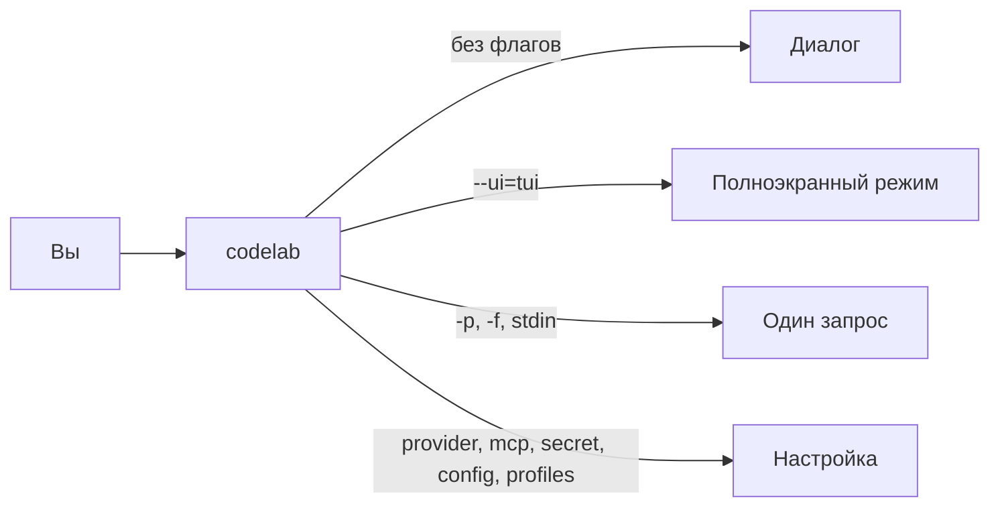
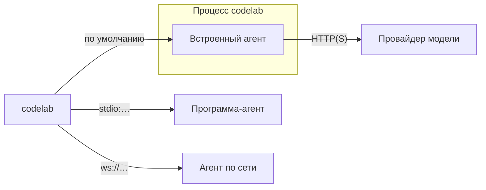
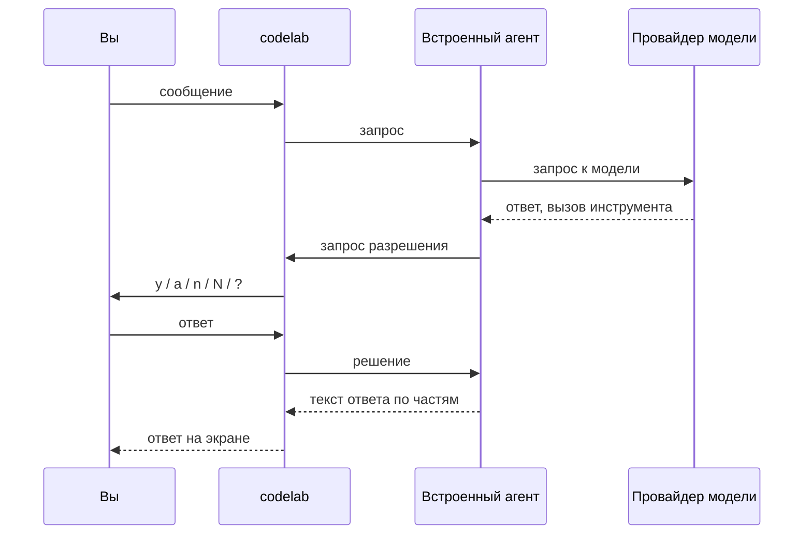

# Обзор: что такое `codelab`

`codelab` — терминальный клиент CodeLab. Он соединяет вас с AI-агентом: вы пишете задачу, агент читает файлы проекта, правит их и запускает команды, а `codelab` показывает ход работы и спрашивает ваше разрешение на опасные действия. Прочитав главу, вы поймёте, какие режимы есть у `codelab`, с каким агентом он работает и какую главу открыть под вашу задачу. Оглавление руководства — [руководство пользователя](../user-guide.md).

## Три режима работы

| Режим | Как запустить | Когда нужен |
|---|---|---|
| Диалог (построчный режим) | `codelab` | обычная работа: вопросы и ответы в терминале, история остаётся в прокрутке терминала |
| Полноэкранный режим | `codelab --ui=tui` | тот же диалог в отдельном экране терминала с прокруткой, списком задач и строкой статуса |
| Один запрос | `codelab -p "…"` | скрипты и CI: один запрос, ответ в stdout, код выхода |

Кроме режимов у `codelab` есть подкоманды для настройки: `provider`, `mcp`, `secret`, `config`, `profiles`. Они ничего не спрашивают у агента: правят файлы настроек и завершаются. Ещё одна подкоманда, `test-scenario`, нужна тем, кто проверяет самих агентов, — [отдельная глава](10-test-scenario.md).

## С каким агентом работает `codelab`

Агент — программа, которая общается с моделью и выполняет действия в проекте. `codelab` говорит с агентом по ACP (Agent Client Protocol) — протоколу, по которому клиент и агент обмениваются сообщениями.

- **Встроенный агент** — по умолчанию. Он выполняется внутри процесса `codelab`: отдельную программу ставить не нужно. Имена `embedded` и `default` обозначают его же.
- **Внешний агент** — выбирается флагом `-a`: программа, которую `codelab` запускает сам (`stdio:…`), агент, который уже работает по сети (`ws://…`), или сохранённый профиль. Подробности — в [главе о выборе агента](05-folder-model-agent.md#выбрать-агента).

Возможности самого агента — инструменты, режимы разрешений, навыки, файл `AGENTS.md` проекта, шаблоны команд, сжатие контекста — одинаковы во всех клиентах и описаны в [руководстве агента](../../../codelab_agent/doc/user-guide.md). Здесь описано, как ими пользоваться из `codelab`.

Встроенный агент обращается к модели по сети: нужен ключ облачного провайдера или локальный сервер модели. Как это настроить — в [главе о провайдерах](06-providers.md).

## Как это работает

На схеме — что происходит, когда вы отправляете сообщение встроенному агенту.

Разрешение спрашивает агент: `codelab` только показывает запрос и передаёт ваш ответ. В режиме `-p` вместо вас отвечает правило `--approve` — [глава о запросе без диалога](04-headless.md).

## Какую главу открыть

| Я хочу… | Глава |
|---|---|
| собрать `codelab` и сделать первый запуск | [Установка и первый запуск](01-install-and-first-run.md) |
| работать с агентом в диалоге, знать команды `/…` и клавиши | [Диалог](02-repl.md) |
| работать в полноэкранном режиме | [Полноэкранный режим](03-tui.md) |
| вызывать агента из скрипта или CI | [Один запрос без диалога](04-headless.md) |
| выбрать папку, модель, режим, внешнего агента, профиль | [Папка, модель, режим и агент](05-folder-model-agent.md) |
| подключить провайдера модели | [Провайдеры моделей](06-providers.md) |
| хранить ключи и токены | [Секреты](07-secrets.md) |
| подключить MCP-сервер | [MCP-серверы](08-mcp.md) |
| проверить и править настройки | [Проверка и правка настроек](09-config.md) |
| найти флаг или команду | [Справочник](11-reference.md) |
| разобраться с ошибкой | [Если что-то пошло не так](12-troubleshooting.md) |

## Смотрите также

- [Руководство агента](../../../codelab_agent/doc/user-guide.md) — что умеет агент и что он спрашивает
- [Настройка агента](../../../../docs/user/configuration.md) — файлы `config.yaml`, слои, ключи
- [Эксплуатация `codelab`](../operations.md) — сборка, файлы, окружение, коды выхода
