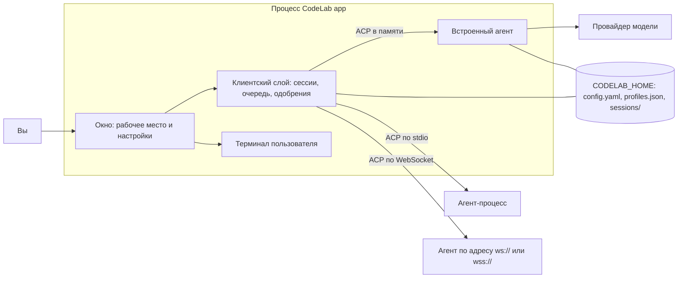

# Настольное приложение CodeLab (`codelab_desktop`)

CodeLab app — настольное приложение для работы с AI-агентом над папкой проекта: сессии по проектам, лента переписки, одобрение действий агента, файлы проекта, терминал и настройки агента в одном окне. Как и терминальный клиент `codelab`, по умолчанию оно запускает встроенного агента в своём процессе; внешний агент подключается профилем. Сейчас приложение собирается и проверяется для macOS.


Сессия в проекте `demo` до первого сообщения: в шапке — проект и режим, под полем ввода — режим и модель.

## Кому какой документ

| Я хочу… | Читать |
|---|---|
| пользоваться CodeLab app | [Руководство пользователя](doc/user-guide.md) |
| собрать приложение, найти его данные и логи | [Эксплуатация](doc/operations.md) |
| менять код приложения | [Разработка](doc/development.md) |

## Быстрый старт

Команды выполняются из корня репозитория. Нужны FVM и Xcode с командной строкой.

1. Подготовьте репозиторий и сгенерированный код — по шагу 1 из [запуска из исходников](../../docs/user/run-from-source.md#1-подготовка).

2. Запустите приложение:

   ```bash
   cd apps/codelab_desktop
   fvm flutter run -d macos
   ```

   Откроется окно с надписью «Open a project to start a session.»

3. Нажмите «Open folder…» и выберите папку проекта. Приложение запустит встроенного агента в этой папке.

4. Если провайдер модели ещё не настроен, на экране появится «No model provider is configured for the embedded agent.» Нажмите «Add provider» и пройдите мастер — подробно в [руководстве пользователя](doc/user-guide.md#подключить-провайдера-модели).

5. Создайте сессию сочетанием ⌘N (или «New session» в боковой панели) и напишите агенту сообщение.

## Как устроено

На схеме — части приложения и то, с чем они говорят.



ACP (Agent Client Protocol) — протокол, по которому клиент и агент обмениваются сообщениями. Встроенный агент выбран по умолчанию; агент-процесс и агент по WebSocket выбираются профилем на странице «Connection». Терминал пользователя — обычная оболочка в папке сессии: он не проходит через агента и его одобрения.

## Смотрите также

- [Документация пользователя CodeLab](../../docs/user/README.md)
- [Эксплуатация CodeLab](../../docs/ops/README.md)
- [Правила приложения для разработчиков и агентов](AGENTS.md)
