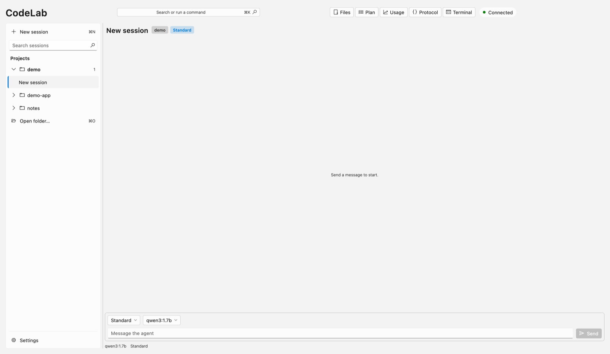
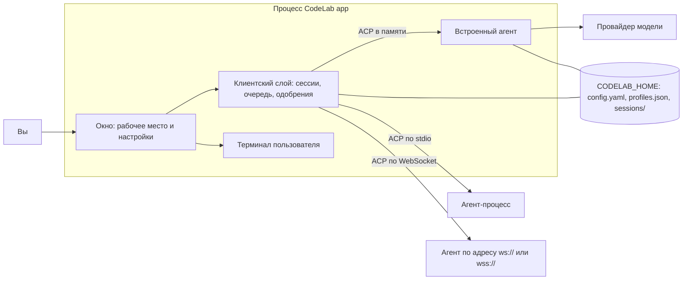

# Настольное приложение CodeLab (`codelab_desktop`)

CodeLab app — настольное приложение для работы с AI-агентом над папкой проекта: сессии по проектам, лента переписки, одобрение действий агента, файлы проекта, терминал, расход модели и настройки агента в одном окне. Оформление — светлое, тёмное или по системе, системный цвет акцента и свои цветовые темы в JSON. При первом запуске приложение проводит по четырём приветственным шагам: что делает CodeLab, правила разрешений, выбор модели, что уходит с компьютера. Как и терминальный клиент `codelab`, по умолчанию оно запускает встроенного агента в своём процессе; внешний агент подключается профилем. Сейчас приложение собирается и проверяется для macOS.



Сессия в проекте `demo` до первого сообщения: в шапке — проект и режим, под полем ввода — режим и модель.

## Кому какой документ

| Я хочу… | Читать |
|---|---|
| пользоваться CodeLab app | [Руководство пользователя](doc/user-guide.md) |
| собрать приложение, найти его данные и логи | [Эксплуатация](doc/operations.md) |
| менять код приложения | [Разработка](doc/development.md) |

## Быстрый старт

Команды выполняются из корня репозитория. Нужны FVM и Xcode с командной строкой.

1. Подготовьте репозиторий и сгенерированный код — по шагу 1 из [запуска из исходников](../../docs/user/run-from-source.md#1-подготовка).

2. Запустите приложение:

   ```bash
   cd apps/codelab_desktop
   fvm flutter run -d macos
   ```

   При самом первом запуске откроются четыре приветственных шага ([руководство](doc/user-guide.md#приветственные-шаги)); после них — окно с экраном «Open a project»

3. Откройте папку проекта: нажмите «Open folder…» (или ⌘O), либо перетащите папку из Finder на экран «Open a project». Приложение запустит встроенного агента в этой папке. Что принимает экран и когда он отказывает — в [руководстве](doc/user-guide.md#первый-запуск).

4. Если провайдер модели ещё не настроен, на экране появится «No model provider is configured for the embedded agent.» Нажмите «Add provider» и пройдите мастер — подробно в [руководстве пользователя](doc/user-guide.md#подключить-провайдера-модели).

5. Создайте сессию сочетанием ⌘N (или «New session» в боковой панели) и напишите агенту сообщение.

## Как устроено

На схеме — части приложения и то, с чем они говорят.



ACP (Agent Client Protocol) — протокол, по которому клиент и агент обмениваются сообщениями. Встроенный агент выбран по умолчанию; агент-процесс и агент по WebSocket выбираются профилем на странице «Connection». Терминал пользователя — обычная оболочка в папке сессии: он не проходит через агента и его одобрения.

## Оформление

Страница «Appearance» (Settings › App) переключает «Light», «Dark» и «Match system» (по умолчанию — по системе), включает системный акцент, выбирает встроенные темы «Fluent Light», «Fluent Dark», «High contrast» и подключает свои темы из `$CODELAB_HOME/themes/*.json`. Подробности и формат файла темы — в [руководстве пользователя](doc/user-guide.md#оформление).

## Локализация

Интерфейс приложения — на английском и русском. Язык выбирается на странице «General» (System, English, Русский) и применяется сразу; подробности — в [руководстве пользователя](doc/user-guide.md#язык-интерфейса).

Для разработчика:

- Тексты приложения лежат в `lib/l10n/`: `app_en.arb` — шаблон, `app_ru.arb` — перевод. Текст кита `codelab_ui` — в [`packages/flutter/codelab_ui/lib/src/l10n/`](../../packages/flutter/codelab_ui/README.md#локализация).
- Код каталога генерирует `fvm flutter gen-l10n` (настройка — `l10n.yaml`). Сгенерированные файлы коммитятся.
- `fvm dart run melos run l10n:check` перегенерирует каталоги app и кита во временной копии и сверяет с рабочими. Скрипт входит в `melos run check`.
- Сторож литералов `ui_literals_test` (`packages/dart/codelab_architecture_tests`) ищет английские строки интерфейса в `lib/app`, в `presentation/` внутри `lib/features` и в `lib/src` кита (кроме превью и `l10n/`) мимо каталога. Исключение — запись с причиной в `test/support/ui_literals_allowlist.txt`: название продукта, значение конфигурации, пример поля. Запись, которой нет в коде, роняет тест.
- Русские формулировки — по [глоссарию](../../docs/architecture/l10n-glossary.md). Как добавить строку и страницу — в [разработке](doc/development.md).
- Меню macOS следует языку системы: `CFBundleLocalizations` в `macos/Runner/Info.plist` и `macos/Runner/ru.lproj/MainMenu.strings`.

## Смотрите также

- [Документация пользователя CodeLab](../../docs/user/README.md)
- [Эксплуатация CodeLab](../../docs/ops/README.md)
- [Правила приложения для разработчиков и агентов](AGENTS.md)
