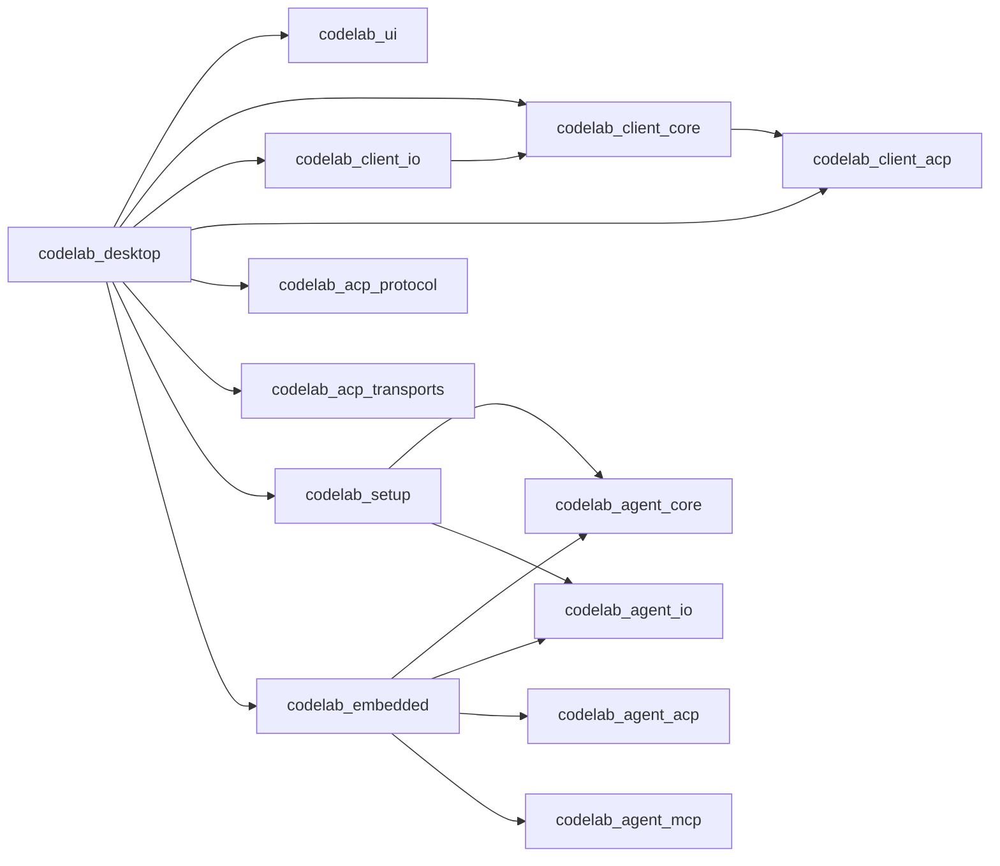
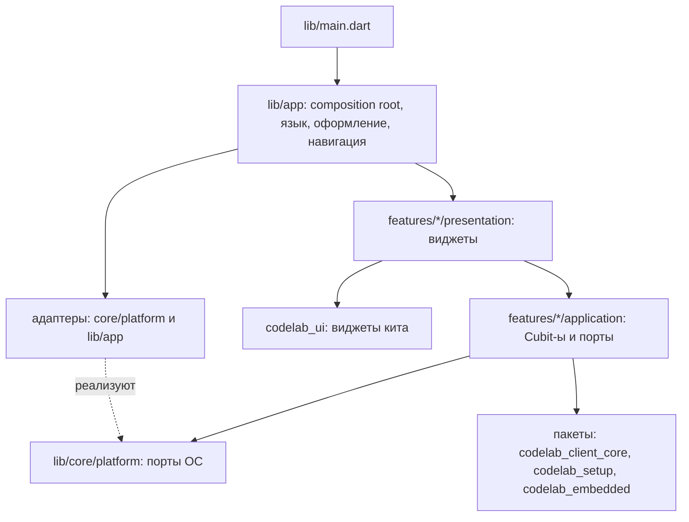

# Обзор приложения

Глава даёт карту: из чего состоит код приложения, какие фичи в нём есть, какие слои у каждой, что запрещено импортировать и как это проверяется. Читайте её сразу после [начала работы](00-getting-started.md): остальные главы ссылаются на понятия отсюда.

Место приложения среди пакетов — в разделе «Место в monorepo» ниже, карта файлов `lib/` — в разделе «Карта кода».

## Одним абзацем

CodeLab app — Flutter-приложение для macOS. Своего состояния сессий, очереди промптов и одобрений у него нет: их владелец — клиентский слой `codelab_client_core` (`ClientWorkspace`, `SessionHandle`), общий с терминальным клиентом `codelab`. Cubit-ы приложения подписываются на это состояние, превращают его в данные для экрана и передают действия пользователя обратно. Агента приложение получает через мосты `codelab_embedded` и `codelab_setup`, виджеты рабочего места — из пакета `codelab_ui`. Всё остальное в `apps/codelab_desktop` — склейка: сборка графа зависимостей, порты к системе, настройки, страницы.

## Место в monorepo

`apps/codelab_desktop` — Flutter-приложение. Владелец состояния сессий — клиентский слой (см. «Одним абзацем» выше). Агентскую сторону приложение получает только через два моста: `codelab_embedded` (встроенный агент в процессе) и `codelab_setup` (конфигурация агента, провайдеры, MCP-серверы, секреты). Прямой импорт `package:codelab_agent_*` запрещён и проверяется сторожем (`melos run guard`). Виджеты рабочего места — пакет `codelab_ui`.

Зависимости по `pubspec.yaml` приложения и его прямых зависимостей:

Сторонние зависимости приложения: `fluent_ui` (виджеты Fluent), `flutter_bloc` (Cubit-ы), `cherrypick` с `cherrypick_annotations` (внедрение зависимостей), `fpdart`, `path`, `path_provider`, `shared_preferences`, `file_selector` (выбор папки и файла), `desktop_drop` (перетаскивание папки на экран «Open a project»; импорт — только `lib/core/platform/os_drop_region.dart`), `system_theme` (системный акцент; импорт — только `lib/core/platform/system_accent_source.dart`), `pty2`, `xterm2` и `xterm2_core` (терминал), `url_launcher`, `flutter_localizations` и `intl` (локализация), `structured_log` с адаптерами `structured_log_flutter`, `structured_log_fluent` и `structured_log_remote_sync` (журнал). `codelab_acp_testing` — только `dev_dependency`.

На схеме опущены зависимости внутри нижних слоёв: `codelab_client_io` зависит ещё от `codelab_client_acp`, а `codelab_client_*`, `codelab_embedded` и `codelab_agent_acp` — от `codelab_acp_protocol` и `codelab_acp_transports`. Общая картина слоёв — [layers-and-dependencies.md](../../../docs/architecture/layers-and-dependencies.md) и [acp-boundary.md](../../../docs/architecture/acp-boundary.md).

## Что где живёт

Если вы не знаете, в каком пакете искать:

| Вопрос | Где ответ |
|---|---|
| как соединяется клиент с агентом, как устроены сессии, очередь, одобрения, транскрипт, инспектор | `codelab_client_core`, [README](../../../packages/dart/codelab_client_core/README.md) |
| сообщения ACP и их кодеки | `codelab_acp_protocol`; границу объясняет [acp-boundary.md](../../../docs/architecture/acp-boundary.md) |
| как запускается встроенный агент в процессе | `codelab_embedded`, [README](../../../packages/dart/codelab_embedded/README.md); [глава 07](07-embedded-agent-and-connections.md) |
| настройки агента: провайдеры, MCP-серверы, секреты, конфигурация | `codelab_setup`, [README](../../../packages/dart/codelab_setup/README.md) |
| профили, недавние проекты, темы на диске, настоящие транспорты | `codelab_client_io` |
| виджеты рабочего места, палитры, сочетания клавиш | `codelab_ui`, [руководство](../../../packages/flutter/codelab_ui/doc/README.md) |
| что делает каждая страница, какие у неё Cubit и порты | `apps/codelab_desktop`: [глава 04](04-navigation-and-settings.md) и [`AGENTS.md`](../AGENTS.md) приложения |
| как подключаются порты ОС, где хранятся настройки окна | `apps/codelab_desktop`: [глава 06](06-platform-and-appearance.md) |

## Feature-first: фичи и слои

Код `lib/` делится на три части: `app/` (сборка и общие владельцы), `core/` (общий код приложения) и `features/<фича>/` (возможности). Правила слоёв — [layers-and-dependencies.md](../../../docs/architecture/layers-and-dependencies.md), разделы 11–18.

В `lib/features/` семь фич. У каждой ровно два слоя, `application/` и `presentation/`; каталогов `domain/` и `infrastructure/` нет — их роль играют пакеты и соседние каталоги:

| Фича | Что делает | `application/` | `presentation/` |
|---|---|---|---|
| `workbench` | рабочее место: подключение, сессии, лента, композер, одобрения, док панелей, экран «Open a project» | `CodeLabShellCubit` из шести частей, `ui_mappers.dart`, переносы секретов, разбор брошенных путей | оболочка, лента, баннеры, панель «Agents», экран «Open a project» |
| `settings` | страницы настроек и диалоги: «Connection», «Providers», «MCP servers», «Agents & modes», «Skills & extensions», «General», «Appearance», «Keyboard», «Legal», мастер провайдера, диалог профиля | Cubit-ы страниц, порты и логика данных страниц | страницы, оболочка настроек, диалоги |
| `onboarding` | пять приветственных шагов первого запуска | `OnboardingCubit`, порт фактов, открыватель мастера | экран и шаги |
| `usage` | панель «Usage»: расход модели, бюджет хода, экспорт CSV | данные карточек и таблиц, правило обновления журнала, CSV | виджеты поверх `CodeLabUsagePane` кита |
| `project_files` | панель «Files»: дерево и просмотр файлов | `ProjectFilesCubit` | панель |
| `terminal` | терминал пользователя: вкладки, ссылки, вывод | `TerminalTabsCubit`, состояние вкладок | вид эмулятора, сброс вывода на кадре |
| `protocol` | панель «Protocol»: кадры ACP и журнал приложения | `ProtocolPaneCubit`, фильтры, сборка JSON Lines | панель |

Что значат слои здесь:

- **`application/`** — Cubit-ы, их состояния, чистые функции и порты. Тут нет виджетов и `BuildContext`; тестируется без дерева виджетов. Исключения «почти слоя» — типовые импорты Flutter, а не виджеты: например, `ui_mappers.dart` берёт `FluentIcons` для значков строк, `shell_cubit.dart` — `ImageProvider`, `appearance_settings_cubit.dart` — `FluentThemeData`.
- **`presentation/`** — виджеты. Они читают состояние из Cubit-а (`BlocBuilder`, `context.read`) и вызывают его методы. Файлов, сети, процессов и хранилища виджет не касается.
- **доменной логики в приложении нет.** Она в `codelab_client_core` (например, правила очереди и одобрений) и `codelab_client_acp`.
- **адаптеров нет внутри фич.** Они в `lib/core/platform/` (ОС и плагины) и `lib/app/` (всё, что знает пакеты агента и IO-барели мостов).

### Схема слоёв внутри приложения

На схеме стрелка читается «зависит от». Композиция (`lib/app/`) знает всех, остальные — только вниз.

Две оговорки, которых на схеме не видно:

- Фичи импортируют друг друга напрямую, например: `workbench` берёт `application/` и `presentation/` соседних фич (`settings`, `usage`, `protocol`, `terminal`, `project_files`), `onboarding` — `settings` и `workbench`, `usage` и `protocol` в `presentation/` — `workbench`. Полный список даёт `grep` по импортам `features/`. Публичного API и закрытой части у фичи нет; связь через узкий интерфейс есть в одном месте — `ConnectionCommands` (`features/settings/application/connection_commands.dart`), его реализует `ConnectionCubit` фичи `workbench`. Это описано в [layers-and-dependencies.md](../../../docs/architecture/layers-and-dependencies.md), раздел 12; сторож межфичевых импортов не проверяет.
- `lib/core/platform/` лежит рядом с фичами, а не внутри: порты нужны нескольким из них (`ConnectionPreferences` — странице «Connection», рабочему месту и composition root).

## Карта кода

Приложение устроено по фичам (feature-first): каждая фича держит слои `application/` (Cubit-ы и состояние, без виджетов) и `presentation/` (виджеты). Слоёв `domain/` и `infrastructure/` в фичах нет: доменная логика живёт в `codelab_client_core`, адаптеры к ОС — в `lib/core/platform/` и `lib/app/`.

| Путь | Что там |
|---|---|
| `lib/main.dart` | точка входа: каталог логов, первое открытие хранилища секретов, `runApp` |
| `lib/app/app_scope.dart` | composition root: `createCodeLabRootScope` (модули Cherrypick и швы тестов), `CodeLabBootstrap`, `CodeLabDependencies`, `CodeLabRootLifecycle` |
| `lib/app/codelab_app_widget.dart` | `CodeLabApp`: `FluentApp`, провайдеры Cubit-ов, переключение рабочего места и настроек, запуск агента после первого кадра |
| `lib/app/language/` | `AppLanguageCubit`: язык интерфейса (System, English, Русский), `AppStrings` в корневой области; `app_language_start.dart` — `AppLanguageStart`, начальный язык и диагностика чтения, которые `main` передаёт в composition root; `CodeLabApp` меняет только `locale` у `FluentApp` |
| `lib/app/appearance/` | оформление: `AppAppearanceCubit` (режим, две темы по режимам, очередь записи, номера операций), `AppAppearanceStart` (решение для первого кадра: сохранённый выбор, загруженные темы, акцент), `built_in_themes.dart`, `fluent_theme_builder.dart` (`FluentThemeData` из ролей темы и `CodeLabPalette`); `CodeLabApp` строит `FluentApp` с обеими темами и `themeMode` |
| `lib/l10n/` | каталоги gen-l10n: `app_en.arb` (шаблон) и `app_ru.arb`, сгенерированный `app_localizations*.dart` (коммитится); настройка — `l10n.yaml` |
| `lib/app/navigation/` | `NavigationCubit`: переход приветственные шаги → рабочее место ↔ настройки, страницы настроек (`SettingsPage`), вкладка страницы «Legal» |
| `lib/app/onboarding/`, `onboarding_probe.dart`, `onboarding_project_port.dart` | приветственные шаги: `OnboardingStart` (решение для первого кадра по флагу `codelab.app.onboarding_done`), зонд фактов о настройках агента (поверх `codelab_setup/io.dart`), адаптер порта выбора проекта поверх фасада рабочего места |
| `lib/app/about_ports_factory.dart`, `legal_ports_factory.dart`, `build_version.dart` | порты раздела «About» (версии, ОС, каталог журналов) и страницы «Legal» (чтение `assets/legal/`, сбор лицензий пакетов из `LicenseRegistry`); константа версии сборки, которую тест сверяет с `pubspec.yaml` |
| `lib/app/embedded_transport_resolver.dart`, `embedded_logger.dart` | открытие и закрытие встроенного агента, логгер агента → журнал приложения |
| `lib/app/connection_environment.dart` | окружение процесса и путь к `profiles.json` |
| `lib/app/client_profile_secrets.dart`, `reopenable_profile_secrets.dart` | хранилище секретов для токенов профилей |
| `lib/app/provider_settings_session.dart`, `provider_setup_probe.dart`, `provider_setup_offer.dart` | конфигурация агента для страниц «Providers» и «MCP servers» и мастера провайдера |
| `lib/app/agent_definitions_loader.dart` | чтение определений агентов для страницы «Agents & modes»: `agentDefinitionRowsAt` из `codelab_setup/io.dart`, тайм-аут 5 с |
| `lib/app/secret_migration_offer.dart`, `embedded_secret_migration_runner.dart` | перенос секретов из `config.yaml` |
| `lib/app/app_exit_handler.dart` | закрытие при выходе: предел 5 с, сброс журналов |
| `lib/core/platform/` | порты и адаптеры платформы: оформление, системный акцент, выбор файла и папки, хранилища `shared_preferences`, недавние проекты, брошенная папка, оболочка пользователя, ссылки, сведения об ОС, меню macOS, открытие каталога, сохранение CSV; перечень портов, адаптеров и ключей — [глава 06](06-platform-and-appearance.md#порты-и-адаптеры) |
| `lib/core/text/` | общие текстовые функции |
| `lib/features/workbench/` | рабочее место: `CodeLabShellCubit` из частей (`ConnectionCubit`, `SessionsCubit`, `ActiveSessionCubit`, `LayoutCubit`, `SettingsCubit`, `TranscriptViewCubit`), маппер строк ленты `ui_mappers.dart`, данные панели «Agents» `agents_pane_data.dart`, перенос секретов, выбор цели «Go to approval» и ответа сочетанием (`approval_go_to_target.dart`, `approval_shortcut_decision.dart`, `approval_focus_return.dart`); виджеты оболочки, ленты, баннеров, панели «Agents», экран «Open a project» (`open_project_screen.dart`) |
| `lib/features/onboarding/` | приветственные шаги: `OnboardingCubit` (шаг, факты, шаг модели, шаг выбора проекта, документ «Privacy»), экран и шаги в `presentation/`; `dart:io` запрещён сторожем |
| `lib/features/settings/` | настройки: страницы «General» (умолчания агента, язык, «Reopen the last project», «Privacy», «About»), «Keyboard» (каталог сочетаний кита, поиск; без Cubit), «Legal» (`LegalPageCubit`, вкладки, поиск по пакетам), «Connection», «Providers», «MCP servers», «Agents & modes» (`AgentsModesCubit` читает умолчания сессии через мост `sessionDefaultsOf` из `codelab_setup`), «Skills & extensions» (`SkillsSettingsCubit`: навыки и расширения, выключатели навыков и согласие на корни), «Appearance» (`AppearanceSettingsCubit`: каталог тем, карточки, превью, контраст, импорт; применённым оформлением владеет `AppAppearanceCubit` из `lib/app/appearance/`, страница только показывает его), диалог профиля, мастер провайдера |
| `lib/features/usage/` | панель «Usage»: `usage_pane_data.dart` (данные карточек и таблиц), `usage_budget.dart` (блок «Turn budget» с вычетом ожиданий одобрений), `ledger_refresh.dart` (обновление журнала), `usage_csv.dart` (экспорт), `usage_step_label.dart` (подписи шагов); виджеты `workbench_usage_pane.dart`, `usage_pane_view.dart` поверх `CodeLabUsagePane` из `codelab_ui` |
| `lib/features/project_files/` | панель «Files»: дерево и просмотр файлов |
| `lib/features/terminal/` | терминал пользователя: вкладки, ссылки, вывод |
| `assets/legal/` | бандл правовых документов: копии корневых `LICENSE`, `THIRD_PARTY_NOTICES.md`, `PRIVACY*.md`, `TERMS*.md`; тест `test/app/legal_assets_test.dart` сверяет побайтно и по `pubspec.yaml` |
| `test_driver/app.dart` | точка входа с расширением `flutter_driver` для управления запущенным приложением |
| `tool/terminal_spike/` | отдельный экспериментальный проект проверки терминала; в приложение не входит |

**`lib/app/`** собирает приложение и держит то, что не принадлежит одной фиче: сборку и жизненный цикл ([глава 02](02-composition-root.md)), общих владельцев состояния процесса (язык, оформление, навигация, решение для первого кадра) и адаптеры, которым нужны IO-барели мостов или пакеты агента.

**`lib/core/`** — только `platform/` (порты и адаптеры к ОС и хранилищам настроек, [глава 06](06-platform-and-appearance.md)) и `text/` (общие текстовые функции). Файл попадает в `core/`, когда у него минимум два независимых потребителя; единственный потребитель — повод оставить порт рядом с ним (так сделан `SettingsPageStore` в `lib/app/navigation/`).

**`lib/l10n/`** — каталоги gen-l10n: `app_en.arb`, `app_ru.arb` и сгенерированные `app_localizations*.dart` ([глава 05](05-localization.md)).

## Правила зависимостей и как их проверяет сторож

Источник правил — корневой [`AGENTS.md`](../../../AGENTS.md) (§5, §6, §7, §10, §11) и [`AGENTS.md` приложения](../AGENTS.md). Проверяет часть из них тест-сторож `packages/dart/codelab_architecture_tests` (`fvm dart run melos run guard`, правила — `test/support/rules.dart`).

Что запрещено и кто проверяет:

| Правило | Проверяет |
|---|---|
| приложение не импортирует `package:codelab_agent_*`: агентскую сторону берёт через `codelab_embedded` и `codelab_setup`; `codelab_agent_*` нет и в `pubspec.yaml` | сторож: правило `apps/codelab_desktop` и `pubspec_allowlist_test.dart` |
| `package:codelab_embedded/io.dart` и `package:codelab_setup/io.dart` — только `lib/app/` | сторож |
| `package:codelab_embedded/testing.dart` — нигде в `lib/` | сторож |
| плагины (`file_selector`, `url_launcher`, `pty2`, `system_theme`, `desktop_drop`) и `dart:ffi` — только в назначенных адаптерах `lib/core/platform/` | сторож ([глава 06](06-platform-and-appearance.md#что-проверяет-сторож)) |
| `dart:io` нет в `features/onboarding`, `features/project_files`, `features/settings/presentation`; нет `dart:io` и Flutter в `features/usage/application` и `features/protocol/application`; нет Flutter в `features/terminal/application` | сторож |
| литералы английского текста в `lib/app` и `presentation/` идут через каталог локализации | сторож `ui_literals_test` ([глава 05](05-localization.md)) |
| литералы активаторов клавиш в app запрещены; единственный каталог — `CodeLabShortcut` кита | тест приложения `test/app/shortcut_catalog_guard_test.dart` |
| виджеты не создают репозитории, клиенты ACP, хранилища и платформенные адаптеры; Cubit-ы не обращаются к файлам и хранилищу напрямую | ревью, [`AGENTS.md`](../AGENTS.md) приложения |
| слои внутри фичи: presentation → application, а не наоборот; application без `BuildContext` и виджетов | ревью |
| фичи не лезут в реализацию друг друга | ревью (сторож не проверяет) |
| widgets не парсят и не отправляют сырые сообщения ACP; permission policy не живёт в виджетах | ревью и спецификации [approval-safety](../../../openspec/specs/approval-safety/spec.md), [agent-workbench-ui](../../../openspec/specs/agent-workbench-ui/spec.md) |

Практически это значит: нарушили запрет из первых строк таблицы — упадёт `guard`; нарушили остальное — это поймает ревью. Новое правило сторожа добавляют вместе с границей ([глава 06](06-platform-and-appearance.md#скелет-нового-порта-платформы)).

Общие правила слоёв и состояния — [layers-and-dependencies.md](../../../docs/architecture/layers-and-dependencies.md), [state-management.md](../../../docs/architecture/state-management.md), [concurrency.md](../../../docs/architecture/concurrency.md).

## Словарь

| Термин | Значение в приложении |
|---|---|
| **ACP** | Agent Client Protocol — протокол, по которому клиент и агент обмениваются сообщениями. Приложение не парсит его в виджетах: сообщения превращает в состояние `codelab_client_core` |
| **Cubit** | класс `flutter_bloc`: хранит состояние и меняет его методами. Cubit-ы приложения живут в `application/` и в `lib/app/` (язык, оформление, навигация) |
| **Рабочее место** (workbench) | основной экран: боковая панель, лента, композер, док панелей; его состояние собирает `CodeLabShellCubit` из частей |
| **Фасад рабочего места** | `CodeLabShellCubit`: собирает общее состояние рабочего места из шести частей (`ConnectionCubit`, `SessionsCubit`, `ActiveSessionCubit`, `LayoutCubit`, `SettingsCubit`, `TranscriptViewCubit`) и делегирует им методы |
| **Док** | область панелей инструментов рабочего места: «Files», «Terminal», «Usage», «Protocol», «Agents» — значения `ToolPane` кита, для которых у приложения есть данные; раскладку хранит `DockLayoutStore` |
| **Страница настроек** | значение `SettingsPage` (`lib/app/navigation/settings_page.dart`); у видимой страницы есть построитель в `settingsPageBuilders` |
| **Composition root** | место, где приложение собирается целиком — `lib/app/app_scope.dart`; больше нигде не создают репозитории, порты и клиентов |
| **Scope** | корневой контейнер зависимостей Cherrypick (`Scope`); `CodeLabDependencies` — то, что из него видят виджеты |
| **Модуль** | класс Cherrypick `Module`: регистрирует группу зависимостей в scope |
| **Порт** | узкий `abstract interface class` на границе приложения и внешнего мира: ОС, файлы, настройки; реализует адаптер, тест подменяет двойником |
| **Адаптер** | реализация порта поверх плагина или `dart:io`; единственное место, где импортируется плагин |
| **Шов** | параметр `createCodeLabRootScope`, через который тест подставляет двойник вместо настоящей зависимости |
| **Двойник** | подмена порта в тестах (`Fake…`, `InMemory…`), лежит в `test/support/` |
| **Мост** | пакет между клиентом и агентской стороной: `codelab_embedded`, `codelab_setup` |
| **Встроенный агент** | Dart-агент, работающий внутри процесса приложения; профиль по умолчанию |
| **Профиль** | запись о том, как подключиться к агенту: встроенный, `stdio`, WebSocket; файл `profiles.json` общий с `codelab` |
| **Дом** (`CODELAB_HOME`) | каталог данных CodeLab: `config.yaml`, `profiles.json`, `recent_projects.json`, `sessions/` и другие; по умолчанию `~/.codelab` |
| **Снимок рабочего пространства** | JSON с проектом и открытыми сессиями окна в `shared_preferences`; по нему восстанавливается прошлый проект |
| **Onboarding** | пять приветственных шагов первого запуска; пока они показаны, агент не стартует |
| **Сторож** | `codelab_architecture_tests`: тесты, которые ловят запрещённые импорты и зависимости |
| **`ValueKey`** | стабильный ключ виджета (например, `settings-nav-providers`): по нему тесты и `flutter_driver` находят элемент |

## Куда читать дальше

- Как собрано и запускается — [глава 02](02-composition-root.md).
- Как состояние доходит до экрана — [глава 03](03-state-flow.md).
- Что менять под задачу — таблица «что изменить и куда смотреть» в [главе 00](00-getting-started.md#что-изменить-и-куда-смотреть) и рецепты в [главе 09](09-extending.md).
