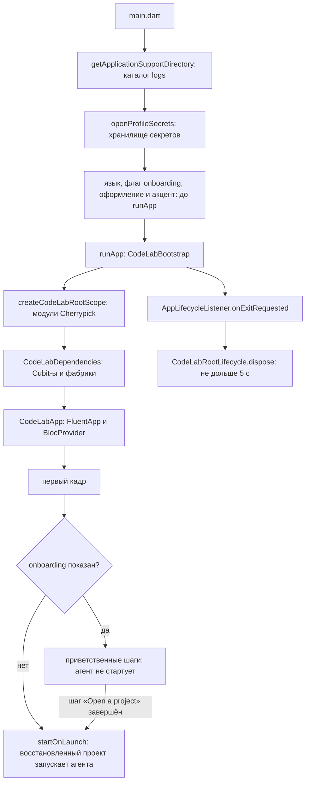
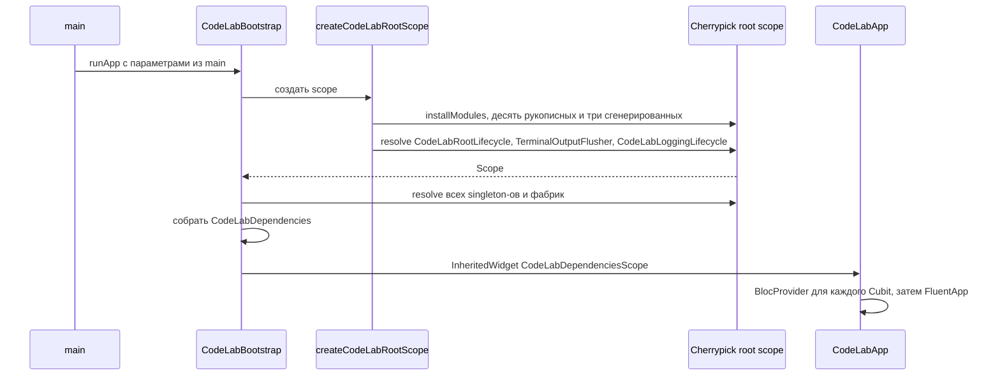
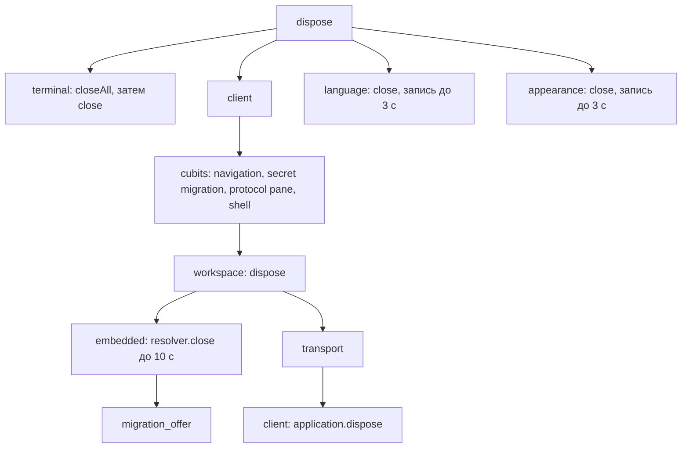

# Composition root

Глава о том, как приложение собирает себя в одно целое: кто создаёт Cubit-ы, порты и клиентский слой, в каком порядке, как это подменяют тесты и как всё закрывается при выходе. Путь запуска и выхода целиком — в разделе «От `main` до первого кадра».

Вся сборка лежит в одном файле, `lib/app/app_scope.dart` (около 2400 строк), и в нескольких соседях `lib/app/`. Composition root — единственное место, которое знает все части приложения сразу: виджеты и Cubit-ы получают готовые зависимости и сами ничего не создают (корневой `AGENTS.md`, §6).

## Что есть в `app_scope.dart`

| Что | Зачем |
|---|---|
| `createCodeLabRootScope({...})` | собирает корневой `Scope` Cherrypick: ставит модули и сразу резолвит три объекта; все параметры — швы тестов |
| `CodeLabLoggingModule`, `CodeLabProtocolModule`, `CodeLabTransportRuntimeModule`, `CodeLabEmbeddedAgentModule`, `CodeLabLanguageModule`, `CodeLabOnboardingModule`, `CodeLabAppearanceModule`, `CodeLabPlatformModule`, `CodeLabConnectionModule`, `CodeLabPresentationModule` | рукописные модули: каждый регистрирует свою группу зависимостей |
| `CodeLabTransportsModuleContract`, `CodeLabProtocolApplicationModuleContract`, `CodeLabRootLifecycleModuleContract` | три модуля на аннотациях `cherrypick_annotations`; по ним генерируется `app_scope.module.cherrypick.g.dart` |
| `CodeLabRootLifecycle` | закрывает всё клиентское в нужном порядке |
| `CodeLabDependencies` и `CodeLabDependenciesScope` | то, что видят виджеты: готовые singleton-ы и фабрики Cubit-ов страниц |
| `CodeLabBootstrap` | виджет-хозяин: создаёт scope, держит слушатель выхода, закрывает всё при снятии |
| `closeCodeLabRootScope()` | закрытие root scope один раз на любое число вызовов |

## От `main` до первого кадра

Первые шаги `main` (каталог журнала, хранилище секретов, чтение языка, onboarding и оформления) нужны, чтобы первый кадр сразу был в нужном виде; ниже — весь путь от `main` до выхода, а затем схема сборки scope, где показано, кто кого вызывает.

Путь запуска и выхода целиком:



- До `runApp` `main` читает язык, флаг приветственных шагов и оформление (с файлами двух тем и системным акцентом): первый кадр сразу на нужном языке, в нужной теме и на нужном экране. Чтение не бросает, диагностику пишут модули scope после настройки журнала.
- Агент стартует не при сборке scope, а после первого кадра (`startOnLaunch`), и только если восстановлен или выбран проект. Пока показаны приветственные шаги, рабочее место не строится и `startOnLaunch` не вызывается: провайдер, сохранённый на шаге модели, действует при первом старте. Папку, выбранную на последнем шаге, агент получает тем же единственным стартом (`SettingsCubit` держит триггер выбора проекта, пока шаги открыты). Выключенный переключатель «Reopen the last project and its tabs» запускает приложение без восстановления проекта.

Сборка scope:



Что важно знать:

- `CodeLabBootstrap` получает из `main` только часть швов: `logDirectoryPath`, `profileSecrets` и `profileSecretsOpener`, `language`, `onboarding`, `appearance`, `systemAccentSource`, `themeLibrary`. Остальные швы `createCodeLabRootScope` в рабочей сборке пустые; их задают тесты, передавая готовый `scope:` в `CodeLabBootstrap`.
- Поля `_scope` и `_dependencies` в `_CodeLabBootstrapState` — `late final`: scope создаётся при первом обращении, то есть в `initState` или `build`, а не в конструкторе виджета.
- Корневой `Scope` Cherrypick (`CherryPick.openRootScope()`) — глобальный синглтон процесса: незакрытый scope переиспользуется молча. Поэтому закрытие scope идёт через `closeCodeLabRootScope()`, которая запоминает идущее закрытие, и тесты закрывают scope в `addTearDown` (`test/support/test_app_scope.dart`).
- В конце `createCodeLabRootScope` резолвятся три объекта сразу: `CodeLabRootLifecycle` (он тянет за собой клиентский граф: рабочее пространство, резолвер встроенного агента и Cubit-ы), `TerminalOutputFlusher` (вешает крючок на Cubit терминала) и `CodeLabLoggingLifecycle` (чтобы `Scope.dispose` увидел его как `Disposable` и дождался сброса журналов).

## Модули и их порядок

Порядок в `installModules` такой, как в таблице. Регистрация в Cherrypick ленивая: `toProvide` вызывает фабрику только на `resolve`, поэтому порядок почти не влияет на связи между типами. Он важен там, где `builder` модуля делает работу сразу: пишет в журнал (`CodeLabLanguageModule`, `CodeLabAppearanceModule`, `CodeLabOnboardingModule`) или настраивает его (`CodeLabLoggingModule`). Поэтому журнал стоит первым, а модули с событиями старта — после него.

| № | Модуль | Что регистрирует | Швы тестов |
|---|---|---|---|
| 1 | `CodeLabLoggingModule` | `LogBuffer` для окна журнала; файловые выходы `application.log` (только не в debug) и `protocol.log`; `CodeLabLoggingLifecycle`. Вызывает `configureCodeLabLogging` | `logDirectoryPath` |
| 2 | `CodeLabProtocolModule` | `ProtocolPayloadPolicy` (`full` в debug-сборке, иначе `metadataOnly`), `ProtocolExportSaver`, `LogRecordSource` над `LogBuffer` | `debugBuild`, `protocolExportSaver` |
| 3 | `CodeLabTransportRuntimeModule` | фабрики транспортов: общая `CodeLabTransportFactory` и две для профилей (`CodeLabStdioTransportFactory`, `CodeLabWebSocketTransportFactory`) | `transportFactory`, `stdioTransportFactory`, `webSocketTransportFactory` |
| 4 | `CodeLabEmbeddedAgentModule` | `EmbeddedAgentOpener`, `EmbeddedCloseSettings`, `SecretMigrationOffer`, `ProviderSetupOffer`, `SecretMigrationRunner`, singleton `EmbeddedTransportResolver` | `embeddedOpener`, `embeddedCloseTimeout`, `environment`, `providerSetupProbe` |
| 5 | `CodeLabLanguageModule` | `AppLanguageCubit`; он же регистрируется как порт `AppStrings` | `language`, `languagePreferences` |
| 6 | `CodeLabOnboardingModule` | `OnboardingPreferences`, `OnboardingProbe`, `OnboardingCubit` (новый на каждый запрос) | `onboarding`, `onboardingProbe`, `onboardingPreferences`, `environment` |
| 7 | `CodeLabAppearanceModule` | `ThemeLibrary`, `AppAppearanceCubit` | `appearance`, `appearancePreferences`, `themeLibrary`, `systemAccentSource` |
| 8 | `CodeLabPlatformModule` | порты платформы: проверка папки, вид пути, выбор папки и файла, открытие ссылок и каталогов, оболочка, недавние проекты, раскладка дока, снимок рабочего пространства. Таблица — в [главе 06](06-platform-and-appearance.md) | `directoryExists`, `localPathKind`, `userShellLauncher`, `externalLinkOpener`, `localFolderOpener`, `projectFolderPicker`, `usageCsvSaver`, `themeFilePicker`, `startupPreferences`, `recentProjectsStore`, `environment` |
| 9 | `CodeLabConnectionModule` | `ConnectionEnvironment`, `ProfileStore`, `ConnectionPreferences`, хранилище секретов (`ReopenableProfileSecrets` и порт `ProfileSecrets`), `SecretSource` и `ProfileSecretSource`, `DefaultProfileResolver` | `environment`, `profileStore`, `profileSecrets`, `profileSecretsOpener` |
| 10 | `CodeLabPresentationModule` | страницы настроек и `NavigationCubit`; `ClientWorkspace`; `CodeLabShellParts` и `CodeLabShellCubit`; `SecretMigrationCubit`, `TerminalTabsCubit`, `TerminalOutputFlusher`, `ProtocolPaneCubit`; фабрики Cubit-ов страниц настроек; порты разделов «About» и «Legal»; открыватели мастера провайдера | `settingsPages`, `providerSettingsOpener`, `projectFiles`, `projectFilesEnabled`, `aboutInfo`, `legalPorts`, `clock`, `onboarding`, `logDirectoryPath` |
| 11–13 | `$CodeLabTransportsModuleContract`, `$CodeLabProtocolApplicationModuleContract`, `$CodeLabRootLifecycleModuleContract` | `StdioAcpAgentProfile`, `AcpTransport`, `AcpClientApplication`, `CodeLabRootLifecycle` | — |

Как читать регистрации в коде:

- `bind<T>().toInstance(x)` — готовый объект, один на scope.
- `bind<T>().toProvide(() => …)` — фабрика: каждый `resolve` создаёт новый объект. Так регистрируются Cubit-ы страниц настроек и `OnboardingCubit`: страница создаёт Cubit при открытии и закрывает его сама.
- `.toProvide(…).singleton()` — фабрика с кэшем: один объект на scope, создаётся при первом `resolve`. Так регистрируются `EmbeddedTransportResolver`, `ClientWorkspace`, `CodeLabShellParts`, `CodeLabShellCubit`, `NavigationCubit`, `TerminalTabsCubit`, `ProtocolPaneCubit`, `SecretMigrationCubit`.
- Внутри `builder(Scope currentScope)` зависимости берут через `currentScope.resolve<T>()` внутри лямбды фабрики, а не снаружи: так порядок регистрации не мешает.

### Что получают клиентский слой и рабочее место

`ClientWorkspace` и шесть частей рабочего места собираются в `CodeLabPresentationModule`:

```dart
bind<ClientWorkspace>()
    .toProvide(
      () => ClientWorkspace(
        backend: AcpClientBackend(currentScope.resolve<AcpClientApplication>()),
        resolvers: _transportResolvers(currentScope),
        snapshots: currentScope.resolve<WorkspaceSnapshotStore>(),
      ),
    )
    .singleton();
```

`_transportResolvers` отдаёт два резолвера: `ConfigTransportResolver` (профили `stdio` и WebSocket на фабриках приложения и источнике токенов `SecretSource`) и `EmbeddedTransportResolver` (встроенный агент). Тот же список идёт в проверку профиля и в список типов профиля в диалоге (`profileKindsFor`): добавить можно только то, что можно открыть. Подробнее — [глава 07](07-embedded-agent-and-connections.md).

Затем `CodeLabShellParts.build(...)` собирает `ConnectionCubit`, `SessionsCubit`, `ActiveSessionCubit`, `SettingsCubit`, `LayoutCubit` и `TranscriptViewCubit` вокруг одного `ClientWorkspace`, а `CodeLabShellCubit` — фасад над ними. Как состояние доходит до виджетов — [глава 03](03-state-flow.md).

## Аннотации и сгенерированный код

Три модуля объявлены абстрактными классами с аннотацией `@module()`:

```dart
@module()
abstract class CodeLabProtocolApplicationModuleContract extends Module {
  @provide()
  @singleton()
  AcpClientApplication application(
    AcpTransport transport,
    CodeLabTransportFactory transportFactory,
    TextFileReader textFileReader,
    …
  ) => AcpClientApplication(…);
}
```

Генератор `cherrypick_generator` (dev-зависимость приложения) пишет `app_scope.module.cherrypick.g.dart`: для каждого модуля класс `$<Имя>` с методом `builder`, который вызывает ваш метод, подставляя параметры через `currentScope.resolve<Тип>()`. Для `@instance()` метод вызывается сразу, для `@provide()` — в фабрике.

- Файл подключён как `part 'app_scope.module.cherrypick.g.dart'` и лежит в git, в отличие от `*.freezed.dart`.
- Параметры метода ищутся в scope **по типу**. В сгенерированном коде `CodeLabTransportFactory` стал `AcpTransport Function()`: typedef — псевдоним, и привязка `bind<CodeLabTransportFactory>()` совпадает с этим ключом.
- Любое изменение сигнатуры аннотированного метода (новый параметр, другой тип) требует перегенерировать файл и закоммитить результат. Если забыть, сгенерированный файл разойдётся с кодом.

Перегенерация (из каталога приложения):

```bash
cd apps/codelab_desktop
fvm dart run build_runner build
```

Проверено на текущем дереве: команда отрабатывает за полминуты и не меняет закоммиченный файл (`cherrypick_generator:module_generator … 1 same`). Флаг `--delete-conflicting-outputs`, который стоит в команде [запуска из исходников](../../../docs/user/run-from-source.md#1-подготовка), текущий `build_runner` принимает, но игнорирует: он пишет, что флаг удалён, — результат тот же.

Рукописные модули генерации не требуют. Новую зависимость регистрируют в рукописном модуле (скелет ниже); аннотированный контракт нужен, только если вы продолжаете уже существующий.

## `CodeLabDependencies`: что видят виджеты

Виджеты не работают со `Scope`. `CodeLabBootstrap` один раз резолвит всё нужное и кладёт в неизменяемый `CodeLabDependencies`; ниже по дереву его отдаёт `CodeLabDependenciesScope` (`InheritedWidget`), а `codeLabDependenciesOf(context)` достаёт.

В объекте три вида полей:

| Вид | Примеры | Кто владеет |
|---|---|---|
| готовые singleton-ы | `shellCubit`, `navigationCubit`, `terminalTabsCubit`, `protocolPaneCubit`, `languageCubit`, `appearanceCubit`, `secretMigrationCubit` | root scope; Cubit-ы закрывает `CodeLabRootLifecycle` |
| фабрики Cubit-ов страниц | `createConnectionSettingsCubit`, `createProviderSettingsCubit`, `createAgentsModesCubit`, `createAppearanceSettingsCubit`, `createOnboardingCubit` и другие `create*` | страница или диалог: создаёт при открытии, закрывает при закрытии |
| порты, открыватели и готовые значения | `aboutPorts`, `legalPorts`, `openEmbeddedWizard`, `openOnboardingWizard`; `logBuffer`, `settingsPages`, `onboardingAppLogsLabel` (строка) | root scope; `CodeLabRootLifecycle` их не закрывает |

Фабрика в `CodeLabDependencies` — это просто `_scope.resolve<ProviderSettingsCubit>` без вызова, то есть ссылка на метод, а не результат. Поле `projectFilesCubit` необязательное: панели «Files» нет, если `ProjectFiles` не привязан.

В `CodeLabApp` (`lib/app/codelab_app_widget.dart`) каждый singleton-Cubit оборачивается в `BlocProvider.value`, а `FluentApp` строится внутри `BlocBuilder`-ов языка и оформления. `BlocProvider` стоит над `FluentApp`, чтобы Cubit был виден и модальным маршрутам `Navigator`.

## `CodeLabBootstrap` и жизнь процесса

`CodeLabBootstrap` — `StatefulWidget`, который владеет тремя вещами:

- `AppLifecycleListener` с `AppExitHandler.onExitRequested`: без него при ⌘Q не вызывается `CodeLabRootLifecycle.dispose()` (дерево виджетов при штатном выходе не размонтируется), и процессы агента остаются сиротами;
- `AppMenuBridge` — мост пункта «Preferences…» нативного меню macOS (канал `codelab/app_menu`);
- ссылка на `CodeLabRootLifecycle`.

При снятии виджета (`dispose`) сначала без `await` запускается `_rootLifecycle.dispose()`, затем закрывается scope через `_closeScopeLogged`: сбой закрытия scope пишется в журнал как `app.shutdown_step_failed` с `step: root_scope`, а не уходит необработанным. Порядок «lifecycle до scope» намеренный: `Scope.dispose` Cherrypick обрывается на первом `Disposable`, который бросил исключение, и без этого сбой сброса журналов оставил бы процессы без сигналов.

Любой `Disposable` root scope должен быть идемпотентным: после сбоя CherryPick не обнуляет scope, и следующий вызов закрывает его заново вместе с уже закрытыми объектами.

## Выход: `CodeLabRootLifecycle` и `AppExitHandler`

`CodeLabRootLifecycle.dispose()` — единственный путь «закрыть всё клиентское». Его вызывают закрытие scope и обработчик выхода; повторный вызов возвращает тот же `Future`. Четыре ветви идут параллельно:



Имена шагов (`terminal`, `cubits`, `workspace`, `embedded`, `migration_offer`, `transport`, `client`, `language`, `appearance`) — закрытый список `_shutdownSteps`. Шаги `language` и `appearance` есть, только если у lifecycle есть соответствующий Cubit. Сбой шага пишется как `app.shutdown_step_failed` с `step` и `error_type` (текст ошибки не пишется: в нём бывают пути) и не мешает остальным.

`AppExitHandler` оборачивает это ограничением по времени:

1. `app.exit_requested`;
2. `CodeLabRootLifecycle.dispose()` с пределом `exitTimeout` — 5 с от первого запроса; повторный запрос ждёт тот же проход;
3. в срок — `app.exit_closed` с `duration_ms`; не в срок — `app.exit_timeout` с `timeout_ms` и `pending` (имена незавершённых шагов, включая ещё не начатые);
4. сброс файловых журналов до `flushTimeout` (500 мс);
5. ответ `AppExitResponse.exit` в любом случае — отмены выхода нет.

Предел 10 с на закрытие встроенного агента (`defaultEmbeddedCloseTimeout`, событие `embedded.close_timeout`) действует внутри `dispose()` и при выходе не наступает: раньше срабатывает предел 5 с. События и поля — в [эксплуатации](operations.md#выход-из-приложения).

## Скелет: новая зависимость в composition root

Допустим, нужна новая настройка окна. Образец — `StartupPreferences` и `StartupSettingsCubit`. Порт и адаптер — по скелету в [главе 06](06-platform-and-appearance.md#скелет-нового-порта-платформы); здесь — регистрация. Четыре места.

1. **Модуль.** Принять порт параметром-швом и привязать (`CodeLabPlatformModule`, `lib/app/app_scope.dart`):

   ```dart
   CodeLabPlatformModule({
     …
     StartupPreferences? startupPreferences,
   }) : _startupPreferences = startupPreferences, …;

   final StartupPreferences? _startupPreferences;

   @override
   void builder(Scope currentScope) {
     …
     bind<StartupPreferences>().toInstance(
       _startupPreferences ?? const SharedPreferencesStartupPreferences(),
     );
   }
   ```

2. **Шов в `createCodeLabRootScope`.** Добавить именованный параметр (`StartupPreferences? startupPreferences`) и передать его в конструктор модуля: `CodeLabPlatformModule(startupPreferences: startupPreferences, …)`.

3. **Фабрика Cubit-а** в `CodeLabPresentationModule` — `toProvide` без `.singleton()`, если Cubit принадлежит странице:

   ```dart
   bind<StartupSettingsCubit>().toProvide(
     () => StartupSettingsCubit(
       preferences: currentScope.resolve<StartupPreferences>(),
       logger: _settingsLogger(),
     ),
   );
   ```

4. **Виджетам.** Поле `createStartupSettingsCubit` в `CodeLabDependencies` (и в его конструкторе) и строка `createStartupSettingsCubit: _scope.resolve<StartupSettingsCubit>` в `_CodeLabBootstrapState._dependencies`. Страница берёт его через `codeLabDependenciesOf(context)`, создаёт Cubit в `didChangeDependencies` и закрывает в `dispose` (так делают `GeneralPageHost` и `LegalPageHost`).

И в тестах: параметр `startupPreferences` в `CodeLabTestBinding` (`test/support/test_app_scope.dart`) с передачей в `createCodeLabRootScope`, иначе тесты, которые собирают граф через `CodeLabTestBinding`, не смогут подменить порт.

Если Cubit должен жить весь процесс (как `AppAppearanceCubit`), он регистрируется `toInstance` или `.singleton()`, попадает в параметры `CodeLabRootLifecycleModuleContract.rootLifecycle`, в `CodeLabRootLifecycle` (новый шаг закрытия при необходимости) и в `CodeLabDependencies`; тогда нужно перегенерировать `app_scope.module.cherrypick.g.dart`.

## Швы тестов

Параметры `createCodeLabRootScope` — швы: в рабочей сборке они пустые, а тест подставляет двойник или временное окружение. Тестовая обёртка `CodeLabTestBinding` (`test/support/test_app_scope.dart`) задаёт безопасные значения по умолчанию и держит `scope`; `binding.bootstrap(child:)` создаёт `CodeLabBootstrap(scope: scope, …)`. Обёртка пробрасывает не все швы: `themeFilePicker`, `embeddedCloseTimeout`, `profileSecretsOpener` и `logDirectoryPath` в ней нет, и тесты, которым они нужны (`test/app/app_scope_embedded_test.dart`, `app_scope_profiles_test.dart`), вызывают `createCodeLabRootScope` напрямую. Колонка «по умолчанию» относится к обёртке.

| Группа | Параметры `createCodeLabRootScope` | По умолчанию в `CodeLabTestBinding` |
|---|---|---|
| встроенный агент и окружение | `embeddedOpener`, `embeddedCloseTimeout`, `environment`, `providerSetupProbe` | открыватель сразу падает; без своего `environment` настоящий дом разработчика не читается; проба «провайдер не нужен» |
| профили и секреты | `profileStore`, `profileSecrets`, `profileSecretsOpener`, `providerSettingsOpener` | хранилище профилей в памяти с одним stdio-профилем по умолчанию; открыватель настроек провайдера бросает |
| рабочее место | `recentProjectsStore`, `directoryExists`, `localPathKind`, `projectFiles`, `projectFilesEnabled`, `clock`, `settingsPages` | недавние проекты в памяти; любая папка существует; панель «Files» только если передан двойник |
| порты платформы | `userShellLauncher`, `externalLinkOpener`, `localFolderOpener`, `projectFolderPicker`, `usageCsvSaver`, `protocolExportSaver`, `themeFilePicker`, `startupPreferences` | выбор папки отвечает «закрыто»; остальные — настоящие адаптеры, пока тест не подставит двойник |
| язык, onboarding, оформление | `language`, `languagePreferences`, `onboarding`, `onboardingProbe`, `onboardingPreferences`, `appearance`, `appearancePreferences`, `themeLibrary`, `systemAccentSource` | язык `en`; onboarding не показывается; оформление «по системе», тем и акцента нет |
| данные «About» и «Legal» | `aboutInfo`, `legalPorts` | настоящие порты, пока тест не задаст свои |
| транспорты и журнал | `transportFactory`, `stdioTransportFactory`, `webSocketTransportFactory`, `logDirectoryPath`, `debugBuild` | общий транспорт — `FakeAcpTransport` |

Что стоит знать:

- В `testWidgets` настоящий файловый ввод-вывод зависает в fake-async зоне, поэтому профили, недавние проекты и настройки провайдера в виджет-тестах всегда двойники; настоящие файлы проверяют обычные `test` на временном `CODELAB_HOME`.
- `SharedPreferences.setMockInitialValues` вызывает сама `CodeLabTestBinding`: у плагина в тестах нет канала.
- `test/flutter_test_config.dart` сверяет настоящий `recent_projects.json` до и после каждого файла тестов и роняет файл, если тот изменился: тест без шва `recentProjectsStore:` или временного `environment: {'CODELAB_HOME': …}` писал бы в список проектов разработчика.
- Закрытие scope в тесте идёт через `closeCodeLabRootScopeInTest()`: обычный `await` на файловых журналах в fake-async зоне зависает.

Подробнее о двойниках и видах тестов — [глава 08](08-testing.md).

## Что дальше

- Как состояние клиентского слоя доходит до виджетов — [глава 03](03-state-flow.md).
- Платформенные порты и оформление — [глава 06](06-platform-and-appearance.md).
- Встроенный агент и профили, регистрируемые здесь, — [глава 07](07-embedded-agent-and-connections.md).
- Правило «IO-барели только в `lib/app/`» и остальные правила сторожа — [глава 01](01-overview.md#правила-зависимостей-и-как-их-проверяет-сторож).
