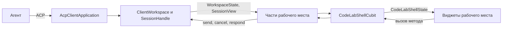
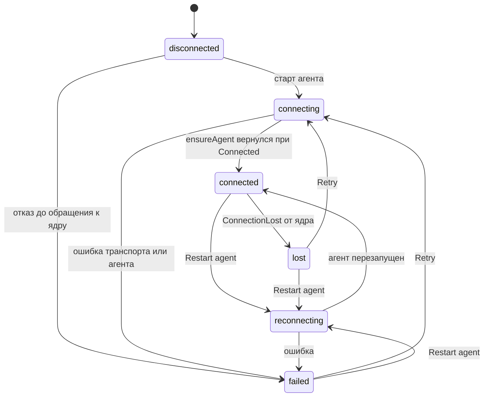
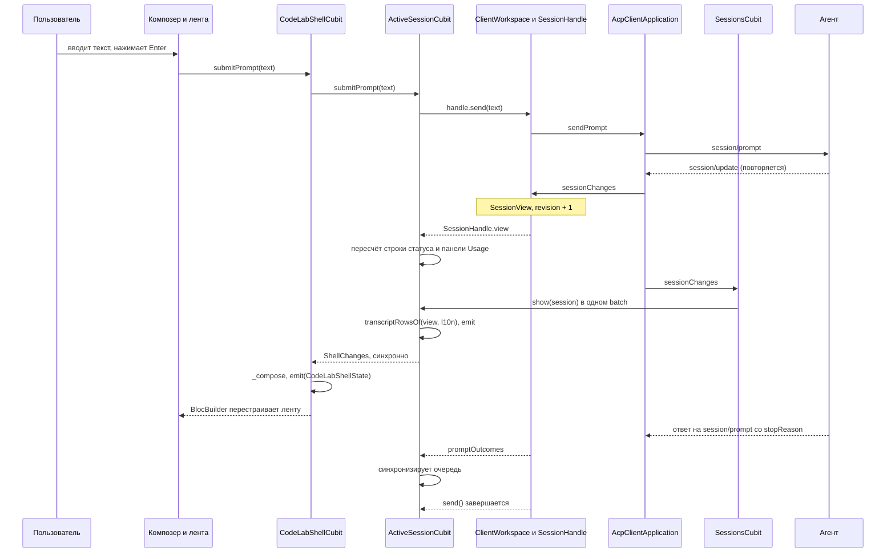
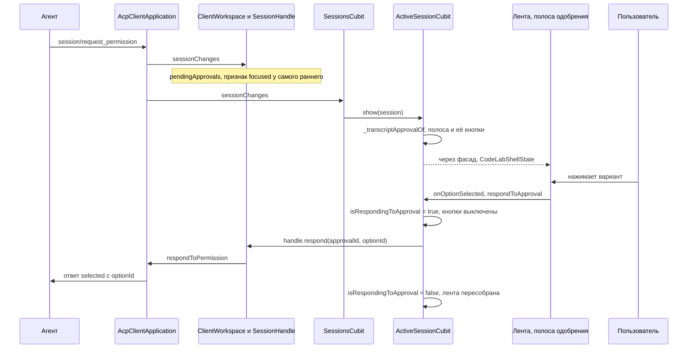
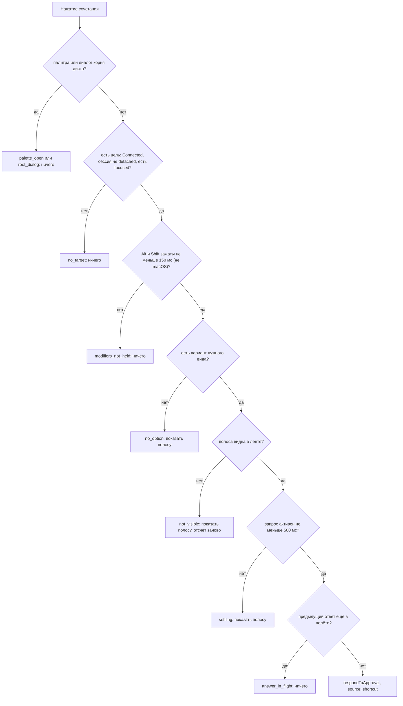

# Путь состояния: от клиентского ядра до виджета

Глава для тех, кто добавляет в рабочее место новое поле, действие или подписку и хочет понять, откуда берётся каждое значение на экране и куда уходит каждое нажатие. Карта каталогов — в [обзоре приложения](01-overview.md), сборка объектов — в [composition root](02-composition-root.md), правила приложения — в [`AGENTS.md`](../AGENTS.md).

## Главная мысль

У приложения нет своего состояния сессий, очереди промптов и одобрений. Владелец этого состояния — `codelab_client_core`: `ClientWorkspace` (соединение и список сессий) и `SessionHandle` (одна сессия). Cubit-ы приложения подписываются на их потоки, переводят снимки в модели `codelab_ui` и публикуют результат виджетам. Действие пользователя идёт обратно по той же цепочке: виджет вызывает метод Cubit-а, Cubit — метод `SessionHandle` или `ClientWorkspace`.

Что здесь решает приложение, а что нет:

| Вопрос | Кто решает |
|---|---|
| Занята ли сессия, ставить ли промпт в очередь, какой из запросов разрешения «активный» | `codelab_client_core` (`SessionHandle.send`, признак `focused` у `PendingApprovalView`) |
| Как это нарисовать: какие строки в ленте, какой тег у вызова, какой чип в шапке | приложение (`ui_mappers.dart`) |
| Какой проект открыт, какая раскладка дока, открыта ли палитра | приложение (`SettingsCubit`, `LayoutCubit`) |
| Можно ли ответить на запрос сочетанием клавиш прямо сейчас | приложение, функция `approvalShortcutDecisionOf` (политика, не виджет) |

Источник правил — [state-management.md](../../../docs/architecture/state-management.md) и [session-lifecycle.md](../../../docs/architecture/session-lifecycle.md); пакет-владелец состояния описан в [README `codelab_client_core`](../../../packages/dart/codelab_client_core/README.md).

## Откуда приходят данные

С клиентским ядром приложение связано тремя потоками и одним синхронным чтением.

| Источник | Что отдаёт | Кто слушает |
|---|---|---|
| `ClientWorkspace.state` | `WorkspaceState`: соединение (`ConnectionView`: `Disconnected`, `Connecting`, `Connected`, `Reconnecting`, `ConnectionLost`, `ConnectionFailed`), список сессий, папки | `ConnectionCubit`, `SessionsCubit` |
| `SessionHandle.view` | `SessionView`: транскрипт, очередь, ожидающие одобрения, опции, план, расход, `canRetry` | `ActiveSessionCubit` — только для сессии в фокусе |
| `ClientWorkspace.promptOutcomes` | `PromptOutcome`: исход хода, `PromptCompleted` или `PromptFailed` (постановка в очередь сюда не идёт: её возвращает сам `send()` как `PromptQueued`) | `ActiveSessionCubit` |
| `SessionHandle.current` | последний `SessionView` без подписки | `ActiveSessionCubit`, фасад — при пересчёте и при нажатиях |
| `AcpClientApplication.sessionChanges` | снимок `AcpSession` ядра клиента на каждое `session/update` | `SessionsCubit` (единственный подписчик среди частей) |

Порядок подписок важен. `ClientWorkspace` подписывается на `sessionChanges` раньше всех частей, поэтому к моменту, когда `SessionsCubit` получает снимок, `SessionView` в `SessionHandle.current` уже обновлён. Ради этого порядка `CodeLabShellParts.build` создаёт части только после `ClientWorkspace` (`lib/features/workbench/application/shell_cubit.dart`, комментарий к `CodeLabShellParts`).

## Части рабочего места и фасад

Состояние рабочего места разложено на шесть Cubit-ов-частей. Их собирает `CodeLabShellParts.build`, а поверх них стоит фасад `CodeLabShellCubit` (`lib/features/workbench/application/`).

| Часть | Состояние | Подписки (владелец — сам Cubit) | Для чего |
|---|---|---|---|
| `ConnectionCubit` | `WindowConnectionState` | `AppStrings.changes`, `ClientWorkspace.state` | профиль окна, статус соединения, старт и перезапуск агента, диалог «Restart agent» |
| `SessionsCubit` | `SessionsState` | `AppStrings.changes`, `AcpClientApplication.sessionChanges`, `ClientWorkspace.state` | список сессий сайдбара, выбор показываемой сессии, вопрос «открыть сессию в корне диска» |
| `ActiveSessionCubit` | `ActiveSessionState` | `AppStrings.changes`, `ClientWorkspace.promptOutcomes`, `SessionHandle.view` (одна, переключается вместе с сессией) | лента, очередь, одобрения, опции, план, строка статуса, данные панелей Agents и Usage; действия «отправить», «отменить», «ответить» |
| `SettingsCubit` | `SettingsState` | потоков не слушает | выбранный проект, недавние проекты, отказ брошенной папки; не путайте со страницами настроек |
| `LayoutCubit` | `LayoutState` | нет | ширины панелей, сайдбар, док, палитра команд; раскладку дока пишет в `DockLayoutStore` |
| `TranscriptViewCubit` | `TranscriptViewState` | нет | ручное раскрытие строк ленты, показанные изображения, выбор строки панели Agents, разовый запрос «показать строку» |

`CodeLabShellCubit` — фасад. Он собирает из частей одно состояние `CodeLabShellState` (`shell_state.dart`) и делегирует частям публичные методы. Виджеты и тесты читают именно его; своей предметной логики в нём нет, кроме ссылок (`openExternalLink`, `showImage`), решения «куда прокрутить к одобрению» и выбора команды палитры.

Как фасад узнаёт об изменении части:

1. Каждая часть наследует `ShellPartCubit` (`shell_part.dart`). Его `emit` после публикации сообщает общему объекту `ShellChanges`.
2. `ShellChanges` синхронно вызывает единственного слушателя — фасад. Поток `Cubit.stream` доставляет состояния асинхронно, а виджеты и тесты читают `shellCubit.state` сразу после вызова метода, поэтому фасад не ждёт этот поток.
3. Если одно событие меняет несколько частей (новая сессия, потеря соединения), часть оборачивает изменения в `batch`: сигнал уходит один раз в конце. Так одно `session/update` даёт ровно одно состояние фасада; это проверяет тест «one session/update produces one state» (`test/features/workbench/application/shell_cubit_characterization/reconnect_test.dart`).
4. Фасад зовёт `_compose` и публикует `CodeLabShellState`. У этого класса нет `operator ==`, поэтому каждый вызов — новое состояние, и `BlocBuilder` перестраивается.

`CodeLabShellParts` и `CodeLabShellCubit` в комментариях кода названы «пятью Cubit-ами», но `TranscriptViewCubit` в списке уже шестой; в этой главе считаются шесть.

### Состояния: изменяемость и тип

Состояния Cubit-ов приложения — обычные классы с `final`-полями и `copyWith` (у состояний частей рабочего места он закрытый, `_copyWith`), а варианты записаны закрытыми иерархиями `sealed` вручную. `@freezed` в `lib/` приложения нет: пакет `freezed` стоит только в `dev_dependencies`. Freezed-модели живут в клиентском ядре (`WorkspaceState`, `SessionView`, `ConnectionView`, `TranscriptItem`); приложение их только читает. Правило и обоснование — [state-management.md, §11–12](../../../docs/architecture/state-management.md).

Невозможные сочетания состояния исключаются типами, а не наборами флагов. Например, у соединения окна — один `CodeLabConnectionStatus`, а не пара `isConnecting` и `isConnected`:

Переходы взяты из `ConnectionCubit` (`_run`, `_handleWorkspaceChange`, `_rejectBeforeConnect`): начальное значение — `disconnected` (конструктор), `connecting` и `reconnecting` ставит `_run` до обращения к ядру, итог после успешной попытки читается из `connectionStatusOf(workspace.current.connection)`, `lost` ставится только из `connected`. Отказ до обращения к ядру (`_rejectBeforeConnect`: пустая команда, нет папки) даёт `failed`, если соединение не живое и не идёт попытка. «Restart agent» из `failed` и `lost` тоже идёт через `reconnecting` (причина события `connection.restart` — `failure`). Значение `idle` перечисления в `ConnectionCubit` не публикуется; оно нужно кадру «проект не выбран» (`CodeLabShellState.awaitingProject`). Единственный писатель статуса — `ConnectionCubit`; виджеты его не вычисляют.

## Путь одного промпта

Пользователь нажимает Enter в композере. Диаграмма показывает, что происходит дальше, пока не придёт конец хода.

Что важно в этой цепочке:

- **Очередь решает ядро.** `ActiveSessionCubit.submitPrompt` не проверяет, занята ли сессия: `SessionHandle.send` сам отправляет `session/prompt` сразу или ставит промпт в очередь занятой сессии (`running`, `cancelling`) и возвращает `PromptQueued`. Тогда Cubit лишь пересчитывает `queuedPrompts` из `SessionView.queue`. Отдельной очереди в приложении нет.
- **Ленту строит один метод.** `ActiveSessionCubit._rowsOf` вызывает `transcriptRowsOf` — единственное место, где `TranscriptItem` ядра превращаются в строки `codelab_ui`. Его зовут `show` (на каждое `session/update`), `_handleLanguage` (смена языка) и `respondToApproval` (пересборка после ответа).
- **Данных, которые нельзя восстановить, Cubit не хранит.** Состояние ленты — функция снимка сессии и языка; при смене языка `AppStrings.changes` заставляет `ActiveSessionCubit` пересобрать строки из последних входов (подробнее — [локализация](05-localization.md)).
- **Поздние события отбрасываются.** `ActiveSessionCubit._onView` игнорирует ревизию сессии, которую уже не показывают, и закрытый Cubit; после каждого `await` Cubit проверяет `isClosed` (корневой `AGENTS.md` §9).
- **Состояние приходит из потоков, а не из метода действия.** `submitPrompt` ленту и флаги не меняет: их публикуют потоки ядра. Исключение одно — очередь: получив `PromptQueued`, Cubit сразу перечитывает её из `SessionView.queue`. Отмена хода (`cancelTurn` → `SessionHandle.cancel`, то есть `session/cancel`) устроена так же: Cubit флаги и ленту не трогает, новое состояние приходит из `sessionChanges`.

Если после этого вы добавляете новое поле в ленту или строку статуса, правка почти всегда состоит из двух шагов: расширить функцию в `ui_mappers.dart` (чистая функция, тест — `test/features/workbench/application/ui_mappers_test.dart`) и пробросить результат через `ActiveSessionState` и `_compose`.

## Как виджеты получают состояние

`CodeLabApp` оборачивает `FluentApp` в `MultiBlocProvider` (`lib/app/codelab_app_widget.dart`) и кладёт туда уже созданные Cubit-ы через `BlocProvider.value`:

| Cubit | Зачем на уровне `FluentApp` |
|---|---|
| `CodeLabShellCubit` | фасад рабочего места |
| `SecretMigrationCubit` | диалог переноса секретов открывается маршрутом `Navigator` и должен его видеть |
| `NavigationCubit` | текущий экран ([навигация и настройки](04-navigation-and-settings.md)) |
| `TerminalTabsCubit` | панель Terminal |
| `ProtocolPaneCubit` | панель Protocol и кнопки в шапке дока |
| `AppLanguageCubit` | язык |
| `AppAppearanceCubit` | тема |

Provider стоит над `FluentApp`, а не внутри `home`: модальные диалоги `showDialog` лежат в маршрутах того же `Navigator` рядом с `home`, а не внутри него, и иначе не нашли бы Cubit.

Что используется в коде:

- `BlocBuilder<CodeLabShellCubit, CodeLabShellState>` — главный способ: `CodeLabShell` (`workbench_shell.dart`) читает состояние целиком и раздаёт его панелям. `BlocSelector` в приложении нет; для точечной подписки есть `buildWhen` у `BlocBuilder` (например, язык и тема в `FluentApp`, панель Usage, страница «Appearance», док в `workbench_shell.dart`, баннер переноса секретов) и один `context.select` (диалог «Restart agent» в `_CodeLabHomeState`).
- `context.read<Cubit>()` — вызвать метод в обработчике; в `build` для подписки он не годится.
- `BlocListener` и `BlocConsumer` — эффект рядом с отрисовкой: запись в журнал при появлении InfoBar одобрения (хост `_CodeLabHomeState`), мастер провайдера, экран onboarding, баннер переноса секретов.
- `codeLabDependenciesOf(context)` — достать фабрику или порт composition root. Виджет не создаёт репозиториев и клиентов (корневой `AGENTS.md` §6): он получает готовое из `CodeLabDependencies`.

Cubit-ы страниц настроек (`ProviderSettingsCubit`, `AgentDefaultsCubit` и другие) устроены иначе: их не видно в `MultiBlocProvider`. Страница создаёт Cubit через `createXxxCubit` из `CodeLabDependencies` в `didChangeDependencies` хоста-страницы, отдаёт его дереву через `BlocProvider.value` и закрывает в `dispose`. Время жизни Cubit-а равно времени открытой страницы. Подробно — в [главе про навигацию и настройки](04-navigation-and-settings.md).

Эфемерное состояние остаётся в `State` виджета: открыта ли справка, редактируется ли строка, какой контроллер у поля. Оно не источник истины для сессии ([state-management.md, §6–7](../../../docs/architecture/state-management.md)).

## Кто закрывает подписки

Подписка на поток всегда принадлежит Cubit-у, который её создал: она создаётся в конструкторе (или, как `SessionHandle.view`, переключается при смене сессии), и отменяется в `close()`.

| Подписка | Где создаётся | Где отменяется |
|---|---|---|
| `AppStrings.changes` у `ConnectionCubit`, `SessionsCubit`, `ActiveSessionCubit` | конструктор | `close()` |
| `ClientWorkspace.state` у `ConnectionCubit` и `SessionsCubit` | конструктор | `close()` |
| `AcpClientApplication.sessionChanges` у `SessionsCubit` | конструктор | `close()` |
| `ClientWorkspace.promptOutcomes` у `ActiveSessionCubit` | конструктор | `close()` |
| `SessionHandle.view` у `ActiveSessionCubit` | `_watchView` при `show` и `showCreated` | `_watchView` при смене `SessionHandle` и в `showMissing` (`_watchView(null)`), `close()`; повторный `show` той же сессии подписку не пересоздаёт |
| `ClientWorkspace.diagnostics` у `CodeLabShellCubit` | конструктор | `close()` |
| `ShellChanges.listen` | конструктор фасада | `close()` фасада (`listen(null)`) |

Закрывает всё это `CodeLabRootLifecycle.dispose()` на шаге `cubits`: `_shellCubit.close()` закрывает части (порядок — сессии, подключение, активная сессия, проект, раскладка, вид ленты), и только затем шаг `workspace` закрывает `ClientWorkspace`. Cubit-ы отписываются раньше, чем исчезает поток. Порядок выхода и пределы времени — в [composition root](02-composition-root.md).

## Одобрения: запрос разрешения от агента до ответа

Запрос `session/request_permission` — самое чувствительное место: ответ на него разрешает агенту опасное действие. Приложение лишь показывает решение и передаёт выбор пользователя; политика и привязка запроса к вызову — в ядре клиента (PERM-003, [permissions.md](../../../docs/architecture/permissions.md)).

Шаги по коду:

1. Ядро кладёт запрос в `SessionView.pendingApprovals` и ставит `focused` самому раннему по `requestedAt` ожидающему (`transcript_projector.dart`). Признак значит «активное одобрение хода», а не клавиатурный фокус.
2. Маппер превращает `PendingApprovalView` в `CodeLabTranscriptApproval.pending` внутри строки вызова (`_transcriptApprovalOf` в `ui_mappers.dart`). Риск (`ApprovalRiskLevel` → `CodeLabApprovalRisk`), варианты (`PermissionOption` → `CodeLabApprovalOption` с видом `allowOnce`, `allowAlways`, `rejectOnce`, `rejectAlways`) и `shortcutsEnabled: approval.focused` — решения приложения. Кнопку полосы виджет не решает показывать: он получает готовую модель.
3. В модель кладётся замыкание `onOptionSelected`. Оно вызывает `ActiveSessionCubit._onApprovalSelected` → `respondToApproval(approvalId:, sessionId:, optionId:)`. Идентичность запроса берётся из записи ленты, а не из «текущего» запроса окна, поэтому поздний клик не решит другой вызов (PERM-003).
4. `respondToApproval` выставляет `isRespondingToApproval` (лента пересобирается без активных кнопок, повторный ответ на время запроса игнорируется), пишет `workbench.approval_answer` с полем `source` (`button` или `shortcut`) и вызывает `SessionHandle.respond`. Отказ — тоже выбор варианта: в ACP отдельного «отклонить» нет.
5. После ответа Cubit пересобирает ленту тем же `emit`, который снимает флаг. Решение появляется в ленте из следующего `sessionChanges`: тег исхода `allowed`, `rejected`, `cancelled` или `unknown`. При отмене хода ядро само отвечает на ожидающие запросы исходом `cancelled` (spec `approval-safety`, «Поток разрешений ACP»).
6. При потере соединения запрос остаётся в `SessionView`, но отвечать некому: `resetAfterConnectionLoss` сбрасывает флаги, а `CodeLabShellCubit.sessionIdsWithPendingApproval` не считает такие запросы и не зовёт к ним (`detached`-сессии тоже не считаются).

### Переход к одобрению и ответ сочетанием

Два дополнительных пути входа начинаются не с кнопки полосы. Оба — решение application, а не виджета.

**«Go to approval»** (Cmd/Ctrl+Shift+A, кнопка панели Agents). `CodeLabShellCubit.goToApproval` вызывает чистую функцию `goToApprovalTargetOf` (`approval_go_to_target.dart`): цель есть, только если соединение `Connected`, сессия не `detached` и у неё есть ожидающее одобрение с `focused`. Дальше `TranscriptViewCubit.requestShow` кладёт разовый `TranscriptShowRequest` (с растущим `serial`) в `CodeLabShellState.transcriptShowRequest`. Лента прокручивается к полосе и, если стоит `focusApproval`, ставит на неё фокус; по окончании вызывает `finishTranscriptShow(serial)`, и запрос гасится. Ответа на запрос этот путь не отправляет. Кнопки «Go to approval» панели Agents идут в `goToAgentApproval` и `goToAgentStepApproval` без фокуса.

**Ответ сочетанием** (⌘Y, ⌥⌘Y, ⌥⌘Z, ⌥⇧⌘Z на macOS; Alt+Shift+Y, Q, X, W на Windows и Linux). Кит сообщает только нажатие и срок зажатия модификаторов; `CodeLabShellCubit.answerApprovalByShortcut` вызывает `approvalShortcutDecisionOf` (`approval_shortcut_decision.dart`) и исполняет результат. Проверки идут в этом порядке, на первом же отказе остановка:

Откуда взяты пороги и порядок: константы `approvalShortcutModifierHoldDelay` (150 мс; Alt+Shift — ещё и смена раскладки) и `approvalShortcutSettleDelay` (500 мс), значения `ApprovalShortcutSkipReason` (`approval_shortcut_decision.dart`), ветки палитры, диалога корня диска и `answer_in_flight` — в `CodeLabShellCubit.answerApprovalByShortcut`. Каждый отказ пишет `workbench.approval_shortcut_skipped` с полем `reason`. Видимость полосы и возраст запроса приходят снаружи функции: ручку `CodeLabApprovalVisibility` держит хост `_CodeLabHomeState` и передаёт ленте через `WorkbenchFocus`, а возраст считает `ApprovalActivationTracker`, которым владеет `ActiveSessionCubit` (его `observe` вызывается на каждый снимок показанной сессии). Отсчёт идёт от появления запроса, а не от нажатия, поэтому трекер нельзя заменить `DateTime.now` в момент нажатия. Часы — один параметр `clock`: тесты двигают их явно.

Куда уходит фокус после ответа: полоса сообщает `onApprovalFocusReleased`, хост выбирает цель чистой функцией `approvalFocusReturnOf` (композер, рабочее место или ничего, если фокус за это время взял пользователь).

### Связь со спецификацией

| Что в коде | Требование |
|---|---|
| Ответ `selected` выбранным `optionId`, `cancelled` при отмене хода | [approval-safety](../../../openspec/specs/approval-safety/spec.md), «Поток разрешений ACP» |
| Ответ привязан к запросу из записи ленты; решение одного вызова не относится к другому | PERM-003, [permissions.md](../../../docs/architecture/permissions.md) |
| Варианты в ленте и сочетания выбираются по виду (`kind`), а не по подписи агента | [agent-workbench-ui](../../../openspec/specs/agent-workbench-ui/spec.md), «Approval options are rendered and bound to shortcuts by kind» |
| Фокус на одобрении — только по действию пользователя, ответ сочетанием, переход с клавиатуры, возврат фокуса | agent-workbench-ui, требования «Одобрение получает клавиатурный фокус только по действию пользователя», «Ответ на одобрение сочетанием с любого места рабочего места», «Переход к ожидающему одобрению с клавиатуры», «Фокус после ухода одобрения» |
| Одобрение видно из настроек и недоступно с клавиатуры на экране настроек | [app-settings](../../../openspec/specs/app-settings/spec.md), «Ожидающее одобрение видно из настроек» и «Рабочее место недоступно с клавиатуры из настроек» |

Приложение не вводит собственного «разрешения по умолчанию»: решение принимает человек, а политика отказа (`no_target`, `not_visible`, `settling`) закрывает случайные нажатия.

## Куда класть новое состояние

Короткая памятка для правок:

1. Данные есть в `SessionView` или `WorkspaceState` — не копируйте их в Cubit, читайте снимок и стройте модель в `ui_mappers.dart`.
2. Данных нет, но они общие для приложения и CLI (очередь, одобрения, расход) — это задача для `codelab_client_core`, а не для Cubit-а приложения.
3. Данные только про окно (ширина панели, открыта ли палитра) — часть рабочего места: `LayoutCubit` или `TranscriptViewCubit`; новую часть заводите, только если ни одна не подходит.
4. Текст, зависящий от языка, в состояние не кладётся: храните вход и язык или типизированный исход ([локализация](05-localization.md)).
5. Новая подписка принадлежит Cubit-у: создайте её в конструкторе, отмените в `close()`, после `await` проверьте `isClosed`, а событие закрытого Cubit-а проигнорируйте.
6. Тест поведения рабочего места — в `test/features/workbench/application/shell_cubit_characterization/` на двойнике транспорта, остальное — на двойниках портов из `test/support/`; как устроены тесты, — [тесты приложения](08-testing.md).

Пошаговые рецепты (новая feature, новая строка, новое сочетание) — в главе [расширение приложения](09-extending.md).
