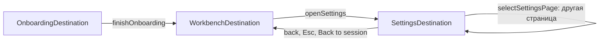
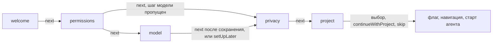

# Навигация, настройки и приветственные шаги

Глава для тех, кто добавляет страницу настроек, меняет переходы между экранами или шаги первого запуска. Краткий рецепт «как добавить страницу» уже есть в [обзоре для разработчика](development.md); здесь — устройство, из которого этот рецепт следует. Состояние вообще и Cubit-ы рабочего места — в [главе про путь состояния](03-state-flow.md), сборка объектов — в [composition root](02-composition-root.md).

## Три экрана и один владелец

Приложение показывает один из трёх экранов. Какой именно — состояние `NavigationCubit` (`lib/app/navigation/navigation_cubit.dart`), а не маршрут `Navigator`: виджеты не открывают настройки через `Navigator.push`, а Cubit не знает `BuildContext`.

Состояние — закрытая иерархия `AppDestination` (`app_destination.dart`):

| Назначение | Что показывает | Поля |
|---|---|---|
| `OnboardingDestination` | приветственные шаги первого запуска | нет |
| `WorkbenchDestination` | рабочее место: сайдбар, сессия, док | нет |
| `SettingsDestination` | экран настроек | `page` — страница, `returnTo` — сессия, активная в момент ухода, `legalTab` — вкладка страницы «Legal» |

Начальное назначение выбирает composition root: `OnboardingDestination`, если `OnboardingStart.show`, иначе `WorkbenchDestination` (`CodeLabPresentationModule` в `app_scope.dart`). Дальше переходы такие:



Правила переходов, каждое — в коде `NavigationCubit`:

- `openSettings({page, source})` на экране настроек ничего не делает, а на onboarding пишет событие `settings.open_skipped` с `reason: onboarding` и тоже ничего не делает. Пустой набор страниц тоже оставляет состояние прежним: пустого экрана быть не должно.
- Целевая страница: переданная `page`, если она видна; иначе последняя сохранённая; иначе «Connection»; если и её нет в сборке — первая видимая. Сохранённая страница читается из `SettingsPageStore` (`shared_preferences`, ключ `codelab.settings.last_page`, значение — `slug`).
- `returnTo` запоминается до `await`: вызов — момент ухода пользователя.
- Номер попытки (`_attempt`) отбрасывает поздний результат чтения `last_page`, если за это время начался более новый переход.
- `selectSettingsPage` игнорирует скрытую и уже выбранную страницы; `legalTab` у других страниц обнуляется и в `last_page` не пишется.
- `back({toSession})` активирует сессию `returnTo`, если она всё ещё открыта (`selectSessionIfOpen`). Другую сессию `back` не подбирает; `toSession` передаёт только кнопка InfoBar ожидающего одобрения.
- Сбой `SettingsPageStore` пишет предупреждение с именем типа ошибки и не мешает переходу.

Откуда вызывается `openSettings`: сочетание Cmd/Ctrl+, и кнопка в сайдбаре (`workbench_shell.dart`, `SettingsOpenSource.shortcut`, `sidebar`), баннер соединения и ссылка экрана «Open a project» (`banner`, `start_screen`) и пункт «Preferences…» меню macOS (`macos/Runner/Base.lproj/MainMenu.xib`): нативная сторона шлёт команду в канал `codelab/app_menu`, `AppMenuBridge` (`lib/core/platform/app_menu_bridge.dart`) вызывает тот же путь с источником `shortcut`.

### Как экран превращается в картинку

`_CodeLabHome` в `lib/app/codelab_app_widget.dart` читает `NavigationCubit` и собирает дерево:

- `OnboardingDestination` — вместо рабочего места строится `_OnboardingHost`; рабочее место не строится совсем.
- Иначе рабочее место (`CodeLabShell`) всегда остаётся в дереве. Под настройками его скрывает `Offstage`, останавливает `TickerMode` и выключает `ExcludeFocus`. Поэтому текст композера, прокрутка ленты и раскрытые блоки не теряются при заходе в настройки, а Tab из настроек не уводит фокус в невидимую полосу одобрения: ответ агенту без контекста вызова недопустим (корневой `AGENTS.md` §10).
- Поверх рабочего места или настроек рисуется диалог «Restart agent», если у `ConnectionCubit` есть `pendingRestart`: перезапуск нажимают и там, и там.

Фокус при уходе запоминается. При возврате решение принимает `_CodeLabHomeState._onNavigation`: сохранённый узел восстанавливается, только если он лежит в рабочем месте, принимает фокус и не является кнопкой сайдбара или узлом-хозяином сочетаний. Иначе запасной путь — чистая функция `approvalFocusReturnOf`: композер, а без него само рабочее место (подробности — в [главе про состояние](03-state-flow.md)).

## Страницы настроек

### `SettingsPage`: что есть и что видно

Все двенадцать страниц заведены в enum `SettingsPage` (`settings_page.dart`) в фиксированном порядке и двух группах (`SettingsGroup.agent` и `SettingsGroup.app`). Порядок значений — порядок показа. У каждой страницы есть `slug` (kebab-case, он же значение `codelab.settings.last_page`) и ключ пункта навигации `settings-nav-<slug>`.

В сборке видны не все: набор задаёт `defaultSettingsPages` (`lib/app/default_settings_pages.dart`), и тесты подставляют свой через `createCodeLabRootScope(settingsPages:)`. Страница без содержимого скрывается, а не показывается пустой (SETUP-17).

| Группа | `slug` | Страница | Видна |
|---|---|---|---|
| Agent | `connection` | Connection | да |
| Agent | `providers` | Providers | да |
| Agent | `mcp-servers` | MCP servers | да |
| Agent | `agents-and-modes` | Agents & modes | да |
| Agent | `permissions-and-tools` | Permissions & tools | нет |
| Agent | `redaction` | Redaction | нет |
| Agent | `skills-and-extensions` | Skills & extensions | да |
| Agent | `code-and-web` | Code & web | нет |
| App | `general` | General | да |
| App | `appearance` | Appearance | да |
| App | `keyboard` | Keyboard | да |
| App | `legal` | Legal | да |

Заголовок страницы и группы зависят от языка и поэтому берутся функциями презентации (`settingsPageTitleOf`, `settingsGroupTitleOf` в `settings_titles.dart`); `switch` в них исчерпывающий, и новое значение enum не скомпилируется без заголовка. Ключ `settings-nav-<slug>` в виджете строит кит: `CodeLabSettingsNavigation.itemKey(id)` с `id = page.slug`; `SettingsPage.navKey` даёт ту же строку для тестов.

### Оболочка настроек

`SettingsShell` (`lib/features/settings/presentation/settings_shell.dart`) — только отображение. Она не решает, какая страница выбрана: получает `selected`, `pages` и колбэки `onSelected`, `onBack` от `_CodeLabHome`. Что она делает сама:

- **Таблица тел.** `settingsPageBuilders` связывает `SettingsPage` с функцией `WidgetBuilder`. Страница из набора видимых должна иметь запись; у страницы без построителя оболочка показывает пустое тело, а не падает. Отдельный параметр `builders` подменяет таблицу в тестах.
- **Поиск «Find a setting».** Запрос — временное состояние поля. `SettingsSearchIndex.search` отбирает страницы по подстроке без учёта регистра в заголовке (на языке интерфейса и на английском) и в ключевых словах (`settingsSearchKeywords<Page>` из ARB, на языке интерфейса и английские). Слова третьего языка страницу не находят. Поиска по значениям настроек нет.
- **Узкое окно.** При ширине меньше `settingsNarrowBreakpoint` (760) навигация переходит наверх (`CodeLabSettingsNavMode.top`).
- **InfoBar ожидающего одобрения.** Если у какой-то сессии есть запрос разрешения, над телом страницы стоит `settings-pending-approval` с кнопкой «Back to session»; она вызывает `NavigationCubit.back(toSession: …)`. Число сессий и целевую сессию даёт `CodeLabShellCubit` (`sessionIdsWithPendingApproval`, `sessionIdForPendingApproval`) в момент построения: подписки на сессии у оболочки нет. Ответить на запрос из настроек нельзя.
- **Фокус.** Своя `FocusScope` и `FocusTraversalGroup`: Tab ходит только по настройкам. Esc привязан записью каталога кита `CodeLabShortcut.leaveSettings` и вызывает `onBack`. Диалог, открытый поверх страницы (`ContentDialog`), живёт в маршруте `Navigator` вне этого поддерева и закрывается сам.

### Как устроена фича `lib/features/settings`

```text
lib/features/settings/
  application/    Cubit-ы страниц, их состояния, порты, чистые функции
  presentation/   страницы, хосты страниц, диалоги, тексты по типам
```

Слоёв `domain/` и `infrastructure/` нет: доменные правила живут в `codelab_client_core` и `codelab_setup`, а реализации портов собирает `lib/app/` (корневой `AGENTS.md` §6; `layers-and-dependencies.md`). Файлы, процессы и хранилище секретов Cubit-ы получают только портами: `codelab_setup/io.dart` пускается в `lib/app/`, а `features/` его не импортирует (правило сторожа).

У каждой страницы есть хост — `StatefulWidget` в файле страницы. Он создаёт Cubit в `didChangeDependencies` (один раз), запускает загрузку, отдаёт дереву через `BlocProvider.value` и закрывает Cubit в `dispose`:

```dart
class _ProvidersPageHostState extends State<ProvidersPageHost> {
  ProviderSettingsCubit? _cubit;

  @override
  void didChangeDependencies() {
    super.didChangeDependencies();
    if (_cubit == null) {
      final cubit = codeLabDependenciesOf(
        context,
      ).createProviderSettingsCubit();
      _cubit = cubit;
      unawaited(cubit.reload());
    }
  }

  @override
  void dispose() {
    unawaited(_cubit?.close());
    super.dispose();
  }

  @override
  Widget build(BuildContext context) =>
      BlocProvider.value(value: _cubit!, child: const ProvidersPage());
}
```

(сокращённый фрагмент `providers_page.dart`). Фабрики `createXxxCubit` — поля `CodeLabDependencies` (`lib/app/app_scope.dart`), их собирает composition root: страница не создаёт репозиториев и клиентов. Время жизни Cubit-а равно времени открытой страницы: при каждом открытии он читает данные заново, а закрытие отбрасывает результаты операций в полёте. Вкладка, запрос поиска и эфемерное состояние не переживают страницу.

| Страница | Cubit-ы | Порты и источники |
|---|---|---|
| Connection | `ConnectionSettingsCubit`; в диалоге «Add connection profile» — `AddProfileCubit` | `ConnectionCommands` (его реализует `ConnectionCubit`), `ProfileStore`, `ProfileSecrets`, `ConnectionPreferences`, `ClientWorkspace`, окружение composition root |
| Providers | `ProviderSettingsCubit`; в мастере — `ProviderWizardCubit` | `ProviderSettingsSession` (открывается заново при каждой загрузке; даёт `AgentConfigStore`, проверку ключа, секреты и автомат мастера) |
| MCP servers | `McpSettingsCubit` | `ProviderSettingsSession`, `EmbeddedMcpStatusSource` |
| Agents & modes | `AgentsModesCubit` | `ProviderSettingsSession`, `AgentDefinitionsPort`, `LocalFolderOpener` |
| Skills & extensions | `SkillsSettingsCubit` | `ProviderSettingsSession`, `LocalFolderOpener` |
| General | `AgentDefaultsCubit` и `StartupSettingsCubit`; язык — `AppLanguageCubit` из корня | `ProviderSettingsSession`, `StartupPreferences`, `AboutPorts` (`ExternalLinkOpener`, `LocalFolderOpener`) |
| Appearance | `AppearanceSettingsCubit`; применённым оформлением владеет `AppAppearanceCubit` | `ThemeLibrary`, `ThemeFilePicker`, `SystemAccentSource` |
| Keyboard | без Cubit | каталог `CodeLabShortcut` кита |
| Legal | `LegalPageCubit` (его создаёт сам `LegalPageHost`) | `LegalPorts` |

Cubit-ы страниц, которые читают конфигурацию агента (Providers, MCP servers, Agents & modes, Skills & extensions, General), устроены одинаково (подписка на соединение общая и у «Connection»): закрытая иерархия состояния `Loading`, `ReadOnly`, `Unreadable`, `Ready` (у Skills ещё `NoFolder`), запись — флаг `Ready.saving`. Правила, общие для них:

1. **Подписка на соединение.** Cubit подписан на `ClientWorkspace.state` (владелец — сам Cubit, отмена в `close()`) и перечитывает страницу при смене подключённого профиля или папки; так устроены `ConnectionSettingsCubit`, `ProviderSettingsCubit`, `McpSettingsCubit`, `AgentsModesCubit`, `AgentDefaultsCubit` и `SkillsSettingsCubit`.
2. **Чьи настройки.** Доступ решает `resolveSettingsAccess` моста `codelab_setup`: встроенный агент и stdio-`codelab-agent` — `EditableSettings`; WebSocket — `RemoteReadOnly`, чужой stdio-агент — `NotManaged`. Для внешнего агента локальный конфиг не читается, страница показывает InfoBar «только чтение».
3. **Запись — только мост.** Cubit строит план `AgentConfigStore.apply(...)` и не пишет файлы; повторные действия во время `saving` игнорируются, конфликт даёт баннер и одно перечитывание без автоповтора.
4. **Поздние результаты.** Каждая загрузка получает номер; снимок после нового `reload`, смены подключения, смены папки или `close()` отбрасывается (события `*.load_discarded`).
5. **Секреты не попадают в состояние.** Значение ключа живёт только внутри `SecretValue` на пути «поле → автомат моста»; ни в состоянии, ни в журнале его нет.
6. **Текст не в состоянии.** Баннеры и исходы — типизированные сообщения; текст строит `presentation/` (`*_texts.dart`) по каталогу ([локализация](05-localization.md)).

Полный список правил и событий журнала каждой страницы — в разделах [`AGENTS.md`](../AGENTS.md) («Страница Providers», «Мастер провайдера», «Страница MCP servers» и далее). Здесь они не дублируются.

### Добавление страницы

Шаги рецепта — в [обзоре](development.md#как-добавить-страницу-настроек), примеры — в [расширении приложения](09-extending.md). Из устройства выше следует то, чего в рецепте нет:

- страница без содержимого остаётся скрытой (сейчас скрыты «Permissions & tools», «Redaction», «Code & web»), а не показывается пустой;
- новое значение `SettingsPage` не скомпилируется без заголовка в `settingsPageTitleOf`; ключевые слова поиска (`settingsPageKeywordsOf`, ARB `settingsSearchKeywords<Page>`) добавляются вместе со страницей;
- хост страницы, а не виджет, создаёт и закрывает Cubit; фабрика лежит в `CodeLabDependencies`.

Поведение задаёт [app-settings](../../../openspec/specs/app-settings/spec.md); страница с новым поведением начинается с OpenSpec change (корневой `AGENTS.md` §17).

## Приветственные шаги (onboarding)

При первом запуске пользователь видит пять шагов вместо рабочего места: «What CodeLab does», «Permissions», «Choose a model», «Privacy», «Open a project». Описание для пользователя — в [руководстве пользователя](user-guide.md); здесь устройство. Поведение задаёт спецификация [app-onboarding](../../../openspec/specs/app-onboarding/spec.md).

### Откуда берётся решение «показывать»

1. Перед `runApp` функция `main` читает флаг через `OnboardingPreferences.load()` (порт `lib/core/platform/onboarding_preferences.dart`; ключ `shared_preferences` — `codelab.app.onboarding_done`, значение только `true`). Чтение не бросает.
2. `OnboardingStart.fromLoad` (`lib/app/onboarding/onboarding_start.dart`) превращает результат в решение: `show` — только если ключа нет. Незнакомое значение и сбой хранилища читаются как «пройден» и не перезаписываются: целостность данных важнее удобства.
3. `main` передаёт решение в `createCodeLabRootScope(onboarding:)`. Модуль `CodeLabOnboardingModule` пишет события `onboarding.shown`, `flag_invalid`, `flag_unreadable` уже после настройки журнала и регистрирует `OnboardingCubit`. Без шва (тесты и хосты без onboarding) экран не показывается.

### Cubit и шаги

`_OnboardingHost` в `codelab_app_widget.dart` создаёт `OnboardingCubit` через `createOnboardingCubit` на время показа экрана и закрывает его в `dispose`: Cubit читает факты при создании, поэтому пересоздавать его на каждой пересборке нельзя.

Какой шаг показан, хранит `OnboardingCubit`, а не навигация: для `NavigationCubit` весь onboarding — одно назначение. Состояние `OnboardingState` (`features/onboarding/application/onboarding_state.dart`):

| Поле | Тип | Смысл |
|---|---|---|
| `step` | `OnboardingStep`: `welcome`, `permissions`, `model`, `privacy`, `project` | текущий шаг |
| `facts` | `FactsLoading`, `FactsLoaded`, `FactsUnavailable` | факты о настройках агента |
| `model` | `ModelPending`, `ModelSkipped`, `ModelChoose`, `ModelSaved` | шаг выбора модели |
| `document` | `LegalTab?` | открытый правовой документ шага «Privacy» |
| `project` | `ProjectStepPhase`: `idle`, `choosing` | идёт ли выбор папки |
| `finishing` | `bool` | выбор принят, запись флага идёт |

Факты читает порт `OnboardingProbe` (адаптер `lib/app/onboarding_probe.dart` поверх `codelab_setup/io.dart`): один вызов с таймаутом 5 с; итог принимается один раз, поздний только пишется в журнал. По фактам шаг модели либо пропускается (`ModelSkipped`: провайдер готов или агент внешний), либо предлагает выбрать (`ModelChoose`). Переходы:



Назад (`back`) идёт по тем же рёбрам в обратном порядке; на «Privacy» оно ведёт к шагу модели, если тот не пропущен. Пока открыт документ, активен мастер провайдера или идёт выбор папки, навигация шага заблокирована.

### Завершение и старт агента

Onboarding завершают только исходы шага «Open a project»: принятая папка (диалог, перетаскивание, недавний проект), `continueWithProject` («Continue in …») и `skip` («Skip for now»). Публичного `finish` нет: выбор делает порт `OnboardingProjectPort` (адаптер `lib/app/onboarding_project_port.dart` поверх фасада `CodeLabShellCubit`), а флаг пишет приватный `_complete`. Порядок: **выбор → флаг → навигация → старт агента**.

1. `_complete` ставит `finishing`, пишет `markDone()`; сбой записи не запирает пользователя (`onboarding.save_failed`, onboarding покажется при следующем запуске).
2. Закрытый за это время Cubit результат не публикует и `onFinished` не зовёт.
3. `onFinished` — это `NavigationCubit.finishOnboarding`: назначение становится `WorkbenchDestination`.
4. Хост `_CodeLabHome` замечает переход `Onboarding → Workbench` и вызывает `CodeLabShellCubit.startOnLaunch()` — один раз за жизнь приложения.

Агент не стартует, пока показан onboarding: рабочее место не строится, `startOnLaunch()` не вызывается. Поэтому провайдер, сохранённый на шаге модели, действует при первом старте агента. Папку последнего шага агент получает тем же единственным стартом: пока onboarding открыт, `SettingsCubit` держит триггер выбора проекта (`projectStartHeld`), а снимает удержание `startOnLaunch()`. Не переносите старт агента внутрь onboarding и не снимайте удержание из `OnboardingCubit` — это записано в [`AGENTS.md`](../AGENTS.md), раздел «Onboarding».

Мастер провайдера на шаге «Choose a model» открывается тем же автоматом `ProviderSetupFlow`, что на странице «Providers» (`OnboardingWizardOpener` в `app_scope.dart`); ключ существует только внутри мастера и в состояние `OnboardingCubit`, сводку и журнал не попадает.

## Что смотреть дальше

- Сквозной разбор настроек: [настройки на клиенте](../../../packages/dart/codelab_client_core/doc/settings-on-client.md) и [алгоритм настроек агента](../../../packages/dart/codelab_agent_core/doc/algorithms/settings.md).
- Спецификации: [app-settings](../../../openspec/specs/app-settings/spec.md), [agent-workbench-ui](../../../openspec/specs/agent-workbench-ui/spec.md), [app-onboarding](../../../openspec/specs/app-onboarding/spec.md).
- Правила приложения по страницам и onboarding — [`AGENTS.md`](../AGENTS.md); события журнала и ключи тестов перечислены там.
- Тесты: `test/app/navigation/navigation_cubit_test.dart`, `test/features/settings/presentation/settings_shell_test.dart`, тесты onboarding в `test/features/onboarding/`; как они устроены — [тесты приложения](08-testing.md).
- Типичные поломки — [частые проблемы](10-troubleshooting.md).
