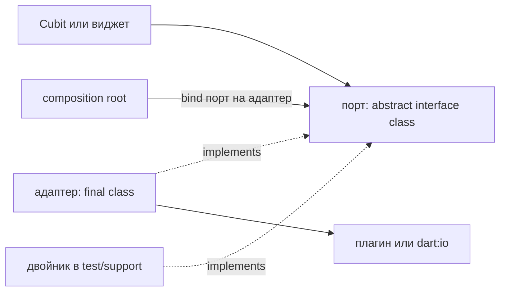
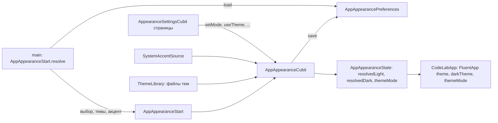

# Платформа и оформление

Глава о двух вещах, которые связывает одно правило: код приложения не говорит с операционной системой напрямую. Первая часть — `lib/core/platform/`: порты и адаптеры, ключи `shared_preferences`, где в коде позволено знать платформу. Вторая — оформление: как выбор пользователя превращается в тему `FluentApp`.

Платформенное правило в общем виде — [platform-integration.md](../../../docs/architecture/platform-integration.md) (§1 «Основной принцип», §4 «Абстракция платформы», §5 «`Platform.is*`», §8 «Изоляция плагинов», §28 «Локальное хранилище настроек»). Здесь — как оно выполнено в этом приложении.

## Правило: плагины только в адаптерах

Cubit и виджет не вызывают плагин, диалог ОС или `dart:io` сами. Для каждого такого места в `lib/core/platform/` есть:

- **порт** — маленький `abstract interface class` с doc-комментарием «почему, для чего, как использовать»;
- **адаптер** — `final class`, единственное место, где импортируется плагин;
- **двойник** в `test/support/` — управляемая подмена для тестов;
- **регистрация** в composition root и **правило сторожа**, которое не пускает импорт плагина в другие файлы.



Выигрыш двойной. Тест подставляет двойник через шов `createCodeLabRootScope` ([глава 02](02-composition-root.md)) и не открывает диалог и не запускает процесс. А когда пакет плагина меняет API, правка остаётся в одном файле. У `system_theme`, например, три особенности, которые закрывает адаптер: молчаливый запасной цвет, неотменяемая подписка и статическое поле без `await`.

## Порты и адаптеры

Порт, адаптер, пакет и место регистрации. «Платформа» — `CodeLabPlatformModule`, «протокол» — `CodeLabProtocolModule`, «оформление» — `CodeLabAppearanceModule` (все в `lib/app/app_scope.dart`).

### Диалоги и внешний мир

| Порт | Адаптер | Что использует | Где собирается | Шов тестов |
|---|---|---|---|---|
| `ProjectFolderPicker` | `FileSelectorProjectFolderPicker` | `file_selector`: `getDirectoryPath` | платформа | `projectFolderPicker` |
| `UsageCsvSaver` | `FileSelectorUsageCsvSaver` | `file_selector`, запись файла | платформа | `usageCsvSaver` |
| `ThemeFilePicker` | `FileSelectorThemeFilePicker` | `file_selector`: `openFile`, тип `json` | платформа | `themeFilePicker` |
| `ProtocolExportSaver` | `FileSelectorProtocolExportSaver` | `file_selector`, запись файла | протокол | `protocolExportSaver` |
| `ExternalLinkOpener` | `UrlLauncherExternalLinkOpener` | `url_launcher`; схемы `http`, `https`, `mailto` по `link_policy.dart` | платформа | `externalLinkOpener` |
| `LocalFolderOpener` | `UrlLauncherLocalFolderOpener` | `url_launcher` и `dart:io`; открывает только каталоги | платформа | `localFolderOpener` |
| `UserShellLauncher` | `PtyUserShellLauncher` | `pty2` и `dart:io`: оболочка пользователя в PTY | платформа | `userShellLauncher` |
| `LocalPathKindOf` (typedef) | `ioLocalPathKind` | `dart:io`: вид пути, ссылки раскрываются | платформа | `localPathKind` |
| `ImageProviderFor` (typedef) | `defaultImageProviderFor` над `LimitedNetworkImage` | `dart:io` `HttpClient` с пределами тела, редиректов и размера | платформа | — |

### Система и нативный код

| Что | Как устроено | Где собирается |
|---|---|---|
| `SystemAccentSource` | порт; адаптер `SystemThemeAccentSource` на `system_theme`, для платформы без акцента — `UnsupportedSystemAccentSource` | `main` создаёт через `SystemThemeAccentSource.start()` и передаёт в `CodeLabBootstrap`; дальше — оформление |
| `OsDropRegion` | не порт, а виджет-адаптер над `desktop_drop`: отдаёт список путей и колбэки входа и выхода, типы плагина наружу не выходят | используется в presentation экрана «Open a project» и шага onboarding |
| `AppMenuBridge` | `MethodChannel` `codelab/app_menu`: нативная сторона (`macos/Runner/AppDelegate.swift`) шлёт `openSettings`, Dart открывает настройки тем же путём, что сочетание | создаёт `CodeLabBootstrap` |
| `BuildInfo` | ОС и архитектура процесса для раздела «About»; единственный файл с `dart:ffi` | `lib/app/about_ports_factory.dart` (один раз и лениво) и `ProtocolPaneCubit` в `app_scope.dart`: метка платформы для экспорта панели Protocol |

### Хранилища настроек

Эти порты читают и пишут `shared_preferences`; ключи — ниже.

| Порт | Адаптер | Где собирается |
|---|---|---|
| `AppLanguagePreferences` | `SharedPreferencesAppLanguagePreferences` | `main` читает до `runApp`; `CodeLabLanguageModule` отдаёт `AppLanguageCubit` |
| `AppAppearancePreferences` | `SharedPreferencesAppAppearancePreferences` | `main` читает до `runApp`; `CodeLabAppearanceModule` отдаёт `AppAppearanceCubit` |
| `OnboardingPreferences` | `SharedPreferencesOnboardingPreferences` | `main`; `CodeLabOnboardingModule` |
| `StartupPreferences` | `SharedPreferencesStartupPreferences` | платформа |
| `ConnectionPreferences` | `SharedPreferencesConnectionPreferences` | `CodeLabConnectionModule` |
| `DockLayoutStore` | `SharedPreferencesDockLayoutStore` | платформа |
| `WorkspaceSnapshotStore` (порт из `codelab_client_core`) | `SharedPreferencesWorkspaceSnapshotStore` | платформа |
| `SettingsPageStore` | `SharedPreferencesSettingsPageStore` (`lib/app/navigation/settings_page_store.dart`) | `CodeLabPresentationModule` |
| `RecentProjectsStore` (порт из `codelab_client_core`) | `MigratingRecentProjectsStore` над `JsonFileRecentProjectsStore` из `codelab_client_io`; при недопустимом `CODELAB_HOME` — `UnavailableRecentProjectsStore` | платформа |

Последний порт к `shared_preferences` больше не пишет: список недавних проектов лежит в `$CODELAB_HOME/recent_projects.json`, общем с `codelab`. Обёртка только один раз переносит прежний ключ `codelab.recent_projects`; подробности — [эксплуатация](operations.md#данные-приложения-вне-codelab_home).

Остальное в `lib/core/platform/` — помощники без плагинов: `link_policy.dart` (какие схемы можно открывать), `home_path_label.dart` (`~` вместо домашнего каталога в подписях).

## Что проверяет сторож

Правила — `packages/dart/codelab_architecture_tests/test/support/rules.dart`, запуск — `fvm dart run melos run guard`. Для приложения они говорят, **где** разрешён импорт:

| Что импортировать | Где разрешено | Почему |
|---|---|---|
| `package:file_selector/` | только `lib/core/platform/` | системные диалоги — нативный API |
| `package:url_launcher/` | только `lib/core/platform/` | порты `ExternalLinkOpener` и `LocalFolderOpener` |
| `package:pty2/` | только `lib/core/platform/user_shell_launcher.dart` | процесс оболочки — инфраструктура |
| `package:system_theme/` | только `lib/core/platform/system_accent_source.dart` | три особенности API закрывает один адаптер |
| `package:desktop_drop/` | только `lib/core/platform/os_drop_region.dart`; в `codelab_ui` запрещён целиком | плагин перетаскивания |
| `dart:ffi` | только `lib/core/platform/build_info.dart` | остальной код берёт `BuildInfo` |
| `package:codelab_embedded/io.dart`, `package:codelab_setup/io.dart` | только `lib/app/` | IO-бареллы мостов — часть composition root |
| `package:codelab_embedded/testing.dart` | нигде в `lib/` | сценарий модели не попадает в релиз |
| `package:codelab_agent_*` | нигде в приложении | агента получают через мосты |
| `package:xterm2_core/`; `package:xterm2/` | `lib/features/terminal/`; `lib/features/terminal/presentation/` | модель и виджет эмулятора |
| `dart:io` | запрещён в `lib/features/onboarding`, `lib/features/project_files`, `lib/features/settings/presentation`, `lib/features/usage/application`, `lib/features/protocol/application` | файлы — только через порты |
| `package:flutter/` | запрещён в `lib/features/terminal/application`, `usage/application`, `protocol/application` | application без Flutter |

Чего сторож не проверяет: направление зависимостей между слоями внутри фичи (presentation → application) и импорты между фичами. Их держит ревью; подробнее — [глава 01](01-overview.md#правила-зависимостей-и-как-их-проверяет-сторож).

Новое правило добавляют в том же изменении, что и граница: правило сторожа — часть изменения, а не отдельная задача (корневой `AGENTS.md`, §5).

## Платформенные проверки в коде

Корневое правило — не раскидывать `Platform.isMacOS` и `Platform.isWindows` по фичам (`AGENTS.md`, §11). В `lib/` `Platform.is*` остались в одном месте:

- `PtyUserShellLauncher` в `lib/core/platform/user_shell_launcher.dart`: поддерживается ли запуск на этой платформе, `isWindows` для выбора оболочки и проверки исполняемого файла. Порт `UserShellLauncher` об ОС не знает.

Остальные упоминания платформы — не ветвления по возможностям:

- `Platform.environment` читают `main.dart` и composition root (`lib/app/app_scope.dart`) и передают дальше как `ConnectionEnvironment`; Cubit-ы и страницы получают словарь переменных, а не `Platform`. Ещё его читает `PtyUserShellLauncher`, когда подбирает оболочку и окружение процесса.
- `Platform.operatingSystem` — параметр `platform` у `EmbeddedSecretMigrationRunner` и вход `BuildInfo.of(...)`: платформа приходит аргументом, чтобы тест проверил ветку Windows на любом хосте.
- `defaultTargetPlatform` из `package:flutter/foundation.dart` читают несколько виджетов (страница «Keyboard», терминал, панель Protocol, оболочка рабочего места, шаг onboarding): значение выбирает подписи клавиш и платформенные варианты показа. Платформенных возможностей оно не решает.
- Решение «какая платформа поддерживает системный акцент» принимает пакет (`supportsAccentColor`, `supportsListeningToAccentColorChanges`), а не код приложения.

Собирается и проверяется только macOS ([эксплуатация](operations.md#платформы)): заготовки других платформ в репозитории есть, но сборок для них нет.

## Ключи `shared_preferences`

Один домен настроек на приложение; на macOS это `~/Library/Preferences/com.example.codelabApp.plist` с префиксом `flutter.` у ключей ([эксплуатация](operations.md#данные-приложения-вне-codelab_home)). Ключи в коде:

| Ключ | Константа | Что хранит | Чей порт |
|---|---|---|---|
| `codelab.workspace.snapshot` | `kWorkspaceSnapshotPrefsKey` | JSON: проект и открытые сессии окна | `WorkspaceSnapshotStore` |
| `codelab.connection.default_profile` | `kConnectionDefaultProfileKey` | id профиля по умолчанию; нет ключа — встроенный агент | `ConnectionPreferences` |
| `codelab.dock.open_panes`, `codelab.dock.active_pane`, `codelab.dock.width` | `_kOpenPanesKey`, `_kActivePaneKey`, `_kWidthKey` | раскладка дока: панели по имени, активная, ширина | `DockLayoutStore` |
| `codelab.settings.last_page` | `_kLastPageKey` | последняя страница настроек | `SettingsPageStore` |
| `codelab.app.language` | `kAppLanguageKey` | `en` или `ru`; для «System» ключа нет | `AppLanguagePreferences` |
| `codelab.app.appearance` | `kAppAppearanceKey` | один JSON-документ оформления с версией | `AppAppearancePreferences` |
| `codelab.app.onboarding_done` | `kOnboardingDoneKey` | `true`, когда приветственные шаги пройдены | `OnboardingPreferences` |
| `codelab.workspace.reopen_last_project` | `kReopenLastProjectKey` | `false`, если проект прошлого запуска не открывать; включено — ключа нет | `StartupPreferences` |
| `codelab.recent_projects` | `_legacyKey` | прежний список проектов; только читается для переноса и удаляется | `MigratingRecentProjectsStore` |

Единый образец у портов `*Preferences`:

- `load()` читается до `runApp` и **не бросает**: сбой хранилища или незнакомое значение дают умолчание и диагностику в типе результата (`AppAppearanceLoad`, `StartupLoad`, `OnboardingLoad`, `AppLanguageLoad`: `storedValueInvalid`, `readFailure`).
- События о диагностике пишутся позже: журнал в `main` ещё не настроен, поэтому результат чтения переезжает в composition root швом (`AppLanguageStart`, `OnboardingStart`, `AppAppearanceStart`), а событие пишет модуль после `configureCodeLabLogging`.
- Незнакомое значение **не перезаписывается**, пока пользователь явно не выберет другое: данные пользователя не портятся молча (корневой `AGENTS.md`, §2).
- В `readFailure` попадает только имя типа ошибки: в тексте исключения бывают пути.
- `save()` ошибки не скрывает: их показывает Cubit или страница («Retry»).
- Включённое значение по умолчанию хранится отсутствием ключа (`reopen_last_project`, язык «System»): `save(true)` удаляет ключ.

Чтобы получить чистые настройки при ручном запуске, удалите домен `com.example.codelabApp` — команда в [эксплуатации](operations.md#данные-приложения-вне-codelab_home). Переменная `CODELAB_HOME` эти настройки **не** изолирует: она переносит только файлы в `$CODELAB_HOME`.

## Оформление

Оформление — выбор пользователя из четырёх значений (режим, тема светлого режима, тема тёмного, системный акцент), который превращается в две готовые `FluentThemeData` для `FluentApp`. Поведение описывают спецификации [app-settings](../../../openspec/specs/app-settings/spec.md) (разделы про режим, системный акцент, хранение и события оформления) и [client-themes](../../../openspec/specs/client-themes/spec.md) (формат файла темы). Пользовательская сторона — в [руководстве пользователя](user/09-settings.md#оформление).



Файлы тем приходят через порт `ThemeLibrary` из `codelab_client_core` (реализация `IoThemeLibrary` — в `codelab_client_io`, разбор файла — `ThemeFile.parse`); к `dart:io` ни Cubit, ни страница не обращаются. В виджет-тестах порты подменяются двойниками: `InMemoryThemeLibrary` и двойник `SystemAccentSource`, поэтому настоящие файлы и канал плагина не нужны.

### Кто что делает

| Файл (`lib/app/appearance/`) | Роль |
|---|---|
| `app_appearance_start.dart` | `AppAppearanceStart`: решение для первого кадра. `resolve` читает файлы тем двух режимов (не дольше 1 с на файл) и первое значение системного акцента (1 с) и не бросает; что не загрузилось, попадает в `themeProblems` и `fallback` |
| `app_appearance_cubit.dart` | `AppAppearanceCubit`: единственный владелец применённого оформления, singleton root scope; состояние — `AppAppearanceState` с готовыми `resolvedLight` и `resolvedDark` |
| `built_in_themes.dart` | три встроенные темы `light`, `dark`, `high-contrast` кодом: `builtInThemeFile(id)` возвращает `ThemeFile` с полным набором ролей |
| `fluent_theme_builder.dart` | `buildFluentTheme(theme, systemAccent:)`: чистая функция из `ThemeFile` в `FluentThemeData` |

Порт хранения и тип выбора — `lib/core/platform/app_appearance_preferences.dart`: `AppAppearanceSettings` с полями `mode` (`light`, `dark`, `system`), `lightTheme`, `darkTheme` (имена тем: встроенные или файлы каталога) и `systemAccent`. Умолчание: режим «по системе», темы `light` и `dark`, акцент выключен.

Страница «Appearance» — отдельный Cubit в `lib/features/settings/` (`AppearanceSettingsCubit`): каталог тем, карточки, превью, проверка контраста, импорт. Применённое оформление он не хранит, а вызывает методы `AppAppearanceCubit`. Фабрика Cubit-а страницы — `createAppearanceSettingsCubit` в `CodeLabDependencies`.

### Как строится тема

`buildFluentTheme` собирает тему в таком порядке:

1. База — `FluentThemeData` режима темы (`light` или `dark`), поверх неё роли встроенной базы (`extends`), затем роли самой темы.
2. Роли, заданные цветом, попадают в `FluentThemeData` (акцент, выделение, ресурсы текста, успех, предупреждение, ошибка).
3. Остальное кладётся в `FluentThemeData.extensions` как `CodeLabPalette` (цвета, которых нет у Fluent: diff, ссылки, тон успеха) и `CodeLabCodeTheme` (палитра подсветки кода). Виджеты кита читают цвета оттуда — [`codelab_ui`](../../../packages/flutter/codelab_ui/doc/README.md).
4. Пользовательская роль применяется как задана, даже при низком контрасте. Подгоняются только цвета, которые app выводит сам: тона под тёмную тему, запасные цвета кода под заменённый фон кода, ссылка под системный акцент. Целевой контраст — 4,7:1 (запас над порогом 4,5:1).
5. Включённый системный акцент заменяет роль `accent` любой темы.

Для `light` и `dark` без системного акцента значения равны тем, что выводит кит: стандартная тема Fluent вид не меняет. Страница показывает контраст пользовательской темы, но не блокирует её (`contrast_checks.dart`).

### Как `AppAppearanceCubit` меняет состояние

Методы: `setMode`, `useTheme`, `resetTheme`, `setSystemAccent`, `reloadTheme`, `refreshSystemAccent`, `retrySave`, `close`. Общие правила:

- **Сначала публикация, потом запись.** Выбор виден сразу, а запись в `shared_preferences` идёт в очереди (`_enqueue`); побеждает последний выбор — запись, которую обогнал более новый, состояние не публикует.
- **Сбой записи не откатывает оформление.** Ставится `saveFailed`, страница предлагает «Retry» (`retrySave`).
- **Защита от устаревших чтений.** Пользовательская тема читается из файла асинхронно. `useTheme`, `resetTheme` и `setMode` берут номер выбора (`_choice`) в начале каждого вызова; чтение применяется, только если нового выбора не было. `reloadTheme` защищён номером операции своего режима (`_lightOp`, `_darkOp`).
- **Тема, которая не загрузилась, заменяется встроенной темой режима**, а выбор пользователя остаётся в документе; `fallback` в состоянии подсказывает странице, какие режимы вернулись к встроенным темам.
- **Тема режима и режим согласуются.** Если «Mode» зафиксирован на другом режиме, выбор темы переключает его на режим темы; при «по системе» режим не меняется.
- **Выход.** `close()` отменяет подписку на акцент и ждёт идущую запись до 3 с (событие `appearance.save_timeout` при срыве). `CodeLabRootLifecycle` закрывает Cubit отдельной параллельной веткой `appearance` ([глава 02](02-composition-root.md#выход-codelabrootlifecycle-и-appexithandler)).

Конкурентный контракт владельцев состояния — [state-management.md](../../../docs/architecture/state-management.md) и [concurrency.md](../../../docs/architecture/concurrency.md).

### Системный акцент

`SystemThemeAccentSource` (`lib/core/platform/system_accent_source.dart`) на пакете `system_theme`:

- `start()` вызывает `main` до `runApp`; `supported` ложно, если платформа не поддерживает акцент, плагин не ответил за 1 с или после чтения остался маркер «нет цвета». Запасной цвет пакета в приложение не попадает.
- `read()` перечитывает цвет; `changes` — поток смен. Уведомления есть на macOS и Windows; на Linux их нет, и `AppearancePageHost` вызывает `AppAppearanceCubit.refreshSystemAccent()` при каждом открытии страницы.
- Cubit подписывается на `changes` один раз, если платформа поддерживает акцент, и отписывается в `close()`.
- Строка «Accent color» страницы показывается только при `systemAccentSupported` из `AppAppearanceStart`: она не появляется и не исчезает после первого кадра.

### Как это применяется в `CodeLabApp`

`CodeLabApp` строит `FluentApp` внутри `BlocBuilder<AppAppearanceCubit, AppAppearanceState>`: `theme` — `resolvedLight`, `darkTheme` — `resolvedDark`, `themeMode` — режим из состояния. Перестраивает `FluentApp` только смена `themeMode` или одной из двух тем; смена языка и смена оформления друг от друга не зависят. Поэтому состояние виджетов (текст в поле ввода, прокрутка) при смене темы не теряется.

### Журнал

Оформление пишет события компонента `settings`: `app.appearance_resolved` при старте, `settings.appearance_changed`, `appearance.theme_loaded`, `appearance.theme_invalid`, `appearance.theme_imported`, `appearance.system_accent_failed`, `appearance.catalog_failed`, `appearance.save_failed` и другие. Имя пользовательской темы в событие не попадает — вместо него `custom`. Таблица полей — [эксплуатация](operations.md#логи-и-диагностика).

## Скелет нового порта платформы

Задача: приложению нужно что-то, чего Flutter не даёт, — например, диалог выбора файла ещё одного вида. Допустим, нужен порт `ConfigFilePicker`. Название вымышленное, образец — реальный `ThemeFilePicker` (`lib/core/platform/theme_file_picker.dart`). Шаги в порядке работы.

1. **Порт и адаптер** в одном файле `lib/core/platform/config_file_picker.dart`. Все имена пакета `file_selector` — только здесь:

   ```dart
   import 'package:file_selector/file_selector.dart';

   /// Порт выбора файла настроек в системном диалоге.
   ///
   /// Почему порт: диалог — нативный API (`AGENTS.md` §11); Cubit не вызывает
   /// плагин, а тест подставляет двойник.
   ///
   /// Для чего: …
   ///
   /// Как использовать: привязан в composition root
   /// (`createCodeLabRootScope(configFilePicker:)`). Отмена диалога — `null`.
   abstract interface class ConfigFilePicker {
     /// Путь выбранного файла или `null`, если пользователь закрыл диалог.
     Future<String?> pickConfigFile();
   }

   final class FileSelectorConfigFilePicker implements ConfigFilePicker {
     const FileSelectorConfigFilePicker();

     static const _yaml = XTypeGroup(label: 'YAML', extensions: ['yaml', 'yml']);

     @override
     Future<String?> pickConfigFile() async {
       final file = await openFile(acceptedTypeGroups: const [_yaml]);
       return file?.path;
     }
   }
   ```

   Порт не бросает сверх контракта: ошибки и отмену он выражает значением (`null`, перечисление исходов) — так сделаны `ExternalLinkOpener` (`ExternalLinkOutcome`), `LocalFolderOpener` (`FolderOpenOutcome`), `UsageCsvSaver` (`UsageCsvSaved`, `UsageCsvCancelled`, `UsageCsvFailed`). Если порт читает и пишет настройки, следуйте образцу `*Preferences` из раздела выше: `load` не бросает, значение не перезаписывается молча.

2. **Регистрация.** Шов в `createCodeLabRootScope`, параметр в `CodeLabPlatformModule` и привязка (образец — `ThemeFilePicker`):

   ```dart
   // createCodeLabRootScope: ConfigFilePicker? configFilePicker,
   // CodeLabPlatformModule(…, configFilePicker: configFilePicker)

   bind<ConfigFilePicker>().toInstance(
     _configFilePicker ?? const FileSelectorConfigFilePicker(),
   );
   ```

   Зависимость от порта передаёт модуль, где собирается Cubit (`currentScope.resolve<ConfigFilePicker>()`); виджет получает готовый Cubit через `CodeLabDependencies` ([глава 02](02-composition-root.md#скелет-новая-зависимость-в-composition-root)).

3. **Правило сторожа**, если используется новый плагин, а не тот, что уже разрешён в `lib/core/platform/`. Для `file_selector` оно уже есть, и новый адаптер в `lib/core/platform/` под него подходит. Для нового плагина добавьте в `packages/dart/codelab_architecture_tests/test/support/rules.dart` запись в стиле существующих:

   ```dart
   PackageRule(
     'apps/codelab_desktop/lib',
     forbidden: ['package:новый_плагин/'],
     exclude: ['core/platform/config_file_picker.dart'],
     sealExclude: false,
   ),
   ```

   `sealExclude: false` значит «исключённому файлу импорт разрешён, остальным нет»; `true` дополнительно запрещает остальным ссылаться на исключённые файлы. Новый плагин в `pubspec.yaml` — архитектурное решение (корневой `AGENTS.md`, §4): сначала OpenSpec change.

4. **Двойник** в `test/support/` по образцу `FakeThemeFilePicker`:

   ```dart
   final class FakeConfigFilePicker implements ConfigFilePicker {
     FakeConfigFilePicker({this.next});

     /// Ответ ближайшего вызова; `null` — пользователь закрыл диалог.
     String? next;

     /// Сколько раз открывали диалог.
     int calls = 0;

     @override
     Future<String?> pickConfigFile() async {
       calls++;
       return next;
     }
   }
   ```

   Передайте его швом: в `CodeLabTestBinding` добавьте параметр и пробросьте в `createCodeLabRootScope` (так сделано у `usageCsvSaver`), или вызовите `createCodeLabRootScope(configFilePicker: FakeConfigFilePicker(…))` напрямую.

5. **Тесты.** Cubit — на двойнике. Адаптер — отдельным файлом в `test/core/platform/`, если у него есть логика кроме вызова плагина (политика схем, ограничения, разбор значения): плагину даётся шов (`launch:`, `open:`), как у `UrlLauncherExternalLinkOpener` и `SharedPreferencesStartupPreferences`. Образцы — `test/core/platform/external_link_opener_test.dart` и `startup_preferences_test.dart`.

6. **Проверка.** `fvm dart format`, `fvm flutter analyze` и `fvm flutter test` в `apps/codelab_desktop`; `fvm dart run melos run guard`, если менялись правила сторожа или импорты между пакетами. Полный перечень проверок — [глава 00](00-getting-started.md#прогон-тестов).

Если решение меняет поведение продукта, платформенный контракт или добавляет плагин, начните с OpenSpec change (`AGENTS.md`, §17). Пошаговый рецепт по теме — в [главе 09](09-extending.md).

## Смотрите также

- [platform-integration.md](../../../docs/architecture/platform-integration.md) — общие правила платформы, секции 8 (изоляция плагинов), 28 (хранилище настроек), 37 (перетаскивание).
- [`codelab_ui`](../../../packages/flutter/codelab_ui/doc/README.md) — виджеты и палитры, которые читает оформление.
- [Эксплуатация](operations.md) — где лежат данные и события журнала.
- [Глава 02](02-composition-root.md) — как порты подключаются и подменяются в тестах.
