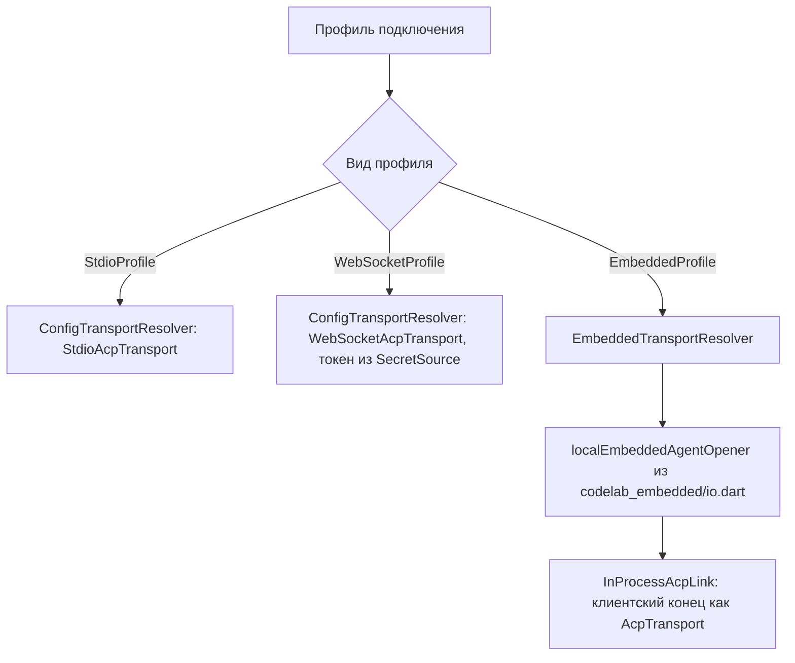
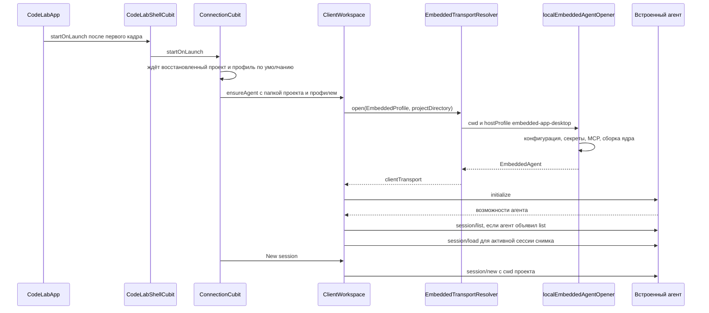

# Встроенный агент и подключения

Глава объясняет, как приложение получает агента: какие бывают профили подключения, какой резолвер открывает каждый из них, как запускается и закрывается встроенный агент, где лежат секреты и как страницы «Providers» и «MCP servers» работают с настройками агента, не импортируя пакеты `codelab_agent_*`. Общую карту кода и поток запуска даёт [development.md](development.md), сборку root scope — [02-composition-root.md](02-composition-root.md). Здесь — только то, что относится к агенту и подключениям.

Правила изменений — в [`AGENTS.md`](../AGENTS.md) приложения, разделы «Встроенный агент», «Профили подключения и настройки», «Секреты». Поведение задают спецификации [embedded-agent](../../../openspec/specs/embedded-agent/spec.md), [client-agent-setup](../../../openspec/specs/client-agent-setup/spec.md) и [app-settings](../../../openspec/specs/app-settings/spec.md).

## Три способа получить агента

Приложение — ACP-клиент. ACP (Agent Client Protocol) — протокол, по которому клиент и агент обмениваются сообщениями. Агента приложению даёт профиль подключения (`ConnectionProfile` из `codelab_client_core`):

| Профиль | Что открывается | Кто открывает |
|---|---|---|
| `EmbeddedProfile` | агент работает в процессе приложения, ACP идёт по паре в памяти (`InProcessAcpLink`) | `EmbeddedTransportResolver` (`lib/app/embedded_transport_resolver.dart`) |
| `StdioProfile` | дочерний процесс, например `codelab-agent serve --stdio`, ACP по stdin и stdout | `ConfigTransportResolver` из `codelab_client_core` на фабрике `CodeLabStdioTransportFactory` |
| `WebSocketProfile` | соединение с агентом по `ws://` или `wss://`; токен берётся по ссылке | `ConfigTransportResolver` на фабрике `CodeLabWebSocketTransportFactory` |

Встроенный агент — профиль по умолчанию. Его описывает константа `embeddedConnectionProfile` (`lib/features/settings/application/embedded_profile.dart`): `id: 'embedded'`, подпись `Embedded agent`, `hostProfile: 'embedded-app-desktop'`. `hostProfile` — имя профиля хоста ядра агента; приложение использует `embedded-app-desktop`, терминальный клиент — `embedded-cli` ([README `codelab_embedded`](../../../packages/dart/codelab_embedded/README.md)). Сам агент собирает пакет `codelab_embedded`; устройство его ядра — в [руководстве ядра агента](../../../packages/dart/codelab_agent_core/doc/README.md).

## Выбор резолвера по профилю

`ClientWorkspace` получает список резолверов и для каждого подключения берёт первый, чей `supports(profile)` истинен (`_resolverFor` в `client_workspace.dart`). Список собирает `_transportResolvers` в `lib/app/app_scope.dart`: сначала `ConfigTransportResolver`, потом `EmbeddedTransportResolver`.

Схема показывает, какой профиль куда попадает.

Тонкости:

- `ConfigTransportResolver.supports` для `EmbeddedProfile` возвращает `false`: ядра агента клиентский слой не знает, поэтому встроенного агента открывает только свой резолвер.
- Тот же список служит ещё двум задачам: проверке профиля и списку видов профилей в диалоге «Add connection profile» (`profileKindsFor(_transportResolvers(...))`). Поэтому то, что можно сохранить, совпадает с тем, что можно открыть.
- У терминального клиента `codelab` есть своя копия `EmbeddedTransportResolver` (`apps/codelab_cli/lib/src/embedded_transport_resolver.dart`). Так задумано: клиентский пакет не может зависеть от моста `codelab_embedded`, а мост — от клиентских пакетов. Правила отмены `open` держат тесты обоих клиентов, поэтому правка отмены вносится в оба резолвера.

## Профили и окружение

### Где лежат профили

Профили stdio и WebSocket хранятся в `$CODELAB_HOME/profiles.json` — одном файле на app и `codelab`. Читает и пишет его `JsonFileProfileStore` из `codelab_client_io`. Встроенный агент в файл не пишется: он всегда есть.

Путь и переменные процесса даёт `ConnectionEnvironment` (`lib/app/connection_environment.dart`). Правило дома одно с CLI — `resolveCodelabHome` из `codelab_client_io`:

- `CODELAB_HOME` непуст — берётся он; `~` в начале раскрывается через `HOME` или `USERPROFILE`;
- иначе `~/.codelab`.

Недопустимый дом не роняет приложение. `ConnectionEnvironment.of` перехватывает `CodelabHomeException`: путь `profilesPath` остаётся `null`, причина — в `homeProblem`, а composition root подставляет `UnavailableProfileStore`. Страница «Connection» показывает причину, а «Add profile», «Rename» и «Remove» недоступны. Тексты причин берутся из `resolveCodelabHome`, например `CODELAB_HOME: ~user is not supported, use an absolute path`.

Битый или незнакомый `profiles.json` не перезаписывается: целостность данных важнее удобства (корневой `AGENTS.md`, §2).

### Профиль по умолчанию и зарезервированные id

- Без выбора пользователя профиль по умолчанию — встроенный агент. Выбор хранится в `shared_preferences` под ключом `codelab.connection.default_profile`; его читает `DefaultProfileResolver` (`lib/features/settings/application/default_profile_resolver.dart`).
- `DefaultProfileResolver.resolve` не бросает. Ключа нет, в нём `embedded` или файл не читается — встроенный агент. Если id указывает на профиль, которого уже нет в читаемом файле, ключ сбрасывается и пишется `connection_profile.default_reset` (info). Сбой чтения пишет `connection_profile.default_unresolved` (warning, поле `error_type`).
- `embedded` и `default` зарезервированы (`reservedProfileIds` в `profile_ids.dart`): `default` — второе имя встроенного агента. Запись `default` в `profiles.json`, оставшаяся от прежних версий, игнорируется (`usableStoredProfiles`), а страница «Connection» предлагает её удалить. Файл сам собой не меняется.
- Новые id профилей — по правилу `^[a-z0-9][a-z0-9._-]{0,63}$` (`isValidProfileId`): нижний регистр и без `:` выбраны заранее, чтобы имя секрета `codelab/profiles/<id>/token` прошло проверку имён секретов.

### Токен профиля — только ссылка

В профиле хранится ссылка: `env:<NAME>` или `secret:<имя>`. Значение читает `ProfileSecretSource` (`codelab_client_core`) в момент открытия транспорта, без кэша: `env:` — из окружения процесса, `secret:` — из хранилища секретов через порт `ProfileSecrets`. В профиле, состоянии Cubit, журнале и на экране значения нет — только источник и признак «задан».

Если у `secret:` нет значения, `ConnectionCubit` перед попыткой пишет предупреждение в диагностику (`Profile <id> has no stored secret value; connecting without a token.`) и событие `connection_profile.token_secret_missing` с `profile_id`, а подключается без токена. Отказ сервера (HTTP 401 или 403) превращается в понятный текст баннера по типизированной причине.

## Старт сессии со встроенным агентом

Агент стартует не при сборке root scope, а после первого кадра и только если есть проект. Схема показывает путь от запуска приложения до первой сессии.

Что здесь неочевидно:

- **Старта нет без проекта.** `ConnectionCubit.startOnLaunch` (`lib/features/workbench/application/connection_cubit.dart`) ждёт восстановление проекта не дольше `projectRestoreTimeout`; нет проекта — возвращается молча. Резолвер дополнительно защищён: пустая папка даёт `ClientWorkspaceException('Open a project to start the embedded agent.')` до очереди `open`.
- **Приветственные шаги держат старт.** Пока показан onboarding, рабочее место не строится и `startOnLaunch` не вызывается: провайдер, сохранённый на шаге модели, должен действовать при первом старте. Выбранную на последнем шаге папку агент получает тем же единственным стартом. Переключатель «Reopen the last project and its tabs» (`codelab.workspace.reopen_last_project`) в выключенном состоянии запускает приложение без восстановления проекта — агент тоже не стартует.
- **Одна попытка за раз.** Параллельные триггеры (выбор проекта, «New session», «Retry») ждут одну идущую попытку (single-flight, `_inFlight`). Номер попытки `ClientWorkspace` отбрасывает результат вытесненной: она не меняет состояние и не пишет ни `failed`, ни «started».
- **`initialize` и список сессий** выполняет `ClientWorkspace._connect`, а не приложение: после `initialize` идёт `session/list` (если агент объявил `sessionCapabilities.list` и проект выбран), затем `WorkspaceRestorer.restoreAfterConnect` загружает активную сессию снимка через `session/load`. Нет `loadSession` у агента или загрузка не удалась — создаётся новая сессия (`session/new`) с заметкой в ленте. Ограничение: активная сессия, чей `cwd` не равен проекту снимка, не загружается вовсе.
- **`session/new`** уходит при «New session» (`ClientWorkspace.newSession`). Названия методов — константы `codelab_acp_protocol`: `initializeMethod`, `sessionNewMethod`, `sessionListMethod`, `sessionLoadMethod`.

Диагностика старта: события `connection.start_on_launch` (info, `profile_id`), `connection.start_failed` (debug, `profile_id`, `repeat`) и записи диагностики `Starting embedded ACP agent: …` и `Embedded ACP agent started: …`. Перезапуск («Restart agent») пишет `connection.restart` с `reason` и числом прерванных сессий, диагностика — `Reconnecting embedded ACP agent: …`. Полный перечень событий соединения — в [operations.md](operations.md#логи-и-диагностика).

## Открытие и закрытие встроенного агента

`EmbeddedTransportResolver` (`lib/app/embedded_transport_resolver.dart`) владеет жизненным циклом агента: один агент на соединение.

**Открытие.**

- Вызов `open` ставится в очередь: следующий ждёт окончания предыдущего, затем `await dispose()` прежнего агента и только потом идёт открыватель. Два агента одного резолвера не пишут один журнал сессий одновременно.
- Результат открывателя годен, только если поколение (`_generation`) не сдвинулось. Если пока агент открывался, пришёл новый `open` или `close()`, агент сразу получает `dispose()` и не становится текущим, а вызывающий получает `EmbeddedOpenCancelledException`. Поводов отмены два: новое подключение или «Restart agent» и закрытие root scope. Кнопки Disconnect нет, публичный API `TransportResolver` ради встроенного агента не менялся (решение L4 change `add-embedded-agent-mode`).
- Открыватель — `localEmbeddedAgentOpener(environment:, logger:)` из `package:codelab_embedded/io.dart` ([README пакета](../../../packages/dart/codelab_embedded/README.md)). Он грузит конфигурацию, открывает хранилище секретов, журнал сессий и MCP. Невалидный конфиг даёт `EmbeddedAgentConfigException`; резолвер превращает её в `ClientWorkspaceException(message)`, и баннер показывает текст проблем без имени класса, с подсказкой `codelab config check`. Отсутствие ключа провайдера соединению не мешает: ошибка придёт на первом ходу заметкой о сбое хода с кнопкой повтора (требование спецификации agent-workbench-ui «Failed turn notice with Retry»).
- Окружение открывателя одно с портом переноса секретов: оба берутся из `Platform.environment` в `CodeLabEmbeddedAgentModule`, поэтому читают одни и те же `CODELAB_HOME` и `CODELAB_CONFIG`.

**Два предложения от резолвера.** Резолвер связывает агента с UI через два порта, созданных composition root:

| Порт | Что несёт | Кто читает |
|---|---|---|
| `ProviderSetupOffer` | признак «нужен провайдер» и папка, с которой агент не открылся | `ConnectionCubit` в обработчике сбоя попытки |
| `SecretMigrationOffer` | папка агента, открытого с секретами в `config.yaml` | `SecretMigrationCubit` |

Начало каждого открытия и успех сбрасывают оба значения. `ProviderSetupOffer` выставляется до исключения и только для текущего открытия: вытесненное открытие не оставит метку новой попытке.

**Закрытие.** `close()` вызывает `CodeLabRootLifecycle` при закрытии root scope. Он дожидается открытия в полёте и `dispose` текущего агента, идемпотентен, после него `open` отклоняется. Закрытие идёт параллельно с ядром клиента: агент замечает закрытие клиентского конца пары сам и останавливается тем же идемпотентным `dispose`.

Пределы времени:

| Предел | Значение | Что происходит по истечении | Где |
|---|---|---|---|
| закрытие агента при закрытии scope | 10 с (`defaultEmbeddedCloseTimeout`) | событие `embedded.close_timeout` (warning), освобождение транспорта и ядра клиента продолжается | `CodeLabRootLifecycle._closeEmbedded`, `app_scope.dart` |
| закрытие транспорта ядра клиента | 2 с (`transportCloseTimeout`) | эскалация `SIGTERM`, затем `SIGKILL` у stdio | `app_scope.dart` |
| выход из приложения целиком | 5 с (`AppExitHandler.exitTimeout`) | событие `app.exit_timeout` с полем `pending` и ответ `exit` | `lib/app/app_exit_handler.dart` |

Предел 10 с действует при закрытии scope без запроса на выход. При выходе раньше срабатывает общий предел 5 с: закрытие агента тогда не укорачивается и идёт, пока VM не остановится. Подробности выхода — в [development.md](development.md#поток-запуска).

## Логгер агента в журнале приложения

Ядро агента пишет в собственный порт `Logger` (его реэкспортирует `codelab_embedded`). `CodeLabEmbeddedLogger` (`lib/app/embedded_logger.dart`) переводит записи в структурный журнал приложения: логгер `codelab_desktop.embedded`, категория `application`, компонент `embedded`.

- Адаптер ничего не добавляет к записи: поля событий агента уже без значений секретов, а процессор журнала маскирует ключи и тексты поверх.
- От ошибки берётся только тип в поле `error_class`: текст мог бы процитировать ответ провайдера или путь; стек не пишется.
- Уровни отсекают приёмники журнала (`isEnabled` всегда `true`).
- Тот же логгер получают `localEmbeddedAgentOpener`, `ioProviderCheck`, `ClientSecretAccess` и функция `providerSetupNeededAt`, поэтому записи моста настроек (`provider_wizard.*`, `secrets.client.fallback`) оказываются в том же журнале.

В журнале встроенного агента полезны `host.plan` (одна запись при сборке: какие возможности выключены и почему) и `embedded.agent.failed` (сбой в зоне агента). Где лежит журнал и как его читать — [operations.md](operations.md#логи-и-диагностика).

## Хранилище секретов и токены профилей

Секреты читает и пишет один набор бэкендов `codelab_agent_io` — общий у app, `codelab` и `codelab-agent`. Приложение достаёт их через мост: `package:codelab_setup/io.dart`. Отдельных хранилищ у app нет, плагины вроде `flutter_secure_storage` не используются.

Путь от `main` до виджета:

1. `main` вызывает `openProfileSecrets` (`lib/app/client_profile_secrets.dart`) до сборки scope: `ProfileSecrets.backend` синхронный, а открытие асинхронно. Недопустимый `CODELAB_HOME` не бросает исключение, а даёт `UnavailableProfileSecrets` — хранилище только для чтения с причиной.
2. Результат попадает в `createCodeLabRootScope(profileSecrets:)`; `CodeLabConnectionModule` оборачивает его в `ReopenableProfileSecrets`. Обёртка делегирует текущему экземпляру, а `reopen()` открывает хранилище заново: при каждом открытии диалога «Add connection profile» и страницы «Connection». Правка `secrets.backend` в `config.yaml` действует без перезапуска. Параллельные `reopen` нумеруются: текущим становится только результат самого свежего вызова.
3. `ClientProfileSecrets` — адаптер порта `ProfileSecrets` поверх `ClientSecretAccess`. Исходы `SecretAdmin` (`SecretStored`, `SecretReadOnly`, …) он переводит в закрытые типы kit без значений. `store` не перезаписывает существующее имя (`Exists`); запись в хранилище только для чтения даёт `ReadOnly` с подсказкой.
4. При каждом (пере)открытии пишется событие `secrets.client.backend` (info): `backend`, `writable` и `reason` без путей.

Бэкенд по умолчанию — `env`: только чтение `CODELAB_SECRET_*`. Писать ключи из app можно после `secrets.backend: file` в глобальном `config.yaml` (файл `$CODELAB_HOME/secrets.yaml`, права `0600`) — см. [operations.md](operations.md#секреты). Приложение, запущенное из Finder, не видит переменных оболочки: это видно в строке профиля («`<NAME>` is not set in CodeLab's environment.») и поэтому для app надёжнее файловый бэкенд.

Владелец записи «секрет ↔ профиль» — `ProfileCommitter` из kit: он записывает секрет с откатом и удаляет собственный секрет `codelab/profiles/<id>/token` при удалении профиля. Cubit-ы в хранилище не пишут. События `connection_profile.token_*` несут только `profile_id` и `backend`: имён секретов и текстов исключений в них нет.

## Страницы «Providers» и «MCP servers»

Обе страницы правят конфигурацию агента, но app ничего не знает о её структуре. Всё — через мост `codelab_setup`.

### Чьи настройки

Решает `resolveSettingsAccess` моста по виду подключения:

| Подключение | Доступ | Что видит пользователь |
|---|---|---|
| встроенный агент | `EditableSettings` | страница редактируется; дом — `CODELAB_HOME` app |
| stdio `codelab-agent` | `EditableSettings` | редактируется; дом — из `env` профиля, иначе дом app; папка проекта учитывается при «Run in the project folder» |
| WebSocket | `RemoteReadOnly` | только чтение, InfoBar с текущей моделью сессии; локальный конфиг не читается |
| чужой stdio-агент | `NotManaged` | то же: локальный конфиг не читается |

Без подключения берётся профиль по умолчанию (`DefaultProfileResolver`). Смена подключения перечитывает доступ. Имени агента из `initialize` приложение не знает, поэтому для stdio решает команда профиля.

### Как страница получает файлы и секреты

IO-барель `codelab_setup/io.dart` разрешён только в `lib/app/`, поэтому сборку делает адаптер (`lib/app/provider_settings_session.dart`):

- `openProviderSettingsSession` собирает для одного агента `ClientSecretAccess`, `FileAgentConfigStore` и `ioProviderCheck` и отдаёт порт `ProviderSettingsSession` (`lib/features/settings/application/provider_settings_session.dart`). Сессия открывается заново при каждой загрузке страницы.
- Cubit (`ProviderSettingsCubit`, `McpSettingsCubit`) создаётся на каждое открытие страницы фабрикой `CodeLabDependencies` и закрывается страницей. Шов тестов — `createCodeLabRootScope(providerSettingsOpener:)`.
- Запись — только мост: `AgentConfigStore.apply`, `ProviderSetupCommitter`, `McpServerCommitter`, `McpServerRemover`. Конфликт записи даёт баннер и перечитывание без автоповтора.
- Проверка «Check» читает ключ только внутри адаптера и сразу передаёт `ProviderCheck` в `SecretValue`; в состояние, события и логи значение не попадает. Позднюю проверку отбрасывает номер на строку, закрытие страницы — все.
- Живой статус MCP встроенного агента даёт `ResolverMcpStatusSource` (`lib/app/embedded_mcp_status_source.dart`) поверх `EmbeddedTransportResolver.currentAgent`. Подписка на `changes` одна, её владелец — Cubit. У агента вне процесса статуса нет: `/mcp list` и `/mcp reload` уходят только по кнопке.

События страниц пишет логгер `codelab_desktop.settings`: `provider_settings.*`, `mcp_settings.*`. Их список — в `AGENTS.md` приложения; значений секретов, URL и текстов исключений в них нет.

### Мастер провайдера и баннер «нужен провайдер»

Автомат мастера — `ProviderSetupFlow` моста, один на CLI и app. `ProviderWizardCubit` — тонкая обёртка: состояние автомата, шаг строки шагов, сводка и баннер конфликта. Ключ вводится в `PasswordBox` без режима подглядывания и уходит в автомат внутри `SecretValue`.

Баннер «No model provider is configured for the embedded agent.» на рабочем месте — следствие такой цепочки:

1. `localEmbeddedAgentOpener` не может открыть агента и бросает `EmbeddedAgentConfigException`.
2. Резолвер зовёт `providerSetupNeededAt` (`lib/app/provider_setup_probe.dart`): читает снимок конфига тем же `CODELAB_HOME`, окружением и папкой, что и открыватель, и применяет правило моста `providerSetupNeeded`. Сбой чтения даёт «не нужен».
3. Ответ кладётся в `ProviderSetupOffer` до исключения.
4. `ConnectionCubit` при сбое попытки встроенного агента читает порт и публикует метку `ProviderSetupNotice`. Любая новая попытка метку сбрасывает.
5. Рабочее место вместо сырого текста показывает баннер с кнопкой «Add provider» (`connection-banner-add-provider`), мастер открывается с `forceDefault: true` и целью `user`.
6. После записи `connectAfterProviderSetup(notice)` подключает встроенный профиль, только если метка та же (иначе пишется `provider_wizard.reconnect_skipped`).

Все события `provider_wizard.*` автомата (`started`, `check_finished`, `saved`, …) пишет мост; приложение добавляет только `provider_wizard.reconnect` и `provider_wizard.reconnect_skipped`.

## Перенос секретов из `config.yaml`

Если в конфиге встроенного агента ключи записаны литералами, мост выставляет признак `EmbeddedAgent.secretsInConfig`. Резолвер после успешного открытия передаёт его вместе с папкой агента в `SecretMigrationOffer`, и `SecretMigrationCubit` показывает баннер «Secrets are stored in the agent config file.» с кнопкой «Migrate secrets».

Перенос выполняет `EmbeddedSecretMigrationRunner` (`lib/app/embedded_secret_migration_runner.dart`) поверх `SecretMigrator` из `codelab_embedded/io.dart`: тот же движок, что у `codelab secret migrate`. Он получает то же окружение, что открыватель, поэтому план строится по файлам агента, а не по текущему проекту окна. Опции: `--all` для папки проекта, без `--force` (замена существующего секрета в app не предлагается). После переноса баннер предлагает «Restart agent». Признак мост считает при открытии и после переноса не пересчитывает: предупреждение держится до переподключения.

## Что откуда импортировать

Границы проверяет сторож `melos run guard` (`packages/dart/codelab_architecture_tests/test/support/rules.dart`); правило нового пакета добавляется вместе с пакетом.

| Что | Где можно импортировать | Почему |
|---|---|---|
| `package:codelab_agent_*` | нигде в app (`lib/`, и в `dependencies` тоже нельзя) | агентскую сторону клиенты получают только через мосты |
| `package:codelab_embedded/codelab_embedded.dart` | где угодно: барель web-безопасен | типы `EmbeddedAgent`, `EmbeddedAgentOpener`, `EmbeddedAgentConfigException`, `Logger` |
| `package:codelab_embedded/io.dart` | только `lib/app/` и тесты | настольный открыватель и `SecretMigrator`: файлы и процессы |
| `package:codelab_embedded/testing.dart` | только тесты и `integration_test/`; в `lib/` целиком запрещён | сценарий модели не должен попасть в релизную сборку; тесты подставляют его швом `createCodeLabRootScope(embeddedOpener:)` |
| `package:codelab_setup/codelab_setup.dart` | где угодно | чистые типы конфигурации и автоматы мастера |
| `package:codelab_setup/io.dart` | только `lib/app/`; в `features/settings/presentation/` явно запрещён вместе с `dart:io` | файлы, хранилище секретов, сеть проверки |
| `dart:io` | не в `features/onboarding`, `features/project_files`, `features/usage/application`, `features/protocol/application` | эти слои получают файлы только портами |

Общая картина слоёв — [layers-and-dependencies.md](../../../docs/architecture/layers-and-dependencies.md). Нарушение ловит `import_guard_test.dart`; типичные симптомы и действия — [10-troubleshooting.md](10-troubleshooting.md).

## Смотрите также

- [`codelab_embedded`](../../../packages/dart/codelab_embedded/README.md) — мост встроенного агента: барели, открыватель, поток открытия.
- [`codelab_setup`](../../../packages/dart/codelab_setup/README.md) — мост настроек агента: доступ, мастер провайдера, запись конфигурации.
- [`codelab_client_io`](../../../packages/dart/codelab_client_io/README.md) — `JsonFileProfileStore`, `resolveCodelabHome`.
- [Руководство по ядру агента](../../../packages/dart/codelab_agent_core/doc/README.md) — как устроен агент, который здесь запускается.
- [02-composition-root.md](02-composition-root.md) — модули Cherrypick и жизненный цикл root scope.
- [04-navigation-and-settings.md](04-navigation-and-settings.md) — навигация и страницы настроек.
- [08-testing.md](08-testing.md) — швы тестов и двойники.
- [10-troubleshooting.md](10-troubleshooting.md) — частые проблемы.
- [operations.md](operations.md) — данные, переменные, логи и секреты для эксплуатации.
