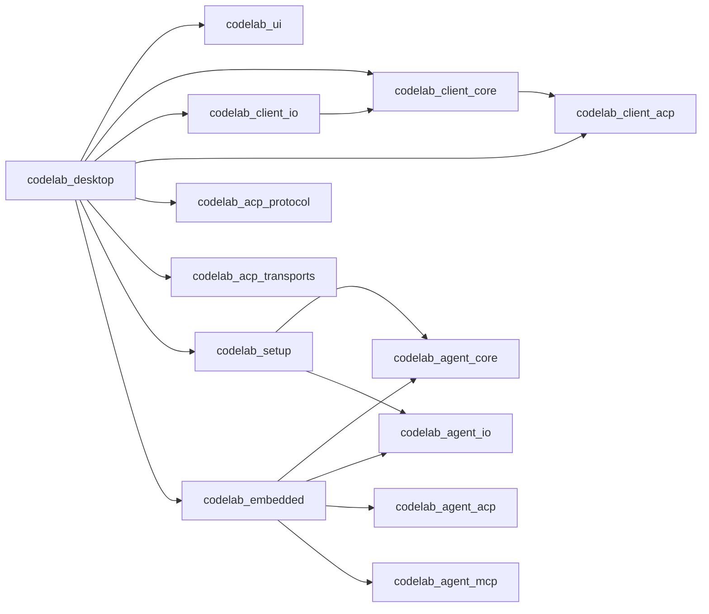
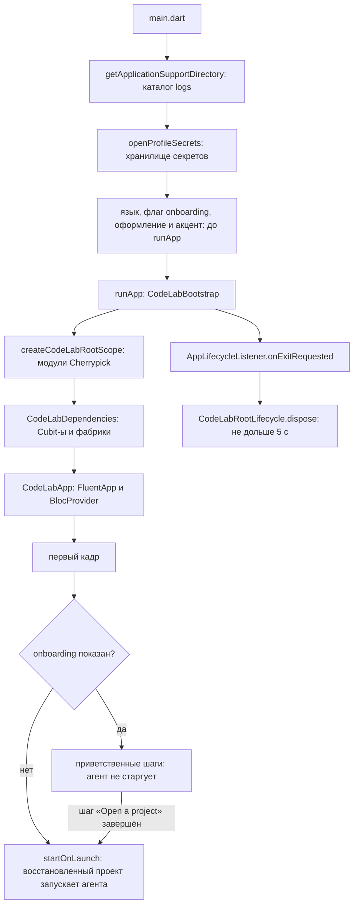

# CodeLab app: разработка

Документ для тех, кто меняет код настольного приложения: краткий обзор — карта кода, зависимости, поток запуска и тесты. Руководство по главам (начало работы, обзор, composition root, путь состояния, навигация и настройки, локализация, платформа и оформление, встроенный агент, тестирование, расширение, частые проблемы) — в [оглавлении `doc/README.md`](README.md). Правила изменений — в [`AGENTS.md`](../AGENTS.md) приложения.

## Место в monorepo

`apps/codelab_desktop` — Flutter-приложение. Своего состояния сессий, очереди промптов и одобрений у него нет: их владелец — клиентский слой `codelab_client_core` (`ClientWorkspace`, `SessionHandle`). Cubit-ы приложения подписываются на это состояние, отображают его и передают действия пользователя, так же как терминальный клиент `codelab`.

Агентскую сторону приложение получает только через два моста: `codelab_embedded` (встроенный агент в процессе) и `codelab_setup` (конфигурация агента, провайдеры, MCP-серверы, секреты). Прямой импорт `package:codelab_agent_*` запрещён и проверяется сторожем (`melos run guard`). Виджеты рабочего места — пакет `codelab_ui`.

Зависимости по `pubspec.yaml` приложения и его прямых зависимостей:



Сторонние зависимости приложения: `fluent_ui` (виджеты Fluent), `flutter_bloc` (Cubit-ы), `cherrypick` с `cherrypick_annotations` (внедрение зависимостей), `fpdart`, `path`, `path_provider`, `shared_preferences`, `file_selector` (выбор папки и файла), `desktop_drop` (перетаскивание папки на экран «Open a project»; импорт — только `lib/core/platform/os_drop_region.dart`), `system_theme` (системный акцент; импорт — только `lib/core/platform/system_accent_source.dart`), `pty2`, `xterm2` и `xterm2_core` (терминал), `url_launcher`, `flutter_localizations` и `intl` (локализация), `structured_log` с адаптерами `structured_log_flutter`, `structured_log_fluent` и `structured_log_remote_sync` (журнал). `codelab_acp_testing` — только `dev_dependency`.

На схеме опущены зависимости внутри нижних слоёв: `codelab_client_io` зависит ещё от `codelab_client_acp`, а `codelab_client_*`, `codelab_embedded` и `codelab_agent_acp` — от `codelab_acp_protocol` и `codelab_acp_transports`. Общая картина слоёв — [layers-and-dependencies.md](../../../docs/architecture/layers-and-dependencies.md) и [acp-boundary.md](../../../docs/architecture/acp-boundary.md).

## Структура кода

Приложение устроено по фичам (feature-first): каждая фича держит слои `application/` (Cubit-ы и состояние, без виджетов) и `presentation/` (виджеты). Слоёв `domain/` и `infrastructure/` в фичах нет: доменная логика живёт в `codelab_client_core`, адаптеры к ОС — в `lib/core/platform/` и `lib/app/`.

| Путь | Что там |
|---|---|
| `lib/main.dart` | точка входа: каталог логов, первое открытие хранилища секретов, `runApp` |
| `lib/app/app_scope.dart` | composition root: `createCodeLabRootScope` (модули Cherrypick и швы тестов), `CodeLabBootstrap`, `CodeLabDependencies`, `CodeLabRootLifecycle` |
| `lib/app/codelab_app_widget.dart` | `CodeLabApp`: `FluentApp`, провайдеры Cubit-ов, переключение рабочего места и настроек, запуск агента после первого кадра |
| `lib/app/language/` | `AppLanguageCubit`: язык интерфейса (System, English, Русский), `AppStrings` в корневой области; `app_language_start.dart` — `AppLanguageStart`, начальный язык и диагностика чтения, которые `main` передаёт в composition root; `CodeLabApp` меняет только `locale` у `FluentApp` |
| `lib/app/appearance/` | оформление: `AppAppearanceCubit` (режим, две темы по режимам, очередь записи, номера операций), `AppAppearanceStart` (решение для первого кадра: сохранённый выбор, загруженные темы, акцент), `built_in_themes.dart`, `fluent_theme_builder.dart` (`FluentThemeData` из ролей темы и `CodeLabPalette`); `CodeLabApp` строит `FluentApp` с обеими темами и `themeMode` |
| `lib/l10n/` | каталоги gen-l10n: `app_en.arb` (шаблон) и `app_ru.arb`, сгенерированный `app_localizations*.dart` (коммитится); настройка — `l10n.yaml` |
| `lib/app/navigation/` | `NavigationCubit`: переход приветственные шаги → рабочее место ↔ настройки, страницы настроек (`SettingsPage`), вкладка страницы «Legal» |
| `lib/app/onboarding/`, `onboarding_probe.dart`, `onboarding_project_port.dart` | приветственные шаги: `OnboardingStart` (решение для первого кадра по флагу `codelab.app.onboarding_done`), зонд фактов о настройках агента (поверх `codelab_setup/io.dart`), адаптер порта выбора проекта поверх фасада рабочего места |
| `lib/app/about_ports_factory.dart`, `legal_ports_factory.dart`, `build_version.dart` | порты раздела «About» (версии, ОС, каталог журналов) и страницы «Legal» (чтение `assets/legal/`, сбор лицензий пакетов из `LicenseRegistry`); константа версии сборки, которую тест сверяет с `pubspec.yaml` |
| `lib/app/embedded_transport_resolver.dart`, `embedded_logger.dart` | открытие и закрытие встроенного агента, логгер агента → журнал приложения |
| `lib/app/connection_environment.dart` | окружение процесса и путь к `profiles.json` |
| `lib/app/client_profile_secrets.dart`, `reopenable_profile_secrets.dart` | хранилище секретов для токенов профилей |
| `lib/app/provider_settings_session.dart`, `provider_setup_probe.dart`, `provider_setup_offer.dart` | конфигурация агента для страниц «Providers» и «MCP servers» и мастера провайдера |
| `lib/app/agent_definitions_loader.dart` | чтение определений агентов для страницы «Agents & modes»: `agentDefinitionRowsAt` из `codelab_setup/io.dart`, тайм-аут 5 с |
| `lib/app/secret_migration_offer.dart`, `embedded_secret_migration_runner.dart` | перенос секретов из `config.yaml` |
| `lib/app/app_exit_handler.dart` | закрытие при выходе: предел 5 с, сброс журналов |
| `lib/core/platform/` | порты и адаптеры платформы: оформление в `shared_preferences` под ключом `codelab.app.appearance` (`AppAppearancePreferences`), системный акцент (порт `SystemAccentSource`, адаптер `SystemThemeAccentSource` на пакете `system_theme`), выбор файла темы (порт `ThemeFilePicker`, `file_selector`), `shared_preferences`-хранилища (снимок рабочего места, раскладка, профиль по умолчанию, флаг приветственных шагов `OnboardingPreferences`, переключатель «Reopen the last project» `StartupPreferences`); недавние проекты — в общем файле `$CODELAB_HOME/recent_projects.json` (`recent_projects_migration.dart`: перенос прежнего ключа `MigratingRecentProjectsStore` и заглушка `UnavailableRecentProjectsStore`), выбор папки, приём брошенной папки (`OsDropRegion` на `desktop_drop`) и проверка вида пути (`LocalPathKindOf`), запуск оболочки (`UserShellLauncher`), открытие ссылок, версия ОС и архитектура для раздела «About» (`build_info.dart`, единственный файл с `dart:ffi`), канал пункта «Preferences…» меню macOS (`app_menu_bridge.dart`), открытие каталога в программе ОС (порт `LocalFolderOpener`, адаптер `UrlLauncherLocalFolderOpener` на `url_launcher`; общий для страниц «Skills & extensions» и «Agents & modes»; каталог пользовательских определений порт может создать, файлы не открывает), загрузка изображений, сохранение CSV панели «Usage» (`UsageCsvSaver`) |
| `lib/core/text/` | общие текстовые функции |
| `lib/features/workbench/` | рабочее место: `CodeLabShellCubit` из частей (`ConnectionCubit`, `SessionsCubit`, `ActiveSessionCubit`, `LayoutCubit`, `SettingsCubit`, `TranscriptViewCubit`), маппер строк ленты `ui_mappers.dart`, данные панели «Agents» `agents_pane_data.dart`, перенос секретов, выбор цели «Go to approval» и ответа сочетанием (`approval_go_to_target.dart`, `approval_shortcut_decision.dart`, `approval_focus_return.dart`); виджеты оболочки, ленты, баннеров, панели «Agents», экран «Open a project» (`open_project_screen.dart`) |
| `lib/features/onboarding/` | приветственные шаги: `OnboardingCubit` (шаг, факты, шаг модели, шаг выбора проекта, документ «Privacy»), экран и шаги в `presentation/`; `dart:io` запрещён сторожем |
| `lib/features/settings/` | настройки: страницы «General» (умолчания агента, язык, «Reopen the last project», «Privacy», «About»), «Keyboard» (каталог сочетаний кита, поиск; без Cubit), «Legal» (`LegalPageCubit`, вкладки, поиск по пакетам), «Connection», «Providers», «MCP servers», «Agents & modes» (`AgentsModesCubit` читает умолчания сессии через мост `sessionDefaultsOf` из `codelab_setup`), «Skills & extensions» (`SkillsSettingsCubit`: навыки и расширения, выключатели навыков и согласие на корни), «Appearance» (`AppearanceSettingsCubit`: каталог тем, карточки, превью, контраст, импорт; применённым оформлением владеет `AppAppearanceCubit` из `lib/app/appearance/`, страница только показывает его), диалог профиля, мастер провайдера |
| `lib/features/usage/` | панель «Usage»: `usage_pane_data.dart` (данные карточек и таблиц), `usage_budget.dart` (блок «Turn budget» с вычетом ожиданий одобрений), `ledger_refresh.dart` (обновление журнала), `usage_csv.dart` (экспорт), `usage_step_label.dart` (подписи шагов); виджеты `workbench_usage_pane.dart`, `usage_pane_view.dart` поверх `CodeLabUsagePane` из `codelab_ui` |
| `lib/features/project_files/` | панель «Files»: дерево и просмотр файлов |
| `lib/features/terminal/` | терминал пользователя: вкладки, ссылки, вывод |
| `assets/legal/` | бандл правовых документов: копии корневых `LICENSE`, `THIRD_PARTY_NOTICES.md`, `PRIVACY*.md`, `TERMS*.md`; тест `test/app/legal_assets_test.dart` сверяет побайтно и по `pubspec.yaml` |
| `test_driver/app.dart` | точка входа с расширением `flutter_driver` для управления запущенным приложением |
| `tool/terminal_spike/` | отдельный экспериментальный проект проверки терминала; в приложение не входит |

## Поток запуска

Так приложение проходит путь от `main` до работающего рабочего места и обратно при выходе.



- `createCodeLabRootScope` ставит модули в порядке: журнал, протокол, фабрики транспортов, встроенный агент, язык, приветственные шаги, оформление, платформа, профили и секреты, презентация, затем сгенерированные контракты Cherrypick (`app_scope.module.cherrypick.g.dart`, хранится в git). Параметры функции (`embeddedOpener`, `environment`, `profileStore`, `recentProjectsStore`, `userShellLauncher`, `projectFiles`, `onboarding`, `legalPorts`, `localPathKind` и другие) — швы тестов: в рабочей сборке они пустые или заданы реальными значениями из `main`.
- `ClientWorkspace` получает два резолвера транспорта (`_transportResolvers` в `app_scope.dart`): `ConfigTransportResolver` из `codelab_client_core` для профилей `stdio` и WebSocket — на фабриках приложения `CodeLabStdioTransportFactory` и `CodeLabWebSocketTransportFactory` (`StdioAcpTransport`, `WebSocketAcpTransport`) и источнике токенов `SecretSource`, — и `EmbeddedTransportResolver` для встроенного агента (`localEmbeddedAgentOpener` из `package:codelab_embedded/io.dart`). Тот же список служит проверке профиля и списку типов в диалоге профиля.
- До `runApp` `main` читает язык, флаг приветственных шагов и оформление (с файлами двух тем и системным акцентом): первый кадр сразу на нужном языке, в нужной теме и на нужном экране. Чтение не бросает, диагностику пишут модули scope после настройки журнала.
- Агент стартует не при сборке scope, а после первого кадра (`startOnLaunch`), и только если восстановлен или выбран проект. Пока показаны приветственные шаги, рабочее место не строится и `startOnLaunch` не вызывается: провайдер, сохранённый на шаге модели, действует при первом старте. Папку, выбранную на последнем шаге, агент получает тем же единственным стартом (`SettingsCubit` держит триггер выбора проекта, пока шаги открыты). Выключенный переключатель «Reopen the last project and its tabs» запускает приложение без восстановления проекта.
- При выходе `AppExitHandler` вызывает весь `CodeLabRootLifecycle.dispose()`: параллельно закрываются вкладки терминала, клиентская ветка (рабочее пространство, встроенный агент, ядро клиента), запись языка и запись оформления. Через 5 с (`AppExitHandler.exitTimeout`) обработчик отвечает `exit` и пишет `app.exit_timeout` с полем `pending` — незавершёнными шагами из `_shutdownSteps` (`terminal`, `cubits`, `workspace`, `embedded`, `migration_offer`, `transport`, `client`, `language`, `appearance`; два последних — отдельные параллельные ветви, которые ждут запись выбранного языка и оформления до 3 с и есть, только если у lifecycle есть Cubit языка или оформления). Предел 10 с на закрытие встроенного агента (`defaultEmbeddedCloseTimeout`, событие `embedded.close_timeout`) действует внутри `dispose()` и при выходе не наступает: раньше срабатывает предел 5 с.

Состояние и переходы — [state-management.md](../../../docs/architecture/state-management.md), [session-lifecycle.md](../../../docs/architecture/session-lifecycle.md), [concurrency.md](../../../docs/architecture/concurrency.md).

## Как добавить страницу настроек

1. Найдите значение в `SettingsPage` (`lib/app/navigation/settings_page.dart`) — там заведены все двенадцать страниц настроек двух групп («Agent» и «App»); в сборке видны девять (`defaultSettingsPages`): «Connection», «Providers», «MCP servers», «Agents & modes», «Skills & extensions», «General», «Appearance», «Keyboard» и «Legal». Скрыты «Permissions & tools», «Redaction» и «Code & web»: у них пока нет содержимого. Если значения нет, добавьте его: группа и `slug` (ключ навигации — `settings-nav-<slug>`).
2. Напишите Cubit в `lib/features/settings/application/` и страницу в `lib/features/settings/presentation/`. Файлы и процессы — только через порт, реализацию которого собирает `lib/app/`.
3. Зарегистрируйте построитель страницы в `settingsPageBuilders` (`lib/features/settings/presentation/settings_shell.dart`) и фабрику Cubit-а в `CodeLabDependencies` (`lib/app/app_scope.dart`).
4. Включите страницу в `defaultSettingsPages` (`lib/app/default_settings_pages.dart`): страница из набора обязана иметь построитель.
5. Добавьте заголовок страницы в `settingsPageTitleOf` (`lib/features/settings/presentation/settings_titles.dart`) и строки в оба каталога `lib/l10n/app_en.arb` и `app_ru.arb`; ключевые слова поиска по настройкам — сообщение `settingsSearchKeywords<Страница>` в оба каталога (`settingsPageKeywordsOf` в том же `settings_titles.dart` разбирает его по запятой), иначе страница находится только по заголовку.
6. Добавьте стабильные `ValueKey` для элементов, которые нажимают тесты.

Поведение настроек задаёт спецификация [app-settings](../../../openspec/specs/app-settings/spec.md); новая страница с новым поведением начинается с OpenSpec change.

## Как добавить строку интерфейса

1. Добавьте ключ в оба каталога: `lib/l10n/app_en.arb` (шаблон) и `lib/l10n/app_ru.arb`. Ключ — camelCase `<экран><элемент><смысл>`; у каждого сообщения в шаблоне есть `@ключ` с `description` — контекстом для переводчика. Русский текст берите по [глоссарию](../../../docs/architecture/l10n-glossary.md).
2. Количество выражайте одним сообщением с ICU `plural` (в `ru` формы `one`, `few`, `many`, `other`): склейка фраз и `n == 1 ? … : …` запрещены.
3. Выполните `fvm flutter gen-l10n` в `apps/codelab_desktop` и закоммитьте сгенерированные `lib/l10n/app_localizations*.dart`.
4. В виджете берите текст в `build` через `context.l10n` (`lib/l10n/l10n.dart`). Текст в состоянии Cubit зависит от языка — делайте его функцией «входы и язык» с портом `AppStrings` (список таких Cubit — в [`AGENTS.md`](../AGENTS.md), раздел «Локализация»); разовое сообщение об исходе храните типизированным значением, а текст собирайте в `presentation/`.
5. Если английская строка должна остаться литералом (название продукта, значение конфигурации), занесите её с причиной в `packages/dart/codelab_architecture_tests/test/support/ui_literals_allowlist.txt`: иначе сторож `ui_literals_test` её найдёт.
6. Проверьте `fvm dart run melos run l10n:check`.

Тексты агента, ядра, хранилища секретов, протокола и журналов не переводятся — полный перечень в [`AGENTS.md`](../AGENTS.md).

## Как добавить сочетание клавиш

Единственный источник активаторов и обозначений клавиш — каталог `CodeLabShortcut` в `packages/flutter/codelab_ui` (`lib/src/atomics/codelab_shortcuts.dart`). Страница «Keyboard» строится из него, поэтому отдельного списка в app нет. В app литералы `SingleActivator`, `CharacterActivator`, `LogicalKeySet` и сравнения с `LogicalKeyboardKey.` запрещены (`test/app/shortcut_catalog_guard_test.dart`).

В одном изменении:

1. запись в каталоге кита;
2. тексты ARB: `settingsKeyboardAction<Имя>` и, если место новое, `settingsKeyboardWhere<Место>`; затем ветки в исчерпывающих `switch` `keyboardShortcutActionOf`, `keyboardShortcutWhereOf` и `keyboardShortcutGroupOf` (`lib/features/settings/presentation/keyboard_page.dart`) — запись без текста не скомпилируется;
3. привязка в месте действия и сценарий нажатия в `test/features/settings/presentation/keyboard_bindings_test.dart` (записи app) или в тесте кита `codelab_shortcut_bindings_test.dart`.

## Системный акцент и темы

- Системный цвет акцента (на Linux — цвет выделения темы GTK) app получает через порт `SystemAccentSource` (`lib/core/platform/system_accent_source.dart`): `AppAppearanceCubit` и страница знают только его. Адаптер `SystemThemeAccentSource` — единственное место, где импортируется пакет `system_theme` (правило сторожа в `codelab_architecture_tests`). Он ждёт `load()` с пределом 1 с, не принимает запасной цвет пакета за настоящий и подписывается на смены один раз за процесс. Поддерживающие платформы и уведомления о смене определяют `supportsAccentColor` и `supportsListeningToAccentColorChanges` пакета: на Linux уведомлений нет, поэтому `AppearancePageHost` вызывает `refreshSystemAccent()` при каждом открытии страницы.
- Выбор файла для «Import JSON…» — порт `ThemeFilePicker` (`lib/core/platform/theme_file_picker.dart`); пакет `file_selector` импортируется только в адаптерах `lib/core/platform/`. Страница к `dart:io` не обращается: каталог тем — порт `ThemeLibrary` из `codelab_client_core` (реализация `IoThemeLibrary` в `codelab_client_io`), разбор файла — `ThemeFile.parse` там же.
- Тест на стороне app подменяет порты двойниками (`InMemoryThemeLibrary`, двойник `SystemAccentSource`): настоящие файлы и канал плагина в виджет-тестах не нужны.

## Тесты

```bash
cd apps/codelab_desktop
fvm flutter test
```

| Каталог | Что | Где запускается |
|---|---|---|
| `test/` | модульные и виджет-тесты: Cubit-ы, мапперы, виджеты на двойниках (`test/support/`: `InMemoryProfileStore`, `FakeProfileSecrets`, `FixedAppStrings` и `TestAppStrings` (`test/support/app_strings.dart`: порт языка с неизменным каталогом и управляемый для тестов смены языка), `FakeUserShellLauncher`, `FakeProjectFiles` и другие) | `fvm flutter test`; входит в `melos run test` и `melos run check` |
| `integration_test/` | сценарии на настоящем приложении macOS против scripted-агента, Dart-агента или встроенного агента со сценарием модели (`integration_test/llm_scripts/`) | скрипты `test:e2e:app:*`, только в ветке `release/<version>` |
| `test_driver/app.dart` | точка входа для ручного управления приложением через `flutter_driver` | вручную |

- Виджет-тесты не работают с настоящими файлами: внутри `testWidgets` файловый ввод-вывод зависает в fake-async зоне. Файлы `profiles.json` и конфигурации проверяют обычные `test` на временном каталоге.
- Скрипты интеграционных тестов: `test:e2e:app:stdio`, `permission`, `fs`, `open-project`, `terminal`, `plan-checklist`, `prompt-queue`, `multi-session`, `command-palette`, `transcript-rendering`, `language` (по одному сценарию против scripted-агента; `language` — смена языка на живой сессии, `integration_test/settings_language_flow_test.dart`), `onboarding` (`integration_test/onboarding_flow_test.dart`: приветственные шаги до открытия проекта), `legal` (`integration_test/settings_legal_flow_test.dart`: страница «Legal»), `usage` (два файла: строка статуса и панель «Usage»), `appearance` (`integration_test/settings_appearance_flow_test.dart`: импорт темы `acme-night`, превью, «Use» в режиме «Dark», перезапуск сохраняет тему), а также `test:e2e:app:dart-agent` и `test:e2e:app:embedded` (все сценарии, кроме помеченных `scripted-only`, против Dart-агента или встроенного агента). Агента выбирает `--dart-define=CODELAB_E2E_AGENT=scripted|dart|embedded`.
- Скрипты `test:e2e:app:*` запускают Dart-агента через `--dart-define=CODELAB_E2E_DART=../../.fvm/flutter_sdk/bin/dart`, то есть ждут ссылку `.fvm/flutter_sdk` в корне репозитория. `fvm install` её не создаёт, а в новом git worktree её нет: каталог `.fvm/` кроме `fvm_config.json` не хранится в git. Создайте ссылку командой `fvm use --skip-pub-get --force` из корня и проверьте `ls .fvm/flutter_sdk/bin/dart`. FVM при этом переписывает `.fvmrc` и `.gitignore` — верните их: `git checkout -- .fvmrc .gitignore`.
- В ветках `feature/*` и `hotfix/*` интеграционные тесты на устройстве не запускаются: для `integration_test/` там достаточно `fvm flutter analyze`. Прогон `test:e2e:app:*` — приёмка выпуска в `release/<version>` (корневой [`AGENTS.md`](../../../AGENTS.md), §21).

Проверки, которые обычно затрагивает изменение приложения:

- `fvm dart format --set-exit-if-changed <файлы>` и `fvm flutter analyze` в `apps/codelab_desktop`;
- `fvm flutter test` в `apps/codelab_desktop`, а при изменении виджетов `codelab_ui` — и в `packages/flutter/codelab_ui`;
- `fvm dart run melos run guard` — при изменении `pubspec.yaml` и импортов между пакетами;
- `fvm dart run melos run l10n:check` — при изменении `.arb`-каталогов: скрипт перегенерирует каталоги во временной копии и сверяет с рабочими. После правки `.arb` выполните `fvm flutter gen-l10n` в `apps/codelab_desktop` (в `packages/flutter/codelab_ui` — для каталога кита `lib/src/l10n/`) и закоммитьте результат; скрипт входит в `melos run check`.

Без сгенерированного кода (`*.freezed.dart`) тесты и запуск падают; как его создать — в [запуске из исходников](../../../docs/user/run-from-source.md#1-подготовка). Уровни тестов — [testing.md](../../../docs/architecture/testing.md).

## Управление запущенным приложением

`test_driver/app.dart` включает расширение `flutter_driver`, и запущенным приложением можно управлять по стабильным `ValueKey` виджетов, например `app-bar-menu`, `sidebar-settings`, `tool-toggle-files`, `settings-nav-providers`:

```bash
cd apps/codelab_desktop
fvm flutter run -d macos -t test_driver/app.dart --print-dtd
```

Команда печатает адрес Dart Tooling Daemon, к которому подключается инструмент управления. Окно по умолчанию — 800×600 логических точек: в такой ширине боковая панель и док выдвигаются поверх ленты.

### Изолированный ручной прогон

`fvm flutter run -d macos` не передаёт запущенному приложению переменные окружения терминала, например `CODELAB_HOME`: приложение читает настоящий `~/.codelab`. Для изолированного прогона соберите приложение (`fvm flutter build macos --debug` или предыдущим `flutter run`) и запустите бинарник с временной папкой:

```bash
CODELAB_HOME=<временная папка> \
  build/macos/Build/Products/Debug/codelab_app.app/Contents/MacOS/codelab_app
```

Путь — от `apps/codelab_desktop`.

## Правила

Правила для изменений — в [`AGENTS.md`](../AGENTS.md) приложения: встроенный агент и границы барелей моста, профили и токены, страницы настроек, мастер провайдера, лента, панель Files, секреты, терминал, тесты. Главное: Cubit-ы и виджеты не обращаются к файлам, процессам и хранилищу секретов напрямую — только через порты, реализации которых собирает `lib/app/`.

## Смотрите также

- Спецификации: [agent-workbench-ui](../../../openspec/specs/agent-workbench-ui/spec.md), [app-settings](../../../openspec/specs/app-settings/spec.md), [embedded-agent](../../../openspec/specs/embedded-agent/spec.md), [client-agent-setup](../../../openspec/specs/client-agent-setup/spec.md), [approval-safety](../../../openspec/specs/approval-safety/spec.md).
- Устройство приложения: [отображение в app](../../../docs/architecture/proposals/dart-agent-and-clients/12-3-desktop-display.md), [этап 7, встроенный агент](../../../docs/architecture/proposals/dart-agent-and-clients/09-12-stage-7-embedded.md), [разрешения](../../../docs/architecture/permissions.md), [платформа](../../../docs/architecture/platform-integration.md).
- [Руководство пользователя CodeLab app](user-guide.md), [эксплуатация](operations.md).
