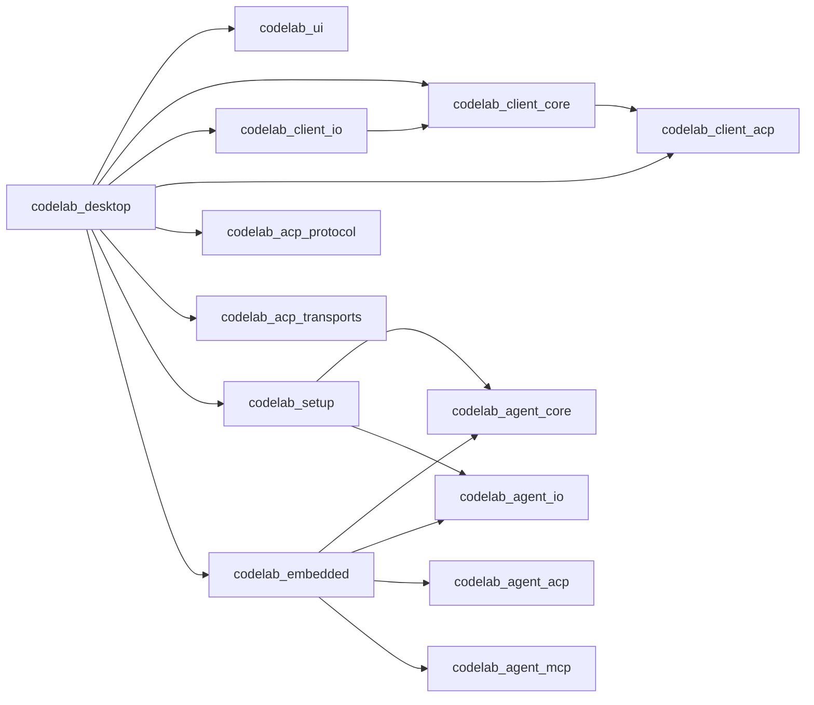
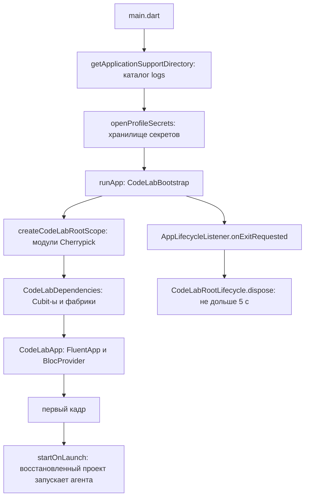

# CodeLab app: разработка

Документ для тех, кто меняет код настольного приложения. Правила изменений — в [`AGENTS.md`](../AGENTS.md) приложения; здесь — карта кода, зависимости, поток запуска и тесты.

## Место в monorepo

`apps/codelab_desktop` — Flutter-приложение. Своего состояния сессий, очереди промптов и одобрений у него нет: их владелец — клиентский слой `codelab_client_core` (`ClientWorkspace`, `SessionHandle`). Cubit-ы приложения подписываются на это состояние, отображают его и передают действия пользователя, так же как терминальный клиент `codelab`.

Агентскую сторону приложение получает только через два моста: `codelab_embedded` (встроенный агент в процессе) и `codelab_setup` (конфигурация агента, провайдеры, MCP-серверы, секреты). Прямой импорт `package:codelab_agent_*` запрещён и проверяется сторожем (`melos run guard`). Виджеты рабочего места — пакет `codelab_ui`.

Зависимости по `pubspec.yaml` приложения и его прямых зависимостей:



Сторонние зависимости приложения: `fluent_ui` (виджеты Fluent), `flutter_bloc` (Cubit-ы), `cherrypick` с `cherrypick_annotations` (внедрение зависимостей), `fpdart`, `path`, `path_provider`, `shared_preferences`, `file_selector` (выбор папки), `pty2`, `xterm2` и `xterm2_core` (терминал), `url_launcher`, `structured_log` с адаптерами `structured_log_flutter`, `structured_log_fluent` и `structured_log_remote_sync` (журнал). `codelab_acp_testing` — только `dev_dependency`.

На схеме опущены зависимости внутри нижних слоёв: `codelab_client_io` зависит ещё от `codelab_client_acp`, а `codelab_client_*`, `codelab_embedded` и `codelab_agent_acp` — от `codelab_acp_protocol` и `codelab_acp_transports`. Общая картина слоёв — [layers-and-dependencies.md](../../../docs/architecture/layers-and-dependencies.md) и [acp-boundary.md](../../../docs/architecture/acp-boundary.md).

## Структура кода

Приложение устроено по фичам (feature-first): каждая фича держит слои `application/` (Cubit-ы и состояние, без виджетов) и `presentation/` (виджеты). Слоёв `domain/` и `infrastructure/` в фичах нет: доменная логика живёт в `codelab_client_core`, адаптеры к ОС — в `lib/core/platform/` и `lib/app/`.

| Путь | Что там |
|---|---|
| `lib/main.dart` | точка входа: каталог логов, первое открытие хранилища секретов, `runApp` |
| `lib/app/app_scope.dart` | composition root: `createCodeLabRootScope` (модули Cherrypick и швы тестов), `CodeLabBootstrap`, `CodeLabDependencies`, `CodeLabRootLifecycle` |
| `lib/app/codelab_app_widget.dart` | `CodeLabApp`: `FluentApp`, провайдеры Cubit-ов, переключение рабочего места и настроек, запуск агента после первого кадра |
| `lib/app/navigation/` | `NavigationCubit`: переход рабочее место ↔ настройки, страницы настроек |
| `lib/app/embedded_transport_resolver.dart`, `embedded_logger.dart` | открытие и закрытие встроенного агента, логгер агента → журнал приложения |
| `lib/app/connection_environment.dart` | окружение процесса и путь к `profiles.json` |
| `lib/app/client_profile_secrets.dart`, `reopenable_profile_secrets.dart` | хранилище секретов для токенов профилей |
| `lib/app/provider_settings_session.dart`, `provider_setup_probe.dart`, `provider_setup_offer.dart` | конфигурация агента для страниц «Providers» и «MCP servers» и мастера провайдера |
| `lib/app/agent_definitions_loader.dart` | чтение определений агентов для страницы «Agents & modes»: `agentDefinitionRowsAt` из `codelab_setup/io.dart`, тайм-аут 5 с |
| `lib/app/secret_migration_offer.dart`, `embedded_secret_migration_runner.dart` | перенос секретов из `config.yaml` |
| `lib/app/app_exit_handler.dart` | закрытие при выходе: предел 5 с, сброс журналов |
| `lib/core/platform/` | порты и адаптеры платформы: `shared_preferences`-хранилища (недавние проекты, снимок рабочего места, раскладка, профиль по умолчанию), выбор папки, запуск оболочки (`UserShellLauncher`), открытие ссылок, открытие файла или каталога в программе ОС (порт `PathOpener`, адаптер `UrlLauncherPathOpener` на `url_launcher`; путь берёт Cubit страницы «Agents & modes» из своего состояния, каталог пользовательских определений порт может создать), загрузка изображений |
| `lib/core/text/` | общие текстовые функции |
| `lib/features/workbench/` | рабочее место: `CodeLabShellCubit` из частей (`ConnectionCubit`, `SessionsCubit`, `ActiveSessionCubit`, `LayoutCubit`, `SettingsCubit`, `TranscriptViewCubit`), маппер строк ленты `ui_mappers.dart`, данные панели «Agents» `agents_pane_data.dart`, перенос секретов; виджеты оболочки, ленты, баннеров, панели «Agents» |
| `lib/features/settings/` | настройки: страницы «Connection», «Providers», «MCP servers», «Agents & modes» (`AgentsModesCubit` читает умолчания сессии через мост `sessionDefaultsOf` из `codelab_setup`), диалог профиля, мастер провайдера |
| `lib/features/project_files/` | панель «Files»: дерево и просмотр файлов |
| `lib/features/terminal/` | терминал пользователя: вкладки, ссылки, вывод |
| `test_driver/app.dart` | точка входа с расширением `flutter_driver` для управления запущенным приложением |
| `tool/terminal_spike/` | отдельный экспериментальный проект проверки терминала; в приложение не входит |

## Поток запуска

Так приложение проходит путь от `main` до работающего рабочего места и обратно при выходе.



- `createCodeLabRootScope` ставит модули в порядке: журнал, фабрики транспортов, встроенный агент, платформа, профили и секреты, презентация, затем сгенерированные контракты Cherrypick (`app_scope.module.cherrypick.g.dart`, хранится в git). Параметры функции (`embeddedOpener`, `environment`, `profileStore`, `userShellLauncher`, `projectFiles` и другие) — швы тестов: в рабочей сборке они пустые.
- `ClientWorkspace` получает два резолвера транспорта (`_transportResolvers` в `app_scope.dart`): `ConfigTransportResolver` из `codelab_client_core` для профилей `stdio` и WebSocket — на фабриках приложения `CodeLabStdioTransportFactory` и `CodeLabWebSocketTransportFactory` (`StdioAcpTransport`, `WebSocketAcpTransport`) и источнике токенов `SecretSource`, — и `EmbeddedTransportResolver` для встроенного агента (`localEmbeddedAgentOpener` из `package:codelab_embedded/io.dart`). Тот же список служит проверке профиля и списку типов в диалоге профиля.
- Агент стартует не при сборке scope, а после первого кадра (`startOnLaunch`), и только если восстановлен проект.
- При выходе `AppExitHandler` вызывает весь `CodeLabRootLifecycle.dispose()`: параллельно закрываются вкладки терминала и клиентская ветка (рабочее пространство, встроенный агент, ядро клиента). Через 5 с (`AppExitHandler.exitTimeout`) обработчик отвечает `exit` и пишет `app.exit_timeout` с полем `pending` — незавершёнными шагами из `_shutdownSteps` (`terminal`, `cubits`, `workspace`, `embedded`, `migration_offer`, `transport`, `client`). Предел 10 с на закрытие встроенного агента (`defaultEmbeddedCloseTimeout`, событие `embedded.close_timeout`) действует внутри `dispose()` и при выходе не наступает: раньше срабатывает предел 5 с.

Состояние и переходы — [state-management.md](../../../docs/architecture/state-management.md), [session-lifecycle.md](../../../docs/architecture/session-lifecycle.md), [concurrency.md](../../../docs/architecture/concurrency.md).

## Как добавить страницу настроек

1. Добавьте значение в `SettingsPage` (`lib/app/navigation/settings_page.dart`), если его ещё нет: группа, заголовок, `slug` (ключ навигации — `settings-nav-<slug>`).
2. Напишите Cubit в `lib/features/settings/application/` и страницу в `lib/features/settings/presentation/`. Файлы и процессы — только через порт, реализацию которого собирает `lib/app/`.
3. Зарегистрируйте построитель страницы в `settingsPageBuilders` (`lib/features/settings/presentation/settings_shell.dart`) и фабрику Cubit-а в `CodeLabDependencies` (`lib/app/app_scope.dart`).
4. Включите страницу в `defaultSettingsPages` (`lib/app/default_settings_pages.dart`): страница из набора обязана иметь построитель.
5. Добавьте стабильные `ValueKey` для элементов, которые нажимают тесты.

Поведение настроек задаёт спецификация [app-settings](../../../openspec/specs/app-settings/spec.md); новая страница с новым поведением начинается с OpenSpec change.

## Тесты

```bash
cd apps/codelab_desktop
fvm flutter test
```

| Каталог | Что | Где запускается |
|---|---|---|
| `test/` | модульные и виджет-тесты: Cubit-ы, мапперы, виджеты на двойниках (`test/support/`: `InMemoryProfileStore`, `FakeProfileSecrets`, `FakeUserShellLauncher`, `FakeProjectFiles` и другие) | `fvm flutter test`; входит в `melos run test` и `melos run check` |
| `integration_test/` | сценарии на настоящем приложении macOS против scripted-агента, Dart-агента или встроенного агента со сценарием модели (`integration_test/llm_scripts/`) | скрипты `test:e2e:app:*`, только в ветке `release/<version>` |
| `test_driver/app.dart` | точка входа для ручного управления приложением через `flutter_driver` | вручную |

- Виджет-тесты не работают с настоящими файлами: внутри `testWidgets` файловый ввод-вывод зависает в fake-async зоне. Файлы `profiles.json` и конфигурации проверяют обычные `test` на временном каталоге.
- Скрипты интеграционных тестов: `test:e2e:app:stdio`, `permission`, `fs`, `open-project`, `terminal`, `plan-checklist`, `prompt-queue`, `multi-session`, `command-palette`, `transcript-rendering` (по одному сценарию против scripted-агента), а также `test:e2e:app:dart-agent` и `test:e2e:app:embedded` (все сценарии, кроме помеченных `scripted-only`, против Dart-агента или встроенного агента). Агента выбирает `--dart-define=CODELAB_E2E_AGENT=scripted|dart|embedded`.
- В ветках `feature/*` и `hotfix/*` интеграционные тесты на устройстве не запускаются: для `integration_test/` там достаточно `fvm flutter analyze`. Прогон `test:e2e:app:*` — приёмка выпуска в `release/<version>` (корневой [`AGENTS.md`](../../../AGENTS.md), §21).

Проверки, которые обычно затрагивает изменение приложения:

- `fvm dart format --set-exit-if-changed <файлы>` и `fvm flutter analyze` в `apps/codelab_desktop`;
- `fvm flutter test` в `apps/codelab_desktop`, а при изменении виджетов `codelab_ui` — и в `packages/flutter/codelab_ui`;
- `fvm dart run melos run guard` — при изменении `pubspec.yaml` и импортов между пакетами.

Без сгенерированного кода (`*.freezed.dart`) тесты и запуск падают; как его создать — в [запуске из исходников](../../../docs/user/run-from-source.md#1-подготовка). Уровни тестов — [testing.md](../../../docs/architecture/testing.md).

## Управление запущенным приложением

`test_driver/app.dart` включает расширение `flutter_driver`, и запущенным приложением можно управлять по стабильным `ValueKey` виджетов, например `app-bar-menu`, `sidebar-settings`, `tool-toggle-files`, `settings-nav-providers`:

```bash
cd apps/codelab_desktop
fvm flutter run -d macos -t test_driver/app.dart --print-dtd
```

Команда печатает адрес Dart Tooling Daemon, к которому подключается инструмент управления. Окно по умолчанию — 800×600 логических точек: в такой ширине боковая панель и док выдвигаются поверх ленты.

### Изолированный ручной прогон

`fvm flutter run -d macos` не передаёт запущенному приложению переменные окружения терминала, например `CODELAB_HOME`: приложение читает настоящий `~/.codelab`. Для изолированного прогона соберите приложение (`fvm flutter build macos --debug` или предыдущим `flutter run`) и запустите бинарник с временной папкой:

```bash
CODELAB_HOME=<временная папка> \
  build/macos/Build/Products/Debug/codelab_app.app/Contents/MacOS/codelab_app
```

Путь — от `apps/codelab_desktop`.

## Правила

Правила для изменений — в [`AGENTS.md`](../AGENTS.md) приложения: встроенный агент и границы барелей моста, профили и токены, страницы настроек, мастер провайдера, лента, панель Files, секреты, терминал, тесты. Главное: Cubit-ы и виджеты не обращаются к файлам, процессам и хранилищу секретов напрямую — только через порты, реализации которых собирает `lib/app/`.

## Смотрите также

- Спецификации: [agent-workbench-ui](../../../openspec/specs/agent-workbench-ui/spec.md), [app-settings](../../../openspec/specs/app-settings/spec.md), [embedded-agent](../../../openspec/specs/embedded-agent/spec.md), [client-agent-setup](../../../openspec/specs/client-agent-setup/spec.md), [approval-safety](../../../openspec/specs/approval-safety/spec.md).
- Устройство приложения: [отображение в app](../../../docs/architecture/proposals/dart-agent-and-clients/12-3-desktop-display.md), [этап 7, встроенный агент](../../../docs/architecture/proposals/dart-agent-and-clients/09-12-stage-7-embedded.md), [разрешения](../../../docs/architecture/permissions.md), [платформа](../../../docs/architecture/platform-integration.md).
- [Руководство пользователя CodeLab app](user-guide.md), [эксплуатация](operations.md).
