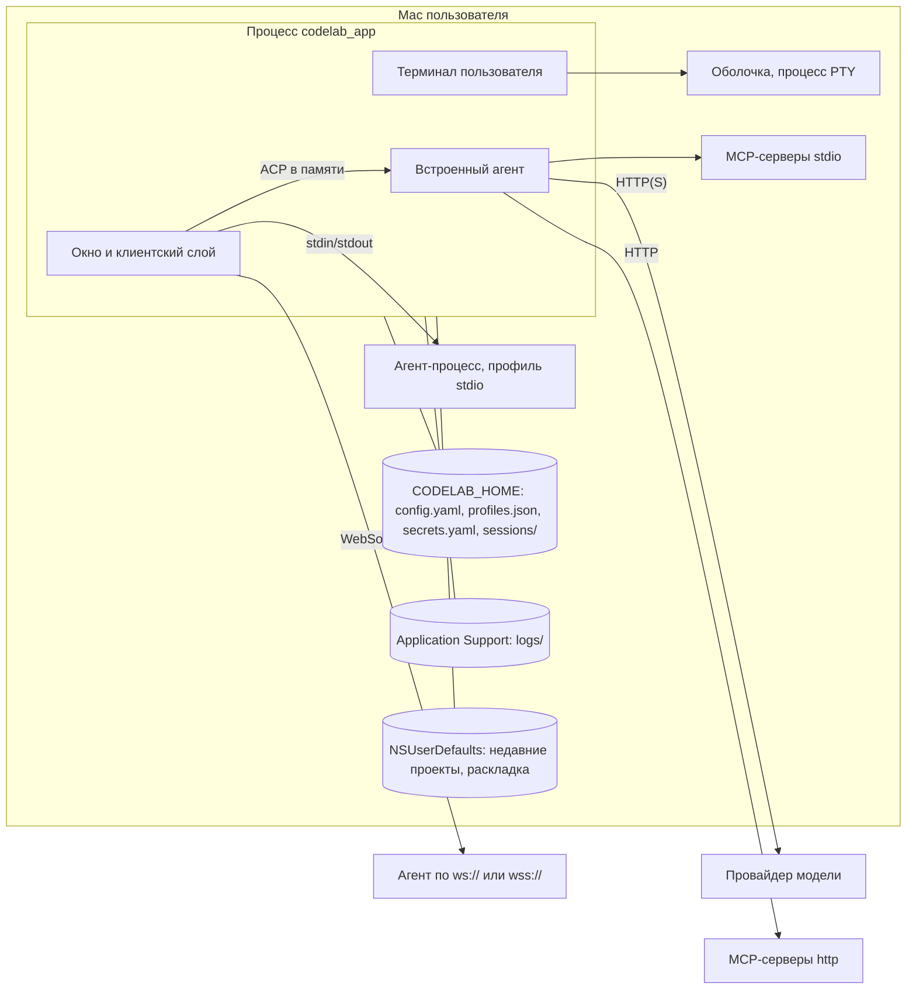

# CodeLab app: эксплуатация

Здесь — как собрать CodeLab app для macOS, где приложение хранит данные и логи, какие переменные окружения оно читает и какие сетевые соединения открывает.

## Схема развёртывания

На схеме — процесс приложения, его файлы и сетевые соединения.



- По умолчанию работает один процесс: встроенный агент выполняется внутри приложения.
- Агент-процесс появляется, только если выбран профиль `stdio`. Приложение запускает его и завершает при выходе.
- Терминал пользователя запускает оболочку входа (`-l`) через PTY (псевдотерминал) в папке сессии: `SHELL`, если это абсолютный путь к исполняемому файлу, иначе `/bin/zsh`, `/bin/bash` или `/bin/sh`. При выходе приложение посылает ей сигнал завершения, а через 3 секунды завершает принудительно.
- Приложение не открывает портов на приём. Исходящие соединения: к провайдеру модели, к MCP-серверам типа `http`, к агенту по WebSocket и загрузка изображения из ответа агента — только `https` и только после нажатия «Show image» (до 32 МБ). Ссылки `http`/`https` из ленты и терминала открывает браузер, а `mailto:` из ленты — почтовый клиент; само приложение по ним не ходит.

## Сборка

Требования и подготовка репозитория (`fvm install`, `melos bootstrap`, генерация `*.freezed.dart`) — в [запуске из исходников](../../../docs/user/run-from-source.md#1-подготовка). Версия Flutter закреплена в `.fvmrc`. Нужен Xcode с командной строкой.

```bash
cd apps/codelab_desktop
fvm flutter build macos
```

Получится `apps/codelab_desktop/build/macos/Build/Products/Release/codelab_app.app`. Отдельного скрипта Melos для сборки приложения нет.

Параметры сборки:

| Параметр | Значение | Где задан |
|---|---|---|
| имя приложения | `codelab_app` | `macos/Runner/Configs/AppInfo.xcconfig` |
| идентификатор бандла | `com.example.codelabApp` — значение шаблона Flutter | `macos/Runner/Configs/AppInfo.xcconfig` |
| версия | `0.1.0` | `pubspec.yaml` |
| минимальная macOS | 12.0 | `macos/Podfile`, `macos/Runner.xcodeproj` |

### Подпись и entitlements

- Сборка подписывается ad-hoc (`CODE_SIGN_IDENTITY = "-"`): без сертификата разработчика и без нотаризации. Для распространения за пределы своей машины подпись и нотаризацию нужно настроить отдельно.
- App Sandbox выключен: `com.apple.security.app-sandbox = false` в `macos/Runner/Release.entitlements` и `DebugProfile.entitlements`. Приложению нужен доступ к папкам проектов, к `CODELAB_HOME` и запуск процессов (агент, оболочка, MCP-серверы). Включение песочницы потребует пересмотра хранилищ секретов — это отдельное изменение.
- Для отладочной и profile-сборки (`DebugProfile.entitlements`) добавлены `com.apple.security.cs.allow-jit` и `com.apple.security.network.server` (сервис отладки Dart).

## Запуск

Из Finder или Dock приложение получает минимальное окружение macOS и не видит переменных, заданных в профиле оболочки. Чтобы передать приложению переменные (`CODELAB_HOME`, ключи), запустите исполняемый файл из терминала:

```bash
CODELAB_HOME="$HOME/.codelab-test" \
  apps/codelab_desktop/build/macos/Build/Products/Release/codelab_app.app/Contents/MacOS/codelab_app
```

Для запуска из Finder ключи лучше хранить в файловом хранилище секретов — [шаг 2 настройки агента](../../../docs/user/configuration.md#шаг-2-задайте-ключ-api).

При запуске приложение восстанавливает последний проект и запускает агента в его папке. Без сохранённого проекта агент не стартует, пока пользователь не откроет папку.

## Где лежат данные

### `CODELAB_HOME`

Конфигурация агента, профили подключения, секреты, журналы сессий встроенного агента и пользовательские цветовые темы app лежат в `CODELAB_HOME` (по умолчанию `~/.codelab`) и общие с терминальным клиентом `codelab` — [каталог `CODELAB_HOME`](../../../docs/ops/codelab-home.md).

Темы — файлы `$CODELAB_HOME/themes/<имя>.json`: их кладёт пользователь или «Import JSON…» на странице «Appearance» (файл копируется без изменений, замена атомарная). Если каталога нет, своих тем просто нет; app создаёт его при «Import JSON…» и при «Open folder»; файл больше 64 КиБ не загружается. Формат и правила — [руководство пользователя](user-guide.md#своя-тема). В каталог app ничего другого не пишет, а файлы тем сам не открывает.

Если `CODELAB_HOME` задан неверно (например, `~user/…`), страница «Connection» показывает причину, а профили недоступны для записи.

### Данные приложения вне `CODELAB_HOME`

| Где | Что |
|---|---|
| `~/Library/Preferences/com.example.codelabApp.plist` | настройки окна через `shared_preferences` (ключи с префиксом `flutter.`): недавние проекты `codelab.recent_projects`, снимок рабочего места `codelab.workspace.snapshot` (проект и активная сессия), профиль по умолчанию `codelab.connection.default_profile`, раскладка панелей `codelab.dock.*`, последняя страница настроек `codelab.settings.last_page`, язык интерфейса `codelab.app.language` (`en` или `ru`; для «System» ключа нет), оформление `codelab.app.appearance` (JSON: `version`, `mode` — `light`, `dark` или `system`, `light_theme`, `dark_theme`, `system_accent`; ключа нет, пока оформление не меняли) |
| `~/Library/Application Support/com.example.codelabApp/logs/` | логи приложения — [ниже](#логи-и-диагностика) |

Имя файла настроек и каталога берётся из идентификатора бандла: другая сборка с другим идентификатором получит отдельные настройки.

Сбросить недавние проекты и раскладку можно, удалив домен настроек при закрытом приложении:

```bash
defaults delete com.example.codelabApp
```

Сессии, профили и конфигурация агента при этом не затрагиваются: они в `CODELAB_HOME`.

## Переменные окружения

Переменные `CODELAB_*` (`CODELAB_HOME`, `CODELAB_CONFIG`, `CODELAB_SECRET_<ИМЯ>`, `CODELAB_DEBUG_SECRETS` и другие) общие для приложений CodeLab — их таблица в [переменных окружения](../../../docs/ops/environment.md). Здесь — только то, что относится к app.

| Переменная | Для чего |
|---|---|
| `HOME` | также сокращает пути до `~` в интерфейсе |
| переменная из `api_key_env` провайдера | ключ API провайдера для встроенного агента |
| переменная из ссылки `env:<ИМЯ>` профиля | токен WebSocket-профиля |
| `SHELL` | оболочка терминала пользователя; без неё — `/bin/zsh`, `/bin/bash`, `/bin/sh` |

Диагностика секретов `CODELAB_DEBUG_SECRETS=1` — в [переменных окружения](../../../docs/ops/environment.md#диагностика). Встроенный агент получает окружение процесса приложения.

### Секреты

- Ключи провайдеров и токены профилей хранятся в общем хранилище секретов CodeLab, как у `codelab` и `codelab-agent`. Отдельного хранилища у приложения нет, связку ключей macOS эта версия не использует.
- По умолчанию хранилище — `env`: только чтение переменных `CODELAB_SECRET_*`. На странице «Providers» оно помечено «read-only». Записывать ключи из приложения можно после `secrets.backend: file` в глобальном `config.yaml`; файл `$CODELAB_HOME/secrets.yaml` хранит значения открытым текстом с правами `0600`.
- Токен профиля сохраняется в `profiles.json` только ссылкой (`env:<ИМЯ>` или `secret:<имя>`), значение читается при подключении.
- Значения ключей и токенов не попадают в состояние приложения, на экран и в логи: только имя секрета и признак «задан».
- Если секреты записаны прямо в `config.yaml`, приложение показывает баннер «Secrets are stored in the agent config file.» с кнопкой «Migrate secrets»: перенос в хранилище и затем перезапуск встроенного агента.

## Логи и диагностика

| Где | Что | Когда пишется |
|---|---|---|
| `~/Library/Application Support/com.example.codelabApp/logs/application.log` | события приложения строками JSON | только в релизной сборке |
| консоль процесса | те же события в читаемом виде | только в отладочной сборке |
| `~/Library/Application Support/com.example.codelabApp/logs/protocol.log` | полная трассировка сообщений ACP; ротация по 10 МБ, до 5 файлов | по умолчанию выключена; в интерфейсе приложения переключателя нет |
| панель «Protocol» (`/logs`) | записи протокола текущей сессии и журнал в памяти | всегда, пока приложение открыто |
| `$CODELAB_HOME/sessions/` | журналы сессий встроенного агента | всегда для встроенного агента |

- Перед записью в любой лог секреты маскируются. События настроек, терминала и файлов проекта не содержат токенов, путей, ввода и вывода терминала, текста файлов.
- Язык интерфейса пишет события (поля — в `context`):

  | Событие | Компонент, уровень | Поля | Когда |
  |---|---|---|---|
  | `app.locale_resolved` | `app`, info | `preference` (`system`, `en`, `ru`), `locale` | один раз при сборке приложения |
  | `settings.language_changed` | `settings`, info | `language`, `locale` | пользователь выбрал язык |
  | `app.locale_applied` | `app`, debug | `locale`, `subscribers` | выбор сменил локаль у подписчиков |
  | `settings.language_save_failed` | `settings`, warning | `error_class` | запись выбора не удалась; текста ошибки нет, потому что в нём бывают пути |
  | `settings.language_save_timeout` | `settings`, warning | `timeout_ms` | при выходе запись выбора языка не завершилась за 3 с; выбор мог не сохраниться |
  | `app.language_preference_invalid` | `app`, warning | нет | при старте после настройки журнала: сохранённое значение незнакомо или не строка; приложение читает его как «System», само значение не пишется |
  | `app.language_preference_read_failed` | `app`, warning | `error_class` | при старте после настройки журнала: хранилище настроек не прочиталось (например, повреждено); приложение стартует как при «System», текста ошибки нет |

- Оформление пишет события в компоненте `settings` (имя своей темы в них не попадает — вместо него `custom`; путей, ключей и значений из файла нет):

  | Событие | Уровень | Поля | Когда |
  |---|---|---|---|
  | `app.appearance_resolved` | info | `mode`, `light_theme`, `dark_theme`, `system_accent`, `fallback` | один раз при сборке приложения |
  | `settings.appearance_changed` | info | `field` (`mode`, `light_theme`, `dark_theme`, `system_accent`), `value`; у тем — `light`, `dark`, `high-contrast` или `custom` | пользователь изменил оформление |
  | `appearance.theme_loaded` | info | `theme`, `extends`, `warnings`, `code_counts` (число предупреждений по кодам) | пользовательская тема прочитана и применена |
  | `appearance.theme_invalid` | warning | `theme`, `code`, `line`, `column`, `error_class` | файл темы отклонён; `code` — код проблемы, например `invalidJson` |
  | `appearance.theme_imported` | info | `outcome`, `error_class` | исход «Import JSON…» |
  | `appearance.system_accent_failed` | warning | `error_class` | не удалось прочитать системный акцент |
  | `appearance.catalog_failed` | warning | `error_class`, `failure` (`notADirectory` или `unreadable`) | каталог тем не прочитался; страница показывает встроенные темы и предупреждение с «Reload», пути в событии нет |
  | `appearance.catalog_discarded` | debug | `reason` | результат устаревшего чтения каталога отброшен |
  | `appearance.stored_value_invalid`, `appearance.read_failed` | warning | `error_class` (у второго) | при старте: сохранённое значение незнакомо или хранилище не прочиталось |
  | `appearance.save_failed` | warning | `error_class` | запись выбора не удалась |
  | `appearance.save_timeout` | warning | `timeout_ms` | при выходе запись не завершилась в срок; выбор мог не сохраниться |

- До выпуска 1.0 тексты сообщений и вывод инструментов в журналах сессий не редактируются — [что попадает в логи и журналы](../../../docs/user/configuration.md#что-попадает-в-логи-и-журналы).
- Отправка событий на сервер логов включается только при сборке разработчиком через `--dart-define=CODELAB_LOG_SERVER_URL=…` и `--dart-define=CODELAB_LOG_SERVER_KEY=…`. В обычной сборке её нет.

## Выход из приложения

При закрытии приложение закрывает вкладки терминала и параллельно — сессии, встроенного агента, агент-процесс и ядро клиента. Отдельной параллельной ветвью приложение дожидается записи выбранного языка (до 3 секунд); она не задерживает закрытие рабочего пространства, агента и транспорта. Если запись не уложилась в эти 3 секунды, приложение пишет `settings.language_save_timeout`. На всё отводится 5 секунд. Не уложилось — приложение пишет событие `app.exit_timeout` с полем `pending`: имена незавершённых шагов (например, `terminal`, `workspace`, `embedded`, `client`, `language`), — и всё равно завершается. Закрытие встроенного агента при этом не укорачивается и идёт, пока процесс не остановится; отдельного события о нём при выходе нет.

Предел 10 секунд на закрытие встроенного агента и событие `embedded.close_timeout` относятся к закрытию корневого scope приложения без запроса на выход; при выходе раньше срабатывает общий предел 5 секунд.

## Сеть и безопасность

- Портов на приём приложение не открывает.
- Файловые операции и команды, которые агент просит у приложения, ограничены папкой сессии; выход за неё отклоняется. Для сессии в корне диска приложение спрашивает подтверждение.
- Терминал пользователя не ограничен папкой сессии и не проходит через одобрения агента: это оболочка от имени пользователя. Терминал не даёт программам читать и писать системный буфер обмена управляющими последовательностями и открывает из вывода только ссылки `http` и `https` после подтверждения.
- `ws://` на другую машину (не локальный адрес) передаёт данные без шифрования: при сохранении такого профиля приложение требует подтверждения «Save anyway» — с токеном и без. Для локального адреса подтверждения нет. Ключ к провайдеру по `http://` на нелокальный адрес мастер помечает предупреждением `The key is sent unencrypted to <host>.`

## Смотрите также

- [Эксплуатация CodeLab](../../../docs/ops/README.md)
- [Каталог `CODELAB_HOME`](../../../docs/ops/codelab-home.md)
- [Руководство пользователя CodeLab app](user-guide.md)
