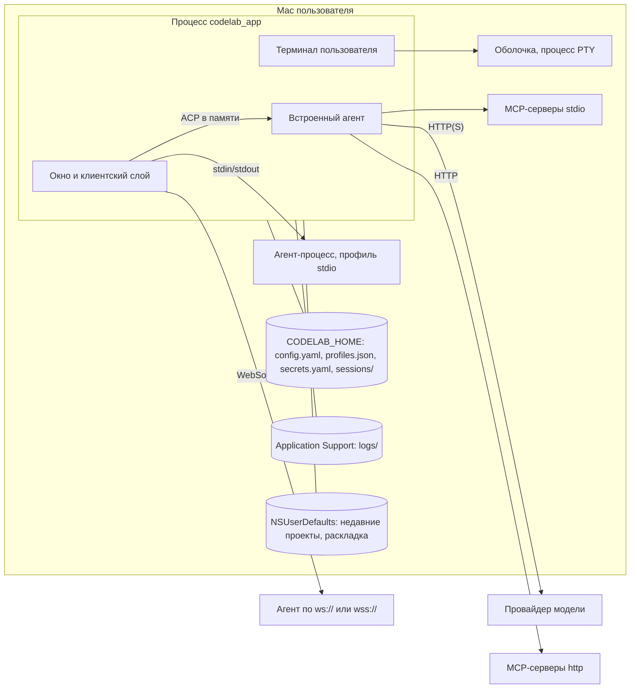

# CodeLab app: эксплуатация

Здесь — как собрать CodeLab app для macOS, где приложение хранит данные и логи, какие переменные окружения оно читает и какие сетевые соединения открывает.

## Схема развёртывания

На схеме — процесс приложения, его файлы и сетевые соединения.



- По умолчанию работает один процесс: встроенный агент выполняется внутри приложения.
- Агент-процесс появляется, только если выбран профиль `stdio`. Приложение запускает его и завершает при выходе.
- Терминал пользователя запускает оболочку входа (`-l`) через PTY (псевдотерминал) в папке сессии: `SHELL`, если это абсолютный путь к исполняемому файлу, иначе `/bin/zsh`, `/bin/bash` или `/bin/sh`. При выходе приложение посылает ей сигнал завершения, а через 3 секунды завершает принудительно.
- Приложение не открывает портов на приём. Исходящие соединения: к провайдеру модели, к MCP-серверам типа `http`, к агенту по WebSocket и загрузка изображения из ответа агента — только `https` и только после нажатия «Show image» (до 32 МБ). Ссылки `http`/`https` из ленты и терминала открывает браузер, а `mailto:` из ленты — почтовый клиент; само приложение по ним не ходит.

## Сборка

Требования и подготовка репозитория (`fvm install`, `melos bootstrap`, генерация `*.freezed.dart`) — в [запуске из исходников](../../../docs/user/run-from-source.md#1-подготовка). Версия Flutter закреплена в `.fvmrc`. Нужен Xcode с командной строкой.

```bash
cd apps/codelab_desktop
fvm flutter build macos
```

Получится `apps/codelab_desktop/build/macos/Build/Products/Release/codelab_app.app`. Отдельного скрипта Melos для сборки приложения нет.

Параметры сборки:

| Параметр | Значение | Где задан |
|---|---|---|
| имя приложения | `codelab_app` | `macos/Runner/Configs/AppInfo.xcconfig` |
| идентификатор бандла | `com.example.codelabApp` — значение шаблона Flutter | `macos/Runner/Configs/AppInfo.xcconfig` |
| версия | `0.1.0` | `pubspec.yaml` |
| минимальная macOS | 12.0 | `macos/Podfile`, `macos/Runner.xcodeproj` |

### Подпись и entitlements

- Сборка подписывается ad-hoc (`CODE_SIGN_IDENTITY = "-"`): без сертификата разработчика и без нотаризации. Для распространения за пределы своей машины подпись и нотаризацию нужно настроить отдельно.
- App Sandbox выключен: `com.apple.security.app-sandbox = false` в `macos/Runner/Release.entitlements` и `DebugProfile.entitlements`. Приложению нужен доступ к папкам проектов, к `CODELAB_HOME` и запуск процессов (агент, оболочка, MCP-серверы). Включение песочницы потребует пересмотра хранилищ секретов — это отдельное изменение.
- Для отладочной и profile-сборки (`DebugProfile.entitlements`) добавлены `com.apple.security.cs.allow-jit` и `com.apple.security.network.server` (сервис отладки Dart).

## Запуск

Из Finder или Dock приложение получает минимальное окружение macOS и не видит переменных, заданных в профиле оболочки. Чтобы передать приложению переменные (`CODELAB_HOME`, ключи), запустите исполняемый файл из терминала:

```bash
CODELAB_HOME="$HOME/.codelab-test" \
  apps/codelab_desktop/build/macos/Build/Products/Release/codelab_app.app/Contents/MacOS/codelab_app
```

Для запуска из Finder ключи лучше хранить в файловом хранилище секретов — [шаг 2 настройки агента](../../../docs/user/configuration.md#шаг-2-задайте-ключ-api).

При запуске приложение восстанавливает последний проект и запускает агента в его папке. Без сохранённого проекта агент не стартует, пока пользователь не откроет папку.

## Где лежат данные

### `CODELAB_HOME`

Конфигурация агента, профили подключения, секреты и журналы сессий встроенного агента лежат в `CODELAB_HOME` (по умолчанию `~/.codelab`) и общие с терминальным клиентом `codelab` — [каталог `CODELAB_HOME`](../../../docs/ops/codelab-home.md).

Если `CODELAB_HOME` задан неверно (например, `~user/…`), страница «Connection» показывает причину, а профили недоступны для записи.

### Данные приложения вне `CODELAB_HOME`

| Где | Что |
|---|---|
| `~/Library/Preferences/com.example.codelabApp.plist` | настройки окна через `shared_preferences` (ключи с префиксом `flutter.`): недавние проекты `codelab.recent_projects`, снимок рабочего места `codelab.workspace.snapshot` (проект и активная сессия), профиль по умолчанию `codelab.connection.default_profile`, раскладка панелей `codelab.dock.*`, последняя страница настроек `codelab.settings.last_page` |
| `~/Library/Application Support/com.example.codelabApp/logs/` | логи приложения — [ниже](#логи-и-диагностика) |

Имя файла настроек и каталога берётся из идентификатора бандла: другая сборка с другим идентификатором получит отдельные настройки.

Сбросить недавние проекты и раскладку можно, удалив домен настроек при закрытом приложении:

```bash
defaults delete com.example.codelabApp
```

Сессии, профили и конфигурация агента при этом не затрагиваются: они в `CODELAB_HOME`.

## Переменные окружения

| Переменная | Для чего |
|---|---|
| `CODELAB_HOME`, `HOME` | каталог настроек и данных — [правило](../../../docs/ops/codelab-home.md#где-лежит-каталог); `HOME` также сокращает пути до `~` в интерфейсе |
| `CODELAB_CONFIG` | абсолютный путь к дополнительному файлу конфигурации встроенного агента |
| `CODELAB_SECRET_<ИМЯ>` | значение секрета без файла хранилища — [правило имени](../../../docs/user/configuration.md#шаг-2-задайте-ключ-api) |
| переменная из `api_key_env` провайдера | ключ API провайдера для встроенного агента |
| переменная из ссылки `env:<ИМЯ>` профиля | токен WebSocket-профиля |
| `CODELAB_DEBUG_SECRETS=1` | встроенный агент пишет в лог приложения, какие секреты искал и нашёл ли; значения не пишутся |
| `SHELL` | оболочка терминала пользователя; без неё — `/bin/zsh`, `/bin/bash`, `/bin/sh` |

Встроенный агент получает окружение процесса приложения. Остальные настройки агента через переменные — в [настройке агента](../../../docs/user/configuration.md).

### Секреты

- Ключи провайдеров и токены профилей хранятся в общем хранилище секретов CodeLab, как у `codelab` и `codelab-agent`. Отдельного хранилища у приложения нет, связку ключей macOS эта версия не использует.
- По умолчанию хранилище — `env`: только чтение переменных `CODELAB_SECRET_*`. На странице «Providers» оно помечено «read-only». Записывать ключи из приложения можно после `secrets.backend: file` в глобальном `config.yaml`; файл `$CODELAB_HOME/secrets.yaml` хранит значения открытым текстом с правами `0600`.
- Токен профиля сохраняется в `profiles.json` только ссылкой (`env:<ИМЯ>` или `secret:<имя>`), значение читается при подключении.
- Значения ключей и токенов не попадают в состояние приложения, на экран и в логи: только имя секрета и признак «задан».
- Если секреты записаны прямо в `config.yaml`, приложение показывает баннер «Secrets are stored in the agent config file.» с кнопкой «Migrate secrets»: перенос в хранилище и затем перезапуск встроенного агента.

## Логи и диагностика

| Где | Что | Когда пишется |
|---|---|---|
| `~/Library/Application Support/com.example.codelabApp/logs/application.log` | события приложения строками JSON | только в релизной сборке |
| консоль процесса | те же события в читаемом виде | только в отладочной сборке |
| `~/Library/Application Support/com.example.codelabApp/logs/protocol.log` | полная трассировка сообщений ACP; ротация по 10 МБ, до 5 файлов | по умолчанию выключена; в интерфейсе приложения переключателя нет |
| панель «Protocol» (`/logs`) | записи протокола текущей сессии и журнал в памяти | всегда, пока приложение открыто |
| `$CODELAB_HOME/sessions/` | журналы сессий встроенного агента | всегда для встроенного агента |

- Перед записью в любой лог секреты маскируются. События настроек, терминала и файлов проекта не содержат токенов, путей, ввода и вывода терминала, текста файлов.
- До выпуска 1.0 тексты сообщений и вывод инструментов в журналах сессий не редактируются — [что попадает в логи и журналы](../../../docs/user/configuration.md#что-попадает-в-логи-и-журналы).
- Отправка событий на сервер логов включается только при сборке разработчиком через `--dart-define=CODELAB_LOG_SERVER_URL=…` и `--dart-define=CODELAB_LOG_SERVER_KEY=…`. В обычной сборке её нет.

## Выход из приложения

При закрытии приложение закрывает вкладки терминала и параллельно — сессии, встроенного агента, агент-процесс и ядро клиента. На всё отводится 5 секунд. Не уложилось — приложение пишет событие `app.exit_timeout` с полем `pending`: имена незавершённых шагов (например, `terminal`, `workspace`, `embedded`, `client`), — и всё равно завершается. Закрытие встроенного агента при этом не укорачивается и идёт, пока процесс не остановится; отдельного события о нём при выходе нет.

Предел 10 секунд на закрытие встроенного агента и событие `embedded.close_timeout` относятся к закрытию корневого scope приложения без запроса на выход; при выходе раньше срабатывает общий предел 5 секунд.

## Сеть и безопасность

- Портов на приём приложение не открывает.
- Файловые операции и команды, которые агент просит у приложения, ограничены папкой сессии; выход за неё отклоняется. Для сессии в корне диска приложение спрашивает подтверждение.
- Терминал пользователя не ограничен папкой сессии и не проходит через одобрения агента: это оболочка от имени пользователя. Терминал не даёт программам читать и писать системный буфер обмена управляющими последовательностями и открывает из вывода только ссылки `http` и `https` после подтверждения.
- `ws://` на другую машину (не локальный адрес) передаёт данные без шифрования: при сохранении такого профиля приложение требует подтверждения «Save anyway» — с токеном и без. Для локального адреса подтверждения нет. Ключ к провайдеру по `http://` на нелокальный адрес мастер помечает предупреждением «The key is sent unencrypted to <host>.»

## Смотрите также

- [Эксплуатация CodeLab](../../../docs/ops/README.md)
- [Каталог `CODELAB_HOME`](../../../docs/ops/codelab-home.md)
- [Руководство пользователя CodeLab app](user-guide.md)
