# CodeLab app: руководство пользователя

CodeLab app — окно для работы с AI-агентом над папкой проекта. После этого руководства вы сможете открыть проект, подключить модель, вести сессии с агентом, отвечать на его запросы разрешений и следить за расходом модели, а также настроить подключение, провайдеров, MCP-серверы, режим разрешений и навыки.

## Перед началом

- Приложение пока собирается из исходников — [запуск из исходников](../../../docs/user/run-from-source.md#4-запуск-app). Установщика сейчас нет.
- Нужна модель: ключ API облачного провайдера (OpenAI, Anthropic, OpenRouter) или локальный сервер без ключа (Ollama, LM Studio). Подключить её можно прямо из приложения.
- Нужна папка проекта: агент работает внутри неё.

## Первый запуск

1. Запустите приложение. Без открытого проекта окно предлагает его открыть.

   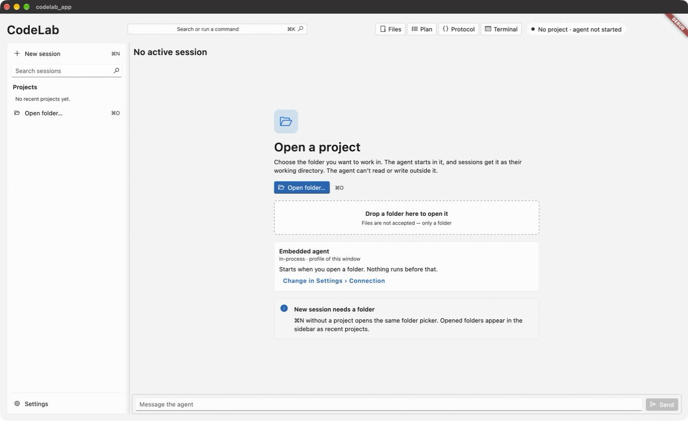

   Статус в правом верхнем углу — «Disconnected»: агент ещё не запущен.

2. Нажмите «Open folder…» и выберите папку проекта. Приложение сразу запускает агента в этой папке.

3. Если модель ещё не настроена, вместо рабочего места появится карточка «Embedded agent» с текстом «No model provider is configured for the embedded agent.»

   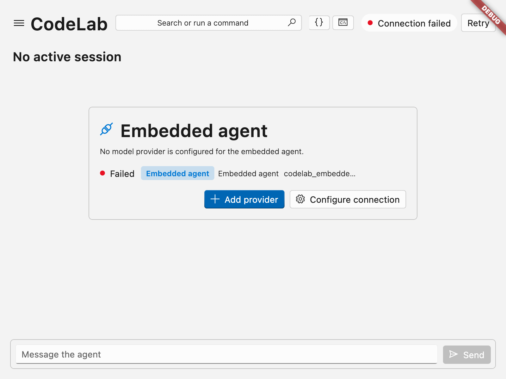

   Нажмите «Add provider» — откроется мастер, он описан в разделе [«Подключить провайдера модели»](#подключить-провайдера-модели). После сохранения приложение само подключит агента, и статус сменится на «Connected».

4. Создайте сессию: ⌘N, «New session» в боковой панели или команда `/new` в палитре.

   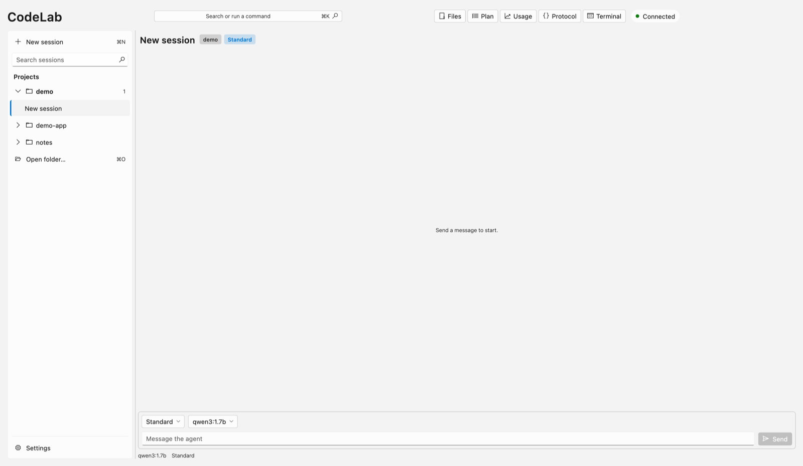

   В шапке сессии — проект и режим агента. Под полем ввода — выбор режима и модели, если агент их предлагает.

При следующем запуске приложение откроет последний проект и запустит агента само.

## Основные задачи

### Открыть проект и переключаться между проектами

Сессии сгруппированы по проектам в боковой панели. В узком окне панель выдвигается кнопкой меню слева от заголовка CodeLab или сочетанием ⌘B.

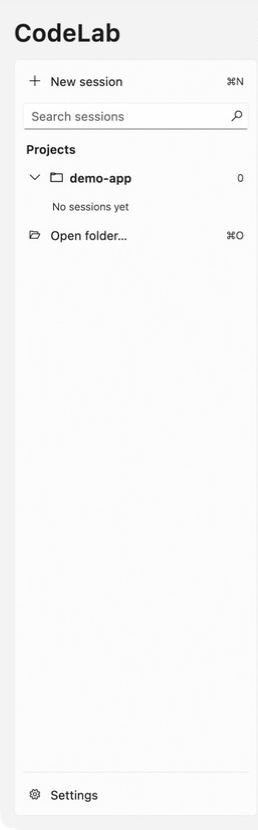

В списке «Projects» — недавние проекты; внизу — «Open folder…» и «Settings».

1. Чтобы открыть новый проект, нажмите «Open folder…» внизу панели.
2. Чтобы вернуться к недавнему проекту, нажмите его имя в списке «Projects».

Агент запускается один раз, в папке проекта, открытого первым; выбор другого проекта его не перезапускает. Сессии каждого проекта берут настройки его папки (`.codelab/config.yaml` и `config.local.yaml`) при открытии. Правки с пометкой «после перезапуска» действуют для всех проектов только после «Restart agent» — подробнее в [настройке агента](../../../docs/user/configuration.md#правки-после-перезапуска-и-сессии-других-папок). Поле «Search sessions» фильтрует список сессий; «Load more» подгружает более старые, если агент отдаёт список частями.

Если выбрать корень диска (`/`), приложение спросит «Open session in the disk root?»: такая сессия даёт агенту доступ ко всему диску.

### Вести сессию с агентом

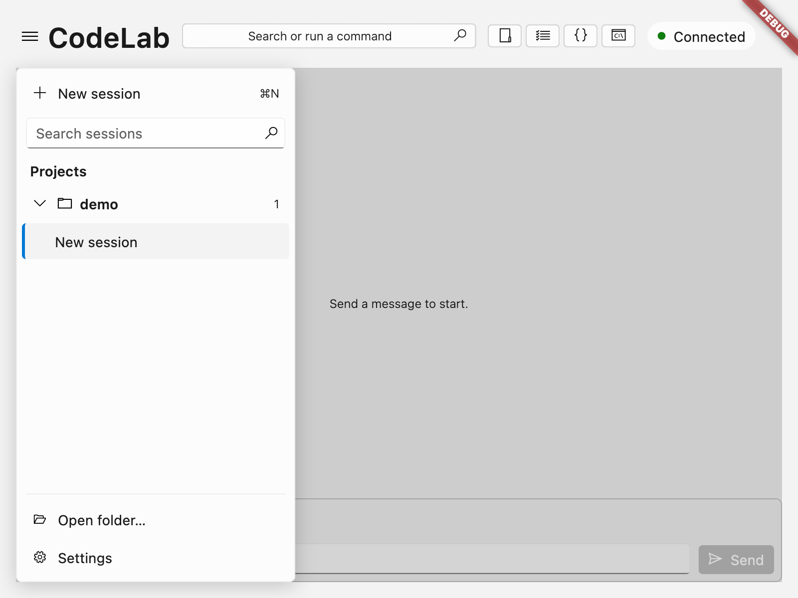

Новая сессия появилась под своим проектом и выделена как активная.

1. Выберите сессию в боковой панели или создайте новую (⌘N).
2. Напишите сообщение в поле «Message the agent» и нажмите «Send» или ⌘⏎.
3. Ответ появляется в ленте по мере того, как агент его пишет: текст, размышления, вызовы инструментов и их результаты.
4. Чтобы остановить ход агента, нажмите Esc или кнопку отмены на месте «Send».

<!-- screenshot: лента сессии с ответом агента и вызовом инструмента — apps/codelab_desktop/doc/images/transcript-turn.png -->

Если ход не удался, в ленте появляется сообщение об ошибке с кнопкой «Retry».

Выпадающие списки под полем ввода (например, «Standard» и модель) предлагает агент: ими меняются режим и модель текущей сессии.

#### Строка статуса под полем ввода

Под полем ввода активной сессии стоит строка статуса: модель, режим и расход. Пока сессия не выбрана, строки нет.

| Сегмент | Что показывает |
|---|---|
| `12.3k → 1.2k` | токены последнего хода: слева вход (включая кэш), справа выход. Подсказка при наведении даёт счётчики input, output, cache read, cache write и reasoning (если агент его сообщил) |
| `$0.13 · session $1.20` | стоимость хода и всей сессии. `—` на месте суммы значит, что цена неизвестна |
| `42% context` | насколько заполнен контекст модели. От 80 % сегмент жёлтый, от 95 % красный; `compaction soon` — агент вот-вот сожмёт историю. Меньше 1 % показывается как `<1%` |

Что ещё стоит знать:

- Перед числом стоит «~», если оно приблизительное: агент не прислал usage для части шагов, не знает цену или сессия была загружена из журнала. Причины («approximate: …») есть только в подсказке сегмента токенов: `agent sent no usage for some steps`, `price unknown for some steps` или `before the session was loaded`. «~» у стоимости объясняет та же подсказка; если сегмент токенов скрыт, причины не видны.
- Если токены хода нулевые, сегмент токенов не показывается; стоимость при этом остаётся.
- Пока ход идёт или отменяется и итог хода ещё не пришёл, вместо токенов и стоимости горит индикатор ожидания. Когда числа уже есть, они остаются на месте между шагами хода.
- Если снимка последнего хода ещё нет, а стоимость сессии известна, стоимость выглядит как `— · session $1.20`.
- `usage: —` означает, что агент не сообщает расход. Нулей вместо неизвестного приложение не показывает.
- Деньги округляются до цента (`$1.20`), малые суммы — до двух значащих цифр (`$0.0041`); токены сокращаются как `999`, `94.0k`, `1.2M`; проценты округляются вниз.
- Клик по строке статуса (или Enter и Space, когда на ней фокус) открывает панель «Usage». Строка кликабельна только пока панель доступна; иначе она остаётся обычным текстом.

#### Панель «Usage»

Панель «Usage» в доке показывает расход текущей сессии подробнее строки статуса. Она доступна, пока агент сообщает расход или умеет отдавать журнал расхода сессии. Тогда в верхней панели есть кнопка «Usage», а в палитре — команда `/usage-pane`. Если агент не сообщает ничего, кнопки и вкладки нет, а место панели в раскладке дока сохраняется. Заголовок панели — «This session».

Что внутри, сверху вниз:

- кнопки «Rebuild from log» (пересобрать журнал расхода из журнала сессии; есть, если агент отдаёт журнал расхода) и «Export CSV» (есть, когда журнал загружен), под ними строка состояния журнала, например `Ledger: up to date · 12 records`. Если журнал пришлось собрать заново по обычной причине (кэш отстал или файла ещё не было), строка остаётся `Ledger: up to date · N records`, а причина видна в подсказке при наведении: `refreshed from the session journal (stale)` или `(missing)`. Строка `rebuilt from journal …` появляется, когда файл кэша оказался повреждён или вы сами нажали «Rebuild from log»;
- карточки: «Input» (с кэшем), «Output» (с reasoning, если он есть), «Cost» и «Turns · steps»; неполные суммы помечены «~», причины — в подписи карточки. Во время хода карточки живые: они берут числа из последних данных хода и не ждут журнал. Журнал они показывают, только если он не старше последних данных, поэтому после хода числа в карточках совпадают с таблицами и CSV. «Turns · steps» во время хода тоже считает ходы по живым данным. У пустой сессии «Cost» — `—`, подпись — `no usage yet`; `price unknown` значит, что ход был, а цены модели агент не знает;
- «Turn budget» — лимиты хода и сколько из них уже потрачено. Блок есть, только если в секции `budget` конфигурации агента задан хотя бы один из ключей `budget.max_tokens`, `budget.max_cost`, `budget.max_duration` (остановка хода по лимиту описана в разделе [«Если что-то пошло не так»](#если-что-то-пошло-не-так) у заметки «The turn stopped: budget exceeded»). Заголовок — «This turn» во время хода и «Last turn» после него, а также в начале нового хода, пока в нём не было первого шага. Под заголовком по строке на каждый заданный лимит, в порядке Steps, Tokens, Cost, Time: подпись `<израсходовано> / <лимит>` (`3 / 50`, `92.0k / 200.0k`, `$0.12 / $0.50`, `1:30 / 5:00`) и полоса заполнения. Пока расход меньше 80 % лимита, полоса обычная; с 80 % — предупреждающая, с 100 % — опасная. Если у модели нет цен, строка Cost выглядит как `— / $0.50`, а под ней стоит `not checked: price unknown`: лимит стоимости для такой модели не проверяется. Подсказка у Tokens — `input + output, including subagents`. Time идёт раз в секунду, пока ход выполняется или отменяется; после хода он стоит. Пока агент ждёт вашего ответа на одобрение, Time не идёт, а после ответа продолжается с того же места, без скачка. Время ожидания одобрения не входит в лимит `budget.max_duration`, поэтому панель его не считает. Одобрение, которое просит субагент, время хода не останавливает: так считает и агент. Если несколько одобрений ждали одновременно, их общее время вычитается один раз. При отмене хода Time идёт до итога хода. Под блоком — пояснение «When a limit is hit, the turn stops at the next step boundary.» Блок строится по живым данным сессии, поэтому он есть и у агента, который не ведёт журнал расхода;
- «Per turn» — таблица ходов, новые сверху, со столбцами «Input», «Output», «Cost». Ход раскрывается и показывает свои шаги; у хода, в котором работали субагенты, есть строка `subagents · N runs`;
- «Per model» — по строке на модель (`провайдер / модель`), а также «Subagents» и «Summaries», если агент их учёл.

Журнал запрашивается у агента автоматически, пока панель открыта: при показе и после завершения хода. Пока он грузится, у заголовка крутится индикатор. Если загрузка не удалась, под шапкой появляется «Couldn't load usage history.» и кнопка «Retry». Если агент не ведёт журнал, вместо таблиц — «This agent does not provide usage history.»; карточки при этом строятся по живым данным сессии.

«Export CSV» открывает диалог сохранения; предложенное имя — `codelab-usage-<начало id сессии>-<дата>-<время>.csv`. В файл попадает всё, что видно в панели, включая группы без шагов; числа точные, неизвестное — пустая ячейка, а не `0`. Если записать файл не вышло, в панели появится «Couldn't save the file.» (существующий файл с тем же именем при этом остаётся прежним); заметка исчезает при переходе к другой сессии

<!-- screenshot: панель Usage с карточками, раскрытым ходом и таблицей Per model — apps/codelab_desktop/doc/images/usage-pane.png -->

### Поставить сообщения в очередь

Пока агент отвечает, новое сообщение не теряется: оно встаёт в очередь сессии и уходит само, когда ход закончится. Очередь видна над полем ввода — блок «Queue» с числом сообщений.

- «Edit» возвращает сообщение в поле ввода и убирает его из очереди.
- «Send now» отправляет сообщение, не дожидаясь своей очереди.
- «Delete» удаляет сообщение, «Clear all» — всю очередь.

<!-- screenshot: блок «Queue» над полем ввода с двумя сообщениями — apps/codelab_desktop/doc/images/prompt-queue.png -->

### Следить за планом и задачами

Если агент составил план, он виден в двух местах:

- над полем ввода — список шагов с текущим шагом и числом оставшихся, пока план не выполнен (его можно скрыть);
- в панели «Plan» — кнопка со списком в верхней панели.

Когда агент создаёт, меняет или закрывает задачи в своём списке, в ленте появляется короткая серая строка о том, что изменилось.

После повторной загрузки сессии эти операции показываются обычными строками вызовов, а не короткими серыми строками; текущий список задач — в плане. Теги исхода одобрения («Allow once» и другие) видны только в живой сессии — и у основного агента, и у субагентов: решения не сохраняются в журнал и после загрузки не восстанавливаются.

<!-- screenshot: план над полем ввода и панель Plan во время хода агента — apps/codelab_desktop/doc/images/plan-checklist.png -->

Основной агент может поручить часть задачи субагенту — отдельному агенту со своим заданием. Субагент, в свою очередь, может запустить своего субагента. В ленте каждый запуск — строка «Subagent <тип>: <задание>»:

- пока субагент работает, под свёрнутой строкой видны три его последних вызова инструментов и «+N more tool calls», если вызовов больше;
- после завершения строка свёрнута и показывает итог: число вызовов, токены и время;
- раскрытая строка показывает вызовы субагента и его потомков с отступом по глубине и его отчёт. Вложенный запуск субагента раскрывается отдельно.

<!-- screenshot: свёрнутая строка работающего субагента с тремя последними вызовами и раскрытая строка с вложенными вызовами — apps/codelab_desktop/doc/images/transcript-subagent.png -->

Когда в сессии появился первый субагент, в верхней панели появляется кнопка панели «Agents», а в палитре — команда `/agents`. Панель показывает всех субагентов сессии:

- в заголовке — «Subagents» и счётчики по состояниям, например «Subagents · 2 running · 1 done»;
- строка на каждого субагента с отступом по глубине: тип, задание и состояние — `running`, `waiting for approval`, `done`, `failed` или `cancelled`. Ниже — время, число вызовов, токены, последнее действие и метки `#N` задач из плана, назначенных субагенту (подсказка метки — название задачи). Поля, которых нет, не показываются;
- время работающего субагента растёт раз в секунду, пока сессия занята. Если ход прервался, например оборвалось соединение, строка остаётся `running`, но без времени.

Действия панели:

1. Нажмите строку, чтобы выбрать её. Под списком появится блок «Steps» — вызовы этого субагента и его потомков. Это только обзор: текстов и размышлений субагентов в нём нет.
2. «Show in transcript» прокручивает ленту к строке запуска, раскрывает путь до вложенного субагента и коротко подсвечивает её.
3. «Go to approval» есть у строки в состоянии `waiting for approval` и у ждущего шага в «Steps» с тегом «Awaiting approval». Оно прокручивает ленту к запросу разрешения. Ответить на запрос можно только в ленте — в панели кнопок «Allow» и «Reject» нет.

Выбранная строка запоминается для каждой сессии отдельно, пока приложение открыто. Без субагентов в сессии кнопки и вкладки «Agents» нет, но место панели в раскладке дока сохраняется.

<!-- screenshot: панель Agents с ребёнком и внуком, выбранной строкой и блоком Steps — apps/codelab_desktop/doc/images/agents-pane.png -->

### Отвечать на запросы разрешений

Перед опасным действием — запись файла, команда оболочки, сетевой запрос — агент спрашивает разрешение. Запрос появляется прямо в строке вызова инструмента в ленте.

<!-- screenshot: карточка одобрения в ленте с тегом риска и кнопками Allow и Reject — apps/codelab_desktop/doc/images/approval-card.png -->

1. Посмотрите тег риска: «Read-only», «Local write», «Network», «Shell», «Destructive» или «Unknown risk».
2. Посмотрите команду или путь. «View raw input» показывает полные параметры вызова.
3. Выберите, насколько широким будет решение: «Only this time» или «Always», если агент предлагает такой вариант.
4. Нажмите «Allow» или «Reject».

Сочетания клавиш для карточки:

| macOS | Windows и Linux | Действие |
|---|---|---|
| ⌘⏎ | Ctrl+Enter | разрешить один раз |
| ⌥⌘⏎ | Ctrl+Alt+Enter | разрешать всегда |
| ⌘⌫ | Ctrl+Backspace | отклонить один раз |
| ⌥⌘⌫ | Ctrl+Alt+Backspace | отклонять всегда |
| ⇧⌘A | Ctrl+Shift+A | перейти к одобрению (ответа не даёт) |

Сочетания ответа работают, только когда фокус внутри карточки одобрения. Когда появляется запрос, фокус сам в карточку не переходит: пока вы печатаете или кликаете в ленте, случайное нажатие ⌘⏎ ответа не даст. Довести фокус до карточки можно тремя способами: кликнуть в неё, дойти до кнопок клавишей Tab или нажать ⇧⌘A (Ctrl+Shift+A). Сочетание перехода прокручивает ленту к самому раннему ожидающему запросу сессии и ставит фокус на карточку; если ждёт запрос субагента, лента прокручивается к строке верхнего уровня, под которой стоит его блок. Когда запроса нет, соединения нет или сессия отключена, нажатие ничего не делает.

Фокус на карточке виден по рамке в 2 пикселя. Enter и Space на самой карточке ничего не выбирают, а Tab идёт сразу к кнопкам, так что запрос не решается случайным нажатием после перехода. Пока фокус вне карточки, под кнопками стоит подсказка «Press ⇧⌘A to answer from the keyboard» (на Windows и Linux — `Ctrl+Shift+A`); с фокусом внутри карточки она пропадает. Подсказки сочетаний на кнопках остаются всегда.

Сочетание варианта работает только если агент его предлагает. Если фокус в поле ввода, ⌘⏎ отправляет сообщение, а запрос продолжает ждать.

Когда вы ответили на запрос, а фокус был на карточке, он возвращается в поле ввода (если его нельзя использовать — на рабочее место). Если вы успели сами перевести фокус куда-то ещё, например кликнуть в дерево файлов, он остаётся там. Следующий ожидающий запрос фокуса не получает, даже если стал самым ранним: нажмите ⇧⌘A. Повторное ⌘⏎ после ответа уйдёт в поле ввода: с пустым полем оно ничего не делает, с текстом ставит сообщение в очередь.

Решение относится только к этому вызову.

Если разрешение просит субагент, запрос появляется блоком под строкой запуска верхнего уровня, а не внутри неё: свёрнутая строка не раскрывается. В блоке — путь от первого субагента до того, кто спрашивает, например «review › explore wants to run», команда или инструмент с путём файла, тег риска и те же кнопки и сочетания клавиш. Под путём и в его подсказке — задание субагента. После решения блок сворачивается в тег исхода, а в раскрытой строке вызов виден на своём месте с тем же исходом.

<!-- screenshot: блок «review › explore wants to run» под свёрнутой строкой субагента — apps/codelab_desktop/doc/images/approval-subagent.png -->

Пока ждёт ответа запрос в одной из сессий, в настройках сверху появляется напоминание с кнопкой «Back to session».

### Смотреть файлы проекта

Панель «Files» показывает дерево папки проекта и содержимое выбранного файла только для чтения.

1. Откройте панель кнопкой с иконкой файла в верхней панели, сочетанием ⇧⌘E или командой `/files`.
2. Выберите файл — его текст появится внизу панели с номерами строк.

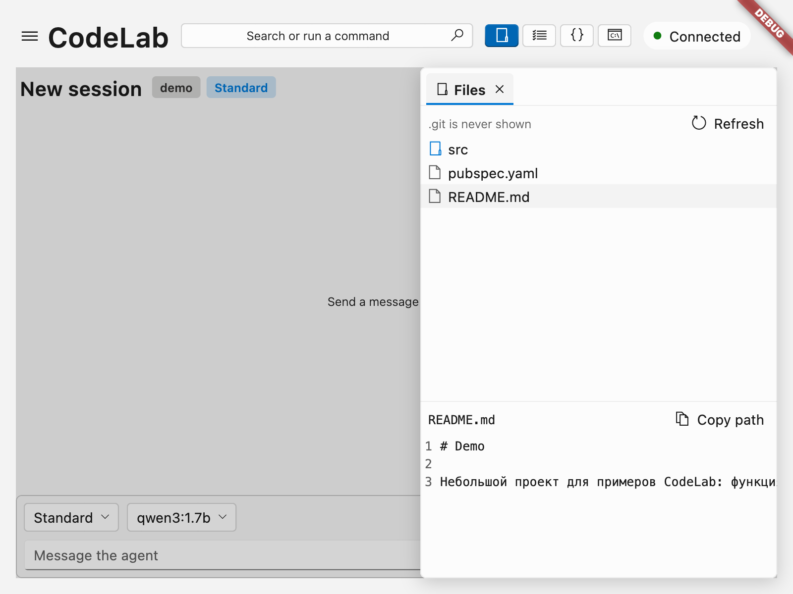

Сверху — дерево проекта, снизу — выбранный файл с номерами строк и «Copy path».

- В дереве работают стрелки: ↑ и ↓ двигаются по файлам, → и ← раскрывают и сворачивают папку, Enter открывает файл или раскрывает папку. Ctrl+Enter и ⌘⏎ файл не открывают.
- «Refresh» перечитывает дерево. Папка `.git` не показывается никогда.
- «Copy path» копирует путь файла относительно проекта.
- Если имя файла похоже на файл с секретами, над просмотром появится предупреждение.

Панель есть, только когда папка сессии находится на этом компьютере: для агента по WebSocket её нет.

### Работать в терминале

Панель «Terminal» — обычная оболочка в папке текущей сессии.

1. Откройте сессию: без неё панель пишет «Open a session to use the terminal».
2. Нажмите кнопку терминала в верхней панели. Появится вкладка «Terminal 1».
3. «+» справа открывает ещё одну вкладку.

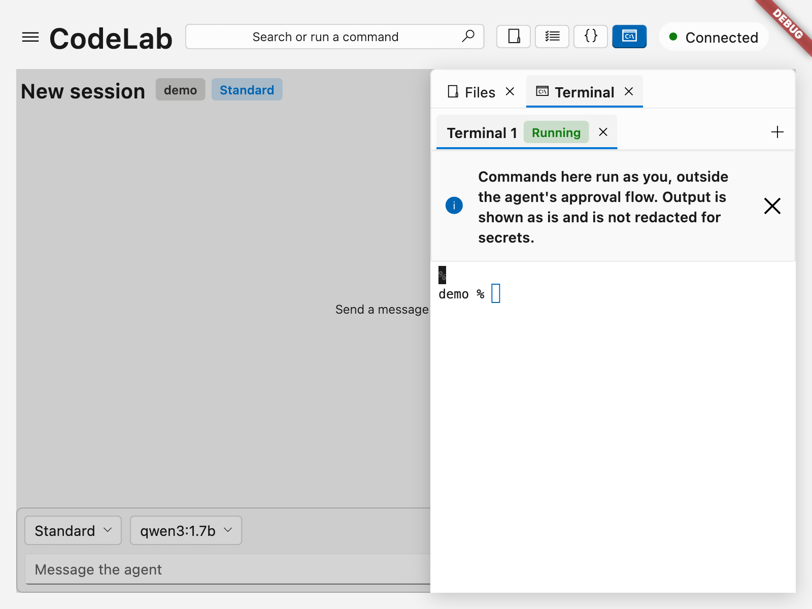

Вкладка «Terminal 1» работает в папке проекта; над ней — напоминание, что терминал работает мимо агента.

Команды в этом терминале выполняются от вашего имени, мимо одобрений агента, и вывод не очищается от секретов — об этом напоминает плашка над терминалом. Вкладки у каждой сессии свои: при переключении сессии панель показывает её вкладки. Вкладки живут, пока вы их не закроете, и переживают смену проекта и переподключение агента. Ссылку в выводе открывает ⌘-клик: приложение покажет адрес в диалоге «Open link?» и откроет только `http` и `https`.

### Пользоваться палитрой команд

Палитра открывается сочетанием ⌘K или полем «Search or run a command» в верхней панели. Набирайте часть названия — список сужается.

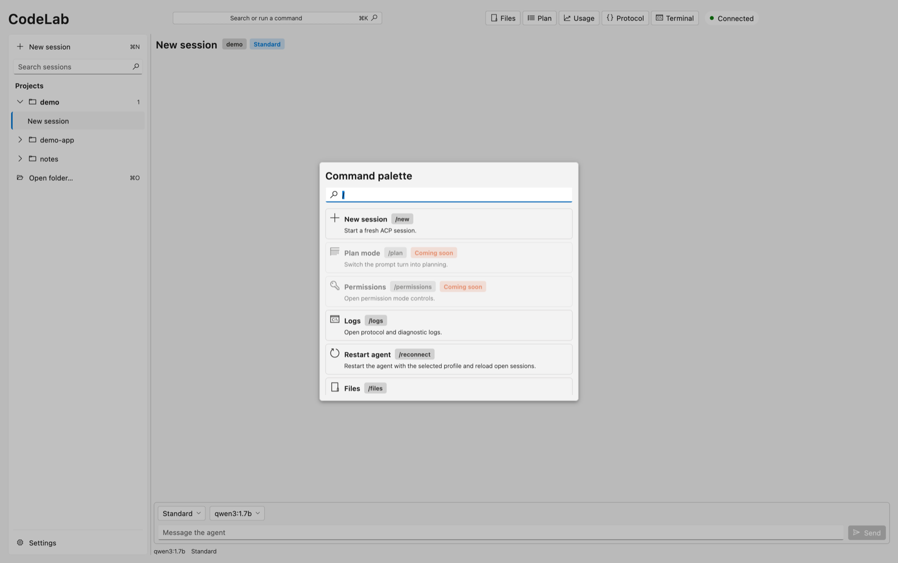

Команды приложения с описаниями; недоступные помечены «Coming soon».

| Команда | Что делает |
|---|---|
| `/new` | новая сессия в текущем проекте |
| `/logs` | открывает панель «Protocol» с записями протокола и журналом |
| `/reconnect` | для локального агента называется «Restart agent»: перезапускает агента и заново открывает сессии |
| `/files` | открывает или закрывает панель «Files» |
| `/agents` | открывает панель «Agents»; есть в списке, только пока в сессии есть субагенты |
| `/usage-pane` | открывает панель «Usage»; есть в списке, только пока панель доступна. Не путать с `/usage` — командой самого агента |
| `/plan`, `/permissions`, `/compact` («Compact transcript») | помечены «Coming soon» и пока ничего не делают; если агент объявил свою команду с тем же именем, вместо заглушки в списке будет команда агента |

Ниже команд приложения идут команды, которые объявил агент. Выбор такой команды вставляет её в поле ввода — допишите аргументы и отправьте. Те же команды подсказывает поле ввода, если начать сообщение с `/`.

### Перезапустить агента

«Restart agent» есть в палитре и на странице настроек «Connection». Если агент в этот момент работает, приложение спросит «Restart agent?»: идущий ход прервётся.

## Как это работает

На схеме — что происходит между вашим сообщением и ответом агента.

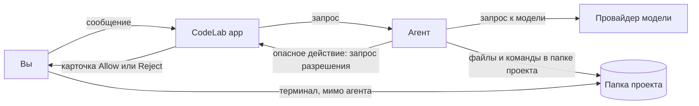

- По умолчанию агент встроен в приложение: отдельная программа не нужна. Профиль на странице «Connection» может указать другого агента — программу, которую приложение запустит само, или агента по адресу `ws://`/`wss://`.
- Агент спрашивает разрешение перед опасными действиями, вы отвечаете в карточке. Чтение и запись файлов, которые агент просит у приложения, ограничены папкой сессии.
- Терминал пользователя работает мимо агента: агент его не видит, одобрения на него не действуют.
- Журналы сессий встроенного агента лежат в `$CODELAB_HOME/sessions/` или в каталоге `sessions.dir` из конфигурации — [общие файлы `CODELAB_HOME`](../../../docs/ops/codelab-home.md#общие-файлы). До выпуска 1.0 тексты сообщений и вывод инструментов в них не очищаются — [что попадает в логи и журналы](../../../docs/user/configuration.md#что-попадает-в-логи-и-журналы).

## Настройка

Настройки открываются кнопкой «Settings» внизу боковой панели или сочетанием ⌘,. Поле «Find a setting» ищет по страницам: по заголовку на текущем языке интерфейса и на английском, а также по ключевым словам на языке интерфейса и на английском. При английском интерфейсе русские слова страницу не находят. Стрелка слева вверху возвращает в рабочее место; набранный текст и открытая сессия при этом сохраняются.

### Сочетания клавиш

Страница «Keyboard» (на русском «Клавиатура», заголовок «Keyboard shortcuts») показывает все сочетания, которые работают в приложении. Список только для чтения: сочетания менять нельзя. Сочетания, которых нет в работе, на странице не показаны.

Таблица состоит из трёх колонок: «Action» (действие), «Shortcut» (сочетание) и «Where» (где оно действует). Строки сгруппированы: «Global», «Navigation», «Transcript», «Composer» и «Approvals». В группе «Approvals» первая строка — «Go to approval» (⇧⌘A или Ctrl+Shift+A), в колонке «Where» у неё «Workbench, while an approval is pending». Остальные четыре строки (разрешить и отклонить, один раз или всегда) действуют там, где написано в «Where»: «Pending approval with keyboard focus, when the agent offers this option», то есть когда фокус клавиатуры внутри карточки ожидающего одобрения и агент предлагает такой вариант. Под таблицей напоминание: у команд агента сочетаний нет, их открывают из палитры команд.

Клавиши показаны по системе, на которой запущено приложение:

- на macOS — символы ⌘, ⌥, ⇧, ⏎, ⌫; порядок модификаторов ⌥, ⇧, ⌘ (например, ⇧⌘E);
- на Windows и Linux — слова `Ctrl`, `Alt`, `Shift`, `Enter`, `Backspace`; порядок `Ctrl`, `Alt`, `Shift` (например, `Ctrl+Alt+Enter`). Подсказки на кнопках там короче: `Ctrl+Alt+⏎`.

Если у строки несколько клавиш с одним действием, между ними стоит «/», например `↑ / ↓`. Программа чтения с экрана произносит их через «or» (на русском «или»).

Поле вверху ищет по тексту действия и по клавишам:

1. Введите слово из действия на языке интерфейса или по-английски, например `sidebar`.
2. Или введите клавишу в любой записи: `⇧⌘E`, `ctrl shift e`, `Ctrl+Shift+E`, `Option+Cmd+Enter`. Регистр и пробелы по краям не важны, а `+` и пробелы внутри записи игнорируются. Так находятся сочетания macOS и на Windows, и наоборот.
3. В таблице остаются только подходящие строки и группы. Если ничего нет, страница пишет «No shortcuts match "…"», а напоминание про команды агента остаётся.

По колонке «Where» поиск не идёт. Поле «Find a setting» находит страницу по словам `shortcut`, `hotkey`, `keybinding`, `key` (на русском интерфейсе — `сочетание`, `горячие клавиши`, `клавиатура`, `клавиша`). Если таблице не хватает ширины, она прокручивается по горизонтали, а текст действия переносится. Esc на странице возвращает в рабочее место.

### Язык интерфейса

Страница «General» (группа «App») содержит строку «Language» с тремя вариантами: «System», «English», «Русский». Выбор применяется сразу, без перезапуска, и сохраняется между запусками. Если записать выбор не удалось, над строкой появится предупреждение с кнопкой «Retry» (на русском «Повторить»), которая повторяет запись; приложение продолжит работать на выбранном языке, а после перезапуска без успешной записи вернётся к прежнему. Если хранилище настроек повреждено и не читается, приложение стартует на языке по умолчанию.

<!-- screenshot: страница General (settings-general.png): строка Language с вариантами System, English, Русский; снять запуском приложения с изолированным CODELAB_HOME -->

На русском показаны страницы «General» и «Keyboard», названия страниц и групп настроек и поиск по ним, а также рабочее место: лента и заметки, сообщения о сбоях хода, боковая панель, шапка, поле ввода, баннеры, палитра команд, диалог перезапуска агента, расход, терминал, файлы проекта, список агентов и заголовки инспектора и журнала отладки, а также страницы настроек «Connection» и «Providers», диалог «Add connection profile» и мастер подключения провайдера. На русском показывается и подпись профиля встроенного агента («Встроенный агент»). Команды палитры находятся и по русскому, и по английскому названию. Остаётся английским то, что приложение не переводит: страницы настроек MCP servers, Agents & modes и Skills, содержимое журнала отладки и инспектора, ответы и команды агента, тексты ядра (сообщения об ошибках соединения), ошибки конфигурации, которые сообщает агент, и тексты хранилища секретов: подсказка «только чтение», причина недоступности хранилища и подробности переноса секретов показываются как есть. Подписи кнопок и сообщений рабочего места в этом руководстве приведены по-английски; на русском языке интерфейса они показываются переведёнными. Вариант «System» сейчас даёт английский язык независимо от языка системы.

### Умолчания агента

Первыми на странице «General» идут сообщение «Shared with the codelab CLI…» и блок «Agent defaults» (на русском «Умолчания агента»), затем «Interface» (язык), «Startup and files» и «About». Тексты ниже даны английскими, как в интерфейсе по умолчанию; русские подписи строк — «Лимит шагов», «Лимит токенов», «Лимит стоимости», «Лимит длительности», «Лимит глубины» и т. п. В блоке 18 ключей конфигурации агента, общих с терминальным клиентом: бюджет хода (`budget.max_steps`, `budget.max_tokens`, `budget.max_cost`, `budget.max_duration`), субагенты (12 ключей `subagents.*`), автоматическое сжатие контекста (`compaction.enabled`) и уровень журнала (`logging.level`). Строки разбиты на группы с подзаголовками «Budget», «Agent», «Subagents» и «Logging» (на русском «Бюджет», «Агент», «Субагенты», «Журнал агента»). Над строками стоит это сообщение, а у каждой строки — метка «shared»: то, что вы изменили здесь, увидит и `codelab /settings`, и наоборот.

<!-- screenshot: блок Agent defaults на странице General (settings-general-agent-defaults.png): InfoBar «Shared with the codelab CLI», строки с меткой shared; снять запуском приложения с изолированным CODELAB_HOME -->

- Изменение сохраняется для всех проектов — в `$CODELAB_HOME/config.yaml` (по умолчанию `~/.codelab/config.yaml`), слой `user` ([слои конфигурации](../../../docs/user/configuration.md#слои-конфигурации)). Записать в проект отсюда нельзя.
- Если значение задаёт проектный файл (`.codelab/config.yaml` или `config.local.yaml`), строка пишет: «This project overrides it (project).» или «(local)». Ваша правка при этом сохраняется, но в проекте действует значение проекта; после записи баннер скажет, какое значение использует агент: «Saved to all projects; <источник> overrides it: the agent uses <значение>.»
- Часть ключей агент применяет только после перезапуска: у строки пометка «(applies after restart)» («применится после перезапуска»), а баннер после записи подсказывает «Applies after Restart agent.» («Применится после «Перезапустить агента».», кнопка на странице «Connection») или «Applies when the agent starts.» («Применится при запуске агента.»), если агент не запущен.
- Значение, не подходящее по типу, не записывается и снимает прежнее «Saved.»: строка подсказывает формат («Enter a whole number…», «Enter a duration like 500ms, 30s, 2m or 1h.»).
- Строка без редактора показывает причину: значение задано переменной окружения или файлом из `CODELAB_CONFIG` («Set by <источник>; it cannot be changed here.»), содержит секрет («Change it with codelab secret set.» или «This value contains a secret; change it in the config file.»).
- Если файл изменился на диске, пока страница была открыта, запись не выполняется: «The config file changed on disk; the page was reloaded. Try again.» Нечитаемый конфиг страница не перезаписывает: «The agent config cannot be read.» и список проблем.
- Для агента по WebSocket и для стороннего агента-программы строки настроек не показываются, только сообщение о том, где их менять: «Read-only: this agent runs on <адрес>. Change its settings on that host: codelab config set.» или «Agent settings are managed by <имя>.»

### Запуск без прошлого проекта

В группе «Startup and files» страницы «General» есть переключатель «Reopen the last project and its tabs». Включён по умолчанию: при запуске приложение открывает последний проект и его сессии (см. [«Первый запуск»](#первый-запуск)). Если выключить, приложение стартует без проекта: боковая панель показывает недавние проекты, а проект и вкладки выбираете вы. Переключатель действует со следующего запуска; настройка принадлежит окну приложения и в `config.yaml` не пишется. Если записать её не удалось: «Couldn't save this setting. The previous value applies at the next start.»

### О приложении

Раздел «About» (на русском «О программе») внизу страницы «General» — раскрывающаяся строка «CodeLab <версия>» с подзаголовком «<ОС> <архитектура> · embedded agent <версия агента>». Внутри:

- «License» — лицензия (MIT) и строка об авторских правах.
- «Config folder» — папка `CODELAB_HOME`, домашний каталог сокращён до `~`.
- «Copy diagnostics» (на русском «Копировать диагностику») — кладёт в буфер обмена семь строк для отчёта об ошибке и пишет «Diagnostics copied.» Пример:

  ```text
  CodeLab 1.0.0
  OS: macOS arm64
  Embedded agent: 1.0.0
  UI language: en (preference: system)
  Connection: embedded · connected
  Agent settings: editable
  Config folder: default
  ```

  Версии здесь условные. В отчёт попадают только версии, ОС, язык, вид и состояние подключения (`embedded`, `stdio`, `websocket`), доступ к настройкам агента (`editable`, `remote-read-only`, `not-managed`) и признак, задана ли своя папка `CODELAB_HOME` (`custom` или `default`). Путей, адресов, имён профилей, значений конфигурации, ключей и текстов ошибок в отчёте нет; подписи всегда английские, независимо от языка интерфейса.
- «Third-party notices» — окно. Вверху подпись: записи реестра сторонних уведомлений CodeLab в том виде, в каком они хранятся в репозитории; ниже — сами записи, затем список лицензий пакетов. Список лицензий пакетов может быть шире состава сборки: в него попадают и пакеты разработки рабочего пространства, которых в приложении нет.
- «Release notes» — открывает в браузере `CHANGELOG.md` ветки `master` на GitHub; при неудаче: «Couldn't open the release notes.»
- «Open log folder» — открывает папку журналов приложения в файловом менеджере; при неудаче: «Couldn't open the log folder.»

Под этими строками сообщение: «Updates come from the installer or your package manager — the app does not update itself.» Приложение само не проверяет и не ставит обновления.

Сбои показываются сообщением под строками: «Couldn't copy the diagnostics.» («Не удалось скопировать диагностику.»; буфер обмена при этом не меняется). Если данные раздела не прочитались, вместо него стоит «Couldn't load the About section.» («Не удалось загрузить раздел «О программе».»).

<!-- screenshot: раздел About на странице General (settings-general-about.png): раскрытая строка с License, Config folder и кнопками; снять запуском приложения с изолированным CODELAB_HOME -->

### Подключение и профили

Страница «Connection» показывает профили подключения — сохранённые способы связаться с агентом.

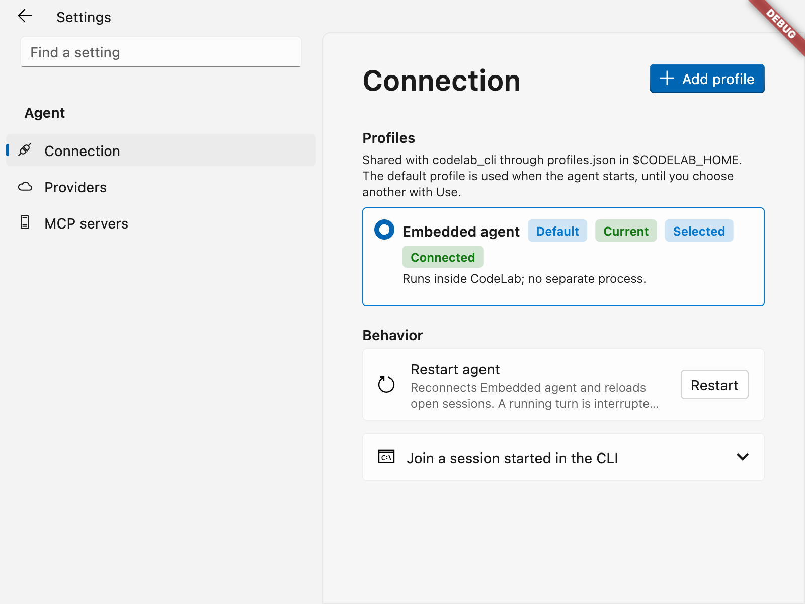

Встроенный агент — профиль по умолчанию, выбранный и подключённый.

- «Embedded agent» — встроенный агент, первый в списке и выбранный по умолчанию. Метки: «Default» — профиль по умолчанию; «Selected» — профиль, с которым агент запустится при следующем старте или «Restart agent»; «Current» — профиль работающего агента; «Connected» — исход последней попытки подключения. «Selected» и «Current» расходятся, пока вы выбрали другой профиль, но ещё не перезапустили агента.
- «Add profile» добавляет внешнего агента: «Local stdio» — программа, которую приложение запустит само (команда, аргументы, переменные окружения, запуск в папке проекта), или «WebSocket» — агент по адресу.

  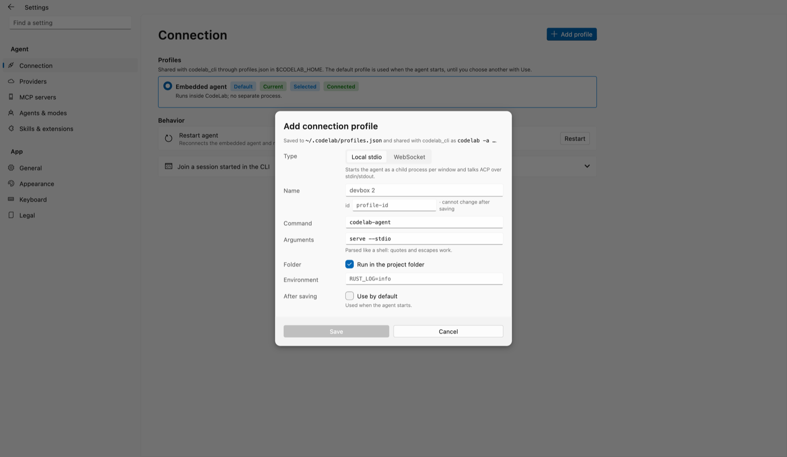

  Подпись вверху диалога называет файл, куда сохранится профиль, — `profiles.json` в `CODELAB_HOME` (на снимке — `~/.codelab/profiles.json`).

- Токен для WebSocket-профиля хранится только ссылкой: переменная окружения («From environment variable») или секрет из хранилища («Use stored secret», «Store a new token»). Сам токен в профиль не записывается. Для адреса `ws://` на другую машину (не `localhost`) приложение попросит подтвердить сохранение («Save anyway»): с токеном предупреждение «ws:// to another machine: the token is sent unencrypted.», без токена — «ws:// to another machine: traffic is sent unencrypted.» Для локального адреса подтверждение не нужно.
- «Use by default» делает профиль профилем по умолчанию — с ним агент стартует при следующем запуске.
- Профили общие с терминальным клиентом `codelab`: профиль из приложения доступен как `codelab -a <id>`. Файл — [`profiles.json` в `CODELAB_HOME`](../../../docs/ops/codelab-home.md#общие-файлы).
- «Join a session started in the CLI» подсказывает, как подключиться к тому же агенту, что и CLI: запустить `codelab-agent serve --ws <port>` и выбрать здесь тот же WebSocket-профиль.

### Подключить провайдера модели

Провайдер — сервис, который отвечает за модель: OpenAI, Anthropic, OpenRouter, Ollama или совместимый сервер. Мастер «Add provider» открывается с карточки «No model provider…» и со страницы «Providers».

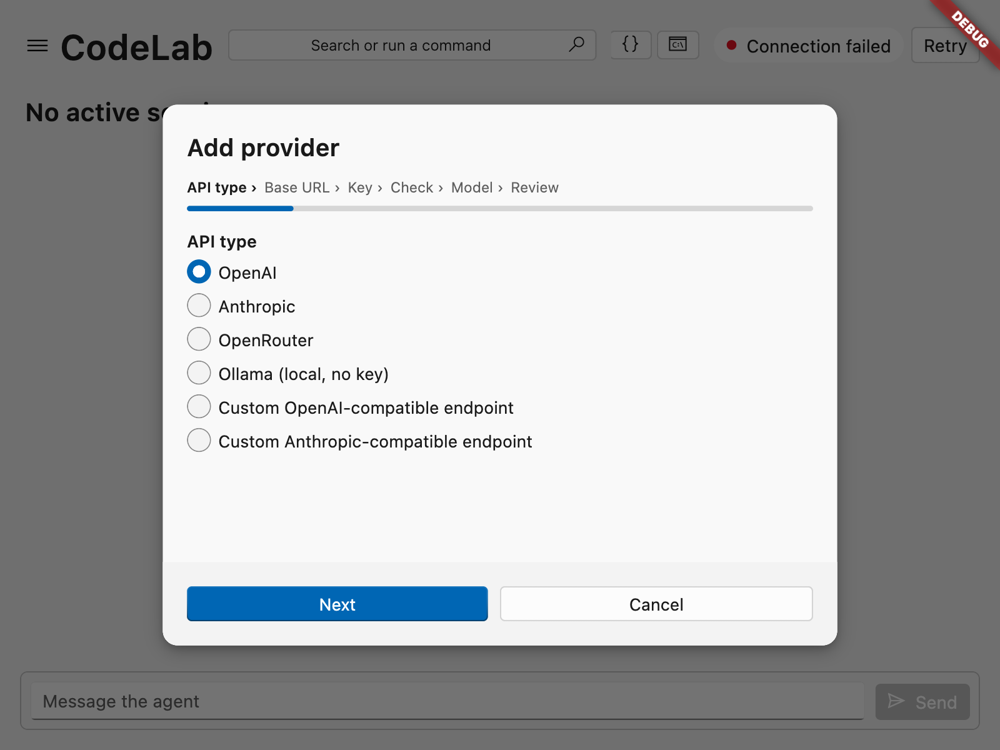

Строка шагов вверху показывает, где вы в мастере; на первом шаге выбирается тип API.

1. «API type» — тип провайдера.
2. «Base URL» — адрес; для известных провайдеров он подставлен.
3. «Key» — откуда брать ключ: «Read from environment variable», ключ в хранилище секретов (если хранилище доступно для записи) или «No key» для локального сервера.
4. «Check» — приложение запрашивает у сервера список моделей. Если сервер не отвечает, мастер так и пишет и предлагает «Retry» или «Save without check».

   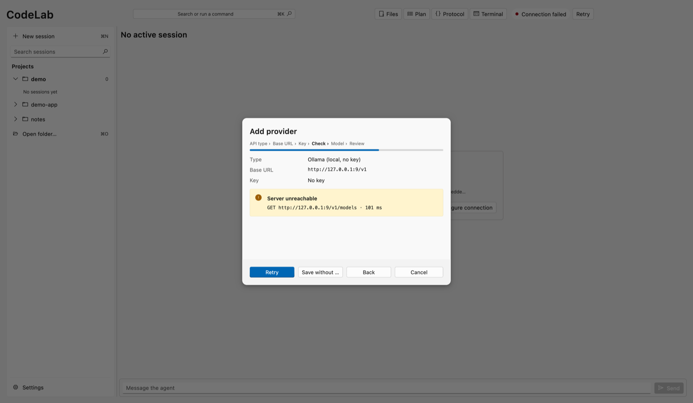

   Мастер показывает запрос, который не прошёл, и сколько он длился.

5. «Model» — модель из списка или вручную, если список недоступен; для модели, введённой вручную, задаётся размер контекста.
6. «Review» — итог и файл, куда запишутся настройки. «Make default model» делает модель моделью по умолчанию, «This project only» пишет настройки только для текущего проекта. «Save» сохраняет.

Ключ, введённый в мастере, не показывается на экране и не попадает в логи.

### Провайдеры

Страница «Providers» показывает модель по умолчанию, хранилище ключей и настроенных провайдеров. У каждого провайдера есть «Check», «Edit» и «Remove».

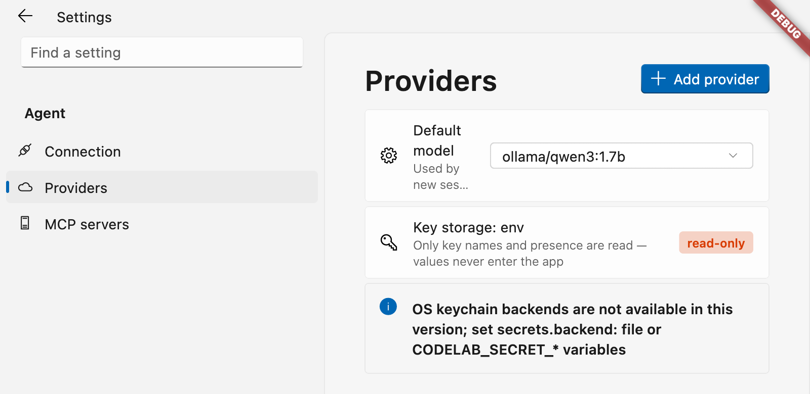

Видны модель по умолчанию `ollama/qwen3:1.7b`, хранилище ключей `env`, которое приложение только читает, и настроенный провайдер `ollama` с меткой «not checked»: его ещё не проверяли.

- «Key storage» — где хранятся ключи. Метка «read-only» значит, что приложение не может записывать ключи: хранилище `env` только читает переменные `CODELAB_SECRET_*`. Чтобы приложение могло сохранять ключи, включите файловое хранилище — [шаг 2 настройки агента](../../../docs/user/configuration.md#шаг-2-задайте-ключ-api).
- Если ход заканчивается сообщением «The model reached its token limit», лимит ответа задаёт ключ `providers.<id>.models.<model>.max_output_tokens` ([шаг 1 настройки](../../../docs/user/configuration.md#шаг-1-подключите-провайдера-и-модель)). Без него — и если о модели нет встроенной записи — провайдеру уходит 4096 токенов. У моделей с рассуждением этот лимит расходуется и на рассуждение, и на аргументы вызовов, поэтому для них значение стоит увеличить.
- Если работающему агенту нужен перезапуск, чтобы увидеть изменения, баннер после сохранения подскажет «Restart agent».
- Для агента по WebSocket и чужого агента-программы страница только показывает текущую модель: их конфигурацию приложение не меняет.

### MCP-серверы

MCP-сервер даёт агенту дополнительные инструменты. Страница «MCP servers» добавляет серверы (`stdio` — программа, `http` — адрес), включает, выключает и удаляет их.

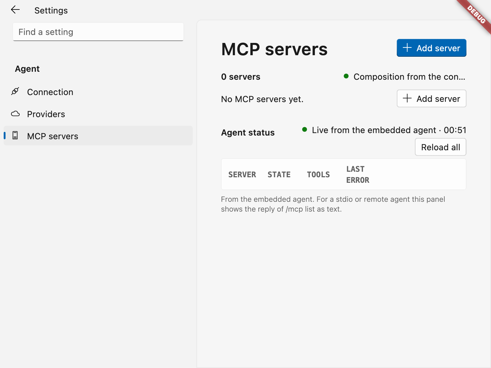

Серверов пока нет, поэтому таблица «Agent status» встроенного агента пуста.

Для встроенного агента внизу видно живое состояние серверов: имя, состояние, число инструментов и последняя ошибка; «Reload all» перезапускает их. Для внешнего агента та же панель показывает ответ команды `/mcp list` текстом.

### Режим разрешений и рассуждение новых сессий

Страница «Agents & modes» (группа «Agent») задаёт, в каком режиме разрешений стартуют новые сессии и с каким уровнем рассуждения работает модель. Это ключи конфигурации агента `permissions.mode` и `agent.effort`, общие с терминальным клиентом: то, что вы выберете здесь, увидит и `codelab`.

<!-- screenshot: страница Agents & modes (settings-agents-modes.png): «Save to», режимы, effort; снять запуском приложения с изолированным CODELAB_HOME -->

- «Default permission mode» — радиогруппа `plan`, `ask`, `standard`, `accept-edits`, `bypass`. Строка «Effective» показывает действующий режим, «Source» — откуда он взят: `default`, `user`, `project`, `local`, `file` или `env`. Если вы выбрали `ask`, а недоверенный проект добавляет `plan`, строка «Effective» говорит: `ask (edits and commands blocked by plan)` — правки и команды заблокированы.
- Выбранный режим действует на новые сессии после «Restart agent» (кнопка на странице «Connection»). Баннер после записи подскажет: «Saved. New sessions use <режим> after Restart agent.»; если агент ещё не запущен — «Saved. New sessions use <режим> when the agent starts.» Если действующее значение после записи отличается от выбранного (его перекрывает другой слой или окружение, либо оно сужено недоверенным проектом), баннер-предупреждение говорит об этом: «Saved to <цель>; <источник> overrides it: new sessions use <значение>…», где <цель> — «All projects» или «This project only», а <источник> — `user`, `project`, `local`, `file`, `env`, `default` или «the untrusted project». Если после записи конфиг стал нечитаемым, остаётся «Saved to <цель>.» Режим одной сессии меняется из композера. До «Restart agent» новая сессия в другой папке, у которой есть проектный конфиг, может быть отклонена после правки режима для «All projects»: агент просит перезапуск (`restart the agent to open sessions in this folder`).
- `bypass` сначала спрашивает подтверждение: «Use bypass for new sessions?» — «Use bypass» записывает, «Cancel» или Esc отказывают. Запись постоянна и действует на все новые сессии выбранной цели; текст диалога: «Only critical commands, changes to the agent's configuration and network tools still ask. Commands run without asking and can reach the network too. Use bypass only in a disposable checkout.» То есть спрашивают только критичные команды, правки конфигурации агента и сетевые инструменты; остальные команды выполняются без вопроса и тоже могут ходить в сеть. Если настройки изменились, пока диалог был открыт, запись не выполняется: «Settings changed while the dialog was open; bypass was not saved.» Используйте `bypass` только в одноразовой копии репозитория.
- `autopilot` в списке неактивен: он включается только флагом запуска агента (`codelab-agent serve --permission-mode autopilot`) и в конфигурацию не записывается.
- «Default reasoning effort» — `low`, `medium` или `high`. Уровень уходит параметром сессии, только если модель умеет рассуждать, и применяется к новым сессиям без перезапуска агента, если отслеживание конфигурации (`config.watch`) не выключено; иначе баннер попросит «Restart agent». Для одной сессии его меняют в композере.
- «Save to» выбирает, куда писать оба ключа: «All projects» — пользовательский конфиг, «This project only» — локальный конфиг проекта (пункт есть, когда выбран проект: сессия в фокусе или выбранный проект). Цель общая для режима и effort.
- Если проект не назван в `trusted_projects`, его конфигурация может только ужесточить режим. Тогда страница сообщает: «This project is not trusted, so its config can only make the mode stricter. New sessions here use <режим>.» Правила слоёв — [настройка агента](../../../docs/user/configuration.md).
- Если файл изменился на диске, пока страница была открыта, запись не выполняется: «The config changed on disk, so nothing was saved. The page was reloaded; review it and try again.» Если выбранный файл конфигурации недоступен — «Cannot save: the target config file is not available.» При другом сбое — «The config was not saved.» Нечитаемый конфиг страница не перезаписывает: «Cannot read the agent config. Fix or remove the file; CodeLab will not overwrite it.»
- Для агента по WebSocket страница только показывает: «Read-only: this agent runs on <адрес>. Change its modes and agents on that host: codelab config set, .codelab/agents.» Для чужого агента-программы — «Agent settings are managed by <имя>.»

#### Определения агентов

Блок «Agent definitions» под режимом и effort показывает, какие определения агентов увидит новая сессия. Определения читаются при создании сессии; выбрать одно для сессии можно в меню агентов композера.

<!-- screenshot: блок Agent definitions страницы Agents & modes (settings-agents-definitions.png): таблица со строками default, general, explore, review, plan и пользовательским определением; снять запуском приложения с изолированным CODELAB_HOME -->

- Таблица только для чтения, шире окна: при нехватке места она прокручивается по горизонтали; длинный путь в «Source» переносится. Колонки: «Name», «Description», «Source», «Available in», «Tools», «Model», «Status». Первой идёт строка `default` (источник `built-in`, «Available in» — `session`), затем встроенные типы субагентов `general`, `explore`, `review`, `plan` (источник `built-in`, «Available in» — `subagent`), затем файлы по имени. «Available in» принимает значения `session`, `subagent` и `both`. В «Tools» — перечень инструментов или `all`; в «Model» — `<провайдер>/<модель>` или `session model`, если модель берётся от сессии. У отклонённых файлов («Model not configured», дубликат, перекрытый проектным, «Error») «Available in», «Tools» и «Model» — `—`.
- Файлы лежат в `$CODELAB_HOME/agents` и в `.codelab/agents` проекта; проектный каталог читается, только если проект назван в `trusted_projects`. Пути в таблице сокращаются до `~`.
- «Status»: «Available»; «Overridden by <путь>» — встроенный тип заменён определением из файла (если путь неизвестен — просто «Overridden»); «Model not configured» — модель определения вне каталога моделей; «Error · line N» (или «Error», если номер строки неизвестен) — файл не разобран; «Not loaded: duplicate name» — имя уже занято; «Shadowed by project» — пользовательский файл заменён проектным; «Subagents off» — встроенный тип недоступен, потому что в конфигурации `subagents.enabled: false`.
- Для каждого файла с ошибкой (включая «Model not configured» и дубликат имени) над таблицей появляется панель ошибки: заголовок — «Cannot load the definition», а при известном номере — «Cannot load the definition · line N»; ниже путь файла (с `~`) и причина разбора, для модели вне каталога без собственного текста — «The model of this definition is not configured.», для дубликата — «Not loaded: another definition has the same name.». Управляющие и невидимые символы в именах и путях показываются видимыми кодами `\uXXXX`. У файла, перекрытого проектным («Shadowed by project»), панели ошибки нет. Кнопка «Open folder» панели открывает каталог, где лежит файл; сами файлы приложение не открывает — править их вы будете в своём редакторе.
- «Open folder» в шапке открывает каталог определений в программе ОС: «User definitions (<путь>)» — каталог `agents` в `CODELAB_HOME`; в скобках его фактический путь, с `~` в начале, если он в домашней папке (по умолчанию `User definitions (~/.codelab/agents)`); при отсутствии каталог создаётся (но не поверх битой ссылки или файла); «This project (.codelab/agents)» — каталог проекта, он не создаётся: пока его нет, пункт неактивен, и подсказка говорит «Create .codelab/agents in the project to add definitions.». Пункта проекта нет, если проект не выбран или не доверенный. Каталог-ссылка открывается по раскрытому пути; ссылка на пакет приложения (имя с расширением вроде `.app`) и битая ссылка не открываются: появляется «Could not open <что>.» То же сообщение — при сбое платформы.
- «Reload» перечитывает определения.
- Недоверенный проект: «Definitions in <проект>/.codelab/agents are not read: the project is not trusted.»
- Если чтение не уложилось в 5 секунд: «Agent definitions were not read within 5 s.»; если упало — «Agent definitions could not be read.»
- Для агента по WebSocket и чужого агента-программы таблицы нет: страница показывает только сообщение «только чтение» из предыдущего раздела.

### Навыки, файлы контекста и шаблоны

Страница «Skills & extensions» (группа «Agent») показывает, что агент подхватит в папке выбранного проекта: файлы контекста `AGENTS.md`, шаблоны команд и навыки. Навык — папка с инструкциями, которую агент или вы вызываете по имени. Страница читает файлы с диска и пишет только два ключа конфигурации: `skills.disabled` и `skills.extra_roots`. Без открытого проекта страница просит открыть папку проекта, а «Open .codelab folder» открывает каталог `CODELAB_HOME`.

- «Context files» — найденные `AGENTS.md` с размером. Метка «used because this folder has no AGENTS.md» стоит у файла, который агент взял вместо `AGENTS.md`; «truncated to …» — файл усечён по бюджету; «not included (budget)» — в контекст не попал.
- «Prompt templates» — команды вида `/имя` с подсказкой аргументов, описанием и файлом-источником.
- «Skills» — таблица «SKILL», «INVOKE AS», «SOURCE». «INVOKE AS» показывает команду вызова, а `Model only` значит, что навык вызывает только модель. Метка «Command only» — навык виден только как команда. Переключатель в строке выключает навык (ключ `skills.disabled`), «Open» открывает его папку. Если переключатель недоступен, подсказка называет причину, например «Set in <источник>; edit that file.» или «Disabled by the project config (<источник>).».
- Под таблицей — порядок поиска: `.codelab/skills`, затем `.agents/skills` от папки сессии до корня репозитория, затем `$CODELAB_HOME/skills` и `~/.agents/skills`, в конце дополнительные каталоги. Ближний навык перекрывает дальний. Список фиксируется при открытии сессии, поэтому новые и изменённые навыки видят только новые сессии.
- Таблица «SKILLS OF OTHER AGENTS» с переключателями «Read ~/.claude/skills» и «Read .claude/skills» даёт согласие читать каталоги навыков других агентов (ключ `skills.extra_roots`). Согласие на относительный каталог действует во всех доверенных проектах, где он есть.
- Если проект не назван в `trusted_projects`, агент не читает его навыки и шаблоны: страница предупреждает об этом и показывает только ваши навыки и файлы `AGENTS.md`.
- Записи сопровождает баннер «Saved» или «Not saved» (конфликт с правкой файла на диске или ошибка записи). Раздел, который не прочитался за 5 секунд, заменяется строкой «<раздел> were not read within 5 s.». Если навыки выключены ключом `skills.enabled: false`, страница пишет «Skills are switched off: skills.enabled is false in <источник>.».
- Нечитаемый конфиг страница не перезаписывает: «Cannot read the agent config. Fix or remove the file; CodeLab will not overwrite it.»
- Для агента по WebSocket страница только показывает «Read-only: this agent runs on <адрес>.», для чужого агента-программы — «Skills are managed by <имя>.».

<!-- screenshot: страница Skills & extensions с файлами контекста, шаблонами и таблицей навыков (settings-skills.png); снять запуском приложения с изолированным CODELAB_HOME -->

Общие настройки агента — файлы, слои, ключи — описаны в [настройке агента](../../../docs/user/configuration.md).

## Если что-то пошло не так

| Что видите | Почему | Что сделать |
|---|---|---|
| «No model provider is configured for the embedded agent.» | у встроенного агента нет провайдера модели | «Add provider» и мастер |
| «Connection failed» и «Retry» в верхней панели | агент не запустился или соединение оборвалось; причина — на карточке под заголовком | исправьте причину и нажмите «Retry»; для внешнего агента проверьте профиль на странице «Connection» |
| «Server unreachable» в мастере провайдера | сервер модели не отвечает по указанному адресу | запустите сервер или исправьте «Base URL»; «Save without check» сохранит настройки без проверки |
| ход завершается ошибкой сразу после отправки | у провайдера нет ключа или он неверный | проверьте строку провайдера на странице «Providers» — «Check» |
| «<ИМЯ> is not set in CodeLab's environment.» в строке WebSocket-профиля на странице «Connection» или под полем токена в диалоге профиля | токен профиля берётся из переменной окружения, а приложение, запущенное из Finder или Dock, не видит переменных оболочки | запустите приложение из терминала с этой переменной или выберите для токена «Use stored secret» или «Store a new token» (нужно файловое хранилище, `secrets.backend: file` — [шаг 2 настройки](../../../docs/user/configuration.md#шаг-2-задайте-ключ-api)) |
| страница «Connection» показывает ошибку чтения, «Add profile» недоступна | файл `profiles.json` повреждён или незнакомого формата; приложение его не перезаписывает | исправьте или удалите файл — [каталог `CODELAB_HOME`](../../../docs/ops/codelab-home.md#общие-файлы) |
| новая сессия в проекте не открывается, в ошибке — «the global permissions changed after the agent started; restart the agent to open sessions in this folder» | вы изменили глобальные права (`permissions`) после запуска агента, а в папке проекта есть `.codelab/config.yaml` или `config.local.yaml` | «Restart agent», затем откройте сессию снова — [правки «после перезапуска»](../../../docs/user/configuration.md#правки-после-перезапуска-и-сессии-других-папок) |
| в ленте заметка «The turn stopped: budget exceeded: <лимит>.» | ход остановился: агент исчерпал лимит бюджета. `<лимит>` — `steps` (`budget.max_steps`), `tokens` (`budget.max_tokens`), `cost` (`budget.max_cost`) или `duration` (`budget.max_duration`) | увеличьте соответствующий ключ секции `budget` в конфигурации агента и перезапустите агента. Если агент не назвал лимит, заметка читается «The turn reached the limit of model requests.» |
| «Open a session to use the terminal» | у терминала нет папки без сессии | создайте или выберите сессию |
| «The project folder does not exist.» в панели Files | папку проекта удалили или переместили | откройте проект заново через «Open folder…» |
| нет кнопки и команды Files | агент подключён по WebSocket, его папка не на этом компьютере | — |

Подробности соединения видны в панели «Protocol» (`/logs`): записи протокола и журнал приложения, «Expand» открывает журнал целиком.

## Смотрите также

- [Настройка агента](../../../docs/user/configuration.md)
- [Терминальный клиент `codelab`](../../codelab_cli/doc/user-guide.md)
- [Эксплуатация CodeLab app](operations.md)
