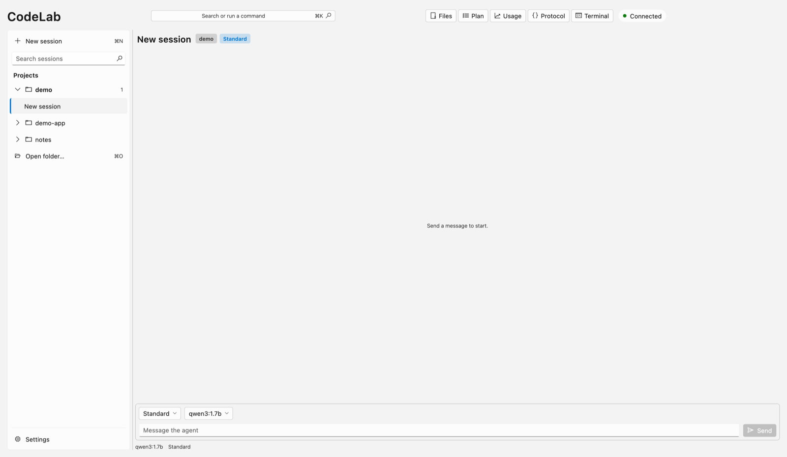
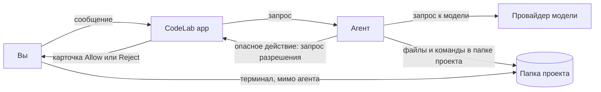

# Обзор окна и основных понятий

CodeLab app — окно, в котором вы работаете с AI-агентом над папкой проекта. Эта глава называет части окна и понятия, которые встречаются во всех остальных главах.

Сессия в проекте `demo` до первого сообщения: слева проекты и сессии, в шапке сессии — проект и режим, под полем ввода — режим и модель.

## Основные понятия

| Понятие | Что это |
|---|---|
| Проект | Папка на диске. Агент стартует в ней, и сессии получают её рабочей папкой. У встроенного агента файловые инструменты и рабочая папка команд ограничены этой папкой ([рабочая папка](../../../codelab_agent/doc/user/05-permissions.md#рабочая-папка)); внешний агент применяет свои правила к файлам вне неё. Проект выбираете вы: кнопкой «Open folder…», ⌘O (Ctrl+O на Windows и Linux) или из списка недавних |
| Сессия | Один разговор с агентом в папке проекта. У проекта может быть много сессий; они перечислены под проектом в боковой панели |
| Ход | Ваше сообщение и всё, что агент делает в ответ: текст, размышления, вызовы инструментов |
| Агент | Программа, которая читает файлы, правит их и запускает команды. По умолчанию агент встроен в приложение, внешнего агента подключают профилем ([глава 6](06-connection-and-profiles.md)) |
| Провайдер и модель | Провайдер — сервис, который отвечает за модель (OpenAI, Anthropic, OpenRouter, Ollama или совместимый сервер). Модель отвечает на запросы агента. Подключение — [глава 7](07-providers-and-models.md) |
| Режим разрешений | Правило, при каких действиях агент спрашивает вас. Новые сессии стартуют в режиме по умолчанию (`standard`), режим меняется в поле ввода ([глава 4](04-permissions.md)) |
| Профиль подключения | Сохранённый способ связаться с агентом: встроенный, программа или адрес WebSocket |

## Части окна

- **Боковая панель.** «New session», поле «Search sessions», список проектов с сессиями, «Open folder…» и «Settings». В узком окне панель выдвигается кнопкой меню слева от заголовка CodeLab или сочетанием ⌘B.
- **Верхняя панель.** Поле «Search or run a command» (палитра команд, ⌘K), кнопки панелей «Files», «Plan», «Protocol», «Terminal» и состояние агента: «Connected», «Connection failed» с кнопкой «Retry» или «No project · agent not started». Кнопки «Usage» и «Agents» условные: «Usage» есть, пока агент сообщает расход или отдаёт журнал расхода, «Agents» — когда в сессии есть субагенты.
- **Лента сессии.** Сообщения, ответы агента, вызовы инструментов, запросы разрешений.
- **Поле ввода.** Поле «Message the agent», выпадающие списки режима и модели (и уровня рассуждения или агента, если агент их предлагает) и строка статуса с расходом. Очередь сообщений и план стоят над полем.
- **Док справа.** Панели «Files», «Plan», «Usage», «Protocol», «Terminal», «Agents» вкладками. В узком окне док выдвигается поверх ленты.
- **Настройки.** Кнопка «Settings» внизу боковой панели, ⌘, или «Preferences…» в меню macOS ([глава 9](09-settings.md)).

## Как это работает

На схеме — что происходит между вашим сообщением и ответом агента.

- По умолчанию агент встроен в приложение: отдельная программа не нужна. Профиль на странице «Connection» может указать другого агента — программу, которую приложение запустит само, или агента по адресу `ws://`/`wss://`.
- Агент спрашивает разрешение перед опасными действиями, вы отвечаете в карточке. Чтение и запись файлов, которые агент просит у приложения, ограничены папкой сессии.
- Терминал пользователя работает мимо агента: агент его не видит, одобрения на него не действуют.
- Журналы сессий встроенного агента лежат в `$CODELAB_HOME/sessions/` или в каталоге `sessions.dir` из конфигурации — [общие файлы `CODELAB_HOME`](../../../../docs/ops/codelab-home.md#общие-файлы). До выпуска 1.0 тексты сообщений и вывод инструментов в них не очищаются — [что попадает в логи и журналы](../../../../docs/user/configuration.md#что-попадает-в-логи-и-журналы).

## Куда дальше

1. [Установка и первый запуск](01-install-and-first-launch.md) — если приложение у вас ещё не открывалось.
2. [Проекты и сессии](02-projects-and-sessions.md) и [диалог с агентом](03-conversation.md) — повседневная работа.
3. [Запросы разрешений](04-permissions.md) — что агенту можно и как отвечать на его вопросы.
4. [Если что-то пошло не так](10-troubleshooting.md).
