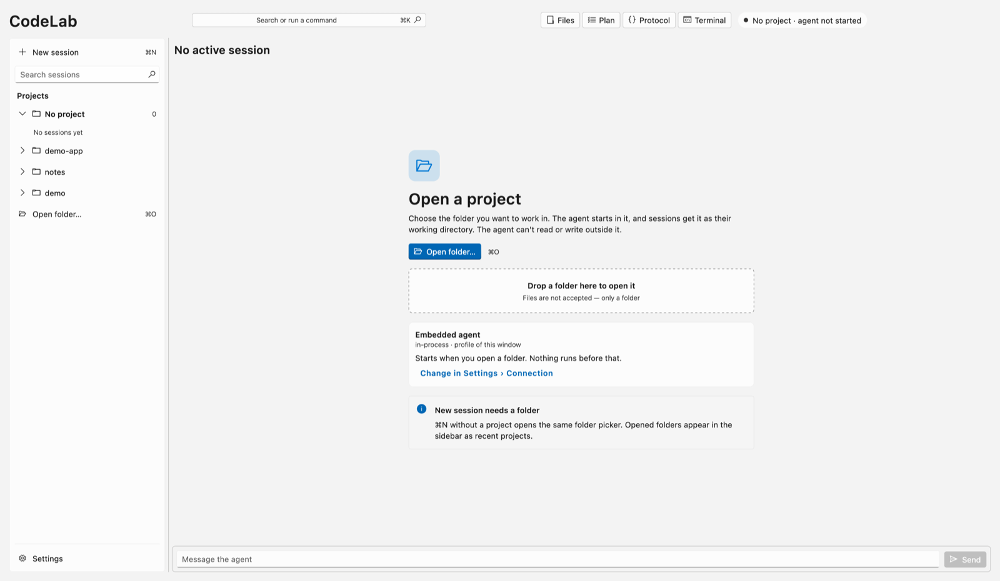
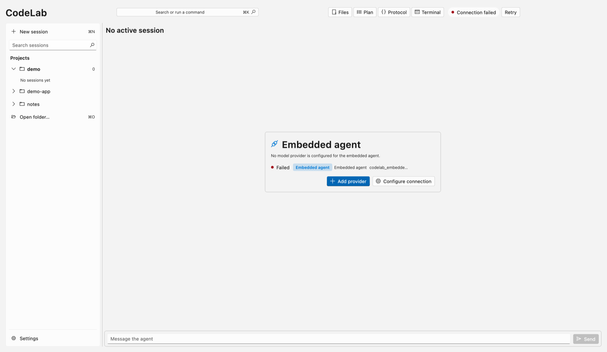
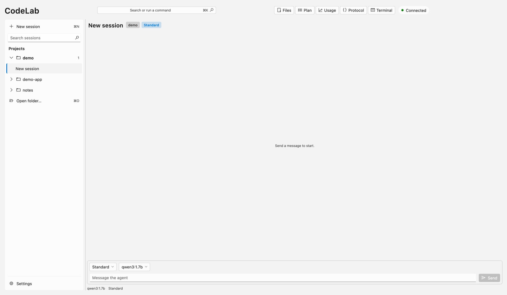
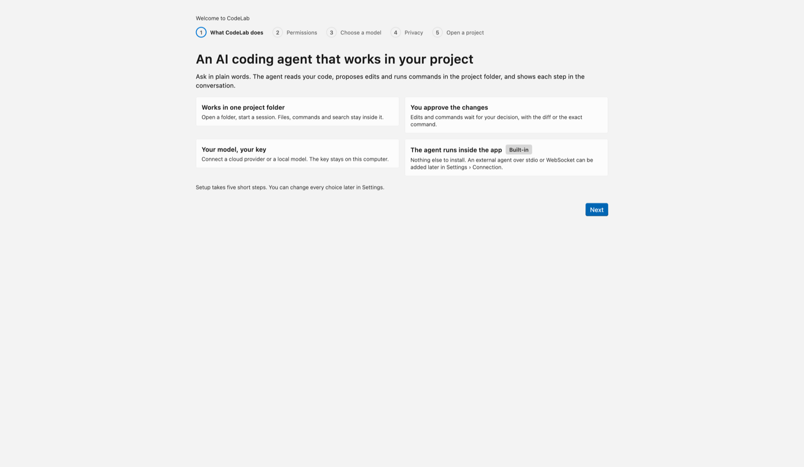
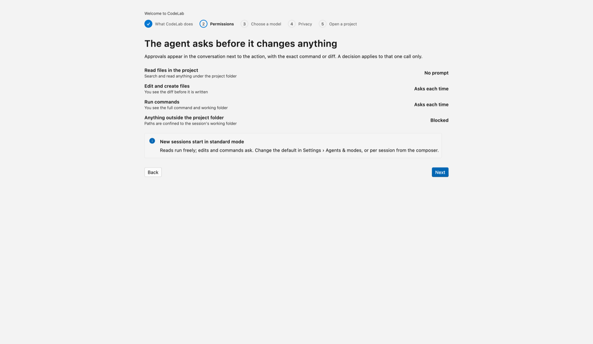
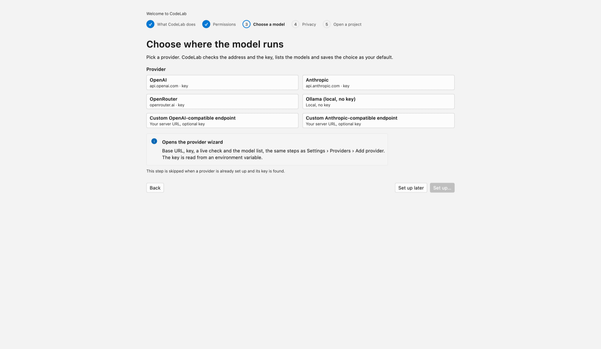
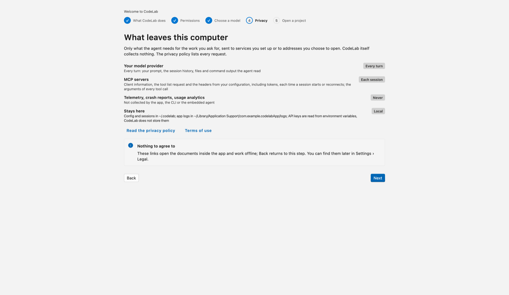
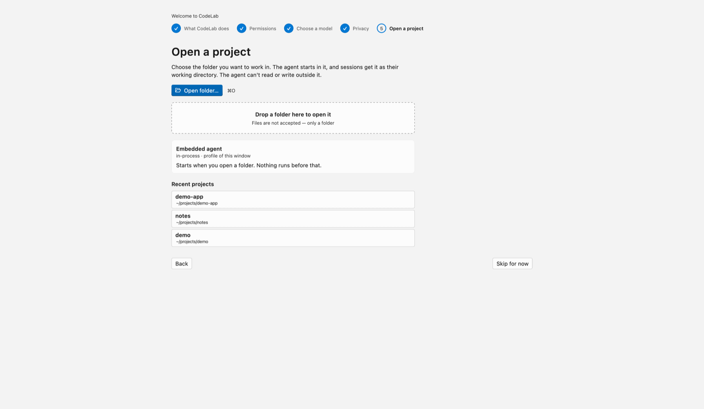

# Установка и первый запуск

Глава ведёт от запуска приложения до первой сессии: что нужно заранее, что показывает экран «Open a project» и что спрашивают приветственные шаги.

## Перед началом

- Приложение пока собирается из исходников — [запуск из исходников](../../../../docs/user/run-from-source.md#4-запуск-app). Установщика сейчас нет.
- Нужна модель: ключ API облачного провайдера (OpenAI, Anthropic, OpenRouter) или локальный сервер без ключа (Ollama, LM Studio). Подключить её можно прямо из приложения.
- Нужна папка проекта: агент работает внутри неё.

## Первый запуск

Самый первый запуск начинается с пяти приветственных шагов — [«Приветственные шаги»](#приветственные-шаги); последний из них — выбор папки проекта. Они показываются один раз. Если на последнем шаге вы выбрали папку, рабочее место сразу открывается с этим проектом, и пункт 1 ниже для вас пропускается. После «Skip for now» (и при всех следующих запусках без проекта) приложение работает так:

1. Запустите приложение. Без открытого проекта окно показывает экран «Open a project».

   

   На экране:

   - заголовок «Open a project» и пояснение, зачем нужна папка: агент стартует в ней, и сессии получают её рабочей папкой. Для встроенного агента добавлено, что он не читает и не пишет вне этой папки. Для агента-процесса и агента по WebSocket вместо этого сказано, что внешний агент сам решает, как обращаться с файлами вне папки;
   - кнопка «Open folder…» с подсказкой сочетания: ⌘O на macOS, Ctrl+O на Windows и Linux;
   - зона «Drop a folder here to open it» с подсказкой «Files are not accepted — only a folder»;
   - карточка агента этого окна: имя профиля и подпись способа подключения — «in-process · profile of this window» для встроенного агента, «stdio · … · profile of this window» или «WebSocket · … · profile of this window» для внешнего. Под ней: «Starts when you open a folder. Nothing runs before that.» (для агента по WebSocket — «Connects when you open a folder. Nothing connects before that.») и ссылка «Change in Settings › Connection», которая открывает страницу подключения;
   - плашка «New session needs a folder»: «New session», ⌘N (Ctrl+N на Windows и Linux) и команда `/new` в палитре без проекта открывают тот же выбор папки.

   Статус в правом верхнем углу — «No project · agent not started». Подсказка к нему: «No project is selected, so no agent is running». Пока папки нет, агент не запущен и ничего не подключается.

2. Откройте папку одним из трёх способов:

   - нажмите «Open folder…» и выберите папку в системном окне;
   - нажмите ⌘O (Ctrl+O на Windows и Linux) — откроется то же окно выбора;
   - перетащите папку из Finder, Проводника или файлового менеджера Linux на экран «Open a project». Пока папка над окном, зона подсвечивается.

   Приложение сразу запускает агента в этой папке. Перетащенная папка работает так же, как выбранная кнопкой: она попадает в недавние проекты, а сессия не создаётся, пока вы сами её не начнёте.

   Приложение не принимает бросок и пишет причину в зоне, если:

   | Что перетащили | Что напишет зона |
   |---|---|
   | файл | «That's a file. Drop a folder to open it as a project.» |
   | несколько элементов | «Drop one folder at a time.» |
   | элемент, которого уже нет на диске | «The dropped item no longer exists: <путь>.» |
   | элемент без пути в файловой системе (например, вложение из браузера) | «This item can't be opened as a project. Drop a folder from your file system.» |

   Причину отказа приложение записывает и в диагностику.

   На Windows перетаскивание из Проводника не работает, если приложение запущено от имени администратора: Windows блокирует бросок между процессами с разными правами. Запустите приложение без повышенных прав либо пользуйтесь кнопкой или Ctrl+O.

   Перетаскивание работает только на экране «Open a project». На рабочем месте с выбранным проектом папку бросить нельзя — используйте «Open folder…» в боковой панели.

3. Если модель ещё не настроена, вместо рабочего места появится карточка «Embedded agent» с текстом «No model provider is configured for the embedded agent.»

   

   Нажмите «Add provider» — откроется мастер, он описан в разделе [«Подключить провайдера модели»](07-providers-and-models.md#подключить-провайдера-модели). После сохранения приложение само подключит агента, и статус сменится на «Connected».

4. Создайте сессию: ⌘N, «New session» в боковой панели или команда `/new` в палитре.

   

   В шапке сессии — проект и режим агента. Под полем ввода — выбор режима и модели, если агент их предлагает.

При следующем запуске приложение откроет последний проект и запустит агента само.

## Приветственные шаги

При самом первом запуске вместо рабочего места открывается экран «Welcome to CodeLab» с пятью шагами. Строка шагов наверху показывает, где вы; пройденные шаги отмечены галочкой. Кнопки «Back» и «Next» внизу листают шаги; на шаге «Privacy» «Next» ведёт к последнему шагу, а на нём вместо «Next» — действия выбора проекта (шаг 5 ниже). Esc экран не закрывает, настройки (⌘,) на нём не открываются.

1. «What CodeLab does». Коротко: агент работает в папке проекта, правки и команды ждут вашего решения, ключ модели остаётся на этом компьютере, а встроенный агент не требует отдельной установки.

   

2. «Permissions». Таблица правил режима `standard`: чтение файлов проекта идёт без вопроса, правки и команды спрашивают каждый раз, всё вне папки проекта заблокировано. Под таблицей — режим, в котором начнутся новые сессии. Пока настройки читаются, режим не называется — на его месте «Reading the agent settings…». Если настройки прочитать не удалось, шаг не утверждает режим и отсылает к «Settings › Agents & modes»: в общей конфигурации может стоять другой режим. Если в конфигурации задан режим, отличный от `standard`, шаг называет его и предупреждает, что таблица описывает `standard`. Если подключение по умолчанию — внешний агент, шаг говорит, что у него свои правила, а запросы одобрения всё равно появятся в переписке.

   

3. «Choose a model». Карточки провайдеров — те же, что в мастере «Add provider». Выберите карточку — до этого «Set up…» неактивна. Кнопка «Set up <провайдер>…» открывает мастер сразу на шаге «Base URL»; описание мастера — в разделе [«Подключить провайдера модели»](07-providers-and-models.md#подключить-провайдера-модели). Пока мастер открывается или открыт, кнопки «Back», «Next», «Set up later», «Set up…» и карточки провайдеров неактивны. Если подключение по умолчанию — агент `codelab-agent` со своей конфигурацией, шаг проверяет и мастер пишет ту же конфигурацию, что и страница «Providers». Здесь мастер всегда сохраняет провайдера как модель по умолчанию, переключателя «This project only» нет. После сохранения шаг пишет «<провайдер> is connected» и показывает модель и место ключа; кнопка «Next» становится активной, а «Set up again…» запускает мастер снова для последней выбранной карточки (прежний провайдер остаётся в конфигурации).

   

4. «Privacy». Что уходит с компьютера (вводная: только то, что нужно для вашей работы, отправляется сервисам, которые вы настроили, или адресам, которые вы открываете сами; CodeLab сам ничего не собирает, а политика конфиденциальности перечисляет все запросы): запросы к вашему провайдеру модели на каждом ходе (ваше сообщение, история сессии, прочитанные файлы и вывод команд); серверам MCP (метка «Each session») при каждом начале и переподключении сессии — сведения о клиенте, запрос списка инструментов и заголовки из вашей конфигурации, включая токены, а при каждом вызове инструмента — его аргументы; телеметрии, отчётов о сбоях и аналитики нет. Строка «Stays here» называет, что остаётся на компьютере: конфигурация и сессии в `CODELAB_HOME`, логи приложения и способ хранения ключей. Путь логов приложения показывается всегда, даже если настройки агента прочитать не удалось. Шаг ничего не просит принять и не пишет согласие. Ссылки «Read the privacy policy» и «Terms of use» открывают документ прямо в окне onboarding, без сети; язык документа — по языку интерфейса. Над документом кнопка «Back to setup» (фокус сразу на ней), она и Esc возвращают на шаг «Privacy», фокус уходит на ту ссылку, что открыла документ. Пока документ открыт, «Back» и «Next» не действуют. Те же документы потом лежат в «Settings › Legal».

   

5. «Open a project». Последний шаг; в строке шагов он подписан «Open a project». Тело шага — то же, что у экрана [«Open a project»](#первый-запуск) без проекта: пояснение, зачем нужна папка, кнопка «Open folder…» с подсказкой ⌘O (Ctrl+O на Windows и Linux), зона «Drop a folder here to open it» и карточка агента этого окна. Ссылки «Change in Settings › Connection» на шаге нет: настройки на этом экране недоступны. Шаг заканчивается так:

   - Папка выбрана кнопкой, ⌘O или перетаскиванием на экран — приложение записывает флаг и открывает рабочее место с этим проектом. Отказ при броске (файл, несколько элементов и т. п.) зона показывает теми же текстами, что на экране без проекта ([таблица](#первый-запуск)), шаг остаётся на месте. Если окно выбора папки закрыть без выбора, шаг тоже остаётся.
   - Если проект с прошлого запуска восстановлен, над «Open folder…» стоит строка «Last project: <папка>» с полным путём под ней, а основная кнопка внизу — «Continue in <папка>»: она завершает шаг с этим проектом. «Skip for now» в этом случае нет.
   - Если проекта нет, внизу кнопка «Skip for now»: она записывает флаг и открывает рабочее место без проекта, то есть с экраном «Open a project». Проект можно открыть позже.
   - Под блоками — «Recent projects»: до пяти недавних проектов (имя папки и путь), восстановленный проект среди них не повторяется. Нажатие выбирает проект, как в боковой панели, и завершает шаг; существование папки заранее не проверяется. Пока выбор идёт или записывается флаг, «Open folder…», записи и кнопки внизу неактивны.

   «Back» с шага 5 возвращает на «Privacy». ⌘N на этом экране не привязан.

   

**Когда экран показывается.** Пока в настройках окна нет флага `codelab.app.onboarding_done`: на новой установке и после обновления с версии без onboarding — один раз, даже если провайдер уже настроен. Флаг записывается в конце шага 5: когда принята папка, по «Continue in …» или по «Skip for now». Если выйти из приложения раньше, в том числе не закончив шаг 5, экран появится при следующем запуске снова. Если флаг нельзя прочитать или в нём неожиданное значение, экран не показывается, чтобы не загораживать рабочее место; значение при этом не перезаписывается.

**Шаг модели пропускается**, если провайдер уже настроен и его ключ найден, и если подключение по умолчанию — внешний агент (его модель настраивается у самого агента). Строка шагов при этом показывает шаг как пройденный. «Back» с четвёртого шага ведёт на второй.

**Когда шаг модели не даёт настроить провайдера.** Если провайдер есть, но его ключ не найден (нет секрета или не задана переменная окружения), шаг объясняет, где его добавить: «Settings › Providers › Edit». Карточки при этом доступны. Если конфигурация агента повреждена или не читается, карточки неактивны: мастер не пишет поверх такого файла; проверьте файл командой `codelab config check`.

**«Set up later»** на шаге модели ведёт сразу к шагу «Privacy» без настройки. Провайдера можно добавить позже на странице «Providers» или кнопкой «Add provider» на рабочем месте.

**Где хранится ключ.** Ключ вводится только в мастере и не попадает в переписку и логи. Шаг «Privacy» называет место по настройке `secrets.backend`: при `env` строка «Stays here» заканчивается словами «API keys are read from environment variables, CodeLab does not store them», при `file` — «API keys in <CODELAB_HOME>/secrets.yaml, an unencrypted file» (в строке вместо `<CODELAB_HOME>` стоит путь). Связки ключей ОС в этой сборке нет.

**Агент стартует после onboarding.** Пока открыты приветственные шаги, рабочее место не строится и агент не запускается, даже если проект восстановлен с прошлого запуска. Когда шаг 5 закончен, приложение переходит в рабочее место, и агент стартует один раз — в папке, которую вы выбрали на шаге (или в восстановленном проекте после «Continue in …»), с тем, что сохранено в конфигурации. После «Skip for now» проекта нет, агент не запускается, пока вы не откроете папку. Если на шаге 3 вы сохранили провайдера (или он уже был настроен), карточка «No model provider is configured…» не появляется. После «Set up later», при повреждённой или не читаемой конфигурации карточка появится, а «Add provider» ведёт в тот же мастер.

**Показать шаги снова.** Закройте приложение и удалите флаг:

```bash
defaults delete com.example.codelabApp flutter.codelab.app.onboarding_done
```

Префикс `flutter.` добавляет `shared_preferences`; идентификатор домена — как в [эксплуатации](../operations.md#данные-приложения-вне-codelab_home). Конфигурация агента и сессии не затрагиваются.
