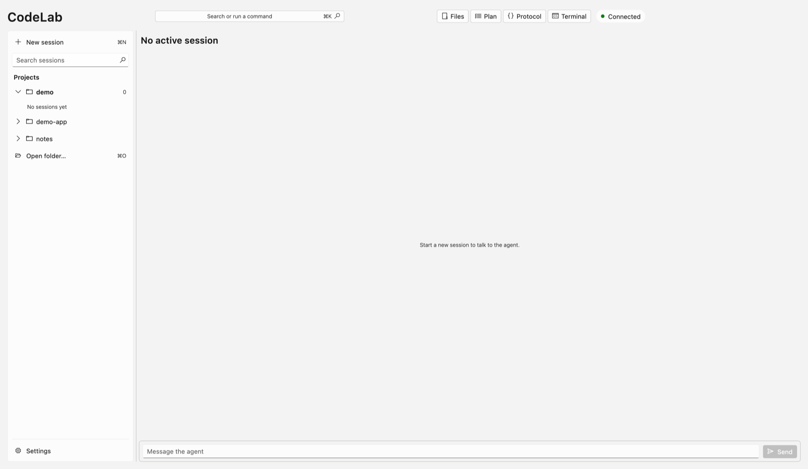
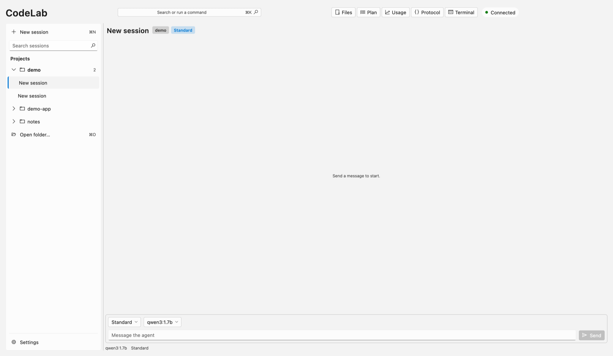
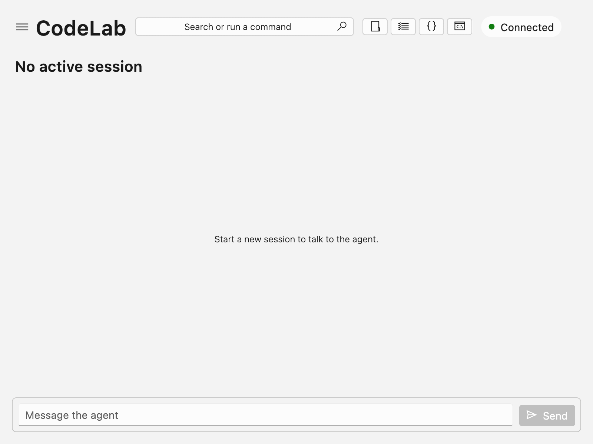

# Проекты и сессии

Глава о том, как открыть проект, переключаться между проектами и сессиями и что происходит с сессиями при перезапуске.

## Открыть проект и переключаться между проектами

Сессии сгруппированы по проектам в боковой панели. В узком окне панель выдвигается кнопкой меню слева от заголовка CodeLab или сочетанием ⌘B.

В группе «Projects» — недавние проекты (не больше 10); список общий с `codelab`: папка, открытая в построчном или полноэкранном режиме `codelab`, появляется и здесь. Пока недавних проектов нет, там написано «No recent projects yet.» Пункт «Open folder…» с подсказкой сочетания стоит в конце списка проектов, «Settings» — внизу панели.

1. Чтобы открыть новый проект, нажмите «Open folder…» в конце списка «Projects» или сочетание ⌘O (Ctrl+O на Windows и Linux).
2. Чтобы вернуться к недавнему проекту, нажмите его имя в списке «Projects».

Агент запускается один раз, в папке проекта, открытого первым; выбор другого проекта его не перезапускает. Сессии каждого проекта берут настройки его папки (`.codelab/config.yaml` и `config.local.yaml`) при открытии. Правки с пометкой «после перезапуска» действуют для всех проектов только после «Restart agent» — подробнее в [настройке агента](../../../../docs/user/configuration.md#правки-после-перезапуска-и-сессии-других-папок). Поле «Search sessions» фильтрует список сессий; «Load more» подгружает более старые, если агент отдаёт список частями.

Если выбрать корень диска (`/`), приложение спросит «Open session in the disk root?»: такая сессия даёт агенту доступ ко всему диску.

## Сессии проекта

Новая сессия появилась под своим проектом и выделена как активная. Число рядом с именем проекта — число его сессий.

1. Создайте сессию: ⌘N (Ctrl+N на Windows и Linux), «New session» в боковой панели или команда `/new` в палитре. Если проект не открыт, сочетание открывает выбор папки.
2. Выберите нужную сессию в списке — лента покажет её историю.
3. Чтобы найти сессию, введите часть названия в поле «Search sessions». «Load more» подгружает более старые сессии, если агент отдаёт список частями.

Пока сессии нет, лента пишет «No active session» и «Start a new session to talk to the agent.»; в пустой сессии — «Send a message to start.»

## Что будет после перезапуска

При следующем запуске приложение открывает последний проект и его сессии и запускает агента (если это не выключено переключателем «Reopen the last project and its tabs» — [«Запуск без прошлого проекта»](09-settings.md#запуск-без-прошлого-проекта)). История сессий встроенного агента хранится в журналах сессий ([общие файлы `CODELAB_HOME`](../../../../docs/ops/codelab-home.md#общие-файлы)); как агент продолжает сессию, описано в [руководстве агента](../../../codelab_agent/doc/user/09-sessions.md).

После переподключения агента приложение заново открывает сессии. Если агент не умеет восстанавливать сессии или конкретную сессию восстановить не удалось, в ленте появляется заметка: «The agent cannot restore sessions after reconnecting.», «Session `<id>` could not be restored after reconnecting.» или, если вместо неё начата новая сессия, «The agent cannot restore sessions; a new session was started.» / «Session `<id>` could not be restored; a new session was started.» Заметка «Session detached» означает, что сессия отключена от агента.

Агент перезапускается кнопкой «Restart» на странице «Connection» или командой «Restart agent» палитры — [«Перезапустить агента»](03-conversation.md#перезапустить-агента).
