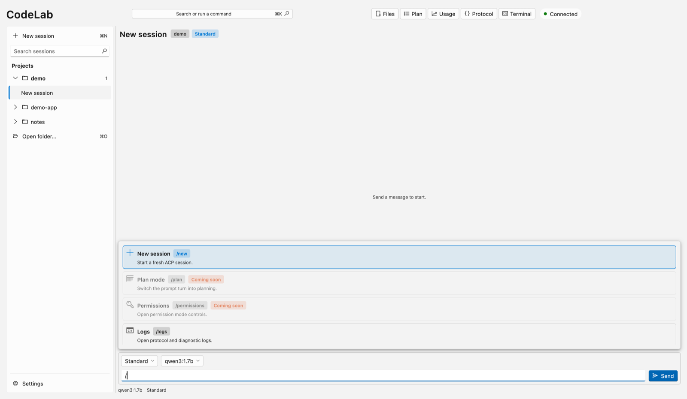
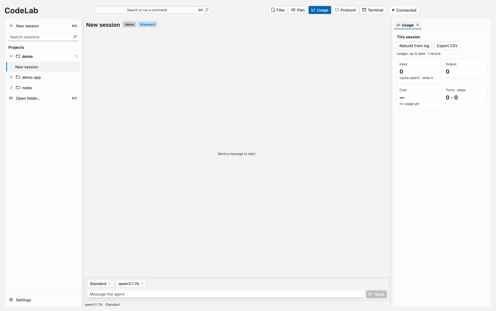

# Диалог с агентом

Глава о ходе работы в сессии: как написать агенту, как читать расход модели, как поставить сообщение в очередь, как следить за планом и субагентами и как остановить или перезапустить агента.

## Вести сессию с агентом

1. Выберите сессию в боковой панели или создайте новую (⌘N).
2. Напишите сообщение в поле «Message the agent» и нажмите «Send» или ⌘⏎.
3. Ответ появляется в ленте по мере того, как агент его пишет: текст, размышления, вызовы инструментов и их результаты.
4. Чтобы остановить ход агента, нажмите Esc или кнопку отмены на месте «Send».

<!-- screenshot: лента сессии с ответом агента и вызовом инструмента — apps/codelab_desktop/doc/images/transcript-turn.png -->

Если ход не удался, в ленте появляется сообщение об ошибке с кнопкой «Retry».

Выпадающие списки под полем ввода (например, «Standard» и модель) предлагает агент: ими меняются режим и модель текущей сессии.

### Поле ввода

Поле «Message the agent» принимает текст. ⌘⏎ (Ctrl+Enter) отправляет сообщение; пока сессия занята, оно встаёт в очередь. Если начать сообщение с `/`, поле предлагает команды: команды приложения и команды, которые объявил агент (шаблоны команд, навыки как `/skill:<имя>`). Выберите строку стрелками и Enter, допишите аргументы и отправьте. Esc закрывает меню команд.

Меню команд после `/` — команды приложения; те, что помечены «Coming soon», пока ничего не делают.

Вложить в сообщение файл или изображение в этой версии нельзя: поле принимает только текст.

### Строка статуса под полем ввода

Под полем ввода активной сессии стоит строка статуса: модель, режим и расход. Пока сессия не выбрана, строки нет.

| Сегмент | Что показывает |
|---|---|
| `12.3k → 1.2k` | токены последнего хода: слева вход (включая кэш), справа выход. Подсказка при наведении даёт счётчики input, output, cache read, cache write и reasoning (если агент его сообщил) |
| `$0.13 · session $1.20` | стоимость хода и всей сессии. `—` на месте суммы значит, что цена неизвестна |
| `42% context` | насколько заполнен контекст модели. От 80 % сегмент жёлтый, от 95 % красный; `compaction soon` — агент вот-вот сожмёт историю. Меньше 1 % показывается как `<1%` |

Что ещё стоит знать:

- Перед числом стоит «~», если оно приблизительное: агент не прислал usage для части шагов, не знает цену или сессия была загружена из журнала. Причины («approximate: …») есть только в подсказке сегмента токенов: `agent sent no usage for some steps`, `price unknown for some steps` или `before the session was loaded`. «~» у стоимости объясняет та же подсказка; если сегмент токенов скрыт, причины не видны.
- Если токены хода нулевые, сегмент токенов не показывается; стоимость при этом остаётся.
- Пока ход идёт или отменяется и итог хода ещё не пришёл, вместо токенов и стоимости горит индикатор ожидания. Когда числа уже есть, они остаются на месте между шагами хода.
- Если снимка последнего хода ещё нет, а стоимость сессии известна, стоимость выглядит как `— · session $1.20`.
- `usage: —` означает, что агент не сообщает расход. Нулей вместо неизвестного приложение не показывает.
- Деньги округляются до цента (`$1.20`), малые суммы — до двух значащих цифр (`$0.0041`); токены сокращаются как `999`, `94.0k`, `1.2M`; проценты округляются вниз.
- Клик по строке статуса (или Enter и Space, когда на ней фокус) открывает панель «Usage». Строка кликабельна только пока панель доступна; иначе она остаётся обычным текстом.

### Панель «Usage»

Панель «Usage» в доке показывает расход текущей сессии подробнее строки статуса. Она доступна, пока агент сообщает расход или умеет отдавать журнал расхода сессии. Тогда в верхней панели есть кнопка «Usage», а в палитре — команда `/usage-pane`. Если агент не сообщает ничего, кнопки и вкладки нет, а место панели в раскладке дока сохраняется. Заголовок панели — «This session».

Что внутри, сверху вниз:

- кнопки «Rebuild from log» (пересобрать журнал расхода из журнала сессии; есть, если агент отдаёт журнал расхода) и «Export CSV» (есть, когда журнал загружен), под ними строка состояния журнала, например `Ledger: up to date · 12 records`. Если журнал пришлось собрать заново по обычной причине (кэш отстал или файла ещё не было), строка остаётся `Ledger: up to date · N records`, а причина видна в подсказке при наведении: `refreshed from the session journal (stale)` или `(missing)`. Строка `rebuilt from journal …` появляется, когда файл кэша оказался повреждён или вы сами нажали «Rebuild from log»;
- карточки: «Input» (с кэшем), «Output» (с reasoning, если он есть), «Cost» и «Turns · steps»; неполные суммы помечены «~», причины — в подписи карточки. Во время хода карточки живые: они берут числа из последних данных хода и не ждут журнал. Журнал они показывают, только если он не старше последних данных, поэтому после хода числа в карточках совпадают с таблицами и CSV. «Turns · steps» во время хода тоже считает ходы по живым данным. У пустой сессии «Cost» — `—`, подпись — `no usage yet`; `price unknown` значит, что ход был, а цены модели агент не знает;
- Блок лимитов хода (заголовок «This turn» или «Last turn») — лимиты хода и сколько из них уже потрачено. Блок есть, только если в секции `budget` конфигурации агента задан хотя бы один из ключей `budget.max_tokens`, `budget.max_cost`, `budget.max_duration` (остановка хода по лимиту описана в разделе [«Если что-то пошло не так»](10-troubleshooting.md) у заметки «The turn stopped: budget exceeded»). Заголовок — «This turn» во время хода и «Last turn» после него, а также в начале нового хода, пока в нём не было первого шага. Под заголовком по строке на каждый заданный лимит, в порядке Steps, Tokens, Cost, Time: подпись `<израсходовано> / <лимит>` (`3 / 50`, `92.0k / 200.0k`, `$0.12 / $0.50`, `1:30 / 5:00`) и полоса заполнения. Пока расход меньше 80 % лимита, полоса обычная; с 80 % — предупреждающая, с 100 % — опасная. Если у модели нет цен, строка Cost выглядит как `— / $0.50`, а под ней стоит `not checked: price unknown`: лимит стоимости для такой модели не проверяется. Подсказка у Tokens — `input + output, including subagents`. Time идёт раз в секунду, пока ход выполняется или отменяется; после хода он стоит. Пока агент ждёт вашего ответа на одобрение, Time не идёт, а после ответа продолжается с того же места, без скачка. Время ожидания одобрения не входит в лимит `budget.max_duration`, поэтому панель его не считает. Одобрение, которое просит субагент, время хода не останавливает: так считает и агент. Если несколько одобрений ждали одновременно, их общее время вычитается один раз. При отмене хода Time идёт до итога хода. Под блоком — пояснение «When a limit is hit, the turn stops at the next step boundary.» Блок строится по живым данным сессии, поэтому он есть и у агента, который не ведёт журнал расхода;
- «Per turn» — таблица ходов, новые сверху, со столбцами «Input», «Output», «Cost». Ход раскрывается и показывает свои шаги; у хода, в котором работали субагенты, есть строка `subagents · N runs`;
- «Per model» — по строке на модель (`провайдер / модель`), а также «Subagents» и «Summaries», если агент их учёл.

Журнал запрашивается у агента автоматически, пока панель открыта: при показе и после завершения хода. Пока он грузится, у заголовка крутится индикатор. Если загрузка не удалась, под шапкой появляется «Couldn't load usage history.» и кнопка «Retry». Если агент не ведёт журнал, вместо таблиц — «This agent does not provide usage history.»; карточки при этом строятся по живым данным сессии.

«Export CSV» открывает диалог сохранения; предложенное имя — `codelab-usage-<начало id сессии>-<дата>-<время>.csv`. В файл попадает всё, что видно в панели, включая группы без шагов; числа точные, неизвестное — пустая ячейка, а не `0`. Если записать файл не вышло, в панели появится «Couldn't save the file.» (существующий файл с тем же именем при этом остаётся прежним); заметка исчезает при переходе к другой сессии

Панель «Usage» пустой сессии: до первого хода в карточках нули, у «Cost» — `—` и «no usage yet».

<!-- screenshot: панель Usage с карточками, раскрытым ходом и таблицей Per model после хода агента — apps/codelab_desktop/doc/images/usage-pane.png -->

## Поставить сообщения в очередь

Пока агент отвечает, новое сообщение не теряется: оно встаёт в очередь сессии и уходит само, когда ход закончится. Очередь видна над полем ввода — блок «Queue» с числом сообщений.

- «Edit» возвращает сообщение в поле ввода и убирает его из очереди.
- «Send now» отправляет сообщение, не дожидаясь своей очереди.
- «Delete» удаляет сообщение, «Clear all» — всю очередь.

<!-- screenshot: блок «Queue» над полем ввода с двумя сообщениями — apps/codelab_desktop/doc/images/prompt-queue.png -->

## Следить за планом и задачами

Если агент составил план, он виден в двух местах:

- над полем ввода — список шагов с текущим шагом и числом оставшихся, пока план не выполнен (его можно скрыть);
- в панели «Plan» — кнопка со списком в верхней панели.

Когда агент создаёт, меняет или закрывает задачи в своём списке, в ленте появляется короткая серая строка о том, что изменилось.

После повторной загрузки сессии эти операции показываются обычными строками вызовов, а не короткими серыми строками; текущий список задач — в плане. Теги исхода одобрения («Allow once» и другие) видны только в живой сессии — и у основного агента, и у субагентов: решения не сохраняются в журнал и после загрузки не восстанавливаются.

<!-- screenshot: план над полем ввода и панель Plan во время хода агента — apps/codelab_desktop/doc/images/plan-checklist.png -->

Основной агент может поручить часть задачи субагенту — отдельному агенту со своим заданием. Субагент, в свою очередь, может запустить своего субагента. В ленте каждый запуск — строка «Subagent <тип>: <задание>»:

- пока субагент работает, под свёрнутой строкой видны три его последних вызова инструментов и «+N more tool calls», если вызовов больше;
- после завершения строка свёрнута и показывает итог: число вызовов, токены и время;
- раскрытая строка показывает вызовы субагента и его потомков с отступом по глубине и его отчёт. Вложенный запуск субагента раскрывается отдельно.

<!-- screenshot: свёрнутая строка работающего субагента с тремя последними вызовами и раскрытая строка с вложенными вызовами — apps/codelab_desktop/doc/images/transcript-subagent.png -->

Когда в сессии появился первый субагент, в верхней панели появляется кнопка панели «Agents», а в палитре — команда `/agents`. Панель показывает всех субагентов сессии:

- в заголовке — «Subagents» и счётчики по состояниям, например «Subagents · 2 running · 1 done»;
- строка на каждого субагента с отступом по глубине: тип, задание и состояние — `running`, `waiting for approval`, `done`, `failed` или `cancelled`. Ниже — время, число вызовов, токены, последнее действие и метки `#N` задач из плана, назначенных субагенту (подсказка метки — название задачи). Поля, которых нет, не показываются;
- время работающего субагента растёт раз в секунду, пока сессия занята. Если ход прервался, например оборвалось соединение, строка остаётся `running`, но без времени.

Действия панели:

1. Нажмите строку, чтобы выбрать её. Под списком появится блок «Steps» — вызовы этого субагента и его потомков. Это только обзор: текстов и размышлений субагентов в нём нет.
2. «Show in transcript» прокручивает ленту к строке запуска, раскрывает путь до вложенного субагента и коротко подсвечивает её.
3. «Go to approval» есть у строки в состоянии `waiting for approval` и у ждущего шага в «Steps» с тегом «Awaiting approval». Оно прокручивает ленту к запросу разрешения. Ответить на запрос можно только в ленте — в панели кнопок «Allow» и «Reject» нет.

Выбранная строка запоминается для каждой сессии отдельно, пока приложение открыто. Без субагентов в сессии кнопки и вкладки «Agents» нет, но место панели в раскладке дока сохраняется.

<!-- screenshot: панель Agents с ребёнком и внуком, выбранной строкой и блоком Steps — apps/codelab_desktop/doc/images/agents-pane.png -->

## Перезапустить агента

«Restart agent» есть в палитре и на странице настроек «Connection». Если агент в этот момент работает, приложение спросит «Restart agent?»: идущий ход прервётся.

## Смотрите также

- [Инструменты агента](../../../codelab_agent/doc/user/04-tools.md), [субагенты и список задач](../../../codelab_agent/doc/user/07-subagents-and-tasks.md) и [сжатие контекста](../../../codelab_agent/doc/user/09-sessions.md) — что делает агент сам.
- [Запросы разрешений](04-permissions.md)
- [Файлы, терминал, палитра команд и сочетания клавиш](05-workbench-tools.md)
