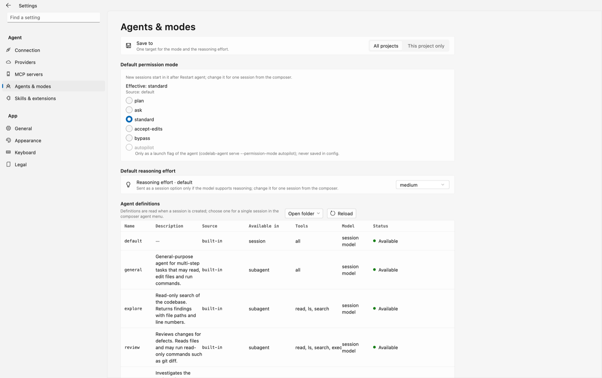

# Запросы разрешений и режимы

Агент спрашивает разрешение перед опасными действиями. Глава показывает, как отвечать на запрос в ленте, как работают сочетания клавиш ответа и как выбрать режим, в котором стартуют новые сессии. Что именно означает каждый режим и какие команды агент считает критическими, описано в [руководстве агента](../../../codelab_agent/doc/user/05-permissions.md#режимы); здесь — как этим пользоваться в app.

## Отвечать на запросы разрешений

В режиме по умолчанию (`standard`) агент спрашивает разрешение перед правкой файла и запуском команды; какие действия спрашивают в каждом режиме — [режимы разрешений](../../../codelab_agent/doc/user/05-permissions.md#режимы). Запрос появляется прямо в строке вызова инструмента в ленте.

<!-- screenshot: карточка одобрения в ленте с тегом риска и кнопками Allow и Reject — apps/codelab_desktop/doc/images/approval-card.png -->

1. Посмотрите тег риска: «Read-only», «Local write», «Network», «Shell», «Destructive» или «Unknown risk».
2. Посмотрите команду или путь. «View raw input» показывает полные параметры вызова.
3. Выберите, насколько широким будет решение: «Only this time» или «Always», если агент предлагает такой вариант.
4. Нажмите «Allow» или «Reject».

Сочетания ответа:

| macOS | Windows и Linux | Действие |
|---|---|---|
| ⌘Y | Alt+Shift+Y | разрешить один раз |
| ⌥⌘Y | Alt+Shift+Q | разрешать всегда |
| ⌥⌘Z | Alt+Shift+X | отклонить один раз |
| ⌥⇧⌘Z | Alt+Shift+W | отклонять всегда |
| ⇧⌘A | Ctrl+Shift+A | перейти к одобрению (ответа не даёт) |

Сочетания ответа действуют с любого места рабочего места, в том числе из поля ввода: фокус на карточке не нужен. Они отвечают самому раннему из ожидающих запросов сессии, а не тому, который вы читаете. Если агент не предлагает такой вариант, сочетание ответа не отправляет. Сочетание ничего не делает, пока открыты настройки, палитра команд или диалог (в том числе диалог выбора корня диска при открытии сессии), а в терминале рабочего места клавиши ответа поглощаются и до запроса не доходят: терминал работает мимо одобрений агента.

Чтобы нельзя было ответить на запрос вслепую, сочетание проверяет четыре вещи:

- Если карточки запроса не видно (лента прокручена вверх, строка не построена, поверх ленты стоит выдвижная панель), первое нажатие только показывает её: лента прокручивается к запросу, ответа нет. Нажмите сочетание ещё раз, когда карточка видна.
- Если запрос появился меньше 500 мс назад, нажатие тоже только показывает его. Если карточку только что показали прокруткой, 500 мс отсчитываются от показа, а не от появления запроса. Так клавиша, нажатая по другому поводу в момент появления запроса, не ответит на него.
- Удержание клавиши не отвечает: одно нажатие даёт не больше одного ответа.
- На Windows и Linux Alt и Shift нужно зажать заранее: не меньше чем за 150 мс до буквы. Alt+Shift — ещё и смена раскладки, и буква, наложившаяся на неё, не должна отвечать на запрос. Если модификаторы нажаты вместе с буквой или чуть раньше, ответа нет и карточка не прокручивается: зажмите Alt и Shift, подождите мгновение и нажмите букву. На macOS это правило не действует.

Подсказки сочетаний на кнопках карточки остаются у самого раннего ожидающего запроса; у остальных их нет. ⌘⏎ (Ctrl+Enter) на запрос не отвечает: оно только отправляет сообщение из поля ввода.

«Go to approval» (⇧⌘A, Ctrl+Shift+A) остаётся для перехода и чтения с экрана. Оно прокручивает ленту к самому раннему ожидающему запросу сессии и ставит фокус на карточку; если ждёт запрос субагента, лента прокручивается к строке верхнего уровня, под которой стоит его блок. Когда запроса нет, соединения нет или сессия отключена, нажатие ничего не делает.

Фокус на карточке виден по рамке в 2 пикселя. Карточка сама фокус не берёт; к ней можно дойти клавишей Tab или переходом. Enter и Space на самой карточке ничего не выбирают, а Tab идёт сразу к кнопкам. Клик по кнопке «Allow» или «Reject» просто отвечает этой кнопкой; клик по охвату, «View raw input» или фону карточки фокус в неё не ставит.

Когда вы ответили на запрос, а фокус был на карточке, он возвращается в поле ввода (если его нельзя использовать — на рабочее место). Если вы успели сами перевести фокус куда-то ещё, например кликнуть в дерево файлов, он остаётся там. Следующему ожидающему запросу фокус не передаётся.

«Only this time» относится только к этому вызову. «Always» действует на такие же вызовы до конца сессии; что считается «такими же» и что не предлагается для критических вызовов — [вопрос и четыре ответа](../../../codelab_agent/doc/user/05-permissions.md#вопрос-и-четыре-ответа).

Если разрешение просит субагент, запрос появляется блоком под строкой запуска верхнего уровня, а не внутри неё: свёрнутая строка не раскрывается. В блоке — путь от первого субагента до того, кто спрашивает, например «review › explore wants to run», команда или инструмент с путём файла, тег риска и те же кнопки и сочетания клавиш. Под путём и в его подсказке — задание субагента. После решения блок сворачивается в тег исхода, а в раскрытой строке вызов виден на своём месте с тем же исходом.

<!-- screenshot: блок «review › explore wants to run» под свёрнутой строкой субагента — apps/codelab_desktop/doc/images/approval-subagent.png -->

Пока ждёт ответа запрос в одной из сессий, в настройках сверху появляется напоминание с кнопкой «Back to session».

## Режим разрешений и рассуждение новых сессий

Страница «Agents & modes» (на русском «Агенты и режимы»; группа «Agent») задаёт, в каком режиме разрешений стартуют новые сессии и с каким уровнем рассуждения работает модель. Это ключи конфигурации агента `permissions.mode` и `agent.effort`, общие с терминальным клиентом: то, что вы выберете здесь, увидит и `codelab`.

Страница «Agents & modes»: цель записи, режим по умолчанию и уровень рассуждения.

- «Default permission mode» — радиогруппа `plan`, `ask`, `standard`, `accept-edits`, `bypass`. Строка «Effective» показывает действующий режим, «Source» — откуда он взят: `default`, `user`, `project`, `local`, `file` или `env`. Если вы выбрали `ask`, а недоверенный проект добавляет `plan`, строка «Effective» говорит: `ask (edits and commands blocked by plan)` — правки и команды заблокированы.
- Выбранный режим действует на новые сессии после «Restart agent» (кнопка на странице «Connection»). Баннер после записи подскажет: «Saved. New sessions use <режим> after Restart agent.»; если агент ещё не запущен — «Saved. New sessions use <режим> when the agent starts.» Если действующее значение после записи отличается от выбранного (его перекрывает другой слой или окружение, либо оно сужено недоверенным проектом), баннер-предупреждение говорит об этом: «Saved to <цель>; <источник> overrides it: new sessions use <значение>…», где <цель> — «All projects» или «This project only», а <источник> — `user`, `project`, `local`, `file`, `env`, `default` или «the untrusted project». Если после записи конфиг стал нечитаемым, остаётся «Saved to <цель>.» Режим одной сессии меняется из композера. До «Restart agent» новая сессия в другой папке, у которой есть проектный конфиг, может быть отклонена после правки режима для «All projects»: агент просит перезапуск (`restart the agent to open sessions in this folder`).
- `bypass` сначала спрашивает подтверждение: «Use bypass for new sessions?» — «Use bypass» записывает, «Cancel» или Esc отказывают. Запись постоянна и действует на все новые сессии выбранной цели; текст диалога: «Only critical commands, changes to the agent's configuration and network tools still ask. Commands run without asking and can reach the network too. Use bypass only in a disposable checkout.» Смысл режима — в [руководстве агента](../../../codelab_agent/doc/user/05-permissions.md#режимы). Если настройки изменились, пока диалог был открыт, запись не выполняется: «Settings changed while the dialog was open; bypass was not saved.» Используйте `bypass` только в одноразовой копии репозитория.
- `autopilot` в списке неактивен: он включается только флагом запуска агента (`codelab-agent serve --permission-mode autopilot`) и в конфигурацию не записывается.
- «Default reasoning effort» — `low`, `medium` или `high`. Уровень уходит параметром сессии, только если модель умеет рассуждать, и применяется к новым сессиям без перезапуска агента, если отслеживание конфигурации (`config.watch`) не выключено; иначе баннер попросит «Restart agent». Для одной сессии его меняют в композере.
- «Save to» выбирает, куда писать оба ключа: «All projects» — пользовательский конфиг, «This project only» — локальный конфиг проекта (пункт есть, когда выбран проект: сессия в фокусе или выбранный проект). Цель общая для режима и effort.
- Если проект не назван в `trusted_projects`, его конфигурация может только ужесточить режим. Тогда страница сообщает: «This project is not trusted, so its config can only make the mode stricter. New sessions here use <режим>.» Правила слоёв — [настройка агента](../../../../docs/user/configuration.md).
- Если файл изменился на диске, пока страница была открыта, запись не выполняется: «The config changed on disk, so nothing was saved. The page was reloaded; review it and try again.» Если выбранный файл конфигурации недоступен — «Cannot save: the target config file is not available.» При другом сбое — «The config was not saved.» Нечитаемый конфиг страница не перезаписывает: «Cannot read the agent config. Fix or remove the file; CodeLab will not overwrite it.»
- Для агента по WebSocket страница только показывает: «Read-only: this agent runs on <адрес>. Change its modes and agents on that host: codelab config set, .codelab/agents.» Для чужого агента-программы — «Agent settings are managed by <имя>.»

## Смотрите также

- [Режимы разрешений](../../../codelab_agent/doc/user/05-permissions.md#режимы) и [критические действия](../../../codelab_agent/doc/user/05-permissions.md#критические-действия) — смысл режимов.
- [Настройка агента](../../../../docs/user/configuration.md) — слои конфигурации и `trusted_projects`.
- [Определения агентов](08-agent-extensions.md#определения-агентов) — профиль с собственным режимом.
