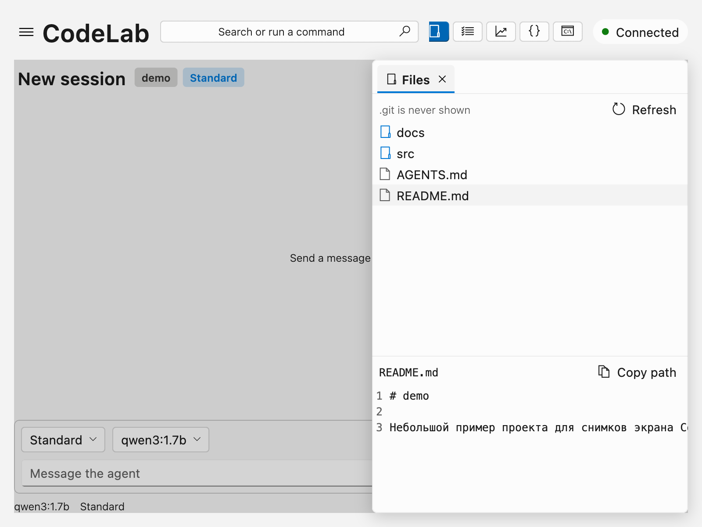
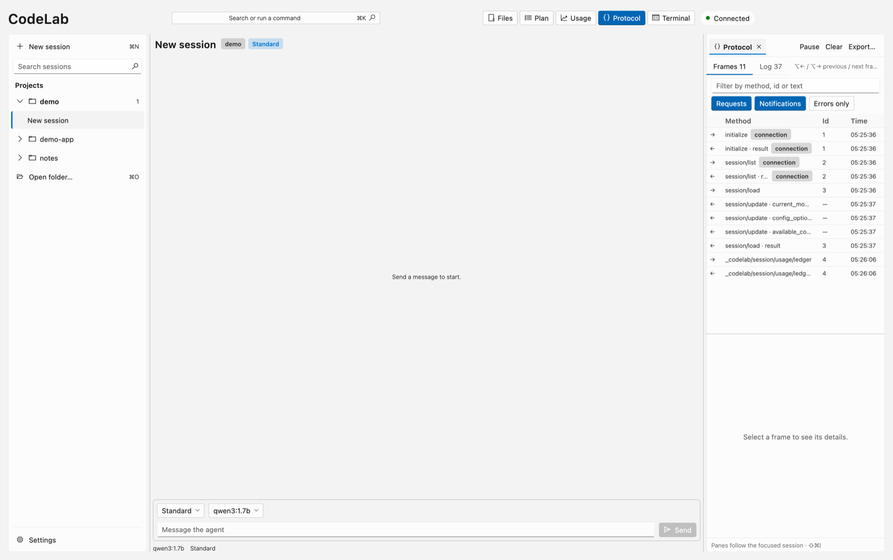
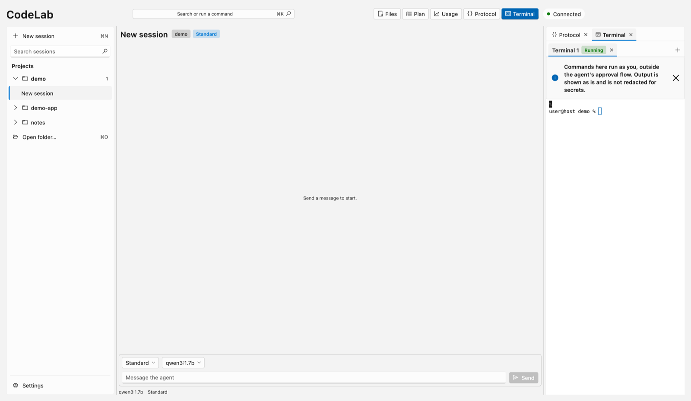
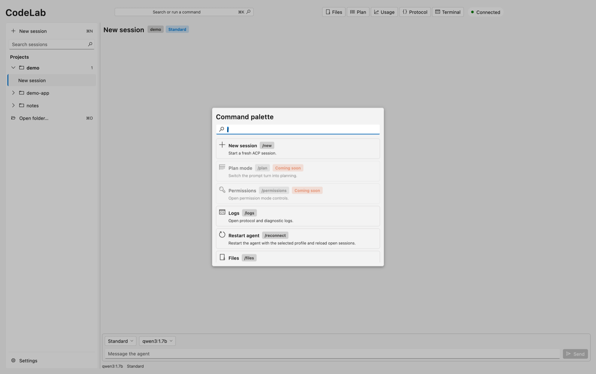
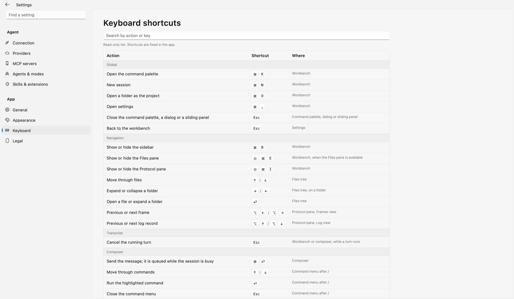

# Файлы, терминал, палитра команд и сочетания клавиш

Инструменты рабочего места: панели «Files», «Protocol» и «Terminal», палитра команд и сочетания клавиш. Панели открываются кнопками в верхней панели и живут в доке справа.

## Смотреть файлы проекта

Панель «Files» показывает дерево папки проекта и содержимое выбранного файла только для чтения.

1. Откройте панель кнопкой с иконкой файла в верхней панели, сочетанием ⇧⌘E (Ctrl+Shift+E на Windows и Linux) или командой `/files`.
2. Выберите файл — его текст появится внизу панели с номерами строк.

Сверху — дерево проекта, снизу — выбранный файл с номерами строк и «Copy path».

- В дереве работают стрелки: ↑ и ↓ двигаются по файлам, → и ← раскрывают и сворачивают папку, Enter открывает файл или раскрывает папку. Ctrl+Enter и ⌘⏎ файл не открывают.
- «Refresh» перечитывает дерево. Папка `.git` не показывается никогда.
- «Copy path» копирует путь файла относительно проекта.
- Если имя файла похоже на файл с секретами, над просмотром появится предупреждение.

Панель есть, только когда папка сессии находится на этом компьютере: для агента по WebSocket её нет.

## Смотреть подробности соединения

Панель «Protocol» показывает, что клиент и агент отправили друг другу по ACP (Agent Client Protocol) и что приложение записало в свой журнал. Она нужна, когда надо понять, почему агент не ответил, что ушло в запросе или какой ошибкой ответил агент.

Панель «Protocol» после запуска сессии: кадры соединения помечены тегом `connection`.

1. Откройте панель кнопкой Protocol в верхней панели, сочетанием ⇧⌘I (Ctrl+Shift+I) или командой `/logs`. Первое нажатие открывает панель, второе сочетание или кнопка — закрывает. Кнопка и сочетание открывают панель на последнем виде (при первом открытии — «Frames»), `/logs` — всегда на «Log».
2. Выберите вид переключателем «Frames» или «Log». У каждого вида — число элементов в его области; справа — подсказка клавиш выбора.
3. Выберите строку: под таблицей откроются подробности. Разделитель между таблицей и подробностями можно перетащить; ни одна часть не бывает ниже 96 px.

**Область.** Панель следует за сессией в фокусе. Она показывает элементы этой сессии и элементы соединения: то, что не принадлежит сессии (`initialize`, `session/list`, события подключения). У таких строк есть тег `connection`. Элементов других сессий нет, выбора сессии в панели тоже нет. Если сессии в фокусе нет, видны только элементы соединения, а над таблицей стоит «No session in focus. Showing connection frames only.» (в «Log» — «…connection records only.»). Запрос `session/new` относится к новой сессии, когда пришёл ответ; пока ответа нет или он ошибка, это элемент соединения.

**«Frames».** Таблица кадров: направление (→ клиент агенту, ← агент клиенту), «Method», «Id», «Time». У ответа подпись вида `session/new · result`, у ошибки — `error -32603 · Internal error`. Фильтры: поиск по методу, id и тексту, переключатели «Requests», «Notifications» и «Errors only». Под таблицей — выбранный кадр: направление, размер, «Copy» и тело. Если в сборке нет полных данных кадров, показаны только поля кадра (метод, id, размер, сессия, код ошибки).

**«Log».** Таблица записей журнала приложения: «Time», «Level», «Category», «Event». Фильтры: поиск, категория и минимальный уровень. «Expand» открывает полноэкранный просмотр журнала. Под таблицей — поля выбранной записи и «Copy». У записи с `request_id` есть ссылка «Show frame in Frames»: она переходит к кадру с этим id. Если кадра уже нет в буфере, ссылка недоступна.

**Действия.** В строке вкладок дока, пока открыта «Protocol», справа стоят «Pause», «Clear» и «Export…». Они действуют на активный вид.

- «Pause» замораживает таблицу. Новые элементы продолжают копиться в буфере, счётчик растёт. Кнопка меняется на «Resume» и показывает накопленное, кроме вытесненного из буфера.
- «Clear» очищает буфер вида целиком, в том числе элементы других сессий. В «Log» буфер общий с полноэкранным просмотром, он тоже становится пустым.
- «Export…» сохраняет то, что видно в таблице (сессия в фокусе с текущими фильтрами), в файл JSON Lines (`.jsonl`) через системный диалог сохранения. Имя по умолчанию — `codelab-protocol-frames-<дата>-<время>.jsonl` или `codelab-protocol-log-…`. Первая строка файла — заголовок (`view`, `build`, версия приложения, платформа, время, сессия, число элементов), дальше по строке на кадр или запись. Если среди кадров есть полные данные, приложение спрашивает «Export full payloads?»: файл будет содержать промпты, содержимое файлов и вывод инструментов. Отказ в подтверждении или в диалоге ничего не записывает. При сбое записи в панели появится «Couldn't save the file.», а существующий файл не изменится. При пустой таблице кнопка недоступна.

**Клавиатура.** Alt+← и Alt+→ выбирают предыдущий и следующий кадр в «Frames», Alt+↑ и Alt+↓ — предыдущую и следующую запись в «Log». Сочетания работают, пока фокус в панели, но не в поле поиска. Без выбора Alt+→ и Alt+↓ берут первую строку, Alt+← и Alt+↑ — последнюю; на краю выбор не меняется.

**Что сохраняется.** Вид, фильтры, выбор и положение разделителя остаются, пока вы закрываете и открываете вкладку в том же окне. После перезапуска приложения они сбрасываются.

**Что видно в обычной (release) сборке.** Хранятся только метаданные кадров: метод, id, направление, размер, сессия, код ошибки и короткая подробность. Тела кадров (промпты, содержимое файлов, вывод инструментов) не хранятся, об этом говорит «Release build: metadata only.» В отладочной сборке тело кадра показано целиком: «Debug build: full payloads.» Кадр, тело которого больше 256 KB, сохраняется без тела с пометкой «The payload is larger than 256 KB and was not stored.»

**Режим «Trace».** В release-сборке перед «Pause» есть переключатель «Trace». Он включает хранение полных данных кадров, чтобы разобрать ошибку: вы видите тела кадров, в том числе аргументы и результаты вызовов инструментов в `session/update`.

- Режим включает только ваше нажатие. После каждого запуска он выключен; переподключение и смена профиля его не выключают.
- Тела получают только кадры, записанные после включения. Ранее записанный кадр показывает «Recorded before Trace was turned on: metadata only.»
- Пока режим включён, в подробностях кадра стоит «Trace on: full payloads.», а данные лежат в памяти приложения. Экспорт кадров с телами требует подтверждения.
- Выключение стирает тела у всех кадров в буфере, у выбранного кадра и у замороженной таблицы: полных данных в панели не остаётся.
- Режим не влияет на записи журнала, полноэкранный просмотр и файл `protocol.log` ([где лежат логи](../operations.md#логи-и-диагностика)). В отладочной сборке переключателя нет: тела и так полные.

**Секреты.** Приложение маскирует секреты до того, как сохранит кадр или запись, всегда, в том числе в режиме «Trace». Значение, которое выглядит как токен или ключ, и пары `name`/`value` для заголовков и переменных окружения MCP-серверов (например, `Authorization`) показаны как `••••••• (masked)`. «Copy» и экспорт отдают уже замаскированный текст.

## Работать в терминале

Панель «Terminal» — обычная оболочка в папке текущей сессии.

1. Откройте сессию: без неё панель пишет «Open a session to use the terminal».
2. Нажмите кнопку терминала в верхней панели. Появится вкладка «Terminal 1».
3. «+» справа открывает ещё одну вкладку.

Вкладка «Terminal 1» работает в папке проекта; над ней — напоминание, что терминал работает мимо агента.

Команды в этом терминале выполняются от вашего имени, мимо одобрений агента, и вывод не очищается от секретов — об этом напоминает плашка над терминалом. Вкладки у каждой сессии свои: при переключении сессии панель показывает её вкладки. Вкладки живут, пока вы их не закроете, и переживают смену проекта и переподключение агента. Ссылку в выводе открывает ⌘-клик (Ctrl+клик на Windows и Linux): приложение покажет адрес в диалоге «Open link?» и откроет только `http` и `https`.

## Пользоваться палитрой команд

Палитра открывается сочетанием ⌘K или полем «Search or run a command» в верхней панели. Набирайте часть названия — список сужается.

Команды приложения с описаниями; недоступные помечены «Coming soon».

| Команда | Что делает |
|---|---|
| `/new` | новая сессия в текущем проекте |
| `/logs` | открывает панель «Protocol» на виде «Log» — журнал приложения; [подробности](#смотреть-подробности-соединения) |
| `/reconnect` | для локального агента называется «Restart agent»: перезапускает агента и заново открывает сессии |
| `/files` | открывает или закрывает панель «Files» |
| `/agents` | открывает панель «Agents»; есть в списке, только пока в сессии есть субагенты |
| `/usage-pane` | открывает панель «Usage»; есть в списке, только пока панель доступна. Не путать с `/usage` — командой самого агента |
| `/plan`, `/permissions`, `/compact` («Compact transcript») | помечены «Coming soon» и пока ничего не делают; если агент объявил свою команду с тем же именем, вместо заглушки в списке будет команда агента |

Ниже команд приложения идут команды, которые объявил агент. Выбор такой команды вставляет её в поле ввода — допишите аргументы и отправьте. Те же команды подсказывает поле ввода, если начать сообщение с `/`.

## Сочетания клавиш

Страница настроек «Keyboard» (на русском «Клавиатура», заголовок «Keyboard shortcuts») показывает все сочетания приложения. Список только для чтения: сочетания менять нельзя.

Страница «Keyboard» с поиском по действию и клавише.

| Действие | macOS | Windows и Linux | Где действует |
|---|---|---|---|
| Open the command palette | ⌘K | Ctrl+K | рабочее место |
| New session | ⌘N | Ctrl+N | рабочее место |
| Open a folder as the project | ⌘O | Ctrl+O | рабочее место |
| Open settings | ⌘, | Ctrl+, | рабочее место |
| Close the command palette, a dialog or a sliding panel | Esc | Esc | палитра, диалог, выдвижная панель |
| Back to the workbench | Esc | Esc | настройки |
| Show or hide the sidebar | ⌘B | Ctrl+B | рабочее место |
| Show or hide the Files pane | ⇧⌘E | Ctrl+Shift+E | рабочее место, когда панель Files доступна |
| Show or hide the Protocol pane | ⇧⌘I | Ctrl+Shift+I | рабочее место |
| Move through files | ↑ / ↓ | ↑ / ↓ | дерево файлов |
| Expand or collapse a folder | → / ← | → / ← | дерево файлов, на папке |
| Open a file or expand a folder | Enter | Enter | дерево файлов |
| Previous or next frame | ⌥← / ⌥→ | Alt+← / Alt+→ | панель Protocol, вид Frames |
| Previous or next log record | ⌥↑ / ⌥↓ | Alt+↑ / Alt+↓ | панель Protocol, вид Log |
| Cancel the running turn | Esc | Esc | рабочее место или поле ввода, пока идёт ход |
| Send the message; it is queued while the session is busy | ⌘⏎ | Ctrl+Enter | поле ввода |
| Move through commands | ↑ / ↓ | ↑ / ↓ | меню команд после `/` |
| Run the highlighted command | Enter | Enter | меню команд после `/` |
| Close the command menu | Esc | Esc | меню команд после `/` |
| Go to approval | ⇧⌘A | Ctrl+Shift+A | рабочее место, пока ждёт запрос |
| Allow once | ⌘Y | Alt+Shift+Y | рабочее место, самый ранний ожидающий запрос |
| Allow always | ⌥⌘Y | Alt+Shift+Q | то же |
| Reject once | ⌥⌘Z | Alt+Shift+X | то же |
| Reject always | ⌥⇧⌘Z | Alt+Shift+W | то же |

Таблица в приложении — 24 строки; у команд агента сочетаний нет, их открывают из палитры команд. Правила ответа на запросы — в [главе 4](04-permissions.md#отвечать-на-запросы-разрешений).

Сочетания работают при любой раскладке ввода. При нелатинской раскладке (например, русской) сочетание нажимается клавишей на месте нужной латинской буквы: ⌘K — клавишей с «л», ⌘Y — клавишей с «н». При латинской раскладке (в том числе AZERTY и QWERTZ) — по напечатанной букве. Набор кириллицы без модификатора сочетанием не считается. Подсказки и таблица всегда показывают латинские клавиши, как на кейкапах. На Windows и Linux поведение при нелатинской раскладке вручную пока не проверено.

Колонки таблицы в приложении — «Action», «Shortcut» и «Where»; строки сгруппированы по «Global», «Navigation», «Transcript», «Composer» и «Approvals».

Клавиши показаны по системе, на которой запущено приложение:

- на macOS — символы ⌘, ⌥, ⇧, ⏎, ⌫; порядок модификаторов ⌥, ⇧, ⌘ (например, ⇧⌘E);
- на Windows и Linux — слова `Ctrl`, `Alt`, `Shift`, `Enter`, `Backspace`; порядок `Ctrl`, `Alt`, `Shift` (например, `Ctrl+Shift+E`). Подсказки на кнопках там короче: `Ctrl+⏎`.

Если у строки несколько клавиш с одним действием, между ними стоит «/», например `↑ / ↓`. Программа чтения с экрана произносит их через «or» (на русском «или»).

Поле вверху ищет по тексту действия и по клавишам; у строк ответа на одобрение поиск знает клавиши обеих систем:

1. Введите слово из действия на языке интерфейса или по-английски, например `sidebar`.
2. Или введите клавишу в любой записи: `⇧⌘E`, `ctrl shift e`, `Ctrl+Shift+E`, `Option+Cmd+Enter`. Регистр и пробелы по краям не важны, а `+` и пробелы внутри записи игнорируются. Так находятся сочетания macOS и на Windows, и наоборот: `alt shift y` на macOS находит строку «Allow once».
3. В таблице остаются только подходящие строки и группы. Если ничего нет, страница пишет «No shortcuts match "…"», а напоминание про команды агента остаётся.

По колонке «Where» поиск не идёт. Поле «Find a setting» находит страницу по словам `shortcut`, `hotkey`, `keybinding`, `key` (на русском интерфейсе — `сочетание`, `горячие клавиши`, `клавиатура`, `клавиша`). Если таблице не хватает ширины, она прокручивается по горизонтали, а текст действия переносится. Esc на странице возвращает в рабочее место.

## Смотрите также

- [Диалог с агентом](03-conversation.md)
- [Эксплуатация: логи и диагностика](../operations.md#логи-и-диагностика)
