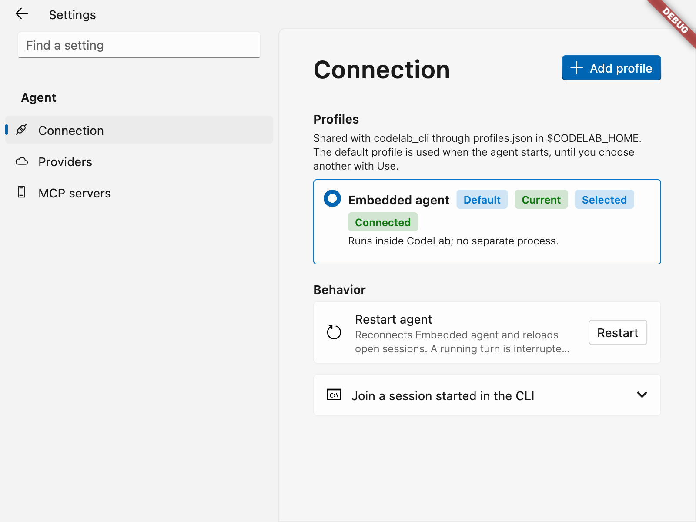
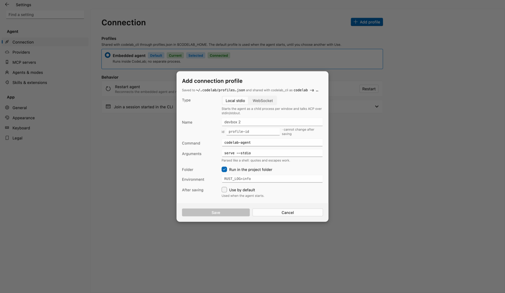
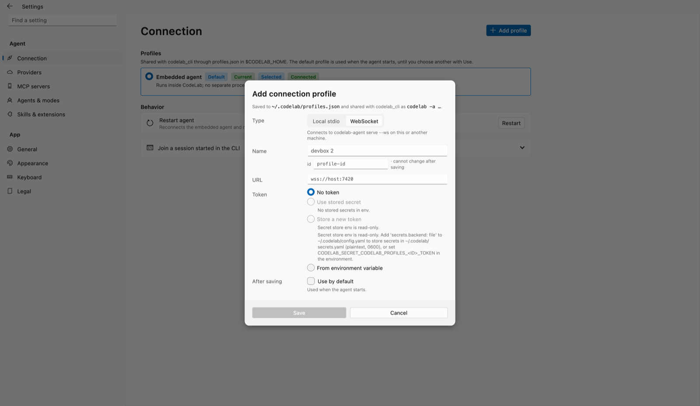

# Подключение и профили

По умолчанию app запускает встроенного агента в своём процессе. Эта глава о том, как подключить другого агента: программу, которую приложение запустит само, или агента по адресу WebSocket.

## Подключение и профили

Страница «Connection» показывает профили подключения — сохранённые способы связаться с агентом.

Встроенный агент — профиль по умолчанию, выбранный и подключённый.

- «Embedded agent» — встроенный агент, первый в списке и выбранный по умолчанию. Метки: «Default» — профиль по умолчанию; «Selected» — профиль, с которым агент запустится при следующем старте или «Restart agent»; «Current» — профиль работающего агента; «Connected» — исход последней попытки подключения. «Selected» и «Current» расходятся, пока вы выбрали другой профиль, но ещё не перезапустили агента.
- «Add profile» добавляет внешнего агента: «Local stdio» — программа, которую приложение запустит само (команда, аргументы, переменные окружения, запуск в папке проекта), или «WebSocket» — агент по адресу.

  

  Подпись вверху диалога называет файл, куда сохранится профиль, — `profiles.json` в `CODELAB_HOME` (на снимке — `~/.codelab/profiles.json`).

- Токен для WebSocket-профиля хранится только ссылкой: переменная окружения («From environment variable») или секрет из хранилища («Use stored secret», «Store a new token»). Сам токен в профиль не записывается. Для адреса `ws://` на другую машину (не `localhost`) приложение попросит подтвердить сохранение («Save anyway»): с токеном предупреждение «ws:// to another machine: the token is sent unencrypted.», без токена — «ws:// to another machine: traffic is sent unencrypted.» Для локального адреса подтверждение не нужно.
- «Use» в строке профиля выбирает его: агент запустится с ним при следующем старте или после «Restart agent». «Use by default» делает профиль профилем по умолчанию. «Rename» меняет имя профиля (id остаётся прежним). Удаление профиля спрашивает «Remove profile <имя>?»; удаляется только запись в `profiles.json`, а для профиля с сохранённым токеном есть флажок «Also delete the stored token <имя>». Текущий или выбранный профиль удалить нельзя: кнопка удаления неактивна, подсказка — «Use another profile first.»
- Профили общие с терминальным клиентом `codelab`: профиль из приложения доступен как `codelab -a <id>`. Файл — [`profiles.json` в `CODELAB_HOME`](../../../../docs/ops/codelab-home.md#общие-файлы).
- «Join a session started in the CLI» подсказывает, как подключиться к тому же агенту, что и CLI: запустить `codelab-agent serve --ws --port <port>` и выбрать здесь тот же WebSocket-профиль.

Тип «WebSocket»: адрес `ws://` или `wss://` и откуда брать токен. Пока хранилище секретов только читает (`secrets.backend: env`), варианты «Use stored secret» и «Store a new token» недоступны, а диалог подсказывает, как включить файловое хранилище.

## Смотрите также

- [Руководство агента: подключение клиентов](../../../codelab_agent/doc/user/02-connect-clients.md) — как запустить `codelab-agent serve --ws` и `--stdio`.
- [Терминальный клиент `codelab`](../../../codelab_cli/doc/user-guide.md) — те же профили.
- [Claude Code как внешний агент](../../../../docs/integrations/claude-code.md) — профиль stdio для `claude-agent-acp` и отличия этого агента от ACP.
- [Если что-то пошло не так](10-troubleshooting.md)
