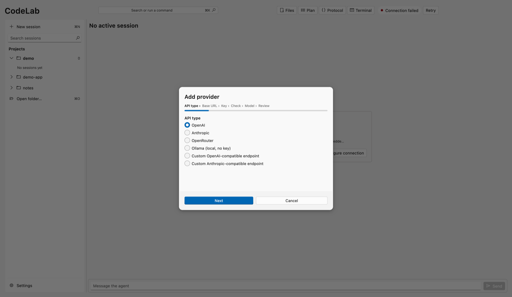
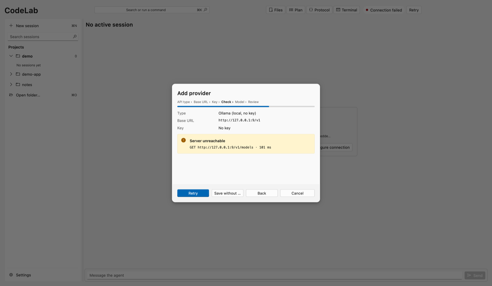
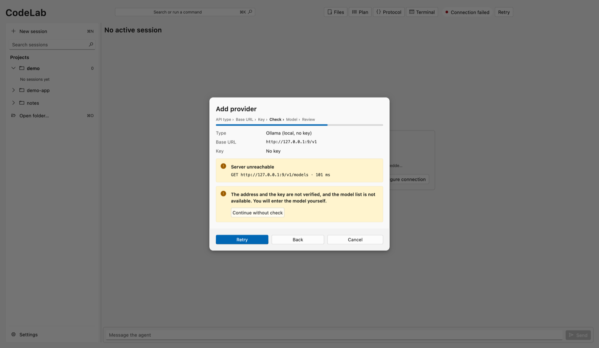
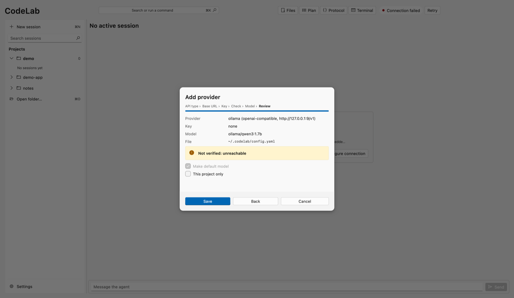
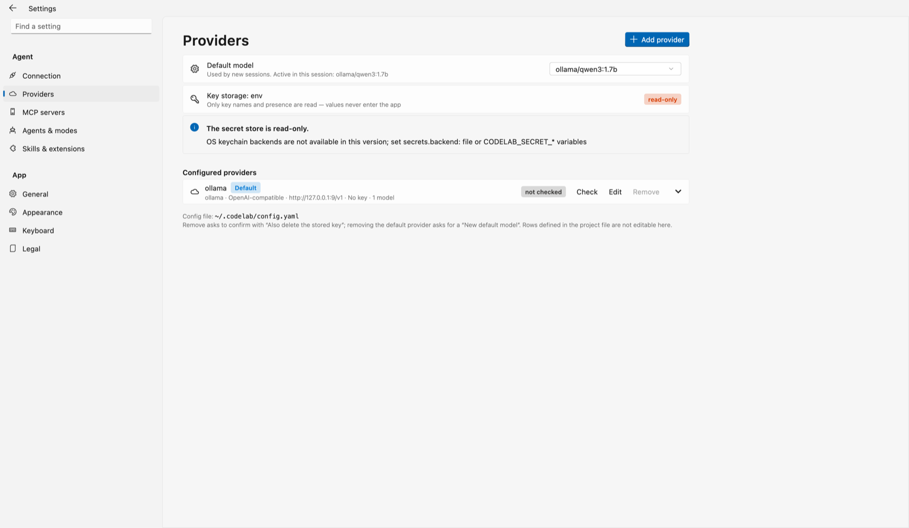

# Провайдеры и модели

Агент работает с моделью, которую вы подключили сами. Глава о мастере «Add provider» и странице «Providers». Ключи и файл `config.yaml` описаны в [настройке агента](../../../../docs/user/configuration.md); модели и провайдеры агента — в [руководстве агента](../../../codelab_agent/doc/user/03-model-and-providers.md).

## Подключить провайдера модели

Провайдер — сервис, который отвечает за модель: OpenAI, Anthropic, OpenRouter, Ollama или совместимый сервер. Мастер «Add provider» открывается с карточки «No model provider…», со страницы «Providers» и с шага «Choose a model» [приветственных шагов](01-install-and-first-launch.md#приветственные-шаги).

Строка шагов вверху показывает, где вы в мастере; на первом шаге выбирается тип API.

1. «API type» — тип провайдера.
2. «Base URL» — адрес; для известных провайдеров он подставлен.
3. «Key» — откуда брать ключ: «Read from environment variable», ключ в хранилище секретов (если хранилище доступно для записи) или «No key» для локального сервера.
4. «Check» — приложение запрашивает у сервера список моделей. Если сервер не отвечает, мастер так и пишет и предлагает «Retry» или «Save without check».

   

   Мастер показывает запрос, который не прошёл, и сколько он длился.

5. «Model» — модель из списка или вручную, если список недоступен; для модели, введённой вручную, задаётся размер контекста.
6. «Review» — итог и файл, куда запишутся настройки. «Make default model» делает модель моделью по умолчанию, «This project only» пишет настройки только для текущего проекта. «Save» сохраняет.

Ключ, введённый в мастере, не показывается на экране и не попадает в логи.

Дополнительно к шагам выше:

- Если выбрать «Save without check», мастер предупредит: «The address and the key are not verified, and the model list is not available. You will enter the model yourself.» — кнопка «Continue without check» ведёт к шагу «Model».

- Для модели, введённой вручную, шаг просит «Context window» (по умолчанию `32000`) и необязательный «Max output tokens».
- Шаг «Review» показывает провайдера, ключ, модель и файл, куда запишутся настройки.

Шаг «Review» перед сохранением. Первая модель всегда становится моделью по умолчанию: переключатель «Make default model» включён и недоступен.

## Провайдеры

Страница «Providers» показывает модель по умолчанию, хранилище ключей и настроенных провайдеров. У каждого провайдера есть «Check», «Edit» и «Remove».

Видны модель по умолчанию `ollama/qwen3:1.7b`, хранилище ключей `env`, которое приложение только читает, и настроенный провайдер `ollama` с меткой «not checked»: его ещё не проверяли.

- «Key storage» — где хранятся ключи. Метка «read-only» значит, что приложение не может записывать ключи: хранилище `env` только читает переменные `CODELAB_SECRET_*`. Чтобы приложение могло сохранять ключи, включите файловое хранилище — [шаг 2 настройки агента](../../../../docs/user/configuration.md#шаг-2-задайте-ключ-api).
- Если ход заканчивается сообщением «The model reached its token limit», лимит ответа задаёт ключ `providers.<id>.models.<model>.max_output_tokens` ([шаг 1 настройки](../../../../docs/user/configuration.md#шаг-1-подключите-провайдера-и-модель)). Без него — и если о модели нет встроенной записи — провайдеру уходит 4096 токенов. У моделей с рассуждением этот лимит расходуется и на рассуждение, и на аргументы вызовов, поэтому для них значение стоит увеличить.
- Если работающему агенту нужен перезапуск, чтобы увидеть изменения, баннер после сохранения подскажет «Restart agent».
- Для агента по WebSocket и чужого агента-программы страница только показывает текущую модель: их конфигурацию приложение не меняет.

## Смотрите также

- [Настройка агента](../../../../docs/user/configuration.md) — ключи, `secrets.backend`, слои.
- [Руководство агента: модель и провайдеры](../../../codelab_agent/doc/user/03-model-and-providers.md)
