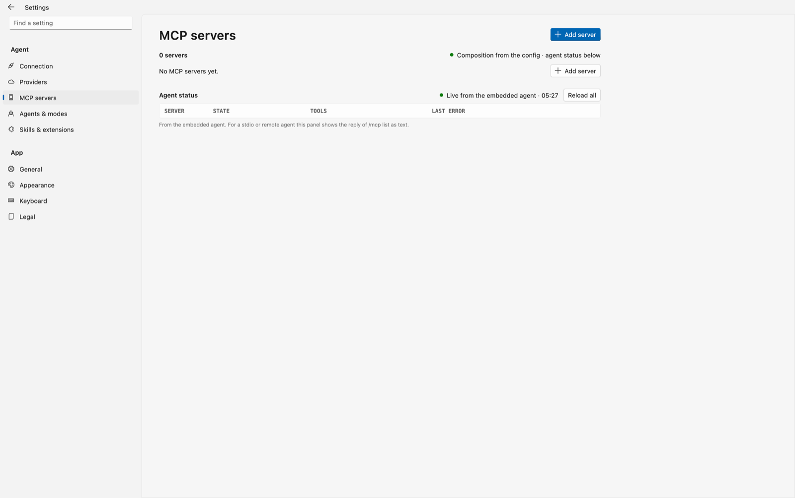
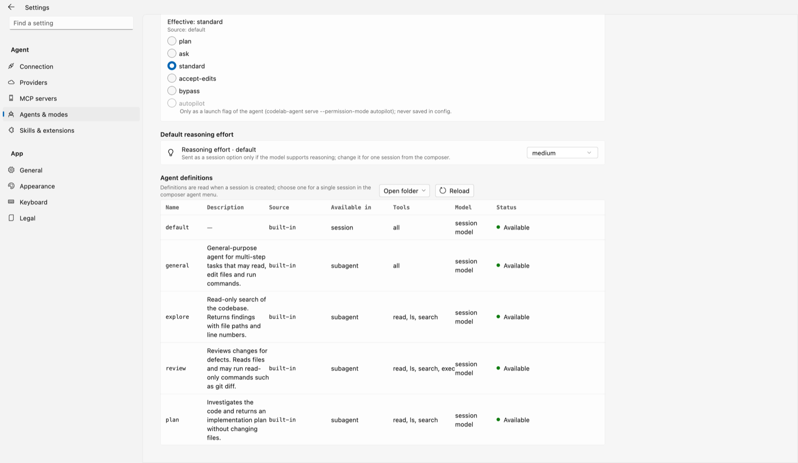
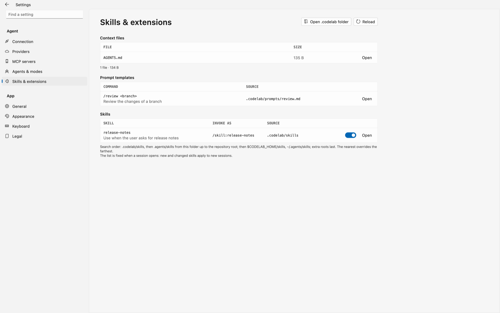

# MCP-серверы, навыки, файлы контекста, шаблоны и определения агентов

Расширения агента — внешние инструменты и файлы проекта, которые он читает при открытии сессии. Что это такое и как агент ими пользуется, описано в руководстве агента: [файлы контекста](../../../codelab_agent/doc/user/06-project-context.md#инструкции-agentsmd), [шаблоны команд](../../../codelab_agent/doc/user/06-project-context.md#шаблоны-команд), [навыки](../../../codelab_agent/doc/user/06-project-context.md#навыки), [определения агентов](../../../codelab_agent/doc/user/06-project-context.md#определения-агентов), [MCP](../../../codelab_agent/doc/user/08-mcp.md). Здесь — страницы app, на которых их видно и настраивают.

## MCP-серверы

MCP-сервер даёт агенту дополнительные инструменты. Страница «MCP servers» (на русском «MCP-серверы») добавляет серверы (`stdio` — программа, `http` — адрес), включает, выключает и удаляет их.

Серверов пока нет, поэтому таблица «Agent status» встроенного агента пуста.

Для встроенного агента внизу видно живое состояние серверов: имя, состояние, число инструментов и последняя ошибка; «Reload all» перезапускает их. Для внешнего агента та же панель показывает ответ команды `/mcp list` текстом. Состояния на русском: «подключается», «подключён», «отключён», «сбой» (с повтором — «сбой · повтор через N с»). Текст последней ошибки приходит от агента и показывается как есть. Подписи формы сервера и сообщения об ошибках в её полях тоже переведены; значения URL, секретов и заголовков в них не попадают.

## Определения агентов

Блок «Agent definitions» под режимом и effort показывает, какие определения агентов увидит новая сессия. Определения читаются при создании сессии; выбрать одно для сессии можно в меню агентов композера.

Без файлов определений в таблице только встроенные строки; файл из `.codelab/agents` или `$CODELAB_HOME/agents` добавляет свою строку.

- Таблица только для чтения, шире окна: при нехватке места она прокручивается по горизонтали; длинный путь в «Source» переносится. Колонки: «Name», «Description», «Source», «Available in», «Tools», «Model», «Status». Первой идёт строка `default` (источник `built-in`, «Available in» — `session`), затем встроенные типы субагентов `general`, `explore`, `review`, `plan` (источник `built-in`, «Available in» — `subagent`), затем файлы по имени. «Available in» принимает значения `session`, `subagent` и `both`. В «Tools» — перечень инструментов или `all`; в «Model» — `<провайдер>/<модель>` или `session model`, если модель берётся от сессии. У отклонённых файлов («Model not configured», дубликат, перекрытый проектным, «Error») «Available in», «Tools» и «Model» — `—`.
- Файлы лежат в `$CODELAB_HOME/agents` и в `.codelab/agents` проекта; условия, при которых агент читает проектный каталог, — в [руководстве агента](../../../codelab_agent/doc/user/06-project-context.md#определения-агентов). Пути в таблице сокращаются до `~`.
- «Status»: «Available»; «Overridden by <путь>» — встроенный тип заменён определением из файла (если путь неизвестен — просто «Overridden»); «Model not configured» — модель определения вне каталога моделей; «Error · line N» (или «Error», если номер строки неизвестен) — файл не разобран; «Not loaded: duplicate name» — имя уже занято; «Shadowed by project» — пользовательский файл заменён проектным; «Subagents off» — встроенный тип недоступен, потому что в конфигурации `subagents.enabled: false`.
- Для каждого файла с ошибкой (включая «Model not configured» и дубликат имени) над таблицей появляется панель ошибки: заголовок — «Cannot load the definition», а при известном номере — «Cannot load the definition · line N»; ниже путь файла (с `~`) и причина разбора, для модели вне каталога без собственного текста — «The model of this definition is not configured.», для дубликата — «Not loaded: another definition has the same name.». Управляющие и невидимые символы в именах и путях показываются видимыми кодами `\uXXXX`. У файла, перекрытого проектным («Shadowed by project»), панели ошибки нет. Кнопка «Open folder» панели открывает каталог, где лежит файл; сами файлы приложение не открывает — править их вы будете в своём редакторе.
- «Open folder» в шапке открывает каталог определений в программе ОС: «User definitions (<путь>)» — каталог `agents` в `CODELAB_HOME`; в скобках его фактический путь, с `~` в начале, если он в домашней папке (по умолчанию `User definitions (~/.codelab/agents)`); при отсутствии каталог создаётся (но не поверх битой ссылки или файла); «This project (.codelab/agents)» — каталог проекта, он не создаётся: пока его нет, пункт неактивен, и подсказка говорит «Create .codelab/agents in the project to add definitions.». Пункта проекта нет, если проект не выбран или не доверенный. Каталог-ссылка открывается по раскрытому пути; ссылка на пакет приложения (имя с расширением вроде `.app`) и битая ссылка не открываются: появляется «Could not open <что>.» То же сообщение — при сбое платформы.
- «Reload» перечитывает определения.
- Недоверенный проект: «Definitions in <проект>/.codelab/agents are not read: the project is not trusted.»
- Если чтение не уложилось в 5 секунд: «Agent definitions were not read within 5 s.»; если упало — «Agent definitions could not be read.»
- Для агента по WebSocket и чужого агента-программы таблицы нет: страница показывает только сообщение «только чтение» из предыдущего раздела.

## Навыки, файлы контекста и шаблоны

Страница «Skills & extensions» (на русском «Навыки и расширения»; группа «Agent») показывает, что агент подхватит в папке выбранного проекта: файлы контекста `AGENTS.md`, шаблоны команд и навыки. Навык — папка с инструкциями, которую агент или вы вызываете по имени. Страница читает файлы с диска и пишет только два ключа конфигурации: `skills.disabled` и `skills.extra_roots`. Без открытого проекта страница просит открыть папку проекта, а «Open .codelab folder» открывает каталог `CODELAB_HOME`.

- «Context files» — найденные `AGENTS.md` с размером. Метка «used because this folder has no AGENTS.md» стоит у файла, который агент взял вместо `AGENTS.md`; «truncated to …» — файл усечён по бюджету; «not included (budget)» — в контекст не попал.
- «Prompt templates» — команды вида `/имя` с подсказкой аргументов, описанием и файлом-источником.
- «Skills» — таблица «SKILL», «INVOKE AS», «SOURCE». «INVOKE AS» показывает команду вызова, а `Model only` значит, что навык вызывает только модель. Метка «Command only» — навык виден только как команда. Переключатель в строке выключает навык (ключ `skills.disabled`), «Open» открывает его папку. Если переключатель недоступен, подсказка называет причину, например «Set in <источник>; edit that file.» или «Disabled by the project config (<источник>).».
- Под таблицей — порядок поиска: `.codelab/skills`, затем `.agents/skills` от папки сессии до корня репозитория, затем `$CODELAB_HOME/skills` и `~/.agents/skills`, в конце дополнительные каталоги. Ближний навык перекрывает дальний. Список фиксируется при открытии сессии, поэтому новые и изменённые навыки видят только новые сессии.
- Таблица «SKILLS OF OTHER AGENTS» с переключателями «Read ~/.claude/skills» и «Read .claude/skills» даёт согласие читать каталоги навыков других агентов (ключ `skills.extra_roots`). Согласие на относительный каталог действует во всех доверенных проектах, где он есть.
- Если проект не назван в `trusted_projects`, агент не читает его навыки и шаблоны: страница предупреждает об этом и показывает только ваши навыки и файлы `AGENTS.md`.
- Записи сопровождает баннер «Saved» или «Not saved» (конфликт с правкой файла на диске или ошибка записи). Раздел, который не прочитался за 5 секунд, заменяется строкой «<раздел> were not read within 5 s.». Если навыки выключены ключом `skills.enabled: false`, страница пишет «Skills are switched off: skills.enabled is false in <источник>.».
- Нечитаемый конфиг страница не перезаписывает: «Cannot read the agent config. Fix or remove the file; CodeLab will not overwrite it.»
- Для агента по WebSocket страница только показывает «Read-only: this agent runs on <адрес>.», для чужого агента-программы — «Skills are managed by <имя>.».

Страница «Skills & extensions» для проекта `demo`: файл `AGENTS.md`, шаблон `/review <branch>` и навык `release-notes` с переключателем.

Общие настройки агента — файлы, слои, ключи — описаны в [настройке агента](../../../../docs/user/configuration.md).

## Смотрите также

- [Настройка агента](../../../../docs/user/configuration.md#mcp-серверы) — ключ `mcp.servers` и слои.
- [Подключить MCP-сервер в `codelab`](../../../codelab_cli/doc/user-guide.md)
