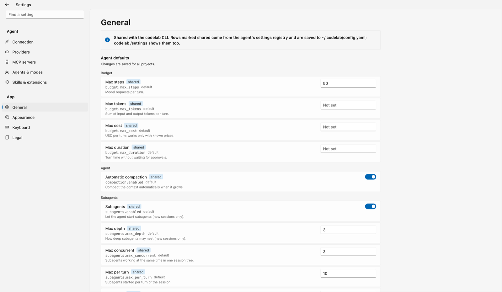
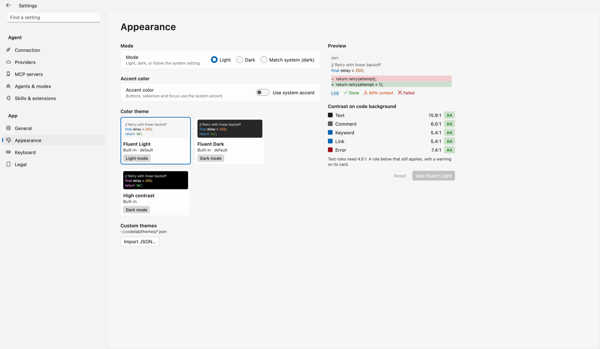
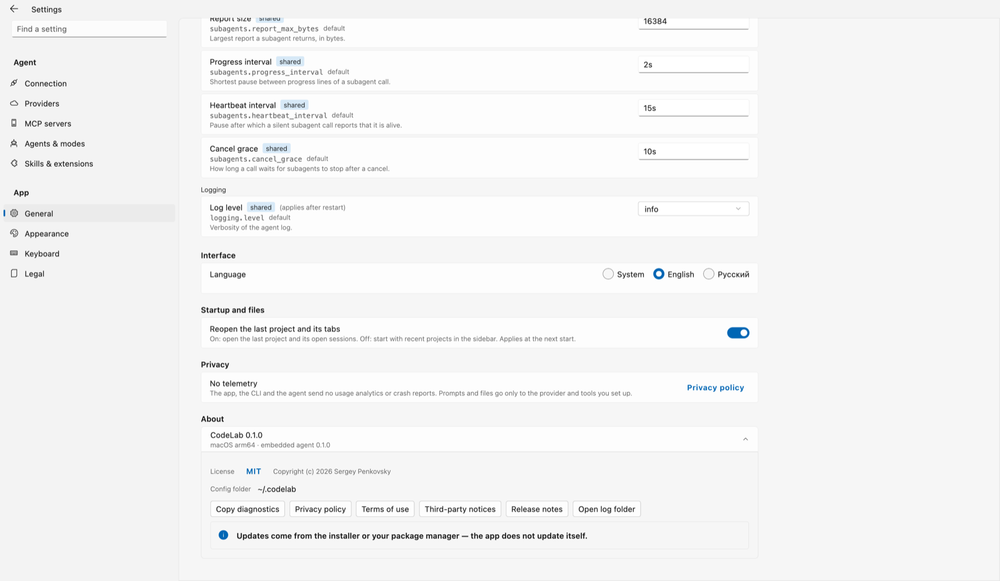
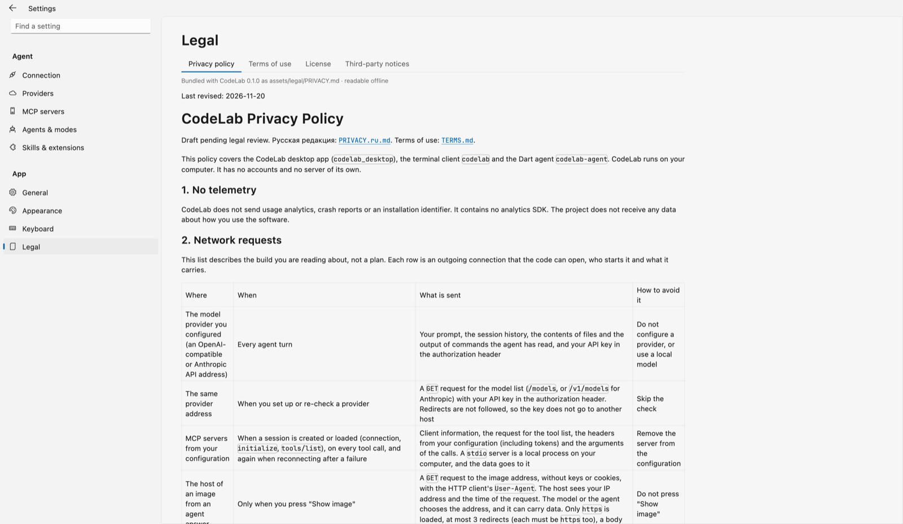
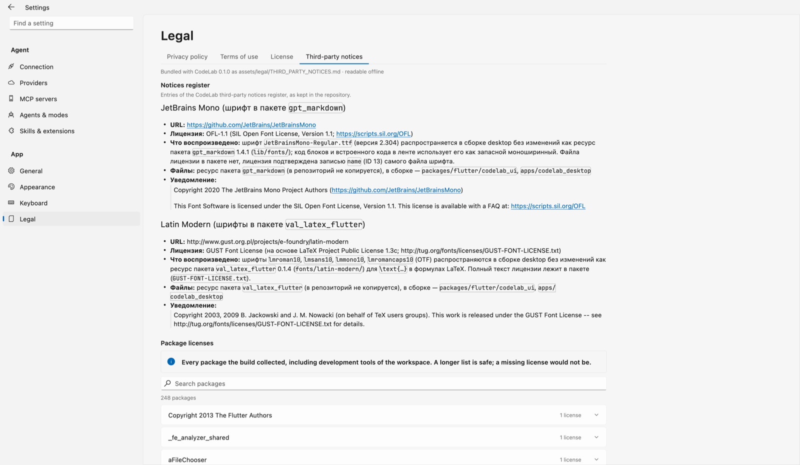

# Настройки приложения

Настройки открываются кнопкой «Settings» внизу боковой панели, сочетанием ⌘, или пунктом «Preferences…» (на русском «Настройки…») меню приложения на macOS. Девять страниц в двух группах. Группа «Agent»: «Connection», «Providers», «MCP servers», «Agents & modes», «Skills & extensions». Группа «App»: «General», «Appearance», «Keyboard», «Legal».

Поле «Find a setting» ищет по страницам: по заголовку на текущем языке интерфейса и на английском, а также по ключевым словам на языке интерфейса и на английском. При английском интерфейсе русские слова страницу не находят. Стрелка слева вверху возвращает в рабочее место; набранный текст и открытая сессия при этом сохраняются.

| Страница | Где описана |
|---|---|
| «Connection» | [глава 6](06-connection-and-profiles.md) |
| «Providers» | [глава 7](07-providers-and-models.md) |
| «MCP servers», «Skills & extensions», определения агентов | [глава 8](08-agent-extensions.md) |
| «Agents & modes» (режим и рассуждение) | [глава 4](04-permissions.md#режим-разрешений-и-рассуждение-новых-сессий) |
| «Keyboard» | [глава 5](05-workbench-tools.md#сочетания-клавиш) |
| «General», «Appearance», «Legal» | эта глава |

## Умолчания агента

Первыми на странице «General» идут сообщение «Shared with the codelab CLI…» и блок «Agent defaults» (на русском «Умолчания агента»), затем «Interface» (язык), «Startup and files», «Privacy» и «About». Тексты ниже даны английскими, как в интерфейсе по умолчанию; русские подписи строк — «Лимит шагов», «Лимит токенов», «Лимит стоимости», «Лимит длительности», «Лимит глубины» и т. п. В блоке 18 ключей конфигурации агента, общих с терминальным клиентом: бюджет хода (`budget.max_steps`, `budget.max_tokens`, `budget.max_cost`, `budget.max_duration`), субагенты (12 ключей `subagents.*`), автоматическое сжатие контекста (`compaction.enabled`) и уровень журнала (`logging.level`). Строки разбиты на группы с подзаголовками «Budget», «Agent», «Subagents» и «Logging» (на русском «Бюджет», «Агент», «Субагенты», «Журнал агента»). Над строками стоит это сообщение, а у каждой строки — метка «shared»: то, что вы изменили здесь, увидит и `codelab /settings`, и наоборот.



Блок «Agent defaults»: у каждой строки метка «shared» и ключ конфигурации.

- Изменение сохраняется для всех проектов — в `$CODELAB_HOME/config.yaml` (по умолчанию `~/.codelab/config.yaml`), слой `user` ([слои конфигурации](../../../../docs/user/configuration.md#слои-конфигурации)). Записать в проект отсюда нельзя.
- Если значение задаёт проектный файл (`.codelab/config.yaml` или `config.local.yaml`), строка пишет: «This project overrides it (project).» или «(local)». Ваша правка при этом сохраняется, но в проекте действует значение проекта; после записи баннер скажет, какое значение использует агент: «Saved to all projects; <источник> overrides it: the agent uses <значение>.»
- Часть ключей агент применяет только после перезапуска: у строки пометка «(applies after restart)» («применится после перезапуска»), а баннер после записи подсказывает «Applies after Restart agent.» («Применится после «Перезапустить агента».», кнопка на странице «Connection») или «Applies when the agent starts.» («Применится при запуске агента.»), если агент не запущен.
- Значение, не подходящее по типу, не записывается и снимает прежнее «Saved.»: строка подсказывает формат («Enter a whole number…», «Enter a duration like 500ms, 30s, 2m or 1h.»).
- Строка без редактора показывает причину: значение задано переменной окружения или файлом из `CODELAB_CONFIG` («Set by <источник>; it cannot be changed here.»), содержит секрет («Change it with codelab secret set.» или «This value contains a secret; change it in the config file.»).
- Если файл изменился на диске, пока страница была открыта, запись не выполняется: «The config file changed on disk; the page was reloaded. Try again.» Нечитаемый конфиг страница не перезаписывает: «The agent config cannot be read.» и список проблем.
- Для агента по WebSocket и для стороннего агента-программы строки настроек не показываются, только сообщение о том, где их менять: «Read-only: this agent runs on <адрес>. Change its settings on that host: codelab config set.» или «Agent settings are managed by <имя>.»

## Язык интерфейса

Страница «General» (группа «App», блок «Interface») содержит строку «Language» с тремя вариантами: «System», «English», «Русский».

- «System» выбирает русский, если первый язык системы русский, иначе английский. Остальные языки из списка системы и регион не учитываются.
- Выбор применяется сразу, без перезапуска, и сохраняется между запусками. Открытые сессии, лента и набранный текст остаются на месте.
- Если записать выбор не удалось, над строкой появится предупреждение с кнопкой «Retry» (на русском «Повторить»), которая повторяет запись. Приложение продолжит работать на выбранном языке, а после перезапуска без успешной записи вернётся к прежнему.
- Если хранилище настроек повреждено и не читается, приложение стартует на языке по умолчанию.

Меню macOS и системные панели (выбор папки, диалоги ОС) следуют языку системы, а не выбору в приложении: при выбранном «English» на русской системе они остаются русскими. Если при «System» вы сменили язык ОС, приложение подхватит его при следующем запуске или после повторного выбора «System».


На русском показаны приветственные шаги, экран «Open a project» («Откройте проект»), страницы «General» («Общие»), «Appearance» («Оформление»), «Keyboard» («Клавиатура») и «Legal» («Правовая информация»), названия страниц и групп настроек и поиск по ним, а также рабочее место: лента и заметки, сообщения о сбоях хода, боковая панель, шапка, поле ввода, баннеры, палитра команд, диалог перезапуска агента, расход, терминал, файлы проекта, список агентов и подписи панели «Protocol», а также страницы настроек «Connection», «Providers», «MCP servers» («MCP-серверы»), «Agents & modes» («Агенты и режимы») и «Skills & extensions» («Навыки и расширения»), диалог «Add connection profile» и мастер подключения провайдера. На русском показывается и подпись профиля встроенного агента («Встроенный агент»). Команды палитры находятся и по русскому, и по английскому названию. Приложение не переводит:

- ответы агента и модели, команды агента, идентификаторы, команды, пути и значения конфигурации;
- содержимое панели «Protocol»: методы, id, поля и JSON кадров, тексты записей журнала (подписи кнопок, фильтров и колонок переведены);
- тексты ядра и агента: сообщения об ошибках соединения, ошибки конфигурации, которые сообщает агент, последняя ошибка сервера в панели «Agent status», ответ команды `/mcp list`, причина разбора файла определения агента, предупреждения навыков и причины отказа записи;
- тексты хранилища секретов: подсказка «только чтение», причина недоступности хранилища и подробности переноса секретов.

Такие тексты показываются как есть под переведённым заголовком. Подписи кнопок и сообщений рабочего места в этом руководстве приведены по-английски; на русском языке интерфейса они показываются переведёнными.

## Оформление

Страница «Appearance» (группа «App») задаёт режим «светлый или тёмный», системный цвет акцента и цветовую тему. Выбор применяется сразу, без перезапуска, и сохраняется между запусками.



Страница «Appearance»: слева режим и карточки тем, справа «Preview» с проверкой контраста.

**Режим.** В блоке «Mode» три варианта: «Light», «Dark» и «Match system (light|dark)»; в скобках — текущий режим системы. По умолчанию выбран «Match system»: на системе с тёмным оформлением приложение откроется тёмным. «Light» и «Dark» фиксируют режим независимо от системы.

**Акцент системы.** Блок «Accent color» с переключателем «Use system accent» показывается, если ОС отдаёт системный цвет акцента. По умолчанию переключатель выключен. Включённый, он заменяет цвет `accent` любой темы, в том числе вашей. На macOS и Windows смена цвета в системных настройках подхватывается сразу. На Linux акцентом служит цвет выделения темы GTK: приложение читает его при запуске и при каждом открытии страницы «Appearance»; смену, сделанную при открытой странице, оно не заметит — откройте страницу заново. Если ОС цвет не отдаёт, блока нет.

**Темы.** В блоке «Color theme» карточки тем: «Fluent Light» (`light`), «Fluent Dark» (`dark`) и «High contrast» (`high-contrast`, тёмная). Приложение хранит по одной теме для светлого и для тёмного режима: «Mode» выбирает, какая из двух действует. Первые две — вид приложения по умолчанию; «High contrast» подходит для тёмного режима. Свои темы стоят в том же ряду карточек после встроенных, с подписью «Custom · extends <база>». Блок «Custom themes» ниже содержит путь к каталогу, кнопку «Import JSON…» и ошибки импорта.

Выбор карточки тему не применяет: справа (при ширине страницы от 960 px) или под блоками показывается «Preview» — образец кода, diff, ссылки и статусов в этой теме — и проверка контраста. Применяют кнопки под превью:

- «Use <имя>» назначает тему её режиму: светлым темам — светлый, тёмным — тёмный. Если «Mode» зафиксирован на другом режиме («Light» при тёмной теме), он переключается на режим темы, чтобы выбор был виден; при «Match system» не меняется. Кнопка недоступна для темы, которая не загрузилась или уже назначена.
- «Reset» возвращает режиму выбранной темы встроенную тему по умолчанию («Fluent Light» или «Fluent Dark»). Недоступна, если она и так назначена.

### Своя тема

Своя тема — JSON-файл в каталоге `$CODELAB_HOME/themes/` (по умолчанию `~/.codelab/themes/`). Формат рассчитан на общее использование с терминальным клиентом `codelab`, но `codelab` темы пока не читает: файл работает только в приложении. Если каталога нет, у вас просто нет своих тем; каталог создаёт «Import JSON…», а кнопка «Open folder» в панели проблем выбранной темы создаёт его и открывает в программе просмотра файлов ОС.

```json
{
  "name": "acme-night",
  "extends": "dark",
  "colors": {
    "accent": "#ff8800",
    "error": "#ff6b6b",
    "code": {
      "background": "#101418",
      "keyword": "#ff9df5"
    }
  }
}
```

Правила файла:

- Файл называется `<name>.json`, значение `name` совпадает с именем файла без `.json`. Имя — от 1 до 32 символов: латинские строчные буквы, цифры и дефис. Имена `auto`, `light`, `dark`, `high-contrast` и `mono` заняты и не подходят: файл `dark.json` в каталоге показывается карточкой «Invalid» с причиной «The name is taken by a built-in theme.».
- `extends` — `light`, `dark` или `high-contrast`; без него берётся `dark`. Роли, которых в файле нет, берутся из этой темы. От `extends` зависит и режим: тема с `extends: light` светлая, остальные тёмные.
- Роли цвета — в `colors`: `text`, `accent`, `muted`, `success`, `error`, `warning`, `info`, `diff_add_bg`, `diff_remove_bg`, `selection`; цвета подсветки кода — во вложенном `colors.code`: `background`, `keyword`, `string`, `comment`, `number`, `type`, `function`, `variable`, `operator`, `attribute`. Роли `approval_border` и `status_bg` допустимы в файле (они нужны терминальному клиенту), но приложение их не применяет.
- Цвет записывается как `#rrggbb`; `default` оставляет роль из `extends`. Цвета терминала (названия ANSI и `256:<n>`) формат допускает, но приложение их не применяет: роль берётся из `extends`, а файл получает предупреждение.
- Размер файла — до 64 КиБ, кодировка UTF-8.

**Import JSON…** в блоке «Custom themes» открывает окно выбора файла, проверяет его и копирует в каталог тем без изменений: файл остаётся таким, каким вы его написали. Если тема с таким именем уже есть и содержимое отличается, приложение спросит «Replace the theme "<имя>"?» и заменит файл только после «Replace». Импортированная тема выбирается для превью, но не применяется — нажмите «Use». Если файл не читается или тему не удалось записать в каталог, показывается «Couldn't import the theme. Check that the file is readable and try again.»; проверьте файл и права на каталог и повторите. Если окно выбора файла не открылось, в блоке «Custom themes» появится «Couldn't open the file dialog.». Если после вопроса о замене файл-источник сменил `name`, приложение ответит «The file changed after you chose it. Choose it again.» и ничего не запишет — выберите файл заново. Файл, который не прошёл проверку, в каталог не попадает; причина с номером строки и колонки показывается в блоке «Custom themes».

При старте приложение читает только назначенные темы, каталог — при каждом открытии страницы и по кнопке «Reload». Файл, который вы правите в редакторе, подхватывается после «Reload»: кнопка перечитывает каталог и обновляет применённую тему. «Reload» и «Open folder» стоят в панели проблем выбранной темы; если панели нет, откройте страницу заново. Файлы тем приложение не открывает: «Open folder» показывает каталог в программе просмотра файлов ОС.

### Предупреждения и ошибки темы

Разбор мягкий: тема с предупреждениями загружается и применяется. Предупреждение показывают бейдж «N warnings» на карточке и панель под списком тем — со строками вида `acme-night.json:4:5 unknown key "acent"`, подсказкой («Ignored. Did you mean "accent"?» — в интерфейсе по-английски; для ключа без похожей роли — «Ignored — not a theme role.») и текстом файла, где строки с предупреждениями подсвечены (табуляция показывается четырьмя пробелами). Панель показывает не больше 50 строк, остальные предупреждения сворачиваются в строку «… and M more warnings»; в тексте файла подсвечены все. Предупреждения вызывают:

| Предупреждение | Что значит |
|---|---|
| `unknown key` | ключ не входит в набор ролей; он пропущен, а в подсказке — ближайшая роль |
| `duplicate key` | ключ повторён; действует последнее значение |
| `terminal color` | значение — цвет терминала; приложение его не применяет |
| `Low contrast` | роль текста ниже порога контраста, см. ниже |

Под списком проблем справка «N roles not set — taken from <база>» перечисляет роли, которых нет в файле. Это не предупреждение.

Блок «Contrast on code background» в «Preview» показывает для ролей «Text», «Comment», «Keyword», «Link» и «Error» отношение контраста к фону кода и пометку «AA» или «Low». Порог — 4,5:1. Роль ниже порога всё равно применяется как задана; она даёт предупреждение «Low contrast» на карточке.

Тема не загружается, если в файле ошибка: файл не UTF-8 или больше 64 КиБ, не JSON, верхний уровень не объект, нет `name` или он не подходит, не совпадает с именем файла или занят, `extends` не из допустимых, значение цвета не подходит: допустимы `#rrggbb`, `default`, название цвета ANSI и `256:<n>`. Карточка такой темы помечена «Invalid», а панель сообщает `<файл>:<строка>:<колонка>` и причину.

- Если тема из файла назначена режиму, а при старте не загрузилась, приложение использует «Fluent Light» или «Fluent Dark» и показывает над страницей предупреждение «"<имя>" couldn't be loaded. Using <встроенная тема> until it is fixed.». Назначение не стирается: исправьте файл, выберите его карточку и нажмите «Reload».
- Если каталог тем есть, но не читается или `themes` — не папка, страница показывает встроенные темы, а в блоке «Custom themes» — предупреждение «Couldn't read <путь>. Custom themes are not shown.» с кнопкой «Reload», которая повторяет чтение.
- Если записать выбор не удалось, над страницей появится предупреждение с кнопкой «Retry». Приложение продолжит работать с выбранным оформлением, а после перезапуска без успешной записи вернётся к прежнему.
- Если сохранённое значение повреждено или хранилище не читается, приложение стартует с оформлением по умолчанию («Match system», «Fluent Light» и «Fluent Dark», акцент выключен) и не перезаписывает значение, пока вы ничего не выбрали.

## Запуск без прошлого проекта

В группе «Startup and files» страницы «General» есть переключатель «Reopen the last project and its tabs». Включён по умолчанию: при запуске приложение открывает последний проект и его сессии (см. [«Первый запуск»](01-install-and-first-launch.md#первый-запуск)). Если выключить, приложение стартует без проекта: боковая панель показывает недавние проекты, а проект и вкладки выбираете вы. Переключатель действует со следующего запуска; настройка принадлежит окну приложения и в `config.yaml` не пишется. Если записать её не удалось: «Couldn't save this setting. The previous value applies at the next start.»

## Конфиденциальность

Блок «Privacy» (на русском «Конфиденциальность») на странице «General» стоит перед «About». В нём одна строка «No telemetry» («Без телеметрии»): «The app, the CLI and the agent send no usage analytics or crash reports. Prompts and files go only to the provider and tools you set up.» Это справка, а не настройка: переключателя нет, потому что отправлять нечего. Справа в строке — ссылка «Privacy policy», она открывает страницу «Legal» на вкладке с политикой.

## О приложении

Раздел «About» (на русском «О программе») внизу страницы «General» — раскрывающаяся строка «CodeLab <версия>» с подзаголовком «<ОС> <архитектура> · embedded agent <версия агента>». Внутри:

- «License» — название лицензии (MIT) ссылкой на вкладку «License» страницы «Legal» и строка об авторских правах.
- «Privacy policy» (на русском «Политика конфиденциальности»), «Terms of use» («Условия использования») и «Third-party notices» («Сторонние уведомления») — кнопки, которые открывают страницу «Legal» на одноимённой вкладке.
- «Config folder» — папка `CODELAB_HOME`, домашний каталог сокращён до `~`.
- «Copy diagnostics» (на русском «Копировать диагностику») — кладёт в буфер обмена семь строк для отчёта об ошибке и пишет «Diagnostics copied.» Пример:

  ```text
  CodeLab 1.0.0
  OS: macOS arm64
  Embedded agent: 1.0.0
  UI language: en (preference: system)
  Connection: embedded · connected
  Agent settings: editable
  Config folder: default
  ```

  Версии здесь условные. В отчёт попадают только версии, ОС, язык, вид и состояние подключения (`embedded`, `stdio`, `websocket`), доступ к настройкам агента (`editable`, `remote-read-only`, `not-managed`) и признак, задана ли своя папка `CODELAB_HOME` (`custom` или `default`). Путей, адресов, имён профилей, значений конфигурации, ключей и текстов ошибок в отчёте нет; подписи всегда английские, независимо от языка интерфейса.
- «Release notes» — открывает в браузере `CHANGELOG.md` ветки `master` на GitHub; при неудаче: «Couldn't open the release notes.»
- «Open log folder» — открывает папку журналов приложения в файловом менеджере; при неудаче: «Couldn't open the log folder.»

Под этими строками сообщение: «Updates come from the installer or your package manager — the app does not update itself.» Приложение само не проверяет и не ставит обновления.

Сбои показываются сообщением под строками: «Couldn't copy the diagnostics.» («Не удалось скопировать диагностику.»; буфер обмена при этом не меняется). Если данные раздела не прочитались, вместо него стоит «Couldn't load the About section.» («Не удалось загрузить раздел «О программе».»).



Нижняя часть страницы «General»: язык, запуск, конфиденциальность и раскрытый раздел «About».

## Правовая информация

Страница «Legal» (на русском «Правовая информация») — последний пункт группы «App», после «Keyboard». Её можно найти и поиском по настройкам, например по словам «privacy», «terms», «license» или «notices». Те же документы открываются и с шага «Privacy» приветственных шагов ([выше](01-install-and-first-launch.md#приветственные-шаги)). Вкладки сверху:



Страница «Legal» открывается на вкладке «Privacy policy».

| Вкладка | На русском | Что на ней |
|---|---|---|
| «Privacy policy» | «Политика конфиденциальности» | политика конфиденциальности; открывается по умолчанию |
| «Terms of use» | «Условия использования» | условия использования; справочные, принимать их не нужно |
| «License» | «Лицензия» | краткое содержание лицензии MIT («Allowed», «Condition», «No warranty»), абзац «Third-party components» со ссылкой на вкладку «Third-party notices» и полный текст лицензии |
| «Third-party notices» | «Сторонние уведомления» | реестр сторонних уведомлений CodeLab и лицензии пакетов с поиском |

- Под вкладками подпись источника: «Bundled with CodeLab <версия> as <файл> · readable offline». Документы поставляются вместе с приложением и читаются без сети.
- Язык документов. Политику и условия приложение показывает на языке интерфейса: на русском — русскую редакцию, при любом другом выборе — английскую. Если сменить язык, пока страница открыта, документ подменяется сразу. Полный текст лицензии, записи реестра и лицензии пакетов не переводятся и показываются на языке источника. Краткое содержание лицензии на вкладке «License» — переводится, но это не сама лицензия: «This summary is not the license. The full text below is what applies.»
- Ссылки в документах. Ссылка на другой правовой документ переключает вкладку. Ссылка `https` открывается в браузере; если не открылась, над документом появится предупреждение «Couldn't open the link.» Остальные ссылки и изображения не открываются и не загружаются.
- Если документ не прочитался, на его месте предупреждение «Couldn't load this document.»
- Вкладка и запрос поиска не сохраняются: при следующем открытии страницы начнётся с «Privacy policy», а если вы пришли по ссылке из «General» — с вкладки этой ссылки.

### Поиск по пакетам

На вкладке «Third-party notices» два блока. «Notices register» («Реестр уведомлений») — записи реестра с подписью «Entries of the CodeLab third-party notices register, as kept in the repository.» Записи на русском при любом языке интерфейса и не зависят от поиска. «Package licenses» («Лицензии пакетов») — лицензии пакетов, которые собрала сборка, по алфавиту. Каждый пакет раскрывается и показывает свои тексты лицензий; рядом с именем — число лицензий. Список собирается при первом открытии вкладки, пока он собирается, виден индикатор.

Поле «Search packages» («Поиск пакетов») ищет по имени пакета: подстрока без учёта регистра, пробелы по краям не учитываются. Найденная часть имени выделена, счётчик меняется с «N packages» на «M of N packages». Крестик в поле и кнопка «Clear search» («Очистить поиск») сбрасывают запрос. Если ничего не найдено, список заменяет блок «No packages match» с текстом «No package name contains “<запрос>”. The notices register above is not affected by search.»

Список лицензий пакетов может быть шире состава сборки: Flutter собирает его по всем пакетам рабочего пространства, включая инструменты разработки, которых в приложении нет. Это сделано намеренно: лишняя лицензия в списке безопасна, а пропущенная нарушила бы условия лицензии. Над полем поиска об этом сказано: «Every package the build collected, including development tools of the workspace. A longer list is safe; a missing license would not be.» Запрос поиска в журнал не пишется.



Вкладка «Third-party notices» страницы «Legal».

Тексты документов — [`PRIVACY.md`](../../../../PRIVACY.md), [`PRIVACY.ru.md`](../../../../PRIVACY.ru.md), [`TERMS.md`](../../../../TERMS.md), [`TERMS.ru.md`](../../../../TERMS.ru.md) в корне репозитория; они общие для app и терминального клиента.

## Смотрите также

- [Настройка агента](../../../../docs/user/configuration.md)
- [Эксплуатация: данные приложения вне `CODELAB_HOME`](../operations.md#данные-приложения-вне-codelab_home)
