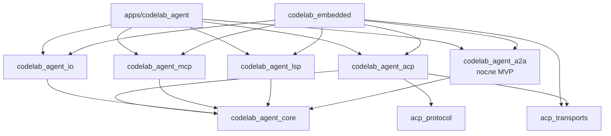

# 1. Слои и пакеты

> Часть [архитектуры ядра агента CodeLab](../agent-core-architecture.md). Status: Proposed. Общие соглашения, термины и порядок чтения — в оглавлении.

← [0. Соответствие шести базовым понятиям обвязки агента](00-six-concepts.md) · [Оглавление ядра](../agent-core-architecture.md) · [2. LLM-контракт](02-llm-contract.md) →

## 1.1. Назначение

Ядро агента должно собираться для VM (AOT), Flutter (macOS, iOS, Android) и web (dart2js, wasm).
Поэтому всё, что касается внешнего мира, вынесено из ядра в адаптеры, а ядро видит только порты.
Правила импорта проверяются автоматически, а не на ревью.

## 1.2. Контракт: пакеты

| Пакет | Ответственность | Зависит от | Запрещено |
|---|---|---|---|
| `packages/dart/codelab_agent_core` | типы сообщений, LLM-контракт и адаптеры провайдеров (HTTP через внедрённый клиент), цикл, инструменты, разрешения, сессии (формат и проекции), сжатие, промпты, `MemoryExecutionEnv`, `AgentRuntime` | чистый Dart, `package:http` (только интерфейс `Client`) | `dart:io`, `dart:isolate`, `dart:ffi`, `dart:html`, `dart:js_interop`, `package:web`, `package:flutter`, `acp_protocol`, `acp_transports` |
| `packages/dart/codelab_agent_io` | `LocalExecutionEnv` (файлы, процессы), файловый `JsonlSessionStore`, секреты из env и keychain, процессный транспорт для MCP stdio; после MVP — `LocalProcessLauncher` (§17.8.2), `FileSessionLeaseStore` и `ProcessProbe` (§17.6.8) | ядро, `dart:io` | Flutter, ACP |
| `packages/dart/codelab_agent_mcp` | MCP-клиент: протокол, streamable HTTP, проекция MCP-инструментов в `AgentTool` | ядро | `dart:io` (stdio-процесс приходит портом из `_io`), Flutter, ACP |
| `packages/dart/codelab_agent_lsp` | после MVP (§17.8): кадрирование `Content-Length`, JSON-RPC, `LspClient`, `LspPool`, кодеки позиций, планировщик `WorkspaceEdit`, инструмент `lsp`, `LspToolFactory` | ядро | `dart:io` (процесс приходит портом `ByteProcessLauncher`), Flutter, ACP |
| `packages/dart/codelab_agent_a2a` | после MVP (§17.15): модели A2A в ProtoJSON, `A2aClient`, `A2aRemoteAgentConnector` (порт `RemoteAgentConnector` ядра), транспортно-независимый A2A-сервер `A2aRequestHandler`, `A2aPermissionGate` | ядро, `package:http` (интерфейс `Client`) | `dart:io` (HTTP-сервер — в `apps/codelab_agent`), Flutter, ACP |
| `packages/dart/codelab_agent_acp` | ACP-сервер поверх `AgentRuntime`: `initialize`, `session/*`, проекция событий, `AcpClientExecutionEnv`, `AcpPermissionGate`, реплей `session/load` | ядро, `acp_protocol`, `acp_transports` | `dart:io`, Flutter |
| `packages/dart/codelab_embedded` | одна функция сборки встроенного агента для клиентов: runtime + ACP-сервер + `InProcessAcpLink`; после MVP — клиентская часть A2A (§17.15.2) | агентские пакеты, `acp_transports` | Flutter |
| `packages/dart/codelab_agent_images` | после MVP (T-29, §17.11.2.1): `PureDartImagePreparer` — реализация порта `ImagePreparer` на `package:image`; отдельная точка входа `lib/io.dart` — `IsolateImagePreparer` (та же реализация в `Isolate.run`) | ядро, `image` | Flutter, ACP; `dart:io`/`dart:isolate` — только в `lib/io.dart` и `lib/src/io/` (исключение §1.4) |
| `packages/dart/codelab_agent_web` | `PersistentWebEnv` (файлы в IndexedDB), хранилище сессий для web; этап 10 | ядро, `package:web` | `dart:io`, Flutter, ACP |
| `apps/codelab_agent` | бинарь `codelab-agent serve --stdio` / `--ws` (после MVP — `--a2a`, HTTP-сервер A2A на `dart:io`, §17.15.4), загрузка конфига, выбор профиля | все агентские пакеты | Flutter, клиентские пакеты |



**Правила `pubspec.yaml`.** Allowlist зависимостей каждого агентского пакета (раздел
`dependencies`; `dev_dependencies` не ограничиваются, кроме запрета Flutter):

| Пакет | Разрешённые `dependencies` |
|---|---|
| `codelab_agent_core` | `http`, `meta`, `collection`, `async`, `crypto` (SHA-256: ключ картинки C-16 §17.11.2.2, PKCE §17.10.6, снимок запроса §17.10.10; официальный пакет dart-lang на чистом Dart, работает в web) |
| `codelab_agent_io` | `codelab_agent_core`, `path`, `meta`, `async`, `yaml` (разбор конфига и frontmatter определений агентов и skills с позициями ошибок, §15, §15.8), `yaml_edit` (запись конфига с сохранением форматирования, §17.5.5), `toml` (только чтение устаревшего `codelab.toml`, §15.7) |
| `codelab_agent_mcp` | `codelab_agent_core`, `http`, `meta`, `async` |
| `codelab_agent_lsp` (после MVP, §17.8.2) | `codelab_agent_core`, `meta`, `async` |
| `codelab_agent_a2a` (после MVP, §17.15.2) | `codelab_agent_core`, `http`, `meta`, `async` |
| `codelab_agent_acp` | `codelab_agent_core`, `acp_protocol`, `acp_transports`, `meta`, `async` |
| `codelab_embedded` | агентские пакеты `codelab_agent_core`, `codelab_agent_io`, `codelab_agent_acp`, с этапа 8 — `codelab_agent_mcp` (после MVP — и `codelab_agent_lsp`, `codelab_agent_images`, `codelab_agent_a2a`), `acp_protocol`, `acp_transports` |
| `codelab_agent_images` (после MVP) | `codelab_agent_core`, `image`, `meta` |
| `codelab_agent_web` | `codelab_agent_core`, `web`, `meta`, `async` |

Расширение allowlist — только через OpenSpec change с обоснованием, почему задачу нельзя решить
имеющимися средствами. Пример `pubspec.yaml` ядра:

```yaml
name: codelab_agent_core
description: Embeddable pure Dart CodeLab agent core — LLM, loop, tools, permissions, sessions.
version: 0.1.0
publish_to: none
resolution: workspace
environment:
  sdk: ">=3.8.0 <4.0.0"   # как в существующих пакетах (dart-agent-and-clients §9.5)
dependencies:             # allowlist PKG-2; точные версии фиксирует pubspec.lock монорепозитория
  async: ^2.12.0
  collection: ^1.19.0
  crypto: ^3.0.6
  http: ^1.2.0
  meta: ^1.16.0
dev_dependencies:
  lints: ^6.0.0
  test: ^1.26.3
```

## 1.3. Контракт: раскладка исходников

Каждый пакет экспортирует публичный API одним файлом `lib/<package>.dart`; всё остальное — в
`lib/src/`. Внутри пакета импорты прямые (`import 'src/llm/messages.dart'`), barrel пакета изнутри
не импортируется (`AGENTS.md` §15).

```text
packages/dart/codelab_agent_core/
  prompts/                         Markdown-исходники промптов (§11)
  tool/gen_prompts.dart            генератор prompts.g.dart (§11)
  lib/codelab_agent_core.dart      публичный экспорт: runtime/, события, порты, типы сообщений;
                                   после MVP — SseDecoder и ServerSentEvent (§2.6) для codelab_agent_a2a
  lib/testing.dart                 только для тестов: ScriptedStreamFunction, FakeClock, … (§14.2)
  lib/src/
    util/      clock.dart ids.dart canonical_json.dart posix_path.dart result.dart
    llm/       messages.dart model_ref.dart events.dart event_stream.dart stream_function.dart
               errors.dart sse.dart stream_state.dart usage.dart overflow.dart
               decorators/ watchdog.dart retry.dart fallback.dart
               providers/  openai_compatible.dart anthropic.dart provider_factory.dart
    cancel/    cancel_token.dart
    env/       execution_env.dart bounded_env.dart env_vars_env.dart memory_env.dart
               process_port.dart (после MVP: ByteProcessLauncher, §4.2, §17.8.2)
    loop/      agent_loop.dart agent.dart agent_events.dart loop_config.dart turn_budget.dart
               payload_builder.dart
    tools/     agent_tool.dart registry.dart executor.dart validator.dart pairing.dart
               path_lock.dart truncate.dart fence.dart unified_diff.dart glob.dart
               builtin/ read.dart write.dart edit.dart ls.dart search.dart exec.dart update_plan.dart
               language_servers.dart (после MVP: порт LanguageServerToolFactory, §17.8.2)
    permissions/ policy.dart modes.dart pattern.dart shell_lexer.dart critical_patterns.dart gate.dart
    session/   records.dart parse.dart tree.dart projections.dart session_store.dart
               lease.dart branches.dart (после MVP: SessionLeaseStore, ветки, §17.6)
    compaction/ estimate.dart cut_point.dart compactor.dart
    spill/     spill_store.dart spill_service.dart (этап 3, §17.4)
    subagents/ remote_agent.dart (после MVP: порт RemoteAgentConnector, §17.15.2)
    host/      host_profile.dart build_agent_core.dart services.dart
    config/    core_config.dart config_tree.dart validate.dart (CoreConfig.fromLayers, §15)
    prompts/   prompts.g.dart compose.dart template.dart
    runtime/   agent_runtime.dart agent_session.dart
    testing/   scripted_stream_function.dart fake_clock.dart (экспорт только через lib/testing.dart)

packages/dart/codelab_agent_io/
  lib/codelab_agent_io.dart
  lib/src/env/      local_execution_env.dart process_tree.dart output_buffer.dart
  lib/src/session/  jsonl_session_store.dart write_queue.dart
                    file_session_lease_store.dart process_probe.dart (после MVP, §17.6.8)
  lib/src/spill/    local_spill_store.dart (этап 3, §17.4)
  lib/src/secrets/  env_secret_store.dart keychain_secret_store.dart
  lib/src/config/   config_loader.dart yaml_reader.dart legacy_toml_reader.dart config_writer.dart (§15, §17.5)
  lib/src/mcp/      stdio_process_transport.dart
  lib/src/process/  local_process_launcher.dart (после MVP, §17.8.2)

packages/dart/codelab_agent_mcp/
  lib/codelab_agent_mcp.dart
  lib/src/          protocol.dart streamable_http.dart mcp_client.dart mcp_tool.dart

packages/dart/codelab_agent_images/              после MVP (T-29, §17.11.2.1)
  lib/codelab_agent_images.dart    PureDartImagePreparer
  lib/io.dart                      IsolateImagePreparer (вне веб-запретов, §1.4)
  lib/src/          prepare.dart exif.dart encode_ladder.dart
  lib/src/io/       isolate_preparer.dart

packages/dart/codelab_agent_lsp/                 после MVP (§17.8.2)
  lib/codelab_agent_lsp.dart
  lib/src/          protocol/ client/ pool/ edits/ tool/
  lib/testing/      FakeLanguageServer, InMemoryProcessLauncher

packages/dart/codelab_agent_a2a/                 после MVP (§17.15.2)
  lib/codelab_agent_a2a.dart
  lib/src/          model/ client/ server/
  lib/testing.dart  FakeA2aServer, MemoryA2aTaskStore

packages/dart/codelab_agent_acp/
  lib/codelab_agent_acp.dart
  lib/src/          agent_server.dart session_bridge.dart event_projection.dart
                    acp_client_env.dart acp_permission_gate.dart replay.dart protocol_trace.dart

packages/dart/codelab_embedded/
  lib/codelab_embedded.dart        createEmbeddedAgent(...)

apps/codelab_agent/
  bin/codelab_agent.dart           main: разбор аргументов, serve --stdio | --ws (после MVP — | --a2a)
  lib/src/                         profile_select.dart serve.dart (конфиг — ConfigLoader из codelab_agent_io)
  lib/src/a2a/                     после MVP: http_binding.dart file_task_store.dart serve_a2a.dart (§17.15.4)
```

## 1.4. Алгоритм: тест-сторож импортов

Тест-сторож — один на репозиторий: пакет `packages/dart/codelab_architecture_tests` (этап 0,
dart-agent-and-clients §9.5), тест `test/import_guard_test.dart`. Правила всех агентских пакетов и
клиентов (столбец «Запрещено» в §1.2, PKG-4) лежат в одной таблице `test/support/rules.dart`;
в самих пакетах копий теста нет. Алгоритм для каждого пакета из таблицы:

1. Собрать все файлы `lib/**/*.dart` пакета (рекурсивно, включая файлы `part`, без `*.g.dart`-исключений: сгенерированный код тоже проверяется). Сюда входят и точки входа верхнего уровня, например `lib/testing.dart` ядра: правила «Запрещено» действуют на неё так же, как на `lib/src/**`. Исключение — отдельная IO-точка входа пакета с веб-сборкой (`lib/io.dart` у `acp_transports`, `codelab_embedded`, `codelab_setup`, после MVP — `codelab_agent_images`) вместе с каталогом её реализации `lib/src/io/`: правило пакета перечисляет их в `exclude`, и запреты веб-сборки (`dart:io` и т. п.) на них не действуют. Чтобы исключение не стало обходом, тот же тест отдельно проверяет, что ни один файл пакета вне `exclude` не импортирует и не экспортирует `io.dart` или файлы `lib/src/io/` (относительным путём или через `package:`).
2. Из каждого файла извлечь URI директив `import`, `export`, `part` регулярным выражением по началу строки: `^\s*(import|export|part)\s+['"]([^'"]+)['"]`. Условные импорты (`if (dart.library.io) '...'`) тоже извлекаются: каждое альтернативное URI проверяется отдельно.
3. Для каждого URI вычислить «цель»: `dart:xxx` → библиотека SDK; `package:name/...` → имя пакета; относительный путь → файл того же пакета (разрешить и запомнить для обхода `export`).
4. Сравнить цель со списком запретов пакета (столбец «Запрещено» в §1.2). Запрет по пакету действует на любой путь внутри него.
5. Транзитивность через `export`: если файл пакета экспортирует другой файл того же пакета, проверка уже покрывает его, потому что обходятся все файлы `lib/`. Экспорт чужого пакета проверяется как импорт.
6. Все нарушения собрать в один список `файл:строка → URI (правило)` и уронить тест одним сообщением.

```dart
// packages/dart/codelab_architecture_tests/test/import_guard_test.dart (фрагмент: правило ядра)
import 'dart:io';
import 'package:test/test.dart';

const forbiddenSdk = {'dart:io', 'dart:isolate', 'dart:ffi', 'dart:html', 'dart:js_interop'};
const forbiddenPackages = {'flutter', 'web', 'acp_protocol', 'acp_transports'};
final directive = RegExp(r'''^\s*(import|export|part)\s+['"]([^'"]+)['"]''', multiLine: true);
final conditional = RegExp(r'''if\s*\([^)]*\)\s*['"]([^'"]+)['"]''');

void main() {
  test('PKG-1: core lib/ does not import forbidden libraries', () {
    final violations = <String>[];
    final files = Directory('../codelab_agent_core/lib').listSync(recursive: true)
        .whereType<File>().where((f) => f.path.endsWith('.dart'));
    for (final file in files) {
      final lines = file.readAsLinesSync();
      for (var i = 0; i < lines.length; i++) {
        final uris = <String>[
          for (final m in directive.allMatches(lines[i])) m.group(2)!,
          for (final m in conditional.allMatches(lines[i])) m.group(1)!,
        ];
        for (final uri in uris) {
          final rule = _violates(uri);
          if (rule != null) violations.add('${file.path}:${i + 1} -> $uri ($rule)');
        }
      }
    }
    expect(violations, isEmpty, reason: violations.join('\n'));
  });
}

String? _violates(String uri) {
  if (forbiddenSdk.contains(uri)) return 'forbidden SDK library';
  if (uri.startsWith('package:')) {
    final name = uri.substring('package:'.length).split('/').first;
    if (forbiddenPackages.contains(name)) return 'forbidden package';
  }
  return null;
}
```

Тест allowlist зависимостей (`codelab_architecture_tests/test/pubspec_allowlist_test.dart`) читает
`pubspec.yaml` каждого агентского пакета построчно: берёт ключи второго уровня внутри секции `dependencies:` (строки с
отступом в два пробела до следующей секции без отступа) и сравнивает множество с allowlist из
§1.2. Разбор YAML-библиотекой не нужен: формат секции фиксирован, а тест не должен тянуть
зависимость.

## 1.5. Инварианты

1. **PKG-1.** Ни один файл `codelab_agent_core/lib/**` не импортирует библиотеки из столбца «Запрещено», в том числе транзитивно через `export`.
2. **PKG-2.** `pubspec.yaml` ядра содержит только зависимости из allowlist (`http`, `meta`, `collection`, `async`, `crypto`; расширение allowlist — через OpenSpec).
3. **PKG-3.** `codelab_agent_acp` и `codelab_agent_mcp` (после MVP — и `codelab_agent_a2a`) не импортируют `dart:io`.
4. **PKG-4.** Клиенты (`apps/codelab_app`, `apps/codelab_cli`) импортируют агентские пакеты только через `codelab_embedded` и `codelab_setup` (типы конфига и секретов для настроек, dart-agent-and-clients §4.1).
5. **PKG-5.** Публичный экспорт ядра не раскрывает `lib/src/llm/providers/*` и внутренние классы цикла: хосты получают адаптеры провайдеров через фабрику `createStreamFunction(ProviderConfig config, CoreLlmServices services)` (§2.10).
6. **PKG-6.** Ядро не создаёт HTTP-клиент, таймеры ожидания, случайность и id само: `http.Client`, `Clock`, `Random` и `IdGenerator` приходят от хоста (в тестах — детерминированные).

## 1.6. Обоснование решения

* **IO — отдельный пакет, а не отдельная точка входа того же пакета.** Граница видна в
  `pubspec.yaml`: у ядра физически нет зависимости, через которую можно было бы дотянуться до
  `dart:io`. Проверка сводится к простому тесту директив, без анализа путей импорта.
* **Ядро не импортирует `acp_protocol`.** Ядро должно работать и без ACP: в тестах прямого API,
  во встроенном режиме будущих хостов, для других протоколов. Если бы типы ACP проникли в ядро,
  любое изменение спецификации ACP затрагивало бы цикл и инструменты.
* **Тест-сторож на регулярных выражениях, а не на анализаторе.** Директивы Dart имеют простой
  синтаксис в начале строки; такой тест работает без зависимостей и за миллисекунды. Ложные
  срабатывания в комментариях исключены требованием `^\s*` и тем, что в `lib/` не хранятся
  закомментированные импорты.
* **Порты `Clock`, `Random`, `IdGenerator`.** Без них сценарные тесты недетерминированы, а
  golden-сравнение журналов и ACP-кадров невозможно.

## 1.7. Как проверить

* `codelab_architecture_tests/test/import_guard_test.dart` — один тест на все агентские пакеты: обход всех файлов `lib/**/*.dart` каждого, включая `part` и `lib/testing.dart`, разбор директив (каждое альтернативное URI условного импорта — отдельно), сравнение со списком запретов пакета (PKG-1, PKG-3); в той же таблице правила клиентов `apps/codelab_app` и `apps/codelab_cli`: импорт `package:codelab_agent_*` запрещён (PKG-4).
* `codelab_architecture_tests/test/pubspec_allowlist_test.dart`: множество `dependencies` равно подмножеству allowlist (PKG-2).
* `no_js_engine_test.dart` — отрицательный тест **`core/no-js-engine-dependency`** (Won't E-11): в замыкании зависимостей каждого агентского пакета и хостов `apps/codelab_agent`, `codelab_embedded` (по `pubspec.lock`) нет пакетов-движков JavaScript и встраиваемых браузеров: имена, совпадающие с `^(flutter_js|flutter_qjs|quickjs.*|js_runtime.*|.*_js_engine|webview.*|flutter_inappwebview.*)$`; `dart:js_interop` и `package:web` используются только в файлах web-профиля (`lib/src/web/**`), а не в коде расширений. Расширения агента — только MCP вне процесса (§6.4) и плагины на Dart (§17.14.3).
* `public_api_test.dart`: файл `lib/codelab_agent_core.dart` не содержит `export 'src/llm/providers/` и `export 'src/loop/agent_loop.dart'` (PKG-5).
* CI-шаг `dart compile js test/web_smoke/main.dart`: программа создаёт `AgentRuntime` на `MemoryExecutionEnv` и scripted `StreamFunction`, проводит один ход и печатает `TurnEnded`; сборка и запуск в `node` проходят.
* `determinism_test.dart`: два прогона одного сценария с `FakeClock`, `SequentialIdGenerator` и `Random(42)` дают побайтово одинаковый JSONL и одинаковую последовательность событий (PKG-6).

---

← [0. Соответствие шести базовым понятиям обвязки агента](00-six-concepts.md) · [Оглавление ядра](../agent-core-architecture.md) · [2. LLM-контракт](02-llm-contract.md) →
